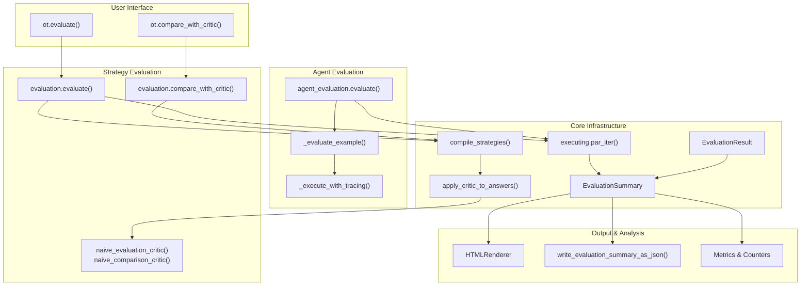
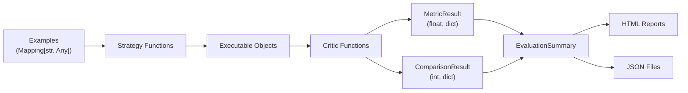
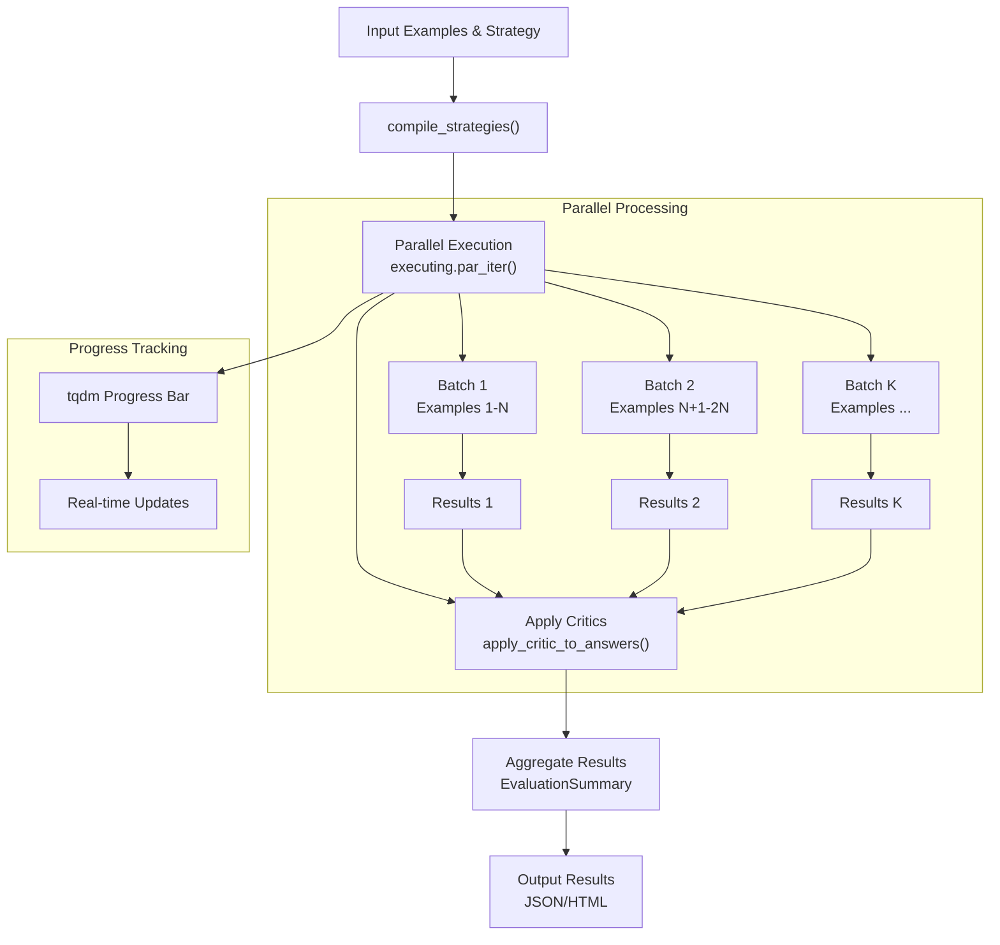
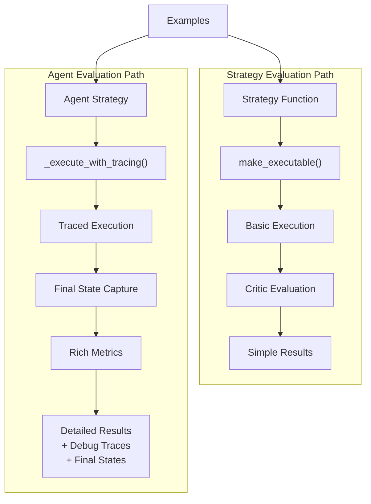
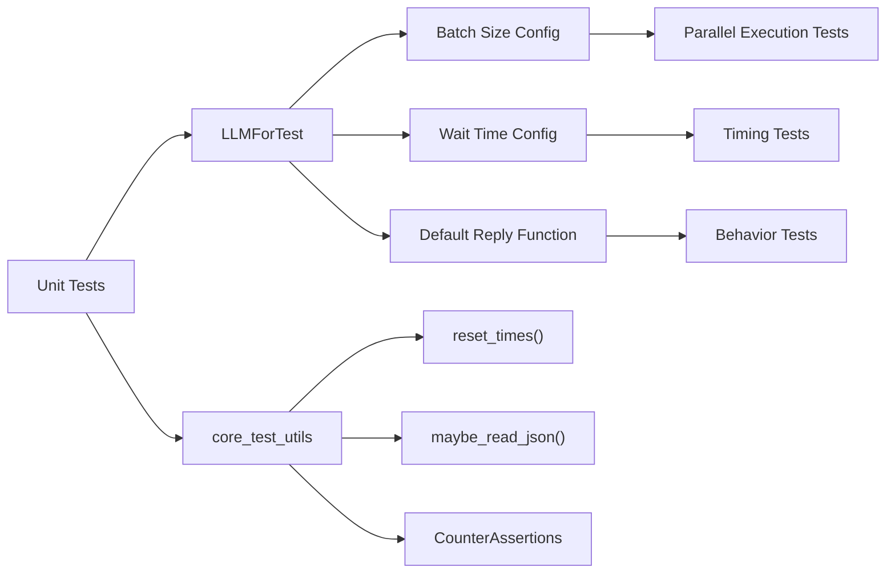

<!-- source: DeepWiki mcp.deepwiki.com · repo google-deepmind/onetwo · page 5 Evaluation and Testing · fetched 2026-10-26 -->

# Evaluation and Testing

<details>
<summary>Relevant source files</summary>

The following files were used as context for generating this wiki page:

- [onetwo/core/core_test_utils.py](onetwo/core/core_test_utils.py)
- [onetwo/evaluation/agent_evaluation.py](onetwo/evaluation/agent_evaluation.py)
- [onetwo/evaluation/agent_evaluation_test.py](onetwo/evaluation/agent_evaluation_test.py)
- [onetwo/evaluation/evaluation.py](onetwo/evaluation/evaluation.py)
- [onetwo/evaluation/evaluation_test.py](onetwo/evaluation/evaluation_test.py)
- [onetwo/ot.py](onetwo/ot.py)

</details>


This document provides a comprehensive guide to evaluating prompting strategies and measuring performance in OneTwo. It covers the evaluation framework for both simple strategies and complex agents, as well as the testing infrastructure used to ensure reliable operation.

For detailed information about strategy evaluation functions and critics, see [Strategy Evaluation](#5.1). For agent-specific evaluation capabilities including tracing and state capture, see [Agent Evaluation](#5.2). For testing utilities and mock backends, see [Testing Infrastructure](#5.3).

## Overview

OneTwo's evaluation system provides two main approaches for measuring the performance of prompting strategies:

1. **Strategy Evaluation** - General-purpose evaluation for any prompting strategy using programmatic or LLM-based critics
2. **Agent Evaluation** - Specialized evaluation for agent-based strategies with enhanced tracing, state capture, and debugging capabilities

Both systems support parallel execution, progress tracking, and comprehensive result collection to enable efficient large-scale evaluation.

## Evaluation Architecture

The evaluation system is built around a common set of core concepts but provides different interfaces optimized for different use cases.



Sources: [onetwo/evaluation/evaluation.py:1-694](), [onetwo/evaluation/agent_evaluation.py:1-566](), [onetwo/ot.py:28-54]()

## Core Data Types

The evaluation system defines several key data types that flow through the evaluation pipeline:

| Type | Definition | Purpose |
|------|------------|---------|
| `Example` | `Mapping[str, Any]` | Input data containing question, expected answer, and metadata |
| `MetricResult` | `tuple[float, Mapping[str, Any]]` | Metric value and additional information from evaluation |
| `ComparisonResult` | `tuple[int, Mapping[str, Any]]` | Index of best answer and comparison details |
| `EvaluationSummary` | Comprehensive results object | Aggregated metrics, counters, and detailed results |
| `EvaluationResult` | Per-example results object | Individual example inputs, outputs, and trace information |



Sources: [onetwo/evaluation/evaluation.py:54-60](), [onetwo/evaluation/agent_evaluation.py:45-58](), [onetwo/core/results.py]()

## Evaluation Workflow

The evaluation process follows a consistent pattern across both strategy and agent evaluation:



Sources: [onetwo/evaluation/evaluation.py:84-134](), [onetwo/evaluation/evaluation.py:576-693](), [onetwo/evaluation/agent_evaluation.py:380-527]()

## Strategy vs Agent Evaluation

The two evaluation systems serve different purposes and provide different capabilities:

| Feature | Strategy Evaluation | Agent Evaluation |
|---------|-------------------|------------------|
| **Target Use Case** | Simple prompting strategies | Complex agent strategies |
| **Tracing Support** | Basic execution tracking | Full execution tracing with `_execute_with_tracing()` |
| **State Capture** | Not supported | Final state capture for agents |
| **Input Extraction** | Simple kwargs extraction | Flexible `inputs_extractor` function |
| **Metric Functions** | Basic critic functions | Rich metric functions with extra info |
| **Output Options** | Limited result output | Configurable results, debug traces, final states |
| **Error Handling** | Basic error reporting | Comprehensive error capture and reporting |



Sources: [onetwo/evaluation/evaluation.py:576-693](), [onetwo/evaluation/agent_evaluation.py:134-214](), [onetwo/evaluation/agent_evaluation.py:380-527]()

## Testing Infrastructure Overview

OneTwo provides comprehensive testing infrastructure to support reliable evaluation:

### Mock Backends

Testing relies on mock LLM backends that simulate real LLM behavior without external dependencies:



Sources: [onetwo/backends/backends_test_utils.py](), [onetwo/core/core_test_utils.py:1-103]()

### Test Utilities

The testing infrastructure provides utilities for common testing patterns:

| Utility | Purpose | Location |
|---------|---------|----------|
| `reset_times()` | Reset execution timestamps for deterministic tests | [onetwo/core/core_test_utils.py:98-102]() |
| `maybe_read_json()` | Safely read JSON files in tests | [onetwo/core/core_test_utils.py:53-59]() |
| `CounterAssertions` | Assert equality for Counter objects | [onetwo/core/core_test_utils.py:26-41]() |
| `LLMForTest` | Mock LLM backend for testing | [onetwo/backends/backends_test_utils.py]() |

## Integration with OneTwo Core

The evaluation system integrates deeply with OneTwo's core execution framework:

- **Execution Model**: Uses `executing.par_iter()` for parallel evaluation and `executing.make_executable()` for strategy compilation
- **Progress Tracking**: Leverages `executing.stream_updates()` and `updating.ListUpdate` for real-time progress monitoring  
- **Results Framework**: Built on `results.EvaluationResult` and `results.EvaluationSummary` for comprehensive result capture
- **Content System**: Supports `content.ChunkList` and multimodal content in examples and outputs
- **Registry System**: Compatible with function registry for backend routing and configuration

Sources: [onetwo/evaluation/evaluation.py:370-434](), [onetwo/evaluation/agent_evaluation.py:452-527](), [onetwo/core/executing.py](), [onetwo/core/results.py]()

## Entry Points

The evaluation functionality is exposed through the main OneTwo API:

```python
import onetwo as ot

# Strategy evaluation
results = ot.evaluate(strategy=my_strategy, examples=examples)

# Strategy comparison  
duration, votes, info = ot.compare_with_critic(
    strategies=[strategy_a, strategy_b], 
    examples=examples
)

# Built-in critics
critic = ot.naive_evaluation_critic
comparison_critic = ot.naive_comparison_critic
```

Sources: [onetwo/ot.py:32-42]()

---

