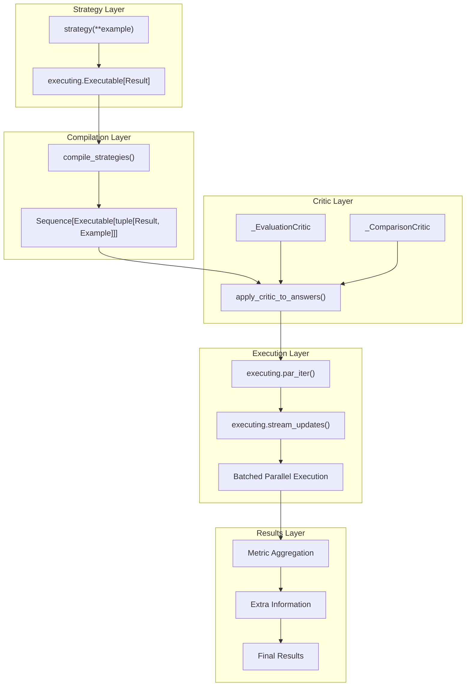
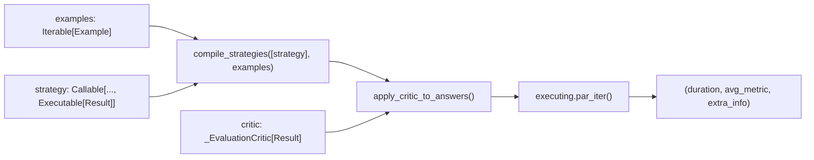
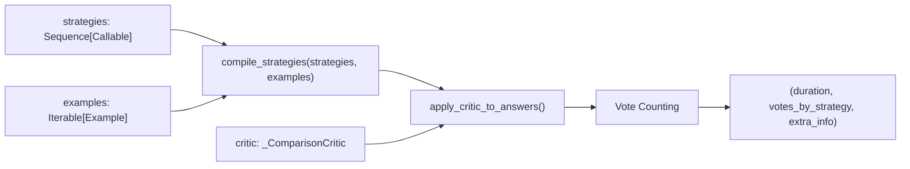
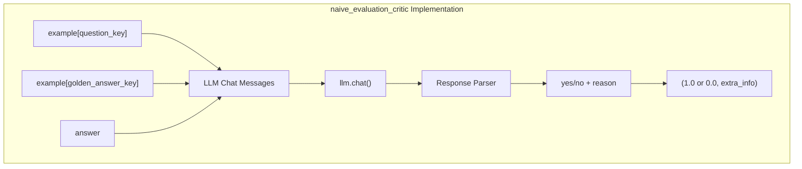
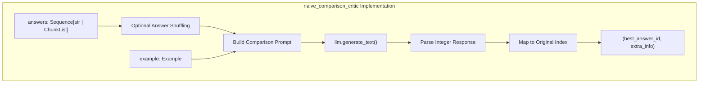
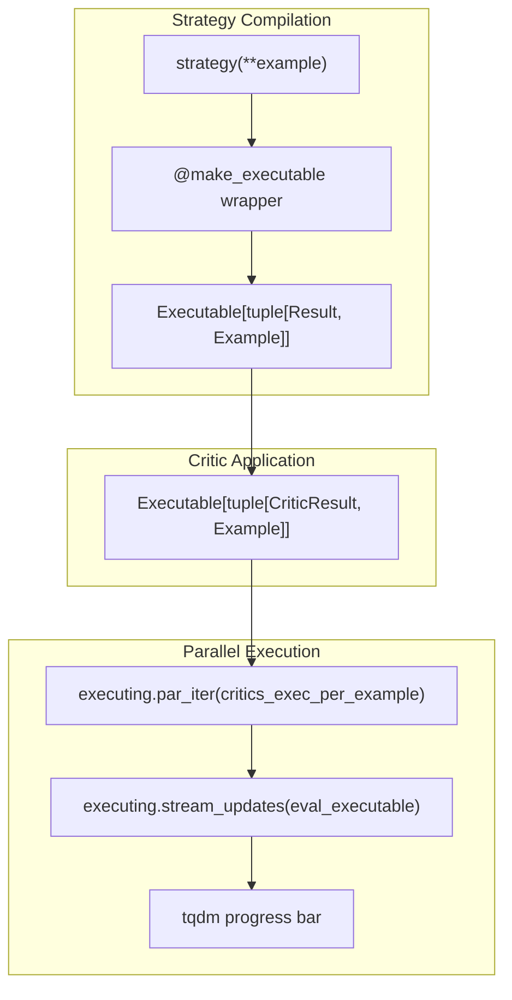

<!-- source: DeepWiki mcp.deepwiki.com · repo google-deepmind/onetwo · page 5.1 Strategy Evaluation · fetched 2026-10-26 -->

# Strategy Evaluation

<details>
<summary>Relevant source files</summary>

The following files were used as context for generating this wiki page:

- [onetwo/evaluation/evaluation.py](onetwo/evaluation/evaluation.py)
- [onetwo/evaluation/evaluation_test.py](onetwo/evaluation/evaluation_test.py)
- [onetwo/ot.py](onetwo/ot.py)

</details>


This document covers the strategy evaluation framework in OneTwo, which provides tools for measuring and comparing the performance of prompting strategies on datasets of examples. The evaluation system supports both programmatic metrics and LLM-based critics for assessing answer quality.

For information about agent-specific evaluation tools and metrics, see [Agent Evaluation](#5.2). For testing infrastructure including mock backends, see [Testing Infrastructure](#5.3).

## Purpose and Core Concepts

The strategy evaluation system enables researchers to:
- Evaluate single prompting strategies against ground truth answers
- Compare multiple strategies using LLM critics  
- Run evaluations efficiently using OneTwo's execution framework
- Aggregate metrics and generate detailed evaluation reports

### Key Data Types

The evaluation system defines several important type aliases:

| Type | Definition | Purpose |
|------|------------|---------|
| `Example` | `Mapping[str, Any]` | Contains question, answers, and metadata for evaluation |
| `SingleMetricValue` | `float` | Numeric score for a single evaluation |
| `MetricResult` | `tuple[SingleMetricValue, ExtraInfo]` | Evaluation result with additional context |
| `ComparisonResult` | `tuple[int, ExtraInfo]` | Index of best answer and context |

Sources: [onetwo/evaluation/evaluation.py:54-59]()

## System Architecture



The evaluation system follows a pipeline architecture where strategies are compiled into executables, critics are applied to generate evaluations, and results are aggregated through the execution framework.

Sources: [onetwo/evaluation/evaluation.py:84-133](), [onetwo/evaluation/evaluation.py:243-307]()

## Core Evaluation Functions

### Single Strategy Evaluation

The `evaluate()` function measures a single strategy's performance:



Key parameters:
- `strategy`: Function that takes example fields as kwargs and returns an `Executable`
- `examples`: Iterable of dictionaries containing questions and reference answers
- `critic`: Evaluation function (defaults to `naive_evaluation_critic`)
- `examples_total_num`: Optional total count for progress tracking

Sources: [onetwo/evaluation/evaluation.py:576-693]()

### Multi-Strategy Comparison  

The `compare_with_critic()` function compares multiple strategies:



The comparison function tracks votes for each strategy and provides normalized vote percentages.

Sources: [onetwo/evaluation/evaluation.py:310-434]()

## Critics System

### Evaluation Critics

Evaluation critics judge single answers against ground truth using the `_EvaluationCritic` protocol:



The default `naive_evaluation_critic` uses few-shot prompting with examples to teach the LLM how to compare answers.

Sources: [onetwo/evaluation/evaluation.py:437-573]()

### Comparison Critics

Comparison critics choose the best answer from multiple options using the `_ComparisonCritic` protocol:



The comparison critic shuffles answers by default to avoid position bias and asks the LLM to choose the best numbered answer.

Sources: [onetwo/evaluation/evaluation.py:136-240]()

## Integration with Execution Framework

### Parallel Processing Pipeline



The evaluation system leverages OneTwo's execution framework for:
- Automatic batching of LLM calls through `@batch_method`
- Parallel processing via `executing.par_iter()`
- Progress tracking with `executing.stream_updates()`
- Caching support through `@cache_method`

Sources: [onetwo/evaluation/evaluation.py:392-421](), [onetwo/evaluation/evaluation.py:652-682]()

## Usage Patterns

### Basic Strategy Evaluation

```python
# Define a strategy function
@executing.make_executable
async def my_strategy(question: str, **kwargs) -> str:
    return await llm.generate_text(prompt=f"Answer: {question}")

# Prepare examples
examples = [
    {"question": "What is 2+2?", "golden_answer": "4"},
    {"question": "What is 3+3?", "golden_answer": "6"}
]

# Run evaluation
duration, avg_metric, extra_info = evaluate(
    strategy=my_strategy,
    examples=examples,
    critic=naive_evaluation_critic
)
```

### Multi-Strategy Comparison

```python
# Compare multiple strategies
duration, votes, extra_info = compare_with_critic(
    strategies=[strategy_a, strategy_b, strategy_c],
    examples=examples,
    critic=naive_comparison_critic
)
```

The evaluation functions are available through the main `ot` module interface via `ot.evaluate` and `ot.compare_with_critic`.

Sources: [onetwo/evaluation/evaluation.py:15-31](), [onetwo/ot.py:32-42]()

---

