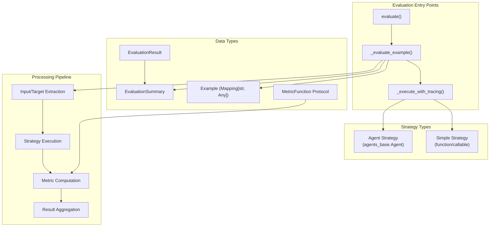
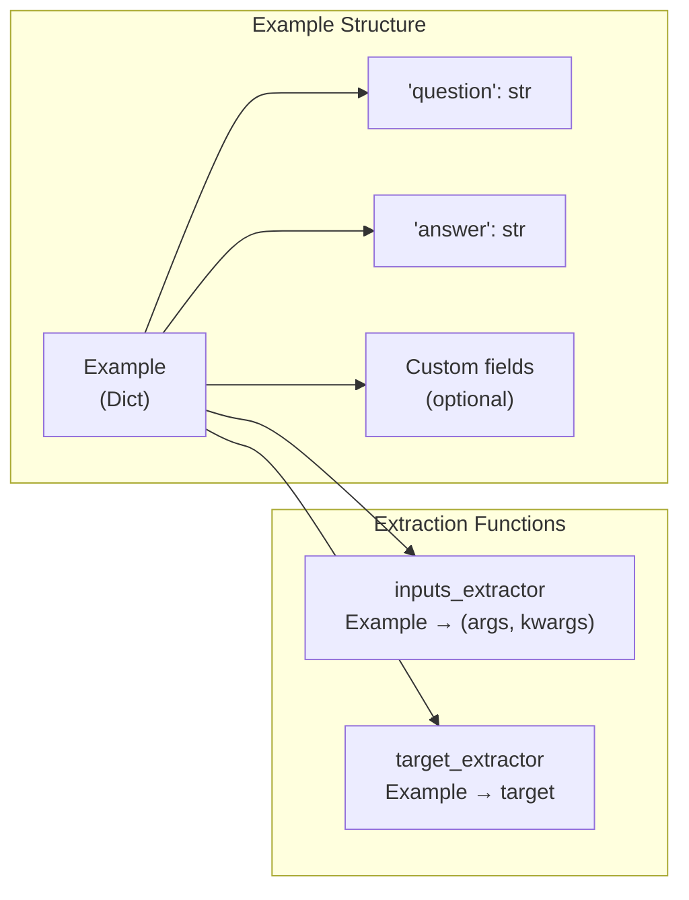
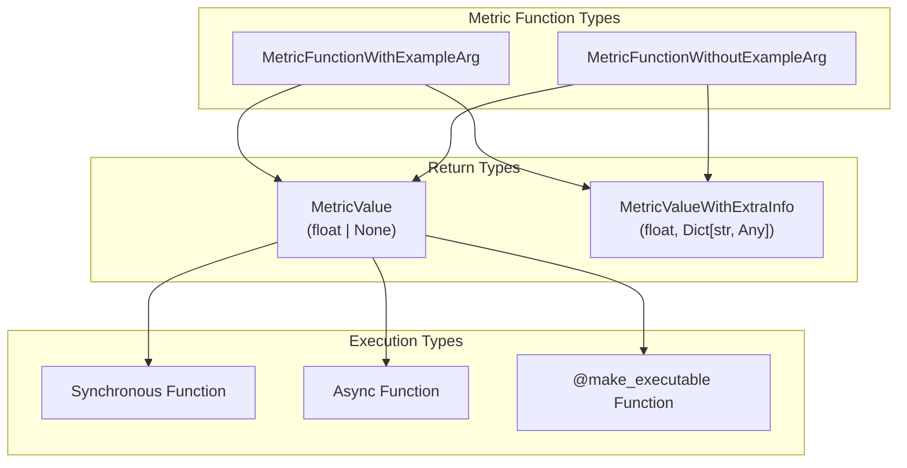
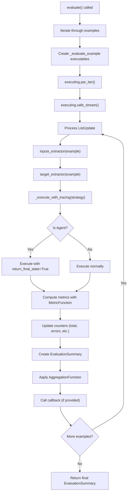
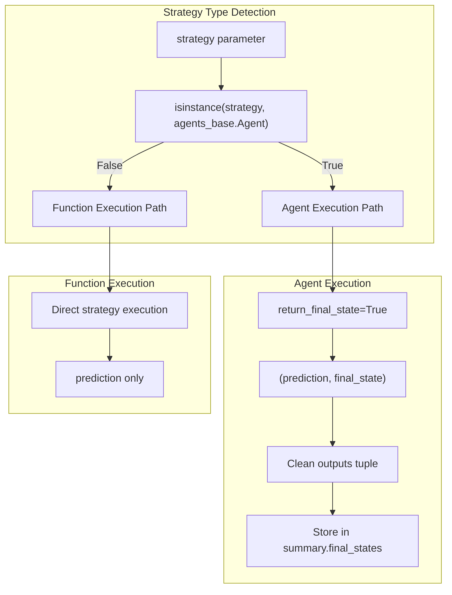
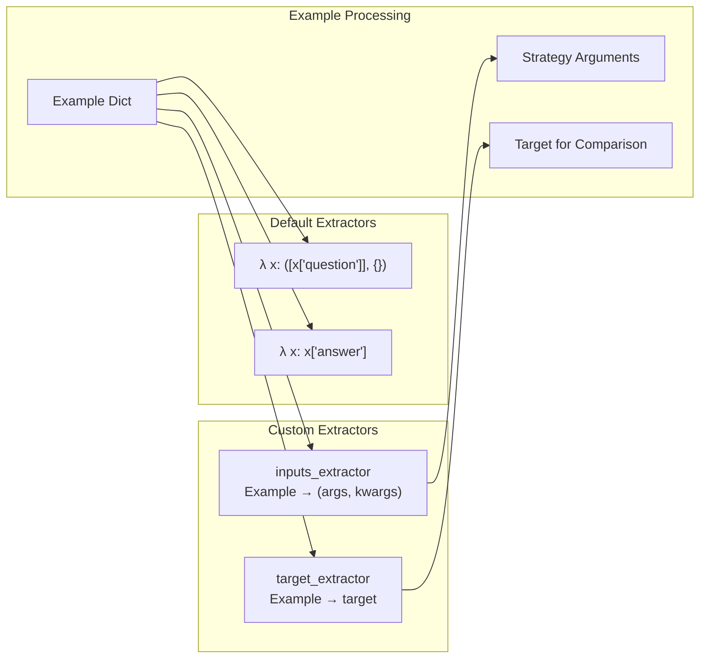
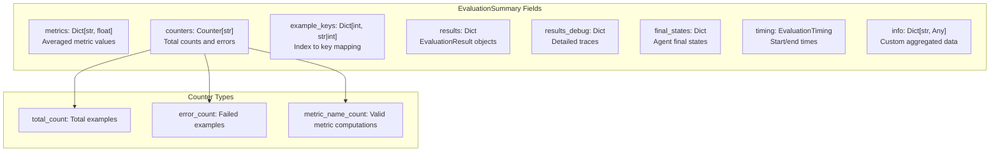

<!-- source: DeepWiki mcp.deepwiki.com · repo google-deepmind/onetwo · page 5.2 Agent Evaluation · fetched 2026-10-26 -->

# Agent Evaluation

<details>
<summary>Relevant source files</summary>

The following files were used as context for generating this wiki page:

- [onetwo/core/core_test_utils.py](onetwo/core/core_test_utils.py)
- [onetwo/evaluation/agent_evaluation.py](onetwo/evaluation/agent_evaluation.py)
- [onetwo/evaluation/agent_evaluation_test.py](onetwo/evaluation/agent_evaluation_test.py)

</details>


This document covers the specialized evaluation framework for agent-based strategies in OneTwo. The agent evaluation system provides tools for running agents on datasets, measuring their performance with custom metrics, and analyzing results with detailed tracing capabilities.

For general strategy evaluation (non-agent prompting strategies), see [Strategy Evaluation](#5.1). For testing infrastructure including mock backends, see [Testing Infrastructure](#5.3).

## Core Architecture

The agent evaluation system is built around the `evaluate()` function in [onetwo/evaluation/agent_evaluation.py](), which orchestrates the evaluation process for both simple strategies and complex agents.



Sources: [onetwo/evaluation/agent_evaluation.py:380-527](), [onetwo/evaluation/agent_evaluation.py:134-213](), [onetwo/evaluation/agent_evaluation.py:216-377]()

## Data Structures and Protocols

### Example Format

Examples are the fundamental unit of evaluation, represented as mappings containing input data and target outputs.

| Component | Type | Description |
|-----------|------|-------------|
| `Example` | `Mapping[str, Any]` | Dictionary containing question, answer, and optional metadata |
| Default structure | `{'question': str, 'answer': str}` | Standard format for Q&A evaluation |
| Custom fields | Any additional keys | Support for multi-field inputs and metadata |



Sources: [onetwo/evaluation/agent_evaluation.py:45](), [onetwo/evaluation/agent_evaluation.py:221-222](), [onetwo/evaluation/agent_evaluation.py:384-385]()

### Metric Functions

The evaluation system supports flexible metric computation through the `MetricFunction` protocol:



Sources: [onetwo/evaluation/agent_evaluation.py:61-110](), [onetwo/evaluation/agent_evaluation.py:52-58](), [onetwo/evaluation/agent_evaluation.py:48-50]()

## Main Evaluation Function

The `evaluate()` function provides the primary interface for running evaluations:

### Function Signature

```python
def evaluate(
    strategy: Callable[[_I], _O] | Callable[[_I], executing.Executable[_O]],
    examples: Iterable[Example],
    *,
    inputs_extractor: Callable[[Example], _I] = lambda x: ([x['question']], {}),
    target_extractor: Callable[[Example], _O] = lambda x: x['answer'],
    metric_functions: Mapping[str, MetricFunction] | None = None,
    aggregation_functions: Sequence[AggregationFunction] | None = None,
    callback: Callable[[int, Example, EvaluationSummary], None] | None = None,
    # ... additional parameters
) -> EvaluationSummary
```

### Evaluation Process Flow



Sources: [onetwo/evaluation/agent_evaluation.py:380-527](), [onetwo/evaluation/agent_evaluation.py:467-471](), [onetwo/evaluation/agent_evaluation.py:472-527]()

## Agent-Specific Features

### Agent Detection and Handling

The evaluation system automatically detects agent strategies and provides specialized handling:



Sources: [onetwo/evaluation/agent_evaluation.py:260-267](), [onetwo/evaluation/agent_evaluation.py:327-351](), [onetwo/evaluation/agent_evaluation.py:371-374]()

### Tracing Support

Agent evaluation includes comprehensive tracing through `_execute_with_tracing()`:

| Feature | Description | Implementation |
|---------|-------------|----------------|
| Execution tracing | Captures full execution trace | `tracing.execution_context.set()` |
| Stage extraction | Extracts specific execution stages | `trace.stages[0]` analysis |
| Redundancy removal | Removes redundant trace layers | Outer trace cleanup logic |
| Agent compatibility | Special handling for agent traces | `isinstance(strategy, agents_base.Agent)` check |

Sources: [onetwo/evaluation/agent_evaluation.py:134-213](), [onetwo/evaluation/agent_evaluation.py:175-176](), [onetwo/evaluation/agent_evaluation.py:196-205]()

## Advanced Configuration

### Custom Extractors

The evaluation system supports custom logic for extracting inputs and targets from examples:



Sources: [onetwo/evaluation/agent_evaluation.py:384-385](), [onetwo/evaluation/agent_evaluation.py:221-222](), [onetwo/evaluation/agent_evaluation_test.py:473-491]()

### Output Control

The evaluation system provides fine-grained control over what data is included in results:

| Parameter | Type | Purpose |
|-----------|------|---------|
| `output_results` | `bool` | Include `EvaluationResult` objects in `results` field |
| `output_results_debug` | `bool` | Include detailed traces in `results_debug` field |
| `output_final_states` | `bool` | Include agent final states (agents only) |
| `output_filter` | `Callable` | Function to determine which examples to include |
| `example_key_function` | `Callable` | Custom key generation for results mapping |

Sources: [onetwo/evaluation/agent_evaluation.py:392-398](), [onetwo/evaluation/agent_evaluation.py:503-515](), [onetwo/evaluation/agent_evaluation.py:484-490]()

### Aggregation Functions

Custom aggregation logic can be applied through `AggregationFunction` protocol:

```python
class AggregationFunction(Protocol):
    def __call__(
        self,
        aggregate_summary: EvaluationSummary,
        example_summary: EvaluationSummary,
    ) -> None:
        """Updates aggregate_summary.info based on example_summary.info."""
```

Sources: [onetwo/evaluation/agent_evaluation.py:113-131](), [onetwo/evaluation/agent_evaluation.py:518-520]()

## Results and Output

### EvaluationSummary Structure

The evaluation produces an `EvaluationSummary` containing:



Sources: [onetwo/core/results.py]() (referenced), [onetwo/evaluation/agent_evaluation.py:272-274](), [onetwo/evaluation/agent_evaluation.py:296-299]()

### JSON Export

Results can be exported to JSON format using `write_evaluation_summary_as_json()`:

| File | Contents |
|------|----------|
| `metrics.json` | Aggregated metric values |
| `counters.json` | Count statistics |
| `results.json` | Simplified evaluation results |
| `results_debug.json` | Full traces and debugging info |
| `final_states.json` | Agent final states |

Sources: [onetwo/evaluation/agent_evaluation.py:530-566](), [onetwo/evaluation/agent_evaluation.py:555-565]()

## Usage Patterns

### Basic Agent Evaluation

```python
# Evaluate a ReAct agent on a question-answering dataset
summary = agent_evaluation.evaluate(
    strategy=react_agent,
    examples=[
        {'question': 'What is 2+2?', 'answer': '4'},
        {'question': 'What color is the sky?', 'answer': 'blue'}
    ],
    metric_functions={'accuracy': lambda target, pred: float(target == pred)},
    output_final_states=True
)
```

### Custom Extractors and Metrics

```python
# Multi-field input extraction
def extract_context_and_question(example):
    return ([example['context'], example['question']], {})

# Metric with extra information
def accuracy_with_rationale(target, prediction, example):
    correct = float(target == prediction)
    extra_info = {'difficulty': example.get('difficulty', 'unknown')}
    return correct, extra_info

summary = agent_evaluation.evaluate(
    strategy=my_agent,
    examples=dataset,
    inputs_extractor=extract_context_and_question,
    metric_functions={'accuracy': accuracy_with_rationale}
)
```

Sources: [onetwo/evaluation/agent_evaluation_test.py:669-711](), [onetwo/evaluation/agent_evaluation_test.py:87-94](), [onetwo/evaluation/agent_evaluation_test.py:716-738]()

---

