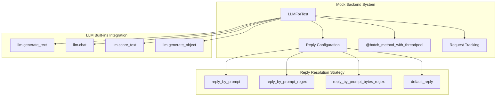
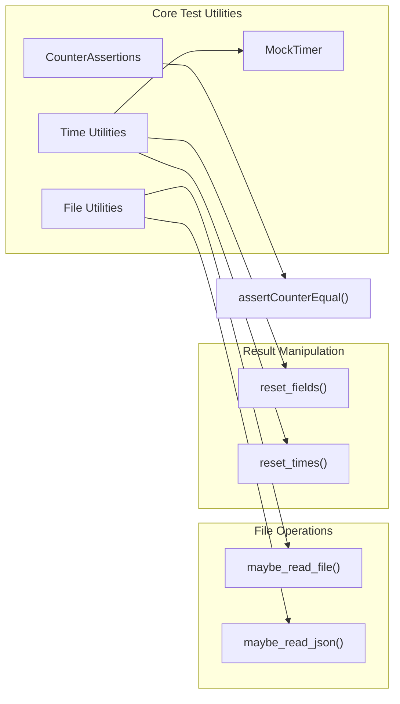
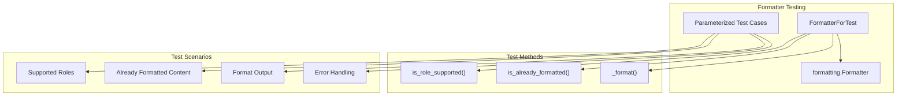

<!-- source: DeepWiki mcp.deepwiki.com · repo google-deepmind/onetwo · page 5.3 Testing Infrastructure · fetched 2026-10-26 -->

# Testing Infrastructure

<details>
<summary>Relevant source files</summary>

The following files were used as context for generating this wiki page:

- [onetwo/backends/backends_test_utils.py](onetwo/backends/backends_test_utils.py)
- [onetwo/backends/formatters.py](onetwo/backends/formatters.py)
- [onetwo/builtins/formatting.py](onetwo/builtins/formatting.py)
- [onetwo/builtins/formatting_test.py](onetwo/builtins/formatting_test.py)
- [onetwo/core/core_test_utils.py](onetwo/core/core_test_utils.py)
- [onetwo/evaluation/agent_evaluation.py](onetwo/evaluation/agent_evaluation.py)
- [onetwo/evaluation/agent_evaluation_test.py](onetwo/evaluation/agent_evaluation_test.py)

</details>


This document covers OneTwo's comprehensive testing infrastructure, including mock backends, test utilities, and specialized testing patterns for prompting strategies and agents. 

For information about the evaluation framework itself (strategy evaluation and agent evaluation), see [Strategy Evaluation](#5.1) and [Agent Evaluation](#5.2). This page focuses on the underlying testing infrastructure that supports development and testing of OneTwo applications.

## Overview

OneTwo provides several layers of testing infrastructure designed to support reliable development of LLM-based applications:

- **Mock Backend System**: Configurable mock LLM backends for deterministic testing
- **Test Utilities**: Helper functions and classes for common testing patterns
- **Agent Testing Framework**: Specialized tools for testing agent strategies
- **Evaluation Testing**: Infrastructure for testing the evaluation framework itself

## Mock Backend System

The core of OneTwo's testing infrastructure is the `LLMForTest` class, which provides a configurable mock implementation of LLM backends.

### LLMForTest Architecture



The `LLMForTest` class supports multiple reply configuration strategies with a clear precedence order:

**For `generate_text`:**
1. `reply_by_prompt` - Exact prompt matching
2. `reply_by_prompt_regex` - Regex pattern matching  
3. `default_reply` - Fallback reply or function

**For `score_text`:**
1. `reply_by_prompt_target` - Prompt+target matching
2. `default_score` - Default score value

Sources: [onetwo/backends/backends_test_utils.py:42-312]()

### Key Features

The mock backend provides several advanced features for testing:

| Feature | Purpose | Configuration |
|---------|---------|---------------|
| **Batching Support** | Test parallel execution | `batch_size` parameter |
| **Streaming Replies** | Test iterative responses | `iterable_replies=True` |
| **Request Tracking** | Verify call patterns | `prompts`, `unexpected_prompts` |
| **Configurable Delays** | Test timing behavior | `wait_time_before_reply` |
| **Exception Simulation** | Test error handling | Exception as reply value |

### Example Usage

```python
# Configure mock backend with specific replies
mock_llm = LLMForTest(
    reply_by_prompt={
        "What is 2+2?": "4",
        "Hello": "Hi there!"
    },
    reply_by_prompt_regex={
        r".*math.*": "I can help with math",
        "": "Default response"  # Empty regex matches everything
    },
    default_reply="I don't understand"
)

# Register with OneTwo's built-in functions
mock_llm.register()

# Now llm.generate_text will use the mock
```

Sources: [onetwo/backends/backends_test_utils.py:222-312]()

## Test Utilities

OneTwo provides several utility modules for common testing patterns.

### Core Test Utilities



### Key Utility Functions

| Function | Purpose | Usage |
|----------|---------|-------|
| `assertCounterEqual()` | Compare Counter objects | Test metric counting |
| `maybe_read_file()` | Safe file reading | Read test fixtures |
| `maybe_read_json()` | Safe JSON parsing | Parse test results |
| `reset_times()` | Normalize timing data | Deterministic test assertions |
| `MockTimer` | Controllable time source | Time-dependent testing |

Sources: [onetwo/core/core_test_utils.py:26-103]()

## Agent Evaluation Testing

The evaluation testing framework provides comprehensive tools for testing prompting strategies and agents.

### Testing Strategy Types

```mermaid
graph TD
    subgraph "Strategy Testing Framework"
        OrdinaryFunction["ordinary_identity_function"]
        AsyncFunction["async_identity_function"] 
        ExecutableFunction["executable_identity_function"]
        TracedFunction["traced_ordinary_identity_function"]
        AgentStrategy["StringAgent"]
    end
    
    subgraph "Metric Function Types"
        OrdinaryMetric["ordinary_accuracy_function"]
        AsyncMetric["async_accuracy_function"]
        ExecutableMetric["executable_accuracy_function"]
        CallableMetric["AccuracyCallable classes"]
    end
    
    subgraph "Test Infrastructure"
        EvaluateCall["agent_evaluation.evaluate()"]
        MockBackend["LLMForTest"]
        TestExamples["Test Examples"]
    end
    
    OrdinaryFunction --> EvaluateCall
    AsyncFunction --> EvaluateCall
    ExecutableFunction --> EvaluateCall
    TracedFunction --> EvaluateCall
    AgentStrategy --> EvaluateCall
    
    OrdinaryMetric --> EvaluateCall
    AsyncMetric --> EvaluateCall
    ExecutableMetric --> EvaluateCall
    CallableMetric --> EvaluateCall
    
    MockBackend --> EvaluateCall
    TestExamples --> EvaluateCall
```



The testing framework supports multiple strategy types and automatically handles their execution patterns:

- **Ordinary Functions**: Direct function calls
- **Async Functions**: Coroutine-based strategies
- **Executable Functions**: `@make_executable` decorated functions
- **Traced Functions**: Functions with tracing enabled
- **Agent Strategies**: Full agent implementations

Sources: [onetwo/evaluation/agent_evaluation_test.py:103-125](), [onetwo/evaluation/agent_evaluation_test.py:187-287]()

### Test Example Patterns

The framework provides several patterns for structuring test examples:

```python
# Simple examples with question/answer pairs
examples = [
    {'question': 'What is 2+2?', 'answer': '4'},
    {'question': 'Hello', 'answer': 'Hi'}
]

# Examples with multiple fields
examples_with_options = [
    {
        'question': 'bla',
        'option': num,
        'answer': f'bla_generated option={num}'
    }
    for num in range(5)
]

# Custom extractors for complex examples
inputs_extractor = lambda x: ([x['question']], {'option': x['option']})
target_extractor = lambda x: x['answer']
```

Sources: [onetwo/evaluation/agent_evaluation_test.py:53-69](), [onetwo/evaluation/agent_evaluation_test.py:473-491]()

## Formatting Test Infrastructure

OneTwo includes specialized testing infrastructure for prompt formatting systems.

### Formatter Testing Pattern



### Test Formatter Implementation

The test infrastructure includes a `FormatterForTest` class that demonstrates the testing pattern for custom formatters:

```python
class FormatterForTest(formatting.Formatter):
    def is_role_supported(self, role):
        return role in {PredefinedRole.USER, PredefinedRole.MODEL}
    
    def is_already_formatted(self, content):
        return any([('</' in str(msg.content)) for msg in content])
    
    def _format(self, content):
        # Custom formatting logic with XML-like tags
        result = ChunkList()
        for msg in content:
            role = msg.role.value if isinstance(msg.role, PredefinedRole) else msg.role
            result += Chunk(content=f'<{role}>{msg.content}</{role}>\n')
        return result
```

Sources: [onetwo/builtins/formatting_test.py:31-56]()

### Parameterized Testing

The formatting tests extensively use parameterized testing to cover multiple scenarios:

```python
@parameterized.named_parameters(
    ('formatted', '<user>This is a user message.</user>', True),
    ('not_formatted', 'This is a user message.', False),
)
def test_format_content_already_formatted(self, content, expected):
    # Test implementation
```

This pattern allows comprehensive testing of edge cases and different formatter configurations.

Sources: [onetwo/builtins/formatting_test.py:79-105]()

## Testing Best Practices

### Deterministic Testing

OneTwo's testing infrastructure emphasizes deterministic testing patterns:

1. **Time Normalization**: Use `reset_times()` to eliminate timing variability
2. **Mock Backends**: Use `LLMForTest` instead of real LLM calls
3. **Freezegun Integration**: Control time progression in tests
4. **Batch Size Testing**: Test both sequential and parallel execution

### Error Testing

The framework provides patterns for testing error conditions:

```python
# Test strategy with argument mismatch
summary = agent_evaluation.evaluate(
    strategy=strategy_requiring_option,
    examples=[{'question': 'Something'}],  # Missing 'option'
    inputs_extractor=lambda x: ([x['question']], {}),  # Doesn't provide option
)

# Verify error handling
self.assertEqual(1, summary.counters['error_count'])
self.assertIsInstance(summary.results[0].error, TypeError)
```

### Performance Testing

The infrastructure supports performance and batching tests:

```python
# Test sequential execution
slow_llm = LLMForTest(
    batch_size=1,
    wait_time_before_reply=timedelta(seconds=1.0)
)

# Test parallel execution  
fast_llm = LLMForTest(
    batch_size=len(examples),
    wait_time_before_reply=timedelta(seconds=1.0)
)

# Compare execution times
```

Sources: [onetwo/evaluation/agent_evaluation_test.py:755-808]()

## Integration with OneTwo Systems

The testing infrastructure integrates seamlessly with OneTwo's core systems:

- **Built-in Functions**: Mock backends automatically configure `llm.generate_text`, `llm.chat`, etc.
- **Execution Framework**: Test utilities work with `@make_executable` and async patterns
- **Results System**: Utilities for normalizing and comparing `ExecutionResult` objects
- **Evaluation Framework**: Direct integration with `agent_evaluation.evaluate()`

This comprehensive testing infrastructure enables reliable development and testing of complex LLM-based applications while maintaining deterministic, reproducible test results.

Sources: [onetwo/backends/backends_test_utils.py:302-312](), [onetwo/evaluation/agent_evaluation_test.py:1-961]()