# Page: Overview

# Overview

<details>
<summary>Relevant source files</summary>

The following files were used as context for generating this wiki page:

- [README.md](README.md)
- [colabs/tutorial.ipynb](colabs/tutorial.ipynb)
- [docs/basics.md](docs/basics.md)

</details>


OneTwo is a Python library designed to simplify interactions with large language and multimodal foundation models, primarily aimed at researchers in prompting and prompting strategies. This document provides a high-level architectural overview of the OneTwo system, its core components, and how they work together to enable complex model interactions.

For detailed information about getting started with basic usage, see [Getting Started](#1.1). For in-depth coverage of the foundational systems, see [Core Architecture](#2). For advanced prompting strategies and agents, see [Advanced Features](#4).

## System Purpose and Architecture

OneTwo enables the creation of complex flows involving multiple calls to foundation models and other tools. The library is built around two key strategies for efficient execution: caching of model requests/responses and asynchronous execution for parallel operations.

### High-Level System Architecture

The OneTwo system is organized into several interconnected layers:

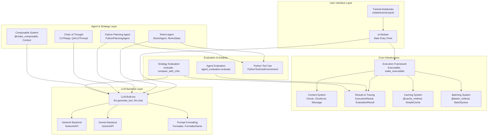

**Sources:** [colabs/tutorial.ipynb:47-226](), [README.md:1-70](), [docs/basics.md:1-27]()

## Core Concepts and Code Entities

### Executables and Built-in Functions

The foundation of OneTwo is the `Executable` abstraction, which represents deferred computation that can be executed against different backends. Built-in functions like `llm.generate_text()`, `llm.chat()`, `llm.instruct()`, and `llm.embed()` return `Executable` objects rather than directly calling models.

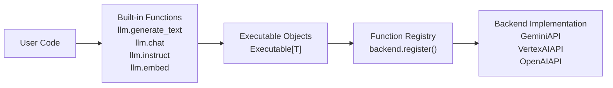

**Sources:** [colabs/tutorial.ipynb:565-573](), [colabs/tutorial.ipynb:617-618](), [docs/basics.md:44-70]()

### Execution Framework

The execution model supports both sequential and parallel operations through the `@ot.make_executable` decorator and functions like `ot.parallel()`. This enables complex computation graphs while maintaining clean, readable code.

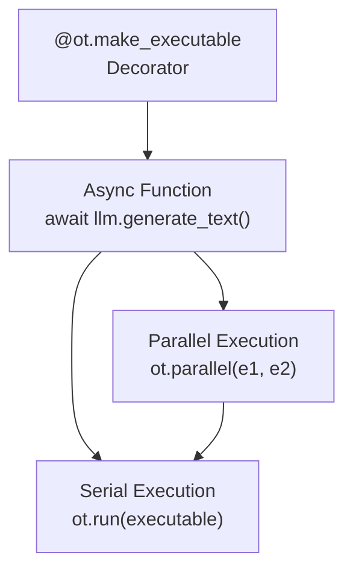

**Sources:** [colabs/tutorial.ipynb:825-840](), [colabs/tutorial.ipynb:859-870](), [docs/basics.md:117-176]()

## Data Flow Architecture

### Request Processing Pipeline

OneTwo processes requests through a sophisticated pipeline that handles content formatting, backend routing, caching, and batching:

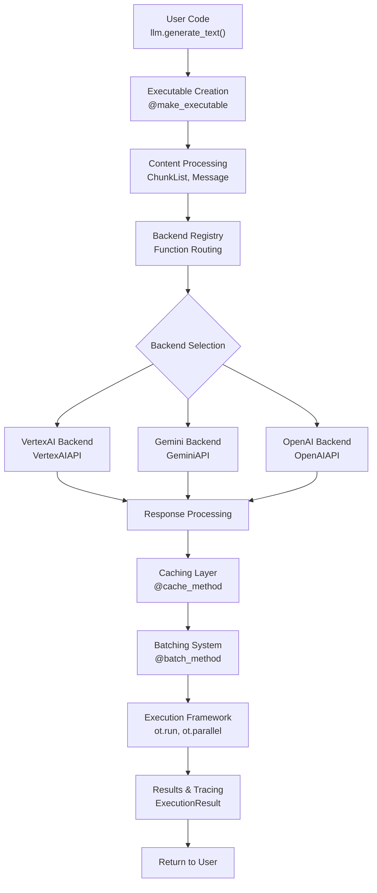

**Sources:** [colabs/tutorial.ipynb:604-608](), [colabs/tutorial.ipynb:825-840](), [colabs/tutorial.ipynb:498-523]()

## Backend System and Content Handling

### Backend Registration and Content Types

OneTwo supports multiple LLM backends through a unified registration system. Content is handled through a multimodal system supporting text, images, and structured messages:

| Component | Code Entity | Purpose |
|-----------|-------------|---------|
| Backend Registry | `backend.register()` | Routes function calls to implementations |
| Content Types | `Chunk`, `ChunkList`, `Message` | Handles multimodal content |
| Formatters | `Formatter`, `FormatterName` | Converts content for specific models |
| Built-in Functions | `llm.generate_text`, `llm.chat`, `llm.instruct` | Uniform API across backends |

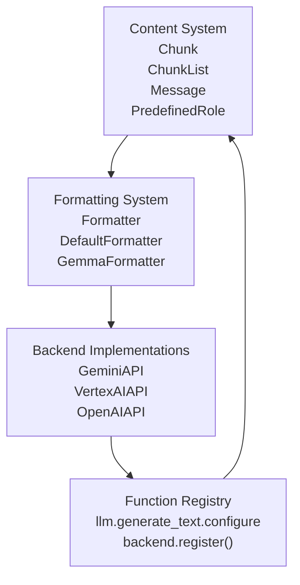

**Sources:** [colabs/tutorial.ipynb:387-428](), [colabs/tutorial.ipynb:646-664](), [docs/basics.md:72-81]()

## Composables and Template System

OneTwo provides multiple approaches for building complex prompts, including Jinja2 templates and composable functions that can be concatenated with the `+` operator:

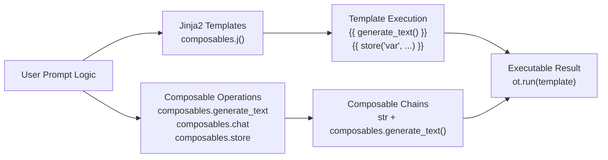

**Sources:** [colabs/tutorial.ipynb:907-915](), [colabs/tutorial.ipynb:934-942](), [colabs/tutorial.ipynb:1054-1064]()

## Evaluation and Testing Framework

OneTwo includes comprehensive evaluation capabilities for comparing prompting strategies and measuring agent performance:

| Evaluation Type | Key Classes | Purpose |
|----------------|-------------|---------|
| Strategy Evaluation | `evaluate()`, `compare_with_critic()` | Compare prompting approaches |
| Agent Evaluation | `agent_evaluation.evaluate()` | Measure agent performance |
| Results Analysis | `EvaluationResult`, `EvaluationSummary` | Store and analyze results |
| Testing Infrastructure | `LLMForTest`, Test utilities | Mock backends for testing |

**Sources:** [colabs/tutorial.ipynb:1338-1370](), [README.md:42-47]()

The OneTwo architecture provides a flexible, efficient foundation for prompting research while maintaining clean abstractions between user code, execution infrastructure, and backend implementations. The system's design enables researchers to focus on prompting strategies rather than infrastructure concerns.

---

# Page: Getting Started

# Getting Started

<details>
<summary>Relevant source files</summary>

The following files were used as context for generating this wiki page:

- [colabs/tutorial.ipynb](colabs/tutorial.ipynb)

</details>


This document provides a tutorial introduction to the OneTwo library's core concepts and basic usage patterns. It covers installation, backend setup, built-in functions, executables, and fundamental prompting techniques. For advanced features like agents and complex reasoning strategies, see [Agent Strategies](#4.1). For comprehensive evaluation frameworks, see [Strategy Evaluation](#5.1).

## Purpose and Core Architecture

OneTwo is a library for building and executing complex LLM prompting strategies. It provides two main layers: a low-level core for connecting to models and chaining calls, and a standard library of reusable prompting components.

### OneTwo System Overview

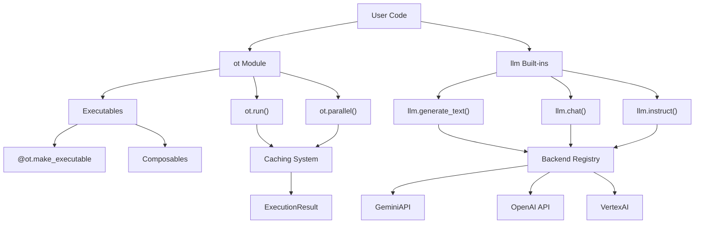

Sources: [colabs/tutorial.ipynb:108-112](), [colabs/tutorial.ipynb:203-225]()

## Installation and Setup

### Installation

Install OneTwo from the GitHub repository:

```bash
pip install git+https://github.com/google-deepmind/onetwo
```

### Basic Imports

The minimum required imports for basic OneTwo operations:

```python
from onetwo import ot
from onetwo.builtins import llm
```

Sources: [colabs/tutorial.ipynb:108-112]()

### Backend Configuration

OneTwo supports multiple LLM backends. Choose one and configure it with your API credentials.

#### Gemini API Setup

```python
from onetwo.backends import gemini_api

backend = gemini_api.GeminiAPI(
    api_key=your_api_key,
    temperature=0.0,
    generate_model_name='models/gemini-1.5-flash',
    cache_filename='cache/gemini_cache.json'
)
backend.register()
```

#### OpenAI API Setup

```python
from onetwo.backends import openai_api

backend = openai_api.OpenAIAPI(
    api_key=your_api_key,
    model_name='gpt-4o-mini',
    temperature=0.0,
    cache_filename='cache/openai_cache.json'
)
backend.register()
```

Sources: [colabs/tutorial.ipynb:387-428](), [colabs/tutorial.ipynb:450-489]()

## Core Concepts

### Built-in Functions and Executables

OneTwo's core abstraction is the `Executable` - objects that represent LLM operations but don't execute immediately. Built-in functions return executables that are later executed with `ot.run()`.

### Built-in Function Mapping

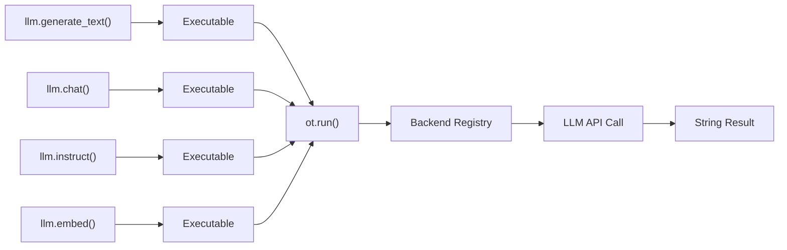

Sources: [colabs/tutorial.ipynb:565-573](), [colabs/tutorial.ipynb:617-618]()

### The Three Main Built-ins

1. **`llm.generate_text()`** - Raw text completion, primarily for base models
2. **`llm.chat()`** - Multi-turn conversation with message history  
3. **`llm.instruct()`** - Single instruction following, converts to chat format

Sources: [colabs/tutorial.ipynb:565-573]()

## Basic Usage Examples

### Text Generation

```python
# Create an executable
e = llm.generate_text(
    'Three not so well known cities in France are',
    max_tokens=20
)

# Execute it
result = ot.run(e)
print(result)
```

Sources: [colabs/tutorial.ipynb:604-608]()

### Chat Conversations

```python
from onetwo.core import content as content_lib

messages = [
    content_lib.Message(
        role=content_lib.PredefinedRole.USER,
        content='Hi, my name is Peter. Who are you?'
    ),
    content_lib.Message(
        role=content_lib.PredefinedRole.MODEL,
        content='Nice to meet you, Peter. My name is Albert.'
    ),
    content_lib.Message(
        role=content_lib.PredefinedRole.USER,
        content='Tell me about yourself.'
    )
]

e = llm.chat(messages, max_tokens=50)
result = ot.run(e)
```

Sources: [colabs/tutorial.ipynb:646-664]()

### Instruction Following

```python
e = llm.instruct('What are three well-known cities in France?', max_tokens=50)
result = ot.run(e)
```

Sources: [colabs/tutorial.ipynb:694-695]()

## Composing Operations

### Sequential Execution with Executables

Create complex flows by composing operations with `@ot.make_executable`:

```python
@ot.make_executable
async def f() -> str:
    result1 = await llm.instruct(
        'Question: What is the capital of France? Answer:',
        max_tokens=20, stop=['\n']
    )
    print('Intermediate result:', result1)
    
    result2 = await llm.instruct(
        f'Question: Who is the mayor of {result1}? Answer:',
        max_tokens=20, stop=['\n'] 
    )
    return result2

result = ot.run(f())
```

Sources: [colabs/tutorial.ipynb:825-839]()

### Parallel Execution

Execute multiple operations concurrently:

```python
e1 = llm.instruct('What is the capital of France?', max_tokens=20)
e2 = llm.instruct('What is the capital of Spain?', max_tokens=20)

# Execute in parallel
parallel_exec = ot.parallel(e1, e2)
results = ot.run(parallel_exec)  # Returns list of results
```

Sources: [colabs/tutorial.ipynb:859-869]()

### Execution Flow

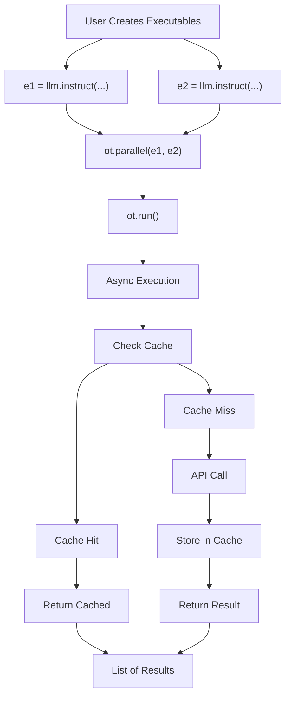

Sources: [colabs/tutorial.ipynb:859-869](), [colabs/tutorial.ipynb:216-217]()

## Templates and Composables

### Jinja2 Templates

Use `composables.j()` for template-based prompting:

```python
from onetwo.builtins import composables

template = composables.j("""
Question: What is the capital of {{ country }}?
Answer: {{ generate_text(max_tokens=10, stop=['\\n']) }}
""")

result = ot.run(template(country='France'))
```

Sources: [colabs/tutorial.ipynb:907-914]()

### Composable Strings

Concatenate strings with LLM operations using `+`:

```python
e = (
    'Question: What is the capital of France? Answer:'
    + composables.generate_text(max_tokens=20, stop=['\n'])
    + '\nQuestion: Who is its mayor? Answer:'
    + composables.generate_text(max_tokens=20, stop=['\n'])
)

result = ot.run(e)
```

Sources: [colabs/tutorial.ipynb:934-942]()

## Caching and Performance

### Automatic Caching

OneTwo automatically caches LLM responses. Identical requests return cached results:

```python
# First call hits the API
result1 = ot.run(llm.generate_text('Hello world'))

# Second identical call returns from cache
result2 = ot.run(llm.generate_text('Hello world'))
```

### Sampling Multiple Responses

Use `ot.repeat()` to generate multiple samples:

```python
executable = llm.generate_text(
    prompt='Five cities in Switzerland:',
    max_tokens=20,
    temperature=1.0  # Non-zero for diversity
)

# Create 3 instances
repeated = ot.repeat(executable, 3)
parallel_exec = ot.parallel(*repeated)
results = ot.run(parallel_exec)  # List of 3 different responses
```

Sources: [colabs/tutorial.ipynb:1117-1133]()

## Variable Management

### F-strings

Use Python f-strings for simple variable substitution:

```python
country = 'France'
prompt = f'Question: What is the capital of {country}?'
result = ot.run(llm.instruct(prompt, max_tokens=10))
```

### Jinja2 Variables

Store and retrieve variables in templates:

```python
prompt = composables.j(
    'Question: What is the capital of {{ question }}?\n'
    'Answer: {{ store("city", generate_text(max_tokens=10) | trim) }}\n'
    'Question: Who is the mayor of {{ __vars__.city }}?\n'
    'Answer: {{ store("mayor", generate_text(max_tokens=10) | trim) }}'
)

result = ot.run(prompt(question='France'))
# Access stored variables
city = prompt['city']
mayor = prompt['mayor']
```

Sources: [colabs/tutorial.ipynb:1054-1063]()

## Basic Evaluation

OneTwo provides evaluation utilities for testing prompting strategies:

```python
# Define a simple strategy
@ot.make_executable
async def strategy(question, **_):
    answer = await llm.generate_text(
        prompt=f'Question: {question}\nAnswer:',
        stop=['Question:', '\n']
    )
    return answer.strip()

# Define evaluation dataset
dataset = [
    {'question': 'What is 2+2?', 'answer': '4'},
    {'question': 'What is the capital of France?', 'answer': 'Paris'}
]

# Run evaluation
def metric_fn(answer, example):
    correct = str(example['answer']) in answer
    return float(correct), {}

time_elapsed, avg_metric, info = ot.evaluate(
    strategy=strategy,
    examples=dataset,
    critic=metric_fn
)
```

Sources: [colabs/tutorial.ipynb:1378-1405]()

## Next Steps

This covers the fundamental concepts for getting started with OneTwo. For more advanced topics, see:

- [Core Concepts](#1.2) for deeper understanding of executables and the function registry
- [Agent Strategies](#4.1) for ReAct and Python Planning agents
- [Reasoning Strategies](#4.3) for Chain-of-Thought and self-consistency
- [Strategy Evaluation](#5.1) for comprehensive evaluation frameworks
- [Performance Systems](#2.4) for caching, batching, and optimization features

Sources: [colabs/tutorial.ipynb:203-225]()

---

# Page: Core Concepts

# Core Concepts

<details>
<summary>Relevant source files</summary>

The following files were used as context for generating this wiki page:

- [README.md](README.md)
- [docs/basics.md](docs/basics.md)
- [onetwo/builtins/builtins_base.py](onetwo/builtins/builtins_base.py)
- [onetwo/builtins/builtins_base_test.py](onetwo/builtins/builtins_base_test.py)
- [onetwo/core/executing_impl.py](onetwo/core/executing_impl.py)
- [onetwo/core/executing_impl_test.py](onetwo/core/executing_impl_test.py)

</details>


This document explains the fundamental abstractions and architecture that power OneTwo's execution model. It covers the core concepts that enable decoupling prompting strategies from model implementations: Executables, built-in functions, the function registry, and backend systems.

For information about specific LLM integrations and backend configurations, see [Backend Systems](#3.2). For details about the execution framework mechanics, see [Execution Framework](#2.2).

## Core Abstractions

OneTwo is built around two primary abstractions that enable flexible, asynchronous execution of language model operations.

### Executables

The `Executable` interface represents any process that can be executed step-by-step, supporting both immediate execution via `await` and streaming execution via `async for`. All operations in OneTwo ultimately return `Executable` objects.

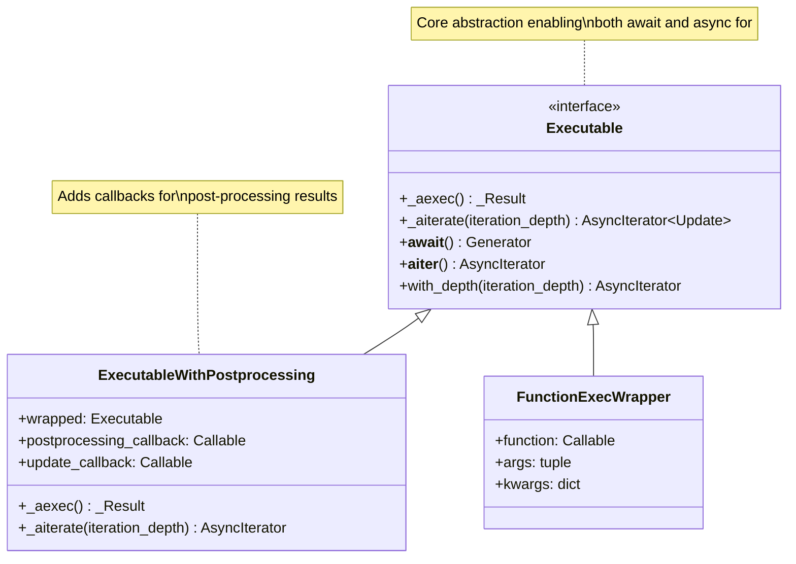

**Sources:** [onetwo/core/executing_impl.py:48-99](), [onetwo/core/executing_impl.py:102-148]()

The `Executable` interface provides two execution modes:
- **Awaitable**: Returns final result when awaited (`await executable`)
- **AsyncIterator**: Streams intermediate updates (`async for update in executable`)

### Built-in Functions

Built-in functions provide a uniform API for common language model operations, decoupled from specific implementations. They are defined as signatures and configured with concrete implementations at runtime.

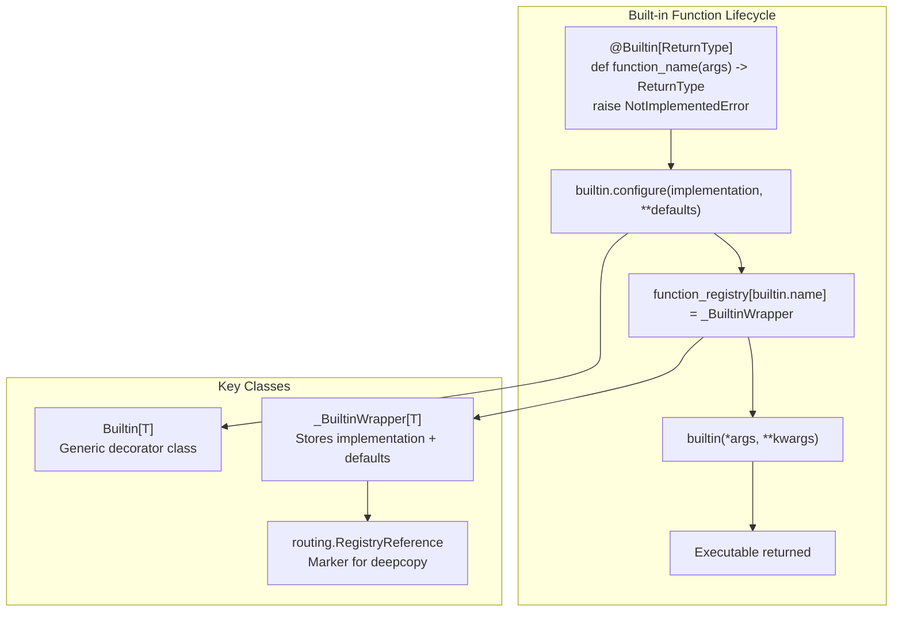

**Sources:** [onetwo/builtins/builtins_base.py:297-346](), [onetwo/builtins/builtins_base.py:95-107](), [docs/basics.md:28-42]()

Built-ins use the `@Builtin[T]` decorator pattern:

| Component | Purpose | Key Methods |
|-----------|---------|-------------|
| `Builtin[T]` | Decorator for function signatures | `configure()`, `update()`, `is_configured()` |
| `_BuiltinWrapper[T]` | Stores implementation and defaults | `__call__()`, `update()`, signature validation |
| Function Registry | Maps builtin names to wrappers | Global routing via `routing.function_registry` |

## Function Registry System

The function registry enables runtime binding of built-in function calls to specific implementations, allowing the same prompting strategy to work with different backends.

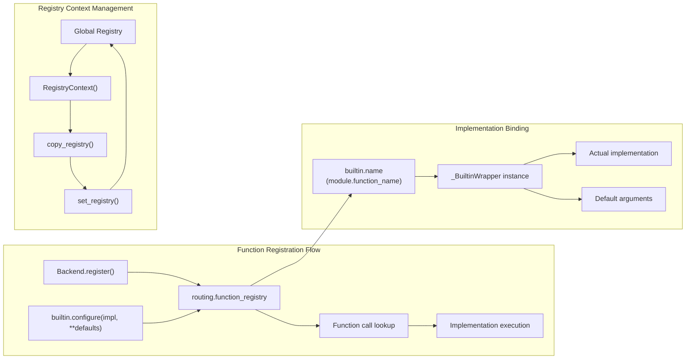

**Sources:** [onetwo/builtins/builtins_base.py:429-431](), [docs/basics.md:72-116](), [onetwo/core/routing.py]()

### Registry Operations

| Operation | Purpose | Example |
|-----------|---------|---------|
| `builtin.configure(impl, **kwargs)` | Bind implementation to builtin | `llm.generate_text.configure(vertex_impl)` |
| `ot.RegistryContext()` | Create temporary registry scope | Context manager for isolated configs |
| `ot.copy_registry()` | Snapshot current registry state | Save configuration for later use |
| `ot.set_registry(registry)` | Activate specific registry | Switch between backend configurations |

## Backend Integration

Backends provide concrete implementations of built-in functions and register themselves in the function registry. The system supports multiple backends simultaneously through registry management.

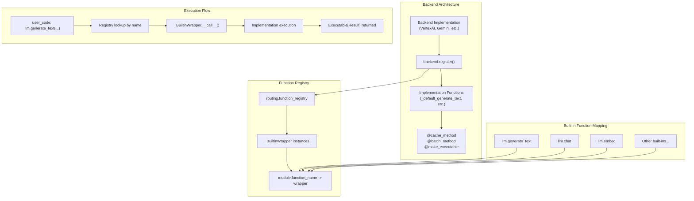

**Sources:** [onetwo/builtins/builtins_base.py:459-502](), [docs/basics.md:74-81](), [README.md:19-37]()

### Implementation Requirements

Backend implementations must satisfy specific constraints when configured with built-ins:

| Constraint | Description | Example |
|------------|-------------|---------|
| **Signature Compatibility** | All non-optional builtin parameters must exist in implementation | `base_fn(a: int)` requires `impl_fn(a: int, ...)` |
| **Type Annotations** | Parameter types must match between builtin and implementation | Supports generic TypeVar matching |
| **Extra Parameters** | Implementation-only parameters must have defaults or be provided in configure | `impl_fn(a: int, b: str = 'default')` |
| **Return Executables** | Implementations automatically wrapped with `@make_executable` if needed | Ensures consistent Executable return types |

## Execution Integration

The integration between built-ins, registry, and execution creates a flexible system where prompting strategies are decoupled from implementation details.

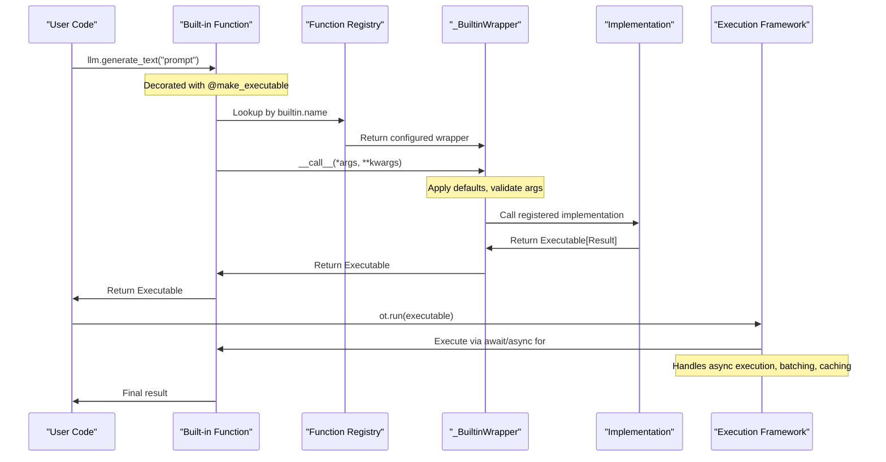

**Sources:** [onetwo/builtins/builtins_base.py:459-502](), [onetwo/core/executing_impl.py:48-99](), [docs/basics.md:44-71]()

### Key Integration Points

| Component | Role | Key Methods |
|-----------|------|-------------|
| **Built-in Functions** | Define uniform API signatures | `configure()`, `__call__()` |
| **Function Registry** | Route calls to implementations | `routing.function_registry` lookup |
| **Executables** | Provide async execution interface | `_aexec()`, `_aiterate()` |
| **Backends** | Supply concrete implementations | `register()`, implementation functions |

This architecture enables powerful features like swapping backends, caching results, batching requests, and composing complex multi-step prompting strategies while maintaining clean separation between strategy definition and execution details.

---

# Page: Core Architecture

# Core Architecture

<details>
<summary>Relevant source files</summary>

The following files were used as context for generating this wiki page:

- [onetwo/core/content.py](onetwo/core/content.py)
- [onetwo/core/content_test.py](onetwo/core/content_test.py)
- [onetwo/core/executing.py](onetwo/core/executing.py)
- [onetwo/core/executing_test.py](onetwo/core/executing_test.py)
- [onetwo/core/results.py](onetwo/core/results.py)
- [onetwo/core/results_test.py](onetwo/core/results_test.py)

</details>


This document provides an overview of OneTwo's foundational systems that enable asynchronous execution, multimodal content handling, and result tracking. These core components form the execution model that powers all higher-level features in OneTwo.

For information about LLM backends and built-in functions, see [LLM Integration](#3). For advanced prompting strategies and agents, see [Advanced Features](#4). For evaluation and testing systems, see [Evaluation and Testing](#5).

## Overview

OneTwo's core architecture consists of four primary systems that work together to provide a flexible execution framework:

1. **Content System** - Handles multimodal content representation
2. **Execution Framework** - Provides asynchronous execution capabilities  
3. **Results and Tracing** - Tracks execution outcomes and debugging information
4. **Performance Systems** - Optimizes execution through caching and batching

## Core Architecture Components

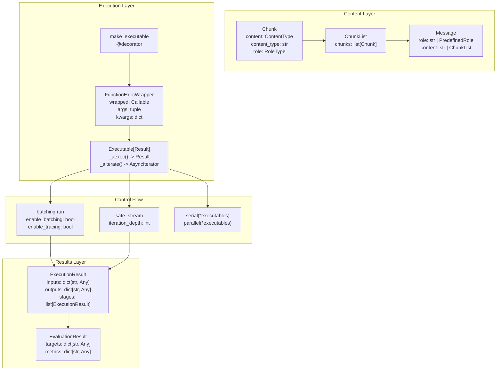

Sources: [onetwo/core/content.py:148-602](), [onetwo/core/executing.py:49-52](), [onetwo/core/executing.py:731-847](), [onetwo/core/results.py:76-151]()

## Content System Architecture

The content system provides a unified representation for multimodal data that can include text, images, and other media types.

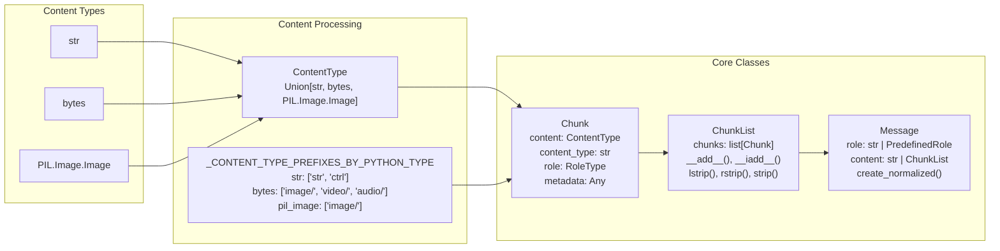

Sources: [onetwo/core/content.py:33-108](), [onetwo/core/content.py:148-318](), [onetwo/core/content.py:320-553](), [onetwo/core/content.py:555-602]()

Key features of the content system:

- **Type Safety**: Validates content types against expected formats
- **Multimodal Support**: Handles text, images, and binary data uniformly
- **Role Management**: Associates content with roles (USER, MODEL, SYSTEM)
- **String Operations**: Provides familiar string manipulation methods on multimodal content

For detailed information about content handling, see [Content System](#2.1).

## Execution Framework Architecture

The execution framework enables functions to be converted into asynchronous, composable executables that can be run individually or in complex patterns.

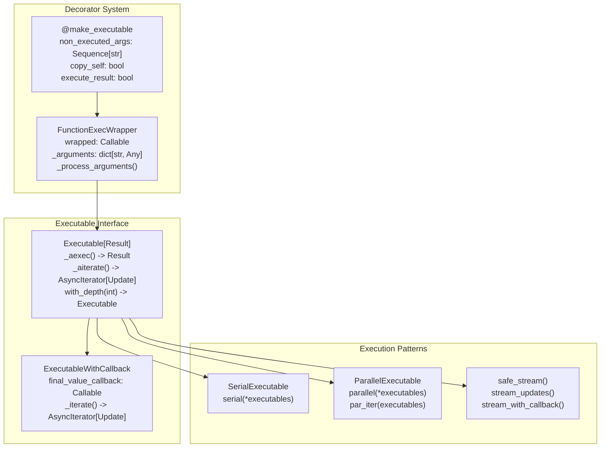

Sources: [onetwo/core/executing.py:511-669](), [onetwo/core/executing.py:731-847](), [onetwo/core/executing.py:675-729]()

Key execution capabilities:

- **Automatic Conversion**: Functions become asynchronous executables via `@make_executable`
- **Argument Processing**: Automatically executes `Executable` arguments before function calls
- **Composition Patterns**: Supports serial and parallel execution of multiple executables
- **Streaming Support**: Enables real-time processing of intermediate results

For detailed information about execution patterns, see [Execution Framework](#2.2).

## Results and Tracing System

The results system captures execution outcomes, debug information, and evaluation metrics in a hierarchical structure.

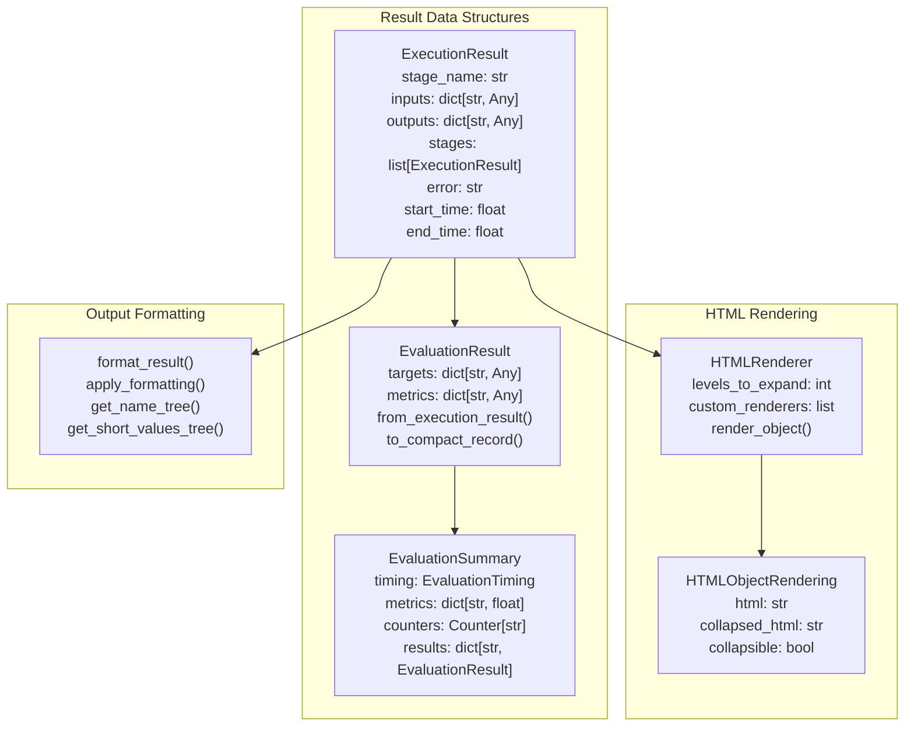

Sources: [onetwo/core/results.py:76-252](), [onetwo/core/results.py:362-446](), [onetwo/core/results.py:687-1057]()

Key result tracking features:

- **Hierarchical Structure**: Nested results capture multi-stage execution flows  
- **Debug Information**: Includes timing, inputs, outputs, and error details
- **Evaluation Metrics**: Extends basic results with targets and performance metrics
- **Rich Rendering**: HTML and text formatters for interactive exploration

For detailed information about results and tracing, see [Results and Tracing](#2.3).

## System Integration Flow

This diagram shows how the core components work together during a typical execution:

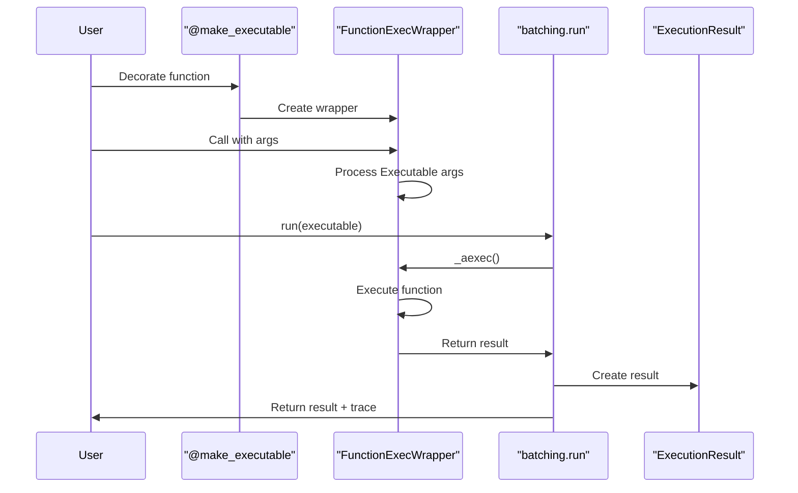

Sources: [onetwo/core/executing.py:511-669](), [onetwo/core/executing.py:866-942](), [onetwo/core/batching.py]()

## Performance and Scalability

OneTwo's core architecture includes several performance optimization systems:

| System | Purpose | Key Components |
|--------|---------|----------------|
| **Batching** | Group multiple requests for efficient processing | `@batch_method`, `BatchQueue` |
| **Caching** | Avoid redundant computations | `@cache_method`, `SimpleCache` |
| **Parallel Execution** | Execute independent tasks concurrently | `parallel()`, `par_iter()` |
| **Streaming** | Process results incrementally | `safe_stream()`, `stream_updates()` |

For detailed information about performance optimizations, see [Performance Systems](#2.4).

## Next Steps

The core architecture provides the foundation for all OneTwo functionality. To learn about specific subsystems:

- **Content handling details**: [Content System](#2.1)
- **Execution patterns**: [Execution Framework](#2.2)  
- **Result tracking**: [Results and Tracing](#2.3)
- **Performance optimization**: [Performance Systems](#2.4)
- **LLM integration**: [LLM Integration](#3)
- **Advanced strategies**: [Advanced Features](#4)

Sources: [onetwo/core/content.py](), [onetwo/core/executing.py](), [onetwo/core/results.py]()

---

# Page: Content System

# Content System

<details>
<summary>Relevant source files</summary>

The following files were used as context for generating this wiki page:

- [onetwo/core/content.py](onetwo/core/content.py)
- [onetwo/core/content_test.py](onetwo/core/content_test.py)

</details>


## Purpose and Scope

The Content System provides the foundational data structures for handling multimodal content in OneTwo prompts and conversations. It defines three core classes that work together to represent text, images, and other media types in a type-safe, composable manner: `Chunk` for individual content pieces, `ChunkList` for collections of chunks, and `Message` for chat conversations.

This system handles content type validation, role assignment for chat scenarios, and provides string manipulation methods for text processing. For information about how content flows through the execution framework, see [Execution Framework](#2.2). For details on how content is formatted for different LLM backends, see [Prompt Formatting](#3.3).

## Core Architecture

### Class Relationships

The Content System consists of three main classes that form a hierarchical structure for representing multimodal content:

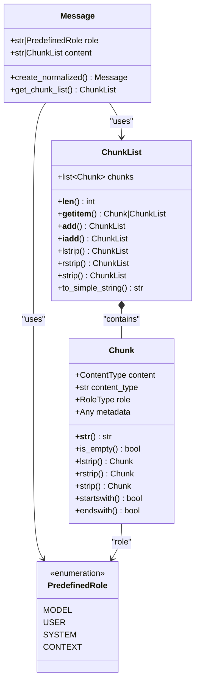

Sources: [onetwo/core/content.py:148-318](), [onetwo/core/content.py:320-553](), [onetwo/core/content.py:555-602](), [onetwo/core/content.py:130-143]()

### Content Type System

The Content System implements a robust type validation mechanism that maps Python types to content type prefixes:

```mermaid
flowchart TD
    Content["ContentType Input"] --> TypeCheck{"Python Type Check"}
    
    TypeCheck -->|str| StrType["Python Type: 'str'"]
    TypeCheck -->|bytes| BytesType["Python Type: 'bytes'"]
    TypeCheck -->|PIL.Image| PILType["Python Type: 'pil_image'"]
    TypeCheck -->|other| Error["ValueError"]
    
    StrType --> StrPrefixes["Allowed Prefixes:<br/>['str', 'ctrl']"]
    BytesType --> BytesPrefixes["Allowed Prefixes:<br/>['bytes', 'image/', 'video/',<br/>'audio/', 'application/', 'vision/']"]
    PILType --> PILPrefixes["Allowed Prefixes:<br/>['image/']"]
    
    StrPrefixes --> Validation["Content Type Validation"]
    BytesPrefixes --> Validation
    PILPrefixes --> Validation
    
    Validation -->|valid| ChunkCreation["Chunk Creation"]
    Validation -->|unknown prefix| Warning["Log Warning"]
    Validation -->|incompatible| TypeError["ValueError"]
    
    Warning --> ChunkCreation
```

Sources: [onetwo/core/content.py:45-74](), [onetwo/core/content.py:77-107](), [onetwo/core/content.py:170-203]()

## Core Classes

### Chunk Class

The `Chunk` class represents a single piece of multimodal content with associated metadata and type information.

#### Key Attributes

| Attribute | Type | Description |
|-----------|------|-------------|
| `content` | `ContentType` | The actual content (str, bytes, or PIL.Image.Image) |
| `content_type` | `str` | MIME-like type identifier (auto-inferred if not provided) |
| `role` | `RoleType` | Role assignment for chat messages (optional) |
| `metadata` | `Any` | Additional metadata for downstream processing |

#### Content Type Inference

When a `Chunk` is created without an explicit `content_type`, the system automatically infers the appropriate type:

- `str` content → `'str'` content type
- `bytes` content → `'bytes'` content type  
- `PIL.Image.Image` content → `'image/jpeg'` content type

#### String Operations

The `Chunk` class provides string manipulation methods that operate only on string content:

```python
# Example usage patterns (from test file)
chunk = Chunk('abccbbabbctest')
stripped = chunk.lstrip('abc')  # Returns Chunk('test')
```

Sources: [onetwo/core/content.py:148-318](), [onetwo/core/content_test.py:216-264]()

### ChunkList Class

The `ChunkList` class manages collections of `Chunk` objects, providing list-like operations and aggregate string manipulation.

#### Core Operations

The class supports standard container operations with automatic type conversion:

```mermaid
flowchart LR
    Input["Input Types"] --> Conversion["Auto-conversion"]
    
    Input --> StringInput["str"]
    Input --> ChunkInput["Chunk"]
    Input --> ChunkListInput["ChunkList"]
    Input --> ContentInput["ContentType"]
    
    Conversion --> ChunkCreation["Chunk Creation"]
    ChunkCreation --> Storage["Internal chunks list"]
    
    Storage --> Operations["List Operations"]
    Operations --> Indexing["__getitem__"]
    Operations --> Addition["__add__, __iadd__"]
    Operations --> Iteration["__iter__"]
```

#### String Processing

`ChunkList` implements sophisticated string processing that handles multimodal content:

- `lstrip()` - Removes leading empty chunks and strips the first non-empty chunk
- `rstrip()` - Removes trailing empty chunks and strips the last non-empty chunk, propagating if entire chunks are stripped
- `to_simple_string()` - Extracts only string and control token content, filtering out binary data

Sources: [onetwo/core/content.py:320-553](), [onetwo/core/content_test.py:173-198](), [onetwo/core/content_test.py:281-446]()

### Message Class

The `Message` class represents chat conversation messages with role-based content organization.

#### Content Normalization

The `Message.create_normalized()` method optimizes content representation:

```mermaid
flowchart TD
    Input["Input Content"] --> TypeCheck{"Content Type?"}
    
    TypeCheck -->|str| StringContent["Keep as string"]
    TypeCheck -->|ChunkList| ChunkListCheck{"Single string chunk<br/>with no metadata?"}
    TypeCheck -->|Sequence[Chunk]| SequenceCheck{"Single string chunk<br/>with no metadata?"}
    
    ChunkListCheck -->|Yes| Normalize["Normalize to string"]
    ChunkListCheck -->|No| KeepChunkList["Keep as ChunkList"]
    
    SequenceCheck -->|Yes| Normalize
    SequenceCheck -->|No| ConvertToChunkList["Convert to ChunkList"]
    
    StringContent --> Result["Message with normalized content"]
    Normalize --> Result
    KeepChunkList --> Result
    ConvertToChunkList --> Result
```

#### Role Management

Messages use the `PredefinedRole` enum for standardized role assignment:

| Role | Purpose |
|------|---------|
| `USER` | User input messages |
| `MODEL` | LLM-generated responses |
| `SYSTEM` | System prompts and instructions |
| `CONTEXT` | Contextual information |

Sources: [onetwo/core/content.py:555-602](), [onetwo/core/content.py:130-143](), [onetwo/core/content_test.py:480-547]()

## Content Type Validation System

### Type Mapping Tables

The Content System maintains bidirectional mappings between Python types and content type prefixes:

```mermaid
graph TB
    subgraph "Python Type to Content Prefixes"
        StrPy["'str'"] --> StrPrefixes["['str', 'ctrl']"]
        BytesPy["'bytes'"] --> BytesPrefixes["['bytes', 'image/', 'video/',<br/>'audio/', 'application/', 'vision/']"]
        PILPy["'pil_image'"] --> PILPrefixes["['image/']"]
    end
    
    subgraph "Content Prefix to Python Types"
        StrPrefix["'str'"] --> StrTypes["['str']"]
        CtrlPrefix["'ctrl'"] --> CtrlTypes["['str']"]
        ImagePrefix["'image/'"] --> ImageTypes["['pil_image', 'bytes']"]
        BytesPrefix["'bytes'"] --> BytesTypes["['bytes']"]
        VideoPrefix["'video/'"] --> VideoTypes["['bytes']"]
        AudioPrefix["'audio/'"] --> AudioTypes["['bytes']"]
        AppPrefix["'application/'"] --> AppTypes["['bytes']"]
        VisionPrefix["'vision/'"] --> VisionTypes["['bytes']"]
    end
```

### Validation Flow

The validation process ensures type safety and provides helpful error messages:

1. **Content Analysis** - Determine Python type from content using `_get_python_and_content_type_from_content()`
2. **Type Inference** - Set default content type if not provided
3. **Prefix Extraction** - Extract content type prefix using `_get_content_type_prefix()`
4. **Compatibility Check** - Verify Python type is compatible with content type prefix
5. **Error Handling** - Log warnings for unknown types, raise errors for incompatible combinations

Sources: [onetwo/core/content.py:45-74](), [onetwo/core/content.py:77-128](), [onetwo/core/content_test.py:36-172]()

## Usage Patterns

### Basic Content Creation

```python
# String content with automatic type inference
text_chunk = Chunk("Hello world")  # content_type='str'

# Binary content with explicit type
image_chunk = Chunk(image_bytes, content_type='image/jpeg')

# Control tokens for special model instructions
control_chunk = Chunk("<special_token>", content_type='ctrl')
```

### Multimodal Prompt Assembly

```python
# Building a multimodal prompt
prompt = ChunkList([
    "Please analyze this image: ",
    Chunk(image_data, content_type='image/png'),
    "\nWhat do you see?"
])
```

### Chat Message Construction

```python
# Simple string message
user_msg = Message.create_normalized(PredefinedRole.USER, "Hello")

# Multimodal message with normalization
content = ChunkList([text, image_chunk])
user_msg = Message.create_normalized(PredefinedRole.USER, content)
```

Sources: [onetwo/core/content_test.py:55-74](), [onetwo/core/content_test.py:173-198](), [onetwo/core/content_test.py:482-528]()

---

# Page: Execution Framework

# Execution Framework

<details>
<summary>Relevant source files</summary>

The following files were used as context for generating this wiki page:

- [onetwo/builtins/builtins_base.py](onetwo/builtins/builtins_base.py)
- [onetwo/builtins/builtins_base_test.py](onetwo/builtins/builtins_base_test.py)
- [onetwo/core/executing.py](onetwo/core/executing.py)
- [onetwo/core/executing_impl.py](onetwo/core/executing_impl.py)
- [onetwo/core/executing_impl_test.py](onetwo/core/executing_impl_test.py)
- [onetwo/core/executing_test.py](onetwo/core/executing_test.py)

</details>


The Execution Framework provides OneTwo's core infrastructure for asynchronous, composable execution of functions and methods. It enables functions to be executed individually, in serial chains, or in parallel batches while supporting both streaming and batch execution modes. This framework serves as the foundation for all LLM interactions, agent operations, and evaluation pipelines in OneTwo.

For information about the data structures used to represent execution results, see [Results and Tracing](#2.3). For performance optimizations like caching and batching, see [Performance Systems](#2.4).

## The Executable Interface

The `Executable` interface is the central abstraction that unifies both awaitable operations and async iterators. Every executable can be used with `await` to get a final result or with `async for` to stream intermediate updates.

```mermaid
graph TB
    subgraph "Executable Interface"
        Executable["Executable[Result]<br/>- _aexec() -> Result<br/>- _aiterate() -> AsyncIterator[Update[Result]]<br/>- __await__()<br/>- __aiter__()"]
    end
    
    subgraph "Core Implementations"
        FunctionExecWrapper["FunctionExecWrapper<br/>Wraps functions/methods"]
        ExecutableWithCallback["ExecutableWithCallback<br/>Streaming with final callback"]
        ExecutableWithPostprocessing["ExecutableWithPostprocessing<br/>Result transformation"]
        SerialExecutable["SerialExecutable<br/>Sequential execution"]
        ParallelExecutable["ParallelExecutable<br/>Concurrent execution"]
    end
    
    subgraph "Built-in Integration"
        BuiltinWrapper["_BuiltinWrapper<br/>Built-in function implementations"]
    end
    
    Executable --> FunctionExecWrapper
    Executable --> ExecutableWithCallback
    Executable --> ExecutableWithPostprocessing
    Executable --> SerialExecutable
    Executable --> ParallelExecutable
    
    FunctionExecWrapper --> BuiltinWrapper
```

Sources: [onetwo/core/executing_impl.py:48-99](), [onetwo/core/executing.py:58-114](), [onetwo/core/executing.py:731-768]()

The `Executable` interface supports dual execution modes:
- **Awaitable mode**: Use `await executable` to get the final result
- **Iterator mode**: Use `async for update in executable` to stream intermediate results

## The make_executable Decorator

The `make_executable` decorator transforms ordinary functions and methods into `Executable` objects, enabling them to participate in OneTwo's execution framework.

```mermaid
flowchart TD
    UserFunction["User Function<br/>def my_func(arg1, arg2): ..."]
    
    Decorator["@make_executable<br/>Transform function"]
    
    FunctionWrapper["FunctionExecWrapper<br/>- wrapped: Callable<br/>- args: tuple<br/>- kwargs: dict<br/>- non_executed_args: list[str]<br/>- execute_result: bool"]
    
    subgraph "Argument Processing"
        ProcessArgs["_process_arguments()<br/>Execute Executable arguments"]
        CallFunction["_call_or_await()<br/>Call wrapped function"]
        HandleResult["Handle result<br/>(execute if Executable)"]
    end
    
    subgraph "Execution Modes"
        AwaitMode["await mode<br/>_aexec()"]
        IterateMode["async for mode<br/>_aiterate()"]
    end
    
    UserFunction --> Decorator
    Decorator --> FunctionWrapper
    FunctionWrapper --> ProcessArgs
    ProcessArgs --> CallFunction
    CallFunction --> HandleResult
    HandleResult --> AwaitMode
    HandleResult --> IterateMode
```

Sources: [onetwo/core/executing.py:510-669](), [onetwo/core/executing.py:731-968]()

### Key Features of make_executable

| Feature | Description | Configuration |
|---------|-------------|---------------|
| **Automatic Argument Execution** | Executes `Executable` arguments before calling the function | `non_executed_args` parameter |
| **Result Execution** | Executes returned `Executable` objects | `execute_result` parameter |
| **Copy Control** | Controls deep-copying behavior | `copy_self`, `non_copied_args` |
| **Iteration Chaining** | Streams updates from specific arguments | `iterate_argument` parameter |

Example usage:
```python
@make_executable
def process_text(text: str, model_call: Executable[str]) -> str:
    # model_call will be automatically executed
    result = await model_call  # This happens automatically
    return f"Processed: {result}"

@make_executable('raw_input')  # Don't execute raw_input
def chain_processing(raw_input: Executable[str], processor: str) -> str:
    # raw_input won't be auto-executed, allowing manual control
    pass
```

## Execution Patterns

OneTwo supports several execution patterns for composing multiple operations:

```mermaid
graph LR
    subgraph "Serial Execution"
        S1["serial(exec1, exec2, exec3)"]
        S2["exec1 → exec2 → exec3"]
        S1 --> S2
    end
    
    subgraph "Parallel Execution" 
        P1["parallel(exec1, exec2, exec3)"]
        P2["exec1<br/>exec2<br/>exec3"]
        P1 --> P2
    end
    
    subgraph "Parallel Iterator"
        PI1["par_iter(iterable_of_execs)"]
        PI2["Chunked parallel execution"]
        PI1 --> PI2
    end
    
    subgraph "Mixed Patterns"
        M1["parallel(<br/>  serial(a, b),<br/>  serial(c, d)<br/>)"]
        M2["Branch 1: a → b<br/>Branch 2: c → d"]
        M1 --> M2
    end
```

Sources: [onetwo/core/executing.py:675-728]()

### Serial Execution
```python
# Execute one after another
result = await serial(
    llm.generate_text("First prompt"),
    llm.generate_text("Second prompt"),
    llm.generate_text("Third prompt")
)
# Returns: [result1, result2, result3]
```

### Parallel Execution
```python
# Execute concurrently
result = await parallel(
    llm.generate_text("Prompt A"),
    llm.generate_text("Prompt B"), 
    llm.generate_text("Prompt C")
)
# Returns: [resultA, resultB, resultC]
```

## Execution Functions

The framework provides multiple ways to execute `Executable` objects:

```mermaid
flowchart TD
    Executable["Executable[Result]"]
    
    subgraph "Execution Functions"
        Run["run(executable)<br/>→ Result"]
        Stream["stream(executable)<br/>→ Iterator[Update[Result]]"]
        SafeStream["safe_stream(executable)<br/>→ ContextManager[Iterator]"]
        StreamCallback["stream_with_callback(executable, callback)<br/>→ Result"]
        StreamUpdates["stream_updates(executable)<br/>→ IteratorWithReturnValue"]
    end
    
    subgraph "Configuration Options"
        EnableBatching["enable_batching: bool"]
        EnableTracing["enable_tracing: bool"] 
        IterationDepth["iteration_depth: int"]
        Tracer["tracer: Tracer"]
    end
    
    Executable --> Run
    Executable --> Stream
    Executable --> SafeStream
    Executable --> StreamCallback
    Executable --> StreamUpdates
    
    EnableBatching --> Run
    EnableTracing --> Run
    IterationDepth --> Stream
    Tracer --> SafeStream
```

Sources: [onetwo/core/executing.py:47](), [onetwo/core/executing.py:165-278](), [onetwo/core/executing.py:341-404](), [onetwo/core/executing.py:443-504]()

### Execution Function Details

| Function | Use Case | Returns | Thread Safety |
|----------|----------|---------|---------------|
| `run()` | Simple execution to completion | Final result | ✓ |
| `stream()` | Streaming with manual iteration | Iterator of updates | ⚠️ Deprecated |
| `safe_stream()` | Streaming with proper cleanup | Context manager | ✓ |
| `stream_with_callback()` | Streaming with callback per update | Final result | ✓ |
| `stream_updates()` | Streaming with return value access | Special iterator | ✓ |

### Iteration Depth Control

The `iteration_depth` parameter controls how deeply nested executables are streamed:

- `iteration_depth=0`: Execute sub-executables in one step
- `iteration_depth=1`: Stream one level of sub-executables  
- `iteration_depth=-1`: Stream all levels (unlimited depth)

## Argument Processing and Execution Flow

The execution framework automatically handles complex argument dependencies:

```mermaid
sequenceDiagram
    participant User
    participant FunctionWrapper as "FunctionExecWrapper"
    participant ArgProcessor as "Argument Processor"
    participant Function as "Wrapped Function"
    participant Result as "Result Handler"
    
    User->>FunctionWrapper: Call decorated function
    FunctionWrapper->>ArgProcessor: _process_arguments()
    
    loop For each Executable argument
        ArgProcessor->>ArgProcessor: Execute argument
        Note over ArgProcessor: Parallel execution if multiple args
    end
    
    ArgProcessor->>Function: Call with executed arguments
    Function->>Result: Return value
    
    alt Result is Executable and execute_result=True
        Result->>Result: Execute returned Executable
    end
    
    Result->>User: Final result
```

Sources: [onetwo/core/executing.py:866-941](), [onetwo/core/executing.py:943-965]()

### Deep Copy Behavior

The framework supports sophisticated copying behavior for safe parallel execution:

- **Default**: Deep copy all arguments and `self` for methods
- **`copy_self=False`**: Preserve method instance references
- **`non_copied_args`**: Specify arguments to reference (not copy)

This enables safe parallel execution while avoiding unnecessary copying of large or shared objects.

## Integration with Built-in Functions

The execution framework integrates seamlessly with OneTwo's built-in function system:

```mermaid
graph TB
    subgraph "Built-in Function Flow"
        BuiltinCall["@Builtin[str]<br/>def llm_function(...)"]
        BuiltinWrapper["_BuiltinWrapper<br/>- implementation: Callable<br/>- defaults: dict"]
        Registry["function_registry<br/>Name → Implementation mapping"]
        Execution["FunctionExecWrapper<br/>Actual execution"]
    end
    
    BuiltinCall --> BuiltinWrapper
    BuiltinWrapper --> Registry
    Registry --> Execution
    
    note1["Built-ins automatically<br/>become Executables"]
    note2["Registry enables runtime<br/>configuration switching"]
    
    BuiltinWrapper -.-> note1
    Registry -.-> note2
```

Sources: [onetwo/builtins/builtins_base.py:95-294](), [onetwo/builtins/builtins_base.py:459-502]()

The `@make_executable` decorator is automatically applied to built-in implementations, ensuring they return `Executable` objects that can be composed with other operations.

## Error Handling and Resource Management

The framework provides robust error handling and resource cleanup:

- **Context Managers**: `safe_stream()` ensures proper thread cleanup on exceptions
- **Exception Propagation**: Errors in parallel execution can be collected or halt processing
- **Resource Cleanup**: Automatic cleanup of background threads and async tasks

Example of safe streaming:
```python
with safe_stream(complex_executable) as iterator:
    for update in iterator:
        # Process update
        if some_condition:
            break  # Threads properly cleaned up
```

The execution framework forms the foundation for all high-level OneTwo operations, providing a consistent, composable interface for asynchronous execution while handling the complexities of argument processing, parallel execution, and resource management.

Sources: [onetwo/core/executing.py:116-163](), [onetwo/core/executing.py:280-304]()

---

# Page: Results and Tracing

# Results and Tracing

<details>
<summary>Relevant source files</summary>

The following files were used as context for generating this wiki page:

- [onetwo/core/results.py](onetwo/core/results.py)
- [onetwo/core/results_test.py](onetwo/core/results_test.py)
- [onetwo/core/tracing.py](onetwo/core/tracing.py)
- [onetwo/core/tracing_test.py](onetwo/core/tracing_test.py)

</details>


This page documents OneTwo's result storage and execution tracing systems. These systems capture the complete execution tree of prompting strategies, including inputs, outputs, timing information, and hierarchical stage decomposition. For information about evaluation metrics and strategy comparison, see [Strategy Evaluation](#5.1). For agent-specific result handling, see [Agent Evaluation](#5.2).

## Core Result Data Structures

OneTwo provides three primary data structures for storing execution results, each serving different purposes in the prompting workflow.

### ExecutionResult

The `ExecutionResult` class serves as the foundational data structure for capturing prompt execution details. It represents a single execution stage with complete input/output tracking and hierarchical nesting capabilities.

```mermaid
classDiagram
    class ExecutionResult {
        +stage_name: str
        +inputs: dict[str, Any]
        +outputs: dict[str, Any]
        +stages: list[ExecutionResult]
        +error: str
        +info: dict[str, Any]
        +start_time: float
        +end_time: float
        +get_leaf_results() list[ExecutionResult]
        +format(color: bool) str
        +update_start_time() None
        +update_end_time() None
        +get_elapsed_time() float
    }
    
    class EvaluationResult {
        +targets: dict[str, Any]
        +metrics: dict[str, Any]
        +to_compact_record() EvaluationResult
        +from_execution_result(execution_result) EvaluationResult
    }
    
    class EvaluationSummary {
        +timing: EvaluationTiming
        +metrics: dict[str, float]
        +counters: Counter[str]
        +example_keys: dict[int, str|int]
        +results: dict[str|int, EvaluationResult]
        +results_debug: dict[str|int, EvaluationResult]
        +final_states: dict[str|int, Any]
        +__iadd__(other) EvaluationSummary
    }
    
    ExecutionResult <|-- EvaluationResult
    EvaluationSummary --> EvaluationResult : contains
```

**Sources:** [onetwo/core/results.py:77-251]()

### EvaluationResult and EvaluationSummary

`EvaluationResult` extends `ExecutionResult` with evaluation-specific fields including target values and computed metrics. `EvaluationSummary` aggregates results across multiple examples in an evaluation run.

| Field | Purpose | Example |
|-------|---------|---------|
| `targets` | Expected/golden outputs | `{"answer": "Paris"}` |
| `metrics` | Computed evaluation metrics | `{"accuracy": 0.85}` |
| `counters` | Example counts per metric | `{"accuracy_count": 100}` |
| `results` | Compact evaluation results | Results without detailed traces |
| `results_debug` | Full evaluation results | Results with complete execution traces |

**Sources:** [onetwo/core/results.py:363-446](), [onetwo/core/results.py:466-601]()

## Tracing System

OneTwo's tracing system captures execution hierarchies through decorators and context variables, enabling detailed debugging and analysis of prompting strategies.

### Tracer Architecture

```mermaid
graph TD
    subgraph "Tracer Interface"
        Tracer["`**Tracer**<br/>Abstract Base Class`"]
        Tracer --> add_stage["add_stage(): Tracer"]
        Tracer --> set_inputs["set_inputs(name, inputs)"]
        Tracer --> update_outputs["update_outputs(name, outputs)"]
    end
    
    subgraph "Tracer Implementations"
        ExecutionResultTracer["`**ExecutionResultTracer**<br/>Creates ExecutionResult tree`"]
        StringTracer["`**StringTracer**<br/>Prints to IO stream`"]
        QueueTracer["`**QueueTracer**<br/>Sends updates to callback`"]
        OutputTracer["`**OutputTracer**<br/>Streams return values`"]
    end
    
    subgraph "Context Variables"
        execution_context["`**execution_context**<br/>Current ExecutionResult`"]
        execution_tracer["`**execution_tracer**<br/>Current Tracer instance`"]
    end
    
    Tracer <|.. ExecutionResultTracer
    Tracer <|.. StringTracer
    Tracer <|.. QueueTracer
    QueueTracer <|-- OutputTracer
    
    ExecutionResultTracer --> execution_context
    StringTracer --> execution_tracer
    QueueTracer --> execution_tracer
```

**Sources:** [onetwo/core/tracing.py:49-131](), [onetwo/core/tracing.py:46-62]()

### Trace Decorator

The `@trace` decorator automatically captures function execution in the result hierarchy. It supports synchronous functions, coroutines, and async iterators.

```python
@trace
def my_function(x, y):
    return x + y

@trace(name="custom_stage", skip=["sensitive_param"])
async def my_async_function(data, sensitive_param):
    return process(data)
```

The decorator handles:
- **Input capture**: Function arguments stored in `ExecutionResult.inputs`
- **Output capture**: Return values stored in `ExecutionResult.outputs`
- **Timing**: Automatic `start_time` and `end_time` recording
- **Hierarchy**: Nested function calls create child stages
- **Context management**: Thread-safe execution context handling

**Sources:** [onetwo/core/tracing.py:335-607]()

### Execution Flow

```mermaid
sequenceDiagram
    participant User as "User Code"
    participant TraceDecorator as "@trace Decorator"
    participant Context as "execution_context"
    participant Tracer as "execution_tracer"
    participant Result as "ExecutionResult"
    
    User->>TraceDecorator: Call decorated function
    TraceDecorator->>Context: Get current ExecutionResult
    TraceDecorator->>Result: Create new stage
    TraceDecorator->>Tracer: set_inputs(name, inputs)
    TraceDecorator->>Context: Set execution context
    
    TraceDecorator->>User: Execute original function
    User-->>TraceDecorator: Return value
    
    TraceDecorator->>Result: Update outputs
    TraceDecorator->>Tracer: update_outputs(name, outputs)
    TraceDecorator->>Context: Reset context
    TraceDecorator-->>User: Return value
```

**Sources:** [onetwo/core/tracing.py:378-607]()

## HTML Rendering

The `HTMLRenderer` class provides rich visualization of execution results with collapsible hierarchies and custom object rendering.

### Rendering Pipeline

```mermaid
graph LR
    subgraph "Rendering Components"
        HTMLRenderer["`**HTMLRenderer**<br/>Main rendering engine`"]
        CustomRenderers["`**custom_renderers**<br/>Type-specific handlers`"]
        DefaultRenderers["`**_get_default_renderers()**<br/>Built-in handlers`"]
    end
    
    subgraph "Object-Specific Renderers"
        render_result["`**_render_result()**<br/>ExecutionResult rendering`"]
        render_evaluation_summary["`**_render_evaluation_summary()**<br/>EvaluationSummary rendering`"]
        render_list["`**_render_list()**<br/>List/tuple rendering`"]
        render_dict["`**_render_dict_like_object()**<br/>Dict/object rendering`"]
    end
    
    subgraph "Output Format"
        HTMLObjectRendering["`**HTMLObjectRendering**<br/>html, collapsed_html, title`"]
        CollapsibleElements["`**Collapsible UI**<br/>JavaScript toggle functionality`"]
    end
    
    HTMLRenderer --> CustomRenderers
    HTMLRenderer --> DefaultRenderers
    DefaultRenderers --> render_result
    DefaultRenderers --> render_evaluation_summary
    DefaultRenderers --> render_list
    DefaultRenderers --> render_dict
    
    render_result --> HTMLObjectRendering
    render_evaluation_summary --> HTMLObjectRendering
    HTMLObjectRendering --> CollapsibleElements
```

**Sources:** [onetwo/core/results.py:687-1261]()

### Rendering Features

| Feature | Description | Configuration |
|---------|-------------|---------------|
| **Hierarchical Expansion** | Collapsible result trees | `levels_to_expand` parameter |
| **Custom Renderers** | Type-specific rendering logic | `custom_renderers` list |
| **LLM Request/Reply** | Special formatting for prompts | Automatic for `generate_text` stages |
| **Compact Representations** | Collapsed view for large objects | `_max_collapsed_rendering_length` |

**Sources:** [onetwo/core/results.py:700-727]()

## Streaming and Updates

OneTwo supports streaming execution updates for real-time monitoring of long-running prompting strategies.

### Streaming Architecture

```mermaid
graph TD
    subgraph "Streaming Functions"
        stream["`**stream(coroutine)**<br/>General-purpose streaming`"]
        stream_updates["`**stream_updates(coroutine)**<br/>Output-focused streaming`"]
        report_update["`**report_update(update)**<br/>Manual update reporting`"]
    end
    
    subgraph "Iterator Types"
        IteratorWithReturnValue["`**IteratorWithReturnValue**<br/>Combines iteration with final value`"]
        Generator["`**Generator**<br/>Yields intermediate updates`"]
    end
    
    subgraph "Queue-Based Tracers"
        QueueTracer_stream["`**QueueTracer**<br/>Callback-based updates`"]
        OutputTracer_stream["`**OutputTracer**<br/>Return value updates`"]
    end
    
    stream --> QueueTracer_stream
    stream_updates --> OutputTracer_stream
    stream --> IteratorWithReturnValue
    stream_updates --> IteratorWithReturnValue
    IteratorWithReturnValue --> Generator
    
    report_update --> QueueTracer_stream
```

**Sources:** [onetwo/core/tracing.py:161-247](), [onetwo/core/tracing.py:137-159]()

### Usage Patterns

**Streaming Execution Updates:**
```python
async def my_strategy():
    await report_update("Starting phase 1")
    result1 = await phase1()
    await report_update("Starting phase 2") 
    result2 = await phase2()
    return combine(result1, result2)

iterator = stream_updates(my_strategy())
for update in iterator:
    print(f"Progress: {update}")
final_result = iterator.value
```

**Streaming with Custom Tracers:**
```python
def callback(update):
    print(f"Received: {update}")

iterator = stream(my_coroutine(), tracer=QueueTracer, iteration_depth=2)
for update in iterator:
    process_update(update)
```

**Sources:** [onetwo/core/tracing.py:222-247](), [onetwo/core/tracing.py:250-257]()

## Integration with Execution Framework

Results and tracing integrate seamlessly with OneTwo's execution framework through the `run()` function and executable decorators.

### Execution Integration

```mermaid
graph TB
    subgraph "Entry Points"
        tracing_run["`**tracing.run()**<br/>Execute with tracing`"]
        executing_run["`**executing.run()**<br/>Execute with enable_tracing`"]
    end
    
    subgraph "Execution Context"
        CoroutineExecution["`**Coroutine Execution**<br/>Async function handling`"]
        ExecutableWrapping["`**Executable Wrapping**<br/>@make_executable integration`"]
        ContextManagement["`**Context Management**<br/>Thread-safe execution`"]
    end
    
    subgraph "Result Collection"
        ExecutionResult_final["`**ExecutionResult**<br/>Complete execution tree`"]
        TimingInfo["`**Timing Information**<br/>start_time, end_time`"]
        ErrorHandling["`**Error Capture**<br/>Exception details`"]
    end
    
    tracing_run --> CoroutineExecution
    executing_run --> ExecutableWrapping
    CoroutineExecution --> ContextManagement
    ExecutableWrapping --> ContextManagement
    
    ContextManagement --> ExecutionResult_final
    ContextManagement --> TimingInfo
    ContextManagement --> ErrorHandling
```

**Sources:** [onetwo/core/tracing.py:271-302](), [onetwo/core/tracing.py:475-503]()

### Key Integration Points

| Integration | Purpose | Implementation |
|-------------|---------|----------------|
| **@make_executable** | Executable tracing | `_wrap_executable_to_trace_outputs()` |
| **Context Variables** | Thread-safe state | `execution_context`, `execution_tracer` |
| **Timing Integration** | Performance tracking | `update_start_time()`, `update_end_time()` |
| **Error Handling** | Exception capture | `ExecutionResult.error` field |

The integration ensures that whether using `tracing.run()` directly or `executing.run()` with `enable_tracing=True`, the same comprehensive tracing capabilities are available across all OneTwo prompting strategies.

**Sources:** [onetwo/core/tracing.py:287-302](), [onetwo/core/results.py:238-250]()

---

# Page: Performance Systems

# Performance Systems

<details>
<summary>Relevant source files</summary>

The following files were used as context for generating this wiki page:

- [onetwo/core/batching.py](onetwo/core/batching.py)
- [onetwo/core/batching_test.py](onetwo/core/batching_test.py)
- [onetwo/core/caching.py](onetwo/core/caching.py)
- [onetwo/core/caching_test.py](onetwo/core/caching_test.py)

</details>


This document covers OneTwo's performance optimization systems, including caching and batching mechanisms that reduce redundant computations and improve throughput for LLM operations. These systems integrate with the execution framework (see [Execution Framework](#2.2)) to provide transparent performance improvements.

For evaluation and testing performance, see [Testing Infrastructure](#5.3). For tracing and debugging performance, see [Results and Tracing](#2.3).

## Caching System

The caching system provides automatic memoization for expensive operations, particularly LLM calls. It supports both deterministic and stochastic (sampled) functions with persistent file-based storage.

### Core Architecture

```mermaid
graph TB
    subgraph "Cache Interfaces"
        SimpleCache["SimpleCache[T]<br/>Abstract Interface"]
        SimpleFileCache["SimpleFileCache[T]<br/>File-based Interface"]
        SimpleFunctionCache["SimpleFunctionCache[T]<br/>Concrete Implementation"]
    end
    
    subgraph "Cache-Enabled Classes"
        CacheEnabled["CacheEnabled[T]<br/>Base Class"]
        FileCacheEnabled["FileCacheEnabled[T]<br/>File Cache Base"]
        UserClass["User Classes<br/>inherit from CacheEnabled"]
    end
    
    subgraph "Key Generation"
        CacheKeyMaker["CacheKeyMaker<br/>Generates Cache Keys"]
        SamplingKey["context_sampling_key<br/>ContextVar for Stochastic Functions"]
    end
    
    subgraph "Decorator System"
        CacheMethod["@cache_method<br/>Method Decorator"]
        SamplingKeyUpdater["SamplingKeyUpdater<br/>Manages Sampling Context"]
    end
    
    SimpleCache --> SimpleFunctionCache
    SimpleFileCache --> SimpleFunctionCache
    CacheEnabled --> UserClass
    FileCacheEnabled --> UserClass
    UserClass --> SimpleFunctionCache
    CacheKeyMaker --> CacheMethod
    SamplingKey --> CacheMethod
    CacheMethod --> UserClass
    SamplingKeyUpdater --> SamplingKey
```

Sources: [onetwo/core/caching.py:148-201](), [onetwo/core/caching.py:252-289](), [onetwo/core/caching.py:373-452]()

### Cache Key Generation

Cache keys are generated from function arguments and metadata using `CacheKeyMaker`:

| Component | Purpose | Configuration |
|-----------|---------|---------------|
| `hashed` | Arguments too large for keys (e.g., arrays) | Sequence of parameter names |
| `dropped` | Arguments to exclude from caching | Sequence of parameter names |
| `_name` | Function identifier in cache | Set by `@cache_method` decorator |

The key generation process creates JSON-serialized representations of function calls:

```mermaid
flowchart LR
    Args["Function Arguments"] --> Expand["utils.get_expanded_arguments()"]
    Expand --> Filter["Apply dropped/hashed filters"]
    Filter --> JSON["JSON serialization with function name"]
    JSON --> Hash["SHA hash for storage key"]
    
    SamplingContext["context_sampling_key"] --> Lookup["Cache Lookup"]
    Hash --> Lookup
    Lookup --> Hit["Cache Hit/Miss"]
```

Sources: [onetwo/core/caching.py:342-371](), [onetwo/core/caching.py:425-451]()

### Stochastic Function Support

The caching system handles stochastic functions (those that may return different results for the same inputs) using sampling keys:

```mermaid
graph TB
    subgraph "Sampling Context"
        ContextVar["context_sampling_key<br/>ContextVar"]
        SamplingKeyUpdater["SamplingKeyUpdater<br/>Updates context during execution"]
    end
    
    subgraph "Cache Storage"
        ValuesByKey["values_by_key<br/>key -> List[CachedValue]"]
        SampleMapping["sample_id_by_sampling_key_by_key<br/>Maps sampling_key to index"]
        UsedValues["num_used_values_by_key<br/>Tracks assignment count"]
    end
    
    ContextVar --> CacheMethod
    SamplingKeyUpdater --> ContextVar
    CacheMethod --> ValuesByKey
    CacheMethod --> SampleMapping
    SampleMapping --> UsedValues
```

Sources: [onetwo/core/caching.py:57-59](), [onetwo/core/caching.py:782-829](), [onetwo/core/caching.py:869-874]()

### Usage Patterns

Classes inherit from `CacheEnabled` and implement `_cache_handler`:

```python
@dataclasses.dataclass
class MyLLMBackend(caching.CacheEnabled[str]):
    def __post_init__(self):
        self._cache_handler = caching.SimpleFunctionCache(
            cache_filename='my_cache.json'
        )
    
    @caching.cache_method(is_sampled=True)
    async def generate_text(self, prompt: str) -> str:
        # Expensive LLM call
        return await self._actual_llm_call(prompt)
```

Sources: [onetwo/core/caching_test.py:91-107](), [onetwo/core/caching.py:541-596]()

## Batching System

The batching system automatically groups multiple function calls into batches for more efficient processing, particularly useful for LLM APIs that support batch operations.

### Batching Architecture

```mermaid
graph TB
    subgraph "Decorators"
        BatchFunction["@batch_function<br/>Function Decorator"]
        BatchMethod["@batch_method<br/>Method Decorator"] 
        AddBatching["@add_batching<br/>Class Decorator"]
        BatchableFunction["@batchable_function<br/>Single-call Interface"]
    end
    
    subgraph "Queue Management"
        BatchQueue["BatchQueue[RequestT, ReplyT]<br/>Manages request batching"]
        ThreadData["_thread_data<br/>Thread-local storage"]
        PriorityQueue["queue.PriorityQueue<br/>Request ordering"]
    end
    
    subgraph "Execution Control"
        RunningContext["running_context()<br/>Async context manager"]
        RunFunction["run()<br/>Main execution entry"]
        StreamFunction["stream()<br/>Streaming execution"]
    end
    
    AddBatching --> BatchMethod
    BatchMethod --> BatchQueue
    BatchFunction --> BatchQueue
    BatchQueue --> ThreadData
    ThreadData --> PriorityQueue
    RunningContext --> BatchQueue
    RunFunction --> RunningContext
    StreamFunction --> RunningContext
    BatchableFunction --> BatchFunction
```

Sources: [onetwo/core/batching.py:246-277](), [onetwo/core/batching.py:557-595](), [onetwo/core/batching.py:929-967]()

### Batch Processing Flow

```mermaid
sequenceDiagram
    participant Client
    participant BatchQueue
    participant Watcher
    participant BatchFunction
    
    Client->>BatchQueue: await function(args)
    BatchQueue->>BatchQueue: Add to priority queue
    
    loop Queue Monitoring
        Watcher->>BatchQueue: Check queue
        Watcher->>Watcher: Apply batching_function rules
        alt Batch Ready
            Watcher->>BatchFunction: Call with batch
            BatchFunction->>Watcher: Return results
            Watcher->>BatchQueue: Store results in containers
        end
    end
    
    BatchQueue->>Client: Return individual result
```

Sources: [onetwo/core/batching.py:325-387](), [onetwo/core/batching.py:451-527]()

### Batching Strategies

| Strategy | Configuration | Use Case |
|----------|---------------|----------|
| Size-based | `batch_size=N` | Simple batching by count |
| Function-based | `batching_function=func` | Custom compatibility rules |
| Threadpool | `@batch_function_with_threadpool` | CPU-intensive operations |

The `batching_function` signature is `(batch, new_request) -> (can_add, is_full)`:

```python
def custom_batching(batch: Sequence[dict], req: dict) -> tuple[bool, bool]:
    # Only batch requests with same model
    can_add = not batch or batch[0]['model'] == req['model']
    is_full = len(batch) >= 5  # Max batch size
    return can_add, is_full
```

Sources: [onetwo/core/batching.py:226-244](), [onetwo/core/batching_test.py:47-57]()

### ThreadPool Integration

For CPU-intensive operations, OneTwo provides threadpool decorators:

```mermaid
graph LR
    subgraph "Single Decorators"
        ThreadpoolMethod["@to_thread_pool_method<br/>Individual async execution"]
    end
    
    subgraph "Batch + Threadpool"
        BatchWithThreadpool["@batch_function_with_threadpool<br/>Combined decorator"]
        RunInThreadpool["run_function_in_threadpool<br/>Executes batch in parallel"]
    end
    
    subgraph "Execution"
        ThreadPoolExecutor["concurrent.futures.ThreadPoolExecutor<br/>Thread management"]
        MultiprocessingPool["multiprocessing.pool.ThreadPool<br/>For batch operations"]
    end
    
    ThreadpoolMethod --> ThreadPoolExecutor
    BatchWithThreadpool --> RunInThreadpool
    RunInThreadpool --> MultiprocessingPool
```

Sources: [onetwo/core/batching.py:1545-1610](), [onetwo/core/batching.py:1383-1456](), [onetwo/core/batching.py:1240-1297]()

## Integration with Execution Framework

Performance systems integrate seamlessly with OneTwo's execution framework:

```mermaid
graph TB
    subgraph "Execution Layer"
        MakeExecutable["@make_executable<br/>Execution Decorator"]
        ExecutableResult["Executable Results"]
        ParallelExecution["parallel() / serial()<br/>Composition"]
    end
    
    subgraph "Performance Layer"
        CacheLayer["@cache_method<br/>Caching"]
        BatchLayer["@batch_method<br/>Batching"] 
    end
    
    subgraph "Implementation Layer"
        LLMBackend["LLM Backend Methods"]
        CacheHandler["Cache Storage"]
        BatchQueue["Batch Processing"]
    end
    
    MakeExecutable --> CacheLayer
    MakeExecutable --> BatchLayer
    CacheLayer --> LLMBackend
    BatchLayer --> LLMBackend
    CacheLayer --> CacheHandler
    BatchLayer --> BatchQueue
    ParallelExecution --> CacheLayer
    ParallelExecution --> BatchLayer
    ExecutableResult --> CacheHandler
```

Sources: [onetwo/core/caching.py:177-187](), [onetwo/core/caching.py:694-717](), [onetwo/core/batching.py:1084-1101]()

### Decorator Stacking

Performance decorators can be combined in specific orders:

```python
@executing.make_executable
@caching.cache_method(is_sampled=True)
@batching.batch_method_with_threadpool(batch_size=10)
def expensive_llm_call(self, prompt: str) -> str:
    # Implementation processes batches in threadpool
    # Results are cached for future calls
    # Executable interface for composition
```

The execution order is: Executable → Cache → Batch → Implementation.

Sources: [onetwo/core/caching_test.py:446-454](), [onetwo/core/batching_test.py:960-974]()

## Performance Monitoring

Both systems provide built-in monitoring capabilities:

### Cache Metrics

The `_CacheData` class tracks cache performance:

| Metric | Description |
|--------|-------------|
| `get_hit` | Successful cache lookups |
| `get_miss` | Cache misses requiring computation |
| `add_new` | New cache entries |
| `add_redundant` | Duplicate cache attempts |

Sources: [onetwo/core/caching.py:831-874](), [onetwo/core/caching_test.py:480-612]()

### Batch Metrics

Batching queues provide debug information when `debug=True`:

```python
# Access batch call history
batch_queue = instance.batching_queues['method_name']
calls_made = batch_queue.calls  # List of batched requests
```

Sources: [onetwo/core/batching.py:412-413](), [onetwo/core/batching_test.py:241-244]()

### Memory and Storage

- **Cache files**: JSON format with tuple preservation via custom encoders
- **Thread safety**: `threading.Lock` protects cache operations
- **Memory management**: LRU eviction not implemented (manual cleanup required)

Sources: [onetwo/core/caching.py:79-115](), [onetwo/core/caching.py:1172-1175](), [onetwo/core/caching.py:1285-1319]()

---

# Page: Utilities and Helpers

# Utilities and Helpers

<details>
<summary>Relevant source files</summary>

The following files were used as context for generating this wiki page:

- [onetwo/core/iterating.py](onetwo/core/iterating.py)
- [onetwo/core/iterating_test.py](onetwo/core/iterating_test.py)
- [onetwo/core/utils.py](onetwo/core/utils.py)
- [onetwo/core/utils_test.py](onetwo/core/utils_test.py)

</details>


This document covers the utility functions, decorators, and helper classes that provide foundational support across the OneTwo library. These utilities handle cross-cutting concerns like asynchronous execution, rate limiting, retry logic, argument processing, and type conversions that are used throughout the core systems.

For information about performance-specific utilities like caching and batching, see [Performance Systems](#2.4). For execution framework utilities, see [Execution Framework](#2.2).

## Overview

The OneTwo utilities are organized into two main modules that provide essential infrastructure for the library's operation:

```mermaid
graph TB
    subgraph "Utility Modules"
        Utils["onetwo.core.utils<br/>General Utilities"]
        Iterating["onetwo.core.iterating<br/>Async/Iterator Utilities"]
    end
    
    subgraph "Core Systems"
        Executing["Execution Framework"]
        Caching["Caching System"] 
        Batching["Batching System"]
        Backend["Backend Integration"]
    end
    
    subgraph "Utility Categories"
        Decorators["Decorator Utilities<br/>@decorator_with_optional_args<br/>@is_method"]
        RateLimit["Rate Limiting<br/>@rate_limit_function<br/>@rate_limit_method"]
        Retry["Retry Logic<br/>@with_retry"]
        AsyncUtils["Async Utilities<br/>asyncio_run_wrapper<br/>to_thread"]
        Args["Argument Handling<br/>get_expanded_arguments<br/>RuntimeParameter"]
        Hash["Hashing<br/>get_str_hash<br/>get_bytes_for_hashing"]
        Exception["Exception Handling<br/>returning_raised_exception<br/>raising_returned_exception"]
        Iterator["Iterator Conversion<br/>async_iterator_to_sync<br/>merge, merge_iter"]
    end
    
    Utils --> Decorators
    Utils --> RateLimit
    Utils --> Retry
    Utils --> Args
    Utils --> Hash
    Utils --> Exception
    
    Iterating --> AsyncUtils
    Iterating --> Iterator
    
    Decorators --> Executing
    RateLimit --> Backend
    Retry --> Backend
    AsyncUtils --> Executing
    Args --> Batching
    Hash --> Caching
    Iterator --> Executing
```

Sources: [onetwo/core/utils.py:1-778](), [onetwo/core/iterating.py:1-744]()

## Decorator Utilities

The `utils` module provides sophisticated decorator infrastructure that supports optional arguments and method detection across the OneTwo codebase.

### Core Decorator Infrastructure

| Function | Purpose | Usage Pattern |
|----------|---------|---------------|
| `decorator_with_optional_args` | Meta-decorator enabling `@dec`, `@dec()`, `@dec(args)` syntax | Applied to decorator definitions |
| `is_method` | Detects if a callable is a method by checking for `self` parameter | Used within decorators for method-specific logic |
| `FromInstance` | Allows decorator parameters to be read from object attributes at runtime | Parameter specification in decorators |
| `RuntimeParameter` | Wrapper for parameters that may be static values or instance-derived | Parameter resolution in decorated methods |

```mermaid
graph TD
    subgraph "Decorator Pattern"
        MetaDec["@decorator_with_optional_args"]
        UserDec["User Decorator<br/>(e.g., @with_retry)"]
        Target["Target Function/Method"]
        Wrapper["Decorated Function"]
    end
    
    subgraph "Method Detection"
        IsMethod["is_method()"]
        SelfCheck["Check first parameter == 'self'"]
        MethodLogic["Method-specific wrapper"]
        FunctionLogic["Function-specific wrapper"]
    end
    
    subgraph "Runtime Parameters"
        FromInst["FromInstance"]
        RuntimeParam["RuntimeParameter"]
        AttrValue["Attribute/Function value"]
        StaticValue["Static value"]
    end
    
    MetaDec --> UserDec
    UserDec --> Target
    Target --> Wrapper
    
    UserDec --> IsMethod
    IsMethod --> SelfCheck
    SelfCheck -->|"True"| MethodLogic
    SelfCheck -->|"False"| FunctionLogic
    
    UserDec --> RuntimeParam
    RuntimeParam --> FromInst
    RuntimeParam --> StaticValue
    FromInst --> AttrValue
```

Sources: [onetwo/core/utils.py:90-133](), [onetwo/core/utils.py:61-88](), [onetwo/core/utils.py:229-274]()

### Usage Example

The decorator infrastructure supports flexible parameter specification:

```python
# Static parameter
@with_retry(max_retries=3)
def my_function():
    pass

# Instance-derived parameter  
class MyClass:
    max_retries = 5
    
    @with_retry(max_retries=FromInstance(name='max_retries'))
    def my_method(self):
        pass
```

Sources: [onetwo/core/utils.py:447-552](), [onetwo/core/utils_test.py:355-425]()

## Asynchronous and Threading Utilities

The `iterating` module provides comprehensive utilities for managing asynchronous execution, threading, and iterator conversions.

### Async Execution Management

| Function | Purpose | Key Features |
|----------|---------|--------------|
| `asyncio_run_wrapper` | Runs coroutines in new thread if event loop already running | Jupyter/Colab compatibility |
| `to_thread` | Decorator converting blocking functions to async | Optional timeout support |
| `to_thread_iterator` | Decorator converting blocking iterators to async | Thread-safe iterator execution |

```mermaid
graph LR
    subgraph "Execution Contexts"
        NoLoop["No Event Loop<br/>asyncio.run()"]
        HasLoop["Running Event Loop<br/>New Thread + Loop"]
    end
    
    subgraph "Conversion Utilities"
        ToThread["@to_thread<br/>function → coroutine"]
        ToThreadIter["@to_thread_iterator<br/>iterator → async iterator"]
        AsyncToSync["async_iterator_to_sync<br/>AsyncIterator → Iterator"]
        SyncToAsync["sync_iterator_to_async<br/>Iterator → AsyncIterator"]
    end
    
    subgraph "Threading Infrastructure"
        ThreadLoop["_ThreadWithAsyncioLoop"]
        QueueSystem["Queue-based Communication"]
        ContextVars["Context Variable Propagation"]
    end
    
    asyncio_run_wrapper --> NoLoop
    asyncio_run_wrapper --> HasLoop
    HasLoop --> ThreadLoop
    
    ToThread --> ThreadLoop
    ToThreadIter --> AsyncToSync
    AsyncToSync --> QueueSystem
    SyncToAsync --> QueueSystem
    QueueSystem --> ContextVars
```

Sources: [onetwo/core/iterating.py:67-103](), [onetwo/core/iterating.py:683-744](), [onetwo/core/iterating.py:634-681]()

### Iterator Merging and Conversion

The module provides sophisticated iterator manipulation capabilities:

| Function | Purpose | Use Case |
|----------|---------|----------|
| `merge` | Merge multiple async iterators in parallel | Parallel execution of similar operations |
| `merge_iter` | Merge iterables of async iterators in chunks | Large-scale parallel processing |
| `async_iterator_to_sync` | Convert async iterator to sync using threading | Integration with sync code |
| `sync_iterator_to_async` | Convert sync iterator to async using threading | Non-blocking iteration |

```mermaid
graph TB
    subgraph "Iterator Sources"
        AI1["AsyncIterator 1"]
        AI2["AsyncIterator 2"] 
        AI3["AsyncIterator N"]
        SI["Sync Iterator"]
    end
    
    subgraph "Conversion Operations"
        Merge["merge(*iterators)<br/>→ AsyncIterator[(result, index)]"]
        MergeIter["merge_iter(iterable)<br/>→ Chunked Processing"]
        A2S["async_iterator_to_sync<br/>→ Queue + Thread"]
        S2A["sync_iterator_to_async<br/>→ Queue + Thread"]
    end
    
    subgraph "Thread Management"
        Queue["queue.Queue<br/>Bounded Buffer"]
        Shutdown["threading.Event<br/>Graceful Shutdown"]
        JobDone["Sentinel Object<br/>End Marker"]
    end
    
    AI1 --> Merge
    AI2 --> Merge
    AI3 --> Merge
    
    AI1 --> A2S
    SI --> S2A
    
    Merge --> Queue
    A2S --> Queue
    S2A --> Queue
    Queue --> Shutdown
    Queue --> JobDone
```

Sources: [onetwo/core/iterating.py:140-209](), [onetwo/core/iterating.py:109-138](), [onetwo/core/iterating.py:501-562]()

## Rate Limiting and Retry Logic

The utilities provide robust rate limiting and retry mechanisms with support for both functions and methods.

### Rate Limiting

| Decorator | Scope | Thread Safety | Parameter Source |
|-----------|-------|---------------|------------------|
| `@rate_limit_function` | Function-level | Global across all calls | Static QPS value |
| `@rate_limit_method` | Method-level | Per-instance | Static or `FromInstance` |

```mermaid
graph TD
    subgraph "Rate Limiting Architecture"
        GlobalLock["threading.Lock<br/>Global Rate Limiter"]
        InstanceLock["threading.Lock<br/>Per-Instance Rate Limiter"]
        Interval["1.0 / qps<br/>Minimum Interval"]
        LastCall["time.perf_counter()<br/>Last Call Timestamp"]
    end
    
    subgraph "Function Rate Limiting"
        FuncDec["@rate_limit_function(qps)"]
        FuncWrapper["Wrapper Function"]
        FuncSleep["time.sleep() or asyncio.sleep()"]
    end
    
    subgraph "Method Rate Limiting"
        MethodDec["@rate_limit_method(qps)"]
        InstanceAttrs["Dynamic Instance Attributes<br/>_lock_{method_name}<br/>_interval_{method_name}<br/>_last_call_{method_name}"]
        MethodWrapper["Instance-aware Wrapper"]
    end
    
    FuncDec --> FuncWrapper
    FuncWrapper --> GlobalLock
    FuncWrapper --> Interval
    FuncWrapper --> LastCall
    FuncWrapper --> FuncSleep
    
    MethodDec --> MethodWrapper
    MethodWrapper --> InstanceAttrs
    InstanceAttrs --> InstanceLock
    InstanceAttrs --> Interval
    InstanceAttrs --> LastCall
```

Sources: [onetwo/core/utils.py:276-337](), [onetwo/core/utils.py:339-445]()

### Retry Logic

The `@with_retry` decorator provides exponential backoff with jitter:

| Parameter | Purpose | Default | Behavior |
|-----------|---------|---------|----------|
| `max_retries` | Maximum retry attempts | 0 | Can be static or `FromInstance` |
| `initial_base_delay` | Starting delay in seconds | 1 | Minimum wait time |
| `max_base_delay` | Maximum delay in seconds | 32 | Delay cap |
| `retriable_error_filter` | Error classification function | `lambda e: True` | Determines retry eligibility |

The retry algorithm implements exponential backoff with randomization:
- Base delay doubles after every 2 consecutive failures at the same delay level
- Actual delay = `base_delay * (1 + random.random())`
- Exception traceback information is preserved in error notes

Sources: [onetwo/core/utils.py:447-552](), [onetwo/core/utils_test.py:355-495]()

## Argument and Parameter Handling

The utilities provide sophisticated argument manipulation for decorators and function introspection.

### Argument Expansion

| Function | Purpose | Returns |
|----------|---------|---------|
| `get_expanded_arguments` | Convert `(*args, **kwargs)` to flat parameter dict | `OrderedDict[str, Any]` |
| `get_calling_args_and_kwargs` | Convert parameter dict back to `(args, kwargs)` | `tuple[tuple, dict]` |

```mermaid
graph LR
    subgraph "Function Signature"
        Sig["inspect.signature(f)"]
        Params["Parameters<br/>POSITIONAL_ONLY<br/>POSITIONAL_OR_KEYWORD<br/>VAR_POSITIONAL<br/>VAR_KEYWORD<br/>KEYWORD_ONLY"]
        Defaults["Default Values"]
    end
    
    subgraph "Argument Processing"
        CallArgs["(*args, **kwargs)"]
        Expand["get_expanded_arguments()"]
        FlatDict["OrderedDict[str, Any]<br/>Flattened Parameters"]
        Reconstruct["get_calling_args_and_kwargs()"]
        CallForm["(args, kwargs)"]
    end
    
    subgraph "Special Handling"
        VarPos["*args → 'args': tuple"]
        VarKw["**kwargs → individual entries"]
        BindPartial["signature.bind_partial()"]
    end
    
    Sig --> Params
    Params --> Defaults
    
    CallArgs --> Expand
    Expand --> BindPartial
    BindPartial --> VarPos
    BindPartial --> VarKw
    VarPos --> FlatDict
    VarKw --> FlatDict
    FlatDict --> Reconstruct
    Reconstruct --> CallForm
```

Sources: [onetwo/core/utils.py:135-182](), [onetwo/core/utils.py:184-227]()

## Hashing and Serialization Utilities

The hashing system provides consistent, deterministic hashing for complex objects including OneTwo content types.

### Hash Function Architecture

| Function | Purpose | Supported Types |
|----------|---------|-----------------|
| `get_bytes_for_hashing` | Convert objects to bytes representation | Built-ins, PIL Images, OneTwo content |
| `get_str_hash` | Generate SHA-224 hex hash | Any hashable object |

```mermaid
graph TD
    subgraph "Supported Types"
        Primitives["int, float, bool, str, bytes"]
        Collections["list, tuple, dict, set"]
        Images["PIL.Image.Image"]
        OneTwo["Chunk, ChunkList, Message"]
        Arrays["numpy.ndarray (via .tobytes())"]
    end
    
    subgraph "Hash Pipeline"
        Input["Any Object"]
        Recurse["_recurse()<br/>Recursive Decomposition"]
        Normalize["Deterministic Ordering<br/>Sort dict keys<br/>Sort set values"]
        Bytes["bytes representation"]
        Hash["hashlib.sha224()"]
        Hex["hex digest"]
    end
    
    subgraph "Special Handling"
        PILConv["PIL Image → JPEG bytes"]
        ChunkConv["Chunk → content"]
        ChunkListConv["ChunkList → [chunk, ...]"]
        MessageConv["Message → formatted string"]
    end
    
    Primitives --> Recurse
    Collections --> Recurse
    Images --> PILConv
    OneTwo --> ChunkConv
    OneTwo --> ChunkListConv
    OneTwo --> MessageConv
    Arrays --> Recurse
    
    Input --> Recurse
    Recurse --> Normalize
    Normalize --> Bytes
    Bytes --> Hash
    Hash --> Hex
```

Sources: [onetwo/core/utils.py:676-778](), [onetwo/core/utils_test.py:497-756]()

## Exception Handling Utilities

The utilities provide decorators for converting between exception raising and returning patterns.

### Exception Conversion Pattern

| Decorator | Conversion | Use Case |
|-----------|------------|----------|
| `@returning_raised_exception` | `raise Exception` → `return Exception` | Error collection without interruption |
| `@raising_returned_exception` | `return Exception` → `raise Exception` | Restore normal exception semantics |

```mermaid
graph LR
    subgraph "Normal Exception Flow"
        NormalFunc["function()"]
        NormalRaise["raise Exception"]
        NormalCatch["try/except"]
    end
    
    subgraph "Exception as Return Value"
        ReturnDec["@returning_raised_exception"]
        ReturnFunc["decorated_function()"]
        ReturnExc["return Exception"]
        ReturnCheck["isinstance(result, Exception)"]
    end
    
    subgraph "Restore Exception Raising"
        RaiseDec["@raising_returned_exception"]
        RaiseFunc["decorated_function()"]
        RaiseCheck["isinstance(result, Exception)"]
        RaiseExc["raise result"]
    end
    
    NormalFunc --> NormalRaise
    NormalRaise --> NormalCatch
    
    ReturnDec --> ReturnFunc
    ReturnFunc --> ReturnExc
    ReturnExc --> ReturnCheck
    
    RaiseDec --> RaiseFunc
    RaiseFunc --> RaiseCheck
    RaiseCheck -->|"True"| RaiseExc
    RaiseCheck -->|"False"| Return["return result"]
```

These decorators support both sync and async functions as well as methods, with appropriate wrapper selection based on function inspection.

Sources: [onetwo/core/utils.py:554-674](), [onetwo/core/utils_test.py:810-893]()

## Integration with Core Systems

The utilities integrate seamlessly with OneTwo's core architecture:

```mermaid
graph TB
    subgraph "Utility Integration Points"
        ExecUtil["executing_impl functions<br/>Exposed via utils module"]
        CacheHash["get_str_hash<br/>Used by caching system"]
        BatchArgs["Argument expansion<br/>Used by batching system"]
        BackendRetry["@with_retry<br/>Applied to backend calls"]
        BackendRate["@rate_limit_method<br/>Applied to API clients"]
    end
    
    subgraph "Core Systems"
        Exec["Execution Framework"]
        Cache["Caching System"]
        Batch["Batching System"] 
        Backend["Backend APIs"]
    end
    
    ExecUtil --> Exec
    CacheHash --> Cache
    BatchArgs --> Batch
    BackendRetry --> Backend
    BackendRate --> Backend
```

The utilities are designed to be composable and work together. For example, a backend method might use multiple decorators:

```python
class BackendAPI:
    @with_retry(max_retries=FromInstance(name='max_retries'))
    @rate_limit_method(FromInstance(name='qps_limit'))
    async def api_call(self, request):
        # Implementation
```

Sources: [onetwo/core/utils.py:48-58](), [onetwo/core/executing_impl.py]()

---

# Page: LLM Integration

# LLM Integration

<details>
<summary>Relevant source files</summary>

The following files were used as context for generating this wiki page:

- [onetwo/backends/backends_test_utils.py](onetwo/backends/backends_test_utils.py)
- [onetwo/backends/formatters.py](onetwo/backends/formatters.py)
- [onetwo/backends/gemini_api.py](onetwo/backends/gemini_api.py)
- [onetwo/backends/gemini_api_test.py](onetwo/backends/gemini_api_test.py)
- [onetwo/backends/vertexai_api.py](onetwo/backends/vertexai_api.py)
- [onetwo/backends/vertexai_api_manual_tests.py](onetwo/backends/vertexai_api_manual_tests.py)
- [onetwo/backends/vertexai_api_test.py](onetwo/backends/vertexai_api_test.py)
- [onetwo/builtins/formatting.py](onetwo/builtins/formatting.py)
- [onetwo/builtins/formatting_test.py](onetwo/builtins/formatting_test.py)
- [pyproject.toml](pyproject.toml)

</details>


This document provides a comprehensive overview of how OneTwo integrates with Large Language Models (LLMs). It covers the backend system architecture, built-in function configuration, and the flow from user code to LLM API calls.

For specific details about the `llm.*` built-in functions, see [Built-in Functions](#3.1). For backend-specific configuration and implementation details, see [Backend Systems](#3.2). For information about prompt formatting and conversation handling, see [Prompt Formatting](#3.3).

## Architecture Overview

OneTwo's LLM integration follows a layered architecture that separates user-facing APIs from backend implementations through a configuration and registration system.

### LLM Integration Architecture

```mermaid
graph TB
    subgraph "User Layer"
        UserCode["User Code"]
    end
    
    subgraph "Built-in Layer"
        GenerateText["llm.generate_text"]
        GenerateTexts["llm.generate_texts"]
        Chat["llm.chat"]
        Embed["llm.embed"]
        CountTokens["llm.count_tokens"]
    end
    
    subgraph "Backend Layer"
        VertexAI["VertexAIAPI"]
        Gemini["GeminiAPI"]
        TestBackend["LLMForTest"]
    end
    
    subgraph "External APIs"
        VertexAPI["Google Cloud Vertex AI"]
        GeminiAPI["Google Gemini API"]
    end
    
    UserCode --> GenerateText
    UserCode --> GenerateTexts
    UserCode --> Chat
    UserCode --> Embed
    UserCode --> CountTokens
    
    GenerateText --> VertexAI
    GenerateText --> Gemini
    GenerateText --> TestBackend
    
    GenerateTexts --> VertexAI
    Chat --> VertexAI
    Chat --> Gemini
    Embed --> VertexAI
    Embed --> Gemini
    CountTokens --> VertexAI
    CountTokens --> Gemini
    
    VertexAI --> VertexAPI
    Gemini --> GeminiAPI
```

Sources: [onetwo/backends/vertexai_api.py:191-216](), [onetwo/backends/gemini_api.py:200-228](), [onetwo/backends/backends_test_utils.py:302-312]()

## Backend Registration System

### Backend Registration Flow

```mermaid
graph LR
    subgraph "Backend Instance"
        BackendInit["Backend.__init__()"]
        PostInit["Backend.__post_init__()"]
        Register["Backend.register()"]
    end
    
    subgraph "Built-in Configuration"
        LLMReset["llm.reset_defaults()"]
        ConfigureGenerate["llm.generate_text.configure()"]
        ConfigureChat["llm.chat.configure()"]
        ConfigureEmbed["llm.embed.configure()"]
        ConfigureCount["llm.count_tokens.configure()"]
    end
    
    BackendInit --> PostInit
    PostInit --> Register
    Register --> LLMReset
    LLMReset --> ConfigureGenerate
    ConfigureGenerate --> ConfigureChat
    ConfigureChat --> ConfigureEmbed
    ConfigureEmbed --> ConfigureCount
```

Sources: [onetwo/backends/vertexai_api.py:191-216](), [onetwo/backends/gemini_api.py:200-228]()

## Core Components

### Backend Classes

| Backend | Class | Purpose |
|---------|-------|---------|
| Vertex AI | `VertexAIAPI` | Google Cloud Vertex AI integration |
| Gemini | `GeminiAPI` | Google Gemini API integration |
| Test | `LLMForTest` | Mock backend for testing |

### Built-in Functions

| Function | Purpose | Configured By |
|----------|---------|---------------|
| `llm.generate_text` | Single text generation | `backend.generate_text` |
| `llm.generate_texts` | Multiple sample generation | `backend.generate_texts` |
| `llm.chat` | Conversational interface | `backend.chat` or `backend.chat_via_api` |
| `llm.embed` | Text embedding | `backend.embed` |
| `llm.count_tokens` | Token counting | `backend.count_tokens` |

Sources: [onetwo/backends/vertexai_api.py:197-216](), [onetwo/backends/gemini_api.py:206-228]()

## Request Processing Flow

### LLM Request Processing Pipeline

```mermaid
graph TB
    subgraph "User Request"
        UserCall["User calls llm.generate_text()"]
    end
    
    subgraph "Processing Layers"
        Executable["@executing.make_executable"]
        Tracing["@tracing.trace"]
        Caching["@caching.cache_method"]
        Batching["@batching.batch_method_with_threadpool"]
        RateLimit["@utils.rate_limit_method"]
    end
    
    subgraph "Backend Processing"
        BackendMethod["backend.generate_text()"]
        APICall["External API Call"]
        ResponseProcess["Response Processing"]
    end
    
    subgraph "Content Handling"
        ChunkConvert["_convert_chunk_list_to_parts_list()"]
        Formatting["Prompt Formatting"]
        Healing["Token Healing"]
    end
    
    UserCall --> Executable
    Executable --> Tracing
    Tracing --> Caching
    Caching --> Batching
    Batching --> RateLimit
    RateLimit --> BackendMethod
    
    BackendMethod --> ChunkConvert
    ChunkConvert --> Formatting
    Formatting --> Healing
    Healing --> APICall
    APICall --> ResponseProcess
```

Sources: [onetwo/backends/vertexai_api.py:292-342](), [onetwo/backends/gemini_api.py:370-418]()

## Backend Implementation Details

### VertexAI Backend Features

The `VertexAIAPI` class provides:

- **Models**: Configurable model names for generation, chat, and embedding
- **Caching**: File-based caching with `SimpleFunctionCache`
- **Batching**: Configurable batch sizes for parallel requests
- **Rate Limiting**: QPS-based rate limiting
- **Safety Settings**: Configurable safety filters
- **Multimodal Support**: Image and video content through `ChunkList`

### Gemini Backend Features

The `GeminiAPI` class provides:

- **Models**: Support for Gemini 2.0 Flash and embedding models
- **Retry Logic**: Configurable retry mechanisms
- **API Key Management**: File-based or direct API key configuration
- **Content Types**: Support for images, videos, and text
- **Truncation**: Post-generation token truncation

Sources: [onetwo/backends/vertexai_api.py:114-189](), [onetwo/backends/gemini_api.py:119-199]()

## Content and Formatting Integration

### Content Processing Flow

```mermaid
graph LR
    subgraph "Input Types"
        StrInput["str"]
        ChunkListInput["ChunkList"]
        MessageInput["Message[]"]
    end
    
    subgraph "Formatting Layer"
        FormatterCheck["Formatter.is_already_formatted()"]
        FormatterApply["Formatter._format()"]
        RoleFilter["Role Filtering"]
    end
    
    subgraph "Backend Conversion"
        VertexConvert["_convert_chunk_list_to_parts_list()"]
        GeminiConvert["_convert_chunk_list_to_contents_type()"]
    end
    
    subgraph "API Format"
        VertexParts["generative_models.Part[]"]
        GeminiContents["content_types.ContentsType"]
    end
    
    StrInput --> FormatterCheck
    ChunkListInput --> FormatterCheck
    MessageInput --> FormatterCheck
    
    FormatterCheck --> FormatterApply
    FormatterApply --> RoleFilter
    
    RoleFilter --> VertexConvert
    RoleFilter --> GeminiConvert
    
    VertexConvert --> VertexParts
    GeminiConvert --> GeminiContents
```

Sources: [onetwo/backends/vertexai_api.py:73-95](), [onetwo/backends/gemini_api.py:75-102](), [onetwo/builtins/formatting.py:130-171]()

## Configuration and Defaults

### Backend Configuration Pattern

Each backend follows a consistent configuration pattern:

1. **Initialization**: Set default parameters and credentials
2. **Post-initialization**: Initialize API clients and models
3. **Registration**: Configure built-in functions with backend methods
4. **Method Decoration**: Apply caching, batching, and rate limiting

### Default Models

| Backend | Generate Model | Chat Model | Embed Model |
|---------|----------------|------------|-------------|
| VertexAI | `gemini-1.0-pro` | `gemini-1.0-pro` | `textembedding-gecko@003` |
| Gemini | `gemini-2.0-flash` | `gemini-2.0-flash` | `embedding-001` |

Sources: [onetwo/backends/vertexai_api.py:46-52](), [onetwo/backends/gemini_api.py:50-55]()

## Error Handling and Safety

### Common Error Patterns

- **Safety Filtering**: Both backends handle safety filter responses
- **Token Limits**: Validation and truncation for token limits
- **API Errors**: Wrapped exceptions with context
- **Empty Responses**: Detection and error reporting for empty results

### Safety Configuration

```python
# Disable safety settings
SAFETY_DISABLED = {
    HarmCategory.HARM_CATEGORY_HARASSMENT: HarmBlockThreshold.BLOCK_NONE,
    HarmCategory.HARM_CATEGORY_HATE_SPEECH: HarmBlockThreshold.BLOCK_NONE,
    # ...
}
```

Sources: [onetwo/backends/vertexai_api.py:57-70](), [onetwo/backends/gemini_api.py:59-72](), [onetwo/backends/vertexai_api.py:284-289](), [onetwo/backends/gemini_api.py:358-367]()

---

# Page: Built-in Functions

# Built-in Functions

<details>
<summary>Relevant source files</summary>

The following files were used as context for generating this wiki page:

- [colabs/tutorial.ipynb](colabs/tutorial.ipynb)
- [onetwo/builtins/builtins_base.py](onetwo/builtins/builtins_base.py)
- [onetwo/builtins/builtins_base_test.py](onetwo/builtins/builtins_base_test.py)
- [onetwo/core/executing_impl.py](onetwo/core/executing_impl.py)
- [onetwo/core/executing_impl_test.py](onetwo/core/executing_impl_test.py)

</details>


This document covers OneTwo's built-in functions, which provide standardized interfaces for common LLM operations. Built-in functions serve as configurable entry points that abstract away backend-specific implementation details while enabling features like caching, batching, and asynchronous execution.

For information about the underlying execution framework that powers built-ins, see [Execution Framework](#2.2). For details about LLM backend configuration, see [Backend Systems](#3.2).

## Overview

Built-in functions in OneTwo are high-level interfaces that provide consistent APIs for LLM operations regardless of the underlying backend or model. They are implemented using a two-phase system: signature definition and runtime configuration with specific implementations.

### Core LLM Built-ins

OneTwo provides four primary built-in functions for LLM interaction:

| Function | Purpose | Primary Use Case |
|----------|---------|------------------|
| `llm.generate_text()` | Raw text completion | Base models, sequence continuation |
| `llm.instruct()` | Instruction following | Single-turn instruction tasks |
| `llm.chat()` | Multi-turn conversation | Dialogue and conversational AI |
| `llm.embed()` | Text embeddings | Semantic similarity and retrieval |

```mermaid
graph TB
    subgraph "User Code"
        UC["User calls llm.generate_text()"]
    end
    
    subgraph "Built-in Layer"
        GT["llm.generate_text"]
        IN["llm.instruct"]
        CH["llm.chat"]
        EM["llm.embed"]
    end
    
    subgraph "Execution Layer"
        EX["Executable Objects"]
        RG["Function Registry"]
    end
    
    subgraph "Backend Layer"
        VA["VertexAI Backend"]
        GM["Gemini Backend"]
        OA["OpenAI Backend"]
    end
    
    UC --> GT
    GT --> EX
    IN --> EX
    CH --> EX
    EM --> EX
    
    EX --> RG
    RG --> VA
    RG --> GM
    RG --> OA
```

Sources: [colabs/tutorial.ipynb:564-573](), [onetwo/builtins/builtins_base.py:297-346]()

## Built-in Architecture

Built-in functions use a decorator-based architecture that separates interface definition from implementation. The core components are the `Builtin` decorator and the `_BuiltinWrapper` class.

### Class Structure

```mermaid
classDiagram
    class Builtin {
        +configure(implementation, *args, **kwargs)
        +update(**kwargs)
        +is_configured() bool
        +name str
        -_wrapped: Callable
        -_name: str
        -_configured: bool
    }
    
    class _BuiltinWrapper {
        +__call__(*args, **kwargs)
        +update(**new_defaults)
        +defaults dict
        -_implementation: Callable
        -_registered_function: partial
        -_defaults: dict
    }
    
    class FunctionRegistry {
        +register(name, wrapper)
        +lookup(name) _BuiltinWrapper
    }
    
    Builtin --> _BuiltinWrapper : "creates via configure()"
    _BuiltinWrapper --> FunctionRegistry : "registered in"
    FunctionRegistry --> _BuiltinWrapper : "returns during execution"
```

Sources: [onetwo/builtins/builtins_base.py:95-295](), [onetwo/builtins/builtins_base.py:297-503]()

### Configuration Flow

The built-in system follows a two-phase lifecycle: definition and configuration.

```mermaid
sequenceDiagram
    participant U as "User Code"
    participant B as "Builtin Decorator"
    participant W as "_BuiltinWrapper"
    participant R as "Function Registry"
    participant I as "Implementation"
    
    Note over U,I: Definition Phase
    U->>B: @Builtin[ReturnType]
    B->>B: Create function signature
    
    Note over U,I: Configuration Phase  
    U->>B: builtin.configure(impl, **defaults)
    B->>W: Create _BuiltinWrapper
    W->>W: Validate signatures
    W->>R: Register in function_registry
    
    Note over U,I: Execution Phase
    U->>B: builtin(*args, **kwargs)
    B->>R: Lookup implementation
    R->>W: Return wrapper
    W->>I: Call with merged args
    I->>U: Return Executable
```

Sources: [onetwo/builtins/builtins_base.py:371-432](), [onetwo/builtins/builtins_base.py:459-502]()

## Core Built-in Functions

### `llm.generate_text()`

Performs raw text completion by asking the model to continue a given text sequence. This function is primarily designed for base models trained on sequence completion tasks.

**Key Parameters:**
- `content`: Text or multimodal content to complete
- `max_tokens`: Maximum number of tokens to generate
- `temperature`: Sampling temperature for randomness control

```python
# Example usage from tutorial
e = llm.generate_text(
    'Three not so well known cities in France are',
    max_tokens=20,
)
result = ot.run(e)
```

Sources: [colabs/tutorial.ipynb:596-608]()

### `llm.chat()`

Handles multi-turn conversations using a sequence of `Message` objects with defined roles. The function adapts to different model chat APIs or formats the conversation appropriately for non-chat models.

**Message Structure:**
- `role`: `PredefinedRole.USER`, `PredefinedRole.MODEL`, or custom roles
- `content`: Text or multimodal content for the message

```python
# Example from tutorial
messages = [
    content_lib.Message(
        role=content_lib.PredefinedRole.USER,
        content='Pretend that you are Albert Einstein in 1911. Hi, my name is Peter.',
    ),
    content_lib.Message(
        role=content_lib.PredefinedRole.MODEL,
        content='Nice to meet you, Peter. My name is Albert.',
    ),
]
e = llm.chat(messages, max_tokens=20)
```

Sources: [colabs/tutorial.ipynb:639-664]()

### `llm.instruct()`

Formats requests as instructions for instruction-tuned models. This function converts the input into an appropriate format that signals to the model that it should follow the given instruction.

```python
# Example from tutorial
e = llm.instruct('What are three well-known cities in France?', max_tokens=50)
result = ot.run(e)
```

Sources: [colabs/tutorial.ipynb:688-695]()

### `llm.embed()`

Generates text embeddings for semantic similarity and retrieval tasks. This function is only available when using backends that support embedding models.

Sources: [colabs/tutorial.ipynb:295-297]()

## Configuration and Usage

### Backend Registration

Built-in functions require backend registration before use. The registration process connects the built-ins to specific model implementations:

```mermaid
graph LR
    subgraph "Backend Creation"
        BC["Backend Constructor"]
        BT["Backend Instance"] 
    end
    
    subgraph "Registration Process"
        REG["backend.register()"]
        FR["Function Registry"]
    end
    
    subgraph "Built-in Configuration"
        UPD["llm.generate_text.update()"]
        DEF["Default Parameters"]
    end
    
    BC --> BT
    BT --> REG
    REG --> FR
    FR --> UPD
    UPD --> DEF
```

Sources: [colabs/tutorial.ipynb:414-428](), [colabs/tutorial.ipynb:479-489]()

### Signature Validation

The built-in system enforces strict signature compatibility between the defined interface and the configured implementation. The validation process checks:

1. **Required Parameters**: All non-optional parameters in the builtin signature must exist in the implementation
2. **Type Annotations**: Parameter types must match between builtin and implementation signatures  
3. **Additional Parameters**: Implementation-specific parameters must have default values or be provided during configuration

```python
# Implementation signature validation
def _check_signatures(base_signature, impl_signature):
    # Validates parameter names, types, and defaults
    # Handles TypeVar normalization for generic types
    # Ensures implementation compatibility
```

Sources: [onetwo/builtins/builtins_base.py:140-201]()

### Default Parameter Handling

Built-ins support sophisticated default parameter management through the `configure()` and `update()` methods:

```python
# Configure with defaults
llm.generate_text.configure(implementation, temperature=0.0, max_tokens=100)

# Update defaults later
llm.generate_text.update(temperature=0.5)

# Runtime None handling - None values are replaced with configured defaults
result = llm.generate_text(prompt, temperature=None)  # Uses configured default
```

Sources: [onetwo/builtins/builtins_base.py:254-294](), [onetwo/builtins/builtins_base.py:434-457]()

## Executable Integration

All built-in functions return `Executable` objects rather than direct results. This integration enables:

- **Asynchronous Execution**: Built-ins can be awaited or used with async iteration
- **Caching**: Automatic request/response caching through the execution framework
- **Batching**: Parallel execution of multiple requests
- **Streaming**: Progressive result updates through async iteration

```mermaid
graph TD
    subgraph "Built-in Call"
        BC["builtin(*args, **kwargs)"]
        EW["ExecutableWrapper"]
    end
    
    subgraph "Execution Framework"
        PE["pre_execute()"]
        EX["Executable Pipeline"]
        CH["Caching Layer"]
        BT["Batching System"]
    end
    
    subgraph "Result Types"
        AW["await result"]
        ST["async for updates"]
        RN["ot.run(executable)"]
    end
    
    BC --> EW
    EW --> PE
    PE --> EX
    EX --> CH
    EX --> BT
    
    EX --> AW
    EX --> ST  
    EX --> RN
```

Sources: [onetwo/builtins/builtins_base.py:459-502](), [onetwo/core/executing_impl.py:48-99]()

## Advanced Features

### Registry Context Management

Built-ins support dynamic reconfiguration through registry contexts, enabling different configurations for different execution environments:

```python
# Different configurations in different contexts
with routing.RegistryContext():
    llm.generate_text.configure(fast_implementation, temperature=0.8)
    # Use fast implementation
    
with routing.RegistryContext():
    llm.generate_text.configure(accurate_implementation, temperature=0.0)
    # Use accurate implementation
```

Sources: [onetwo/builtins/builtins_base_test.py:440-488]()

### Error Handling and Validation

The built-in system includes comprehensive error handling for common configuration mistakes:

- **Partial Function Detection**: Prevents misconfiguration with `functools.partial` objects
- **Unknown Parameter Detection**: Validates that configured parameters exist in the implementation
- **Missing Required Parameters**: Ensures all required builtin parameters are implemented

Sources: [onetwo/builtins/builtins_base.py:121-128](), [onetwo/builtins/builtins_base.py:216-238]()

### Type Safety

Built-in functions maintain type safety through generic type parameters and annotation validation:

```python
@Builtin[str]  # Declares return type
def custom_builtin(input: str) -> str:
    raise NotImplementedError('Implementation provided at runtime')
```

The system validates type compatibility between builtin signatures and implementations, including support for generic `TypeVar` parameters.

Sources: [onetwo/builtins/builtins_base.py:33-93](), [onetwo/builtins/builtins_base_test.py:111-119]()

---

# Page: Backend Systems

# Backend Systems

<details>
<summary>Relevant source files</summary>

The following files were used as context for generating this wiki page:

- [onetwo/backends/gemini_api.py](onetwo/backends/gemini_api.py)
- [onetwo/backends/gemini_api_test.py](onetwo/backends/gemini_api_test.py)
- [onetwo/backends/vertexai_api.py](onetwo/backends/vertexai_api.py)
- [onetwo/backends/vertexai_api_manual_tests.py](onetwo/backends/vertexai_api_manual_tests.py)
- [onetwo/backends/vertexai_api_test.py](onetwo/backends/vertexai_api_test.py)
- [pyproject.toml](pyproject.toml)

</details>


This page documents the backend infrastructure that connects OneTwo to different Large Language Model providers. Backends handle the low-level communication with LLM APIs, including authentication, request formatting, response processing, and performance optimizations like caching and batching.

For information about the high-level LLM functions that use these backends, see [Built-in Functions](#3.1). For details about prompt formatting and conversation patterns, see [Prompt Formatting](#3.3).

## Backend Architecture Overview

OneTwo's backend system provides a standardized interface for interacting with different LLM providers. Each backend implements the `Backend` interface and integrates with OneTwo's execution framework, caching system, and batching infrastructure.

```mermaid
graph TB
    subgraph "User Code"
        A["llm.generate_text()"]
        B["llm.chat()"]
        C["llm.embed()"]
    end
    
    subgraph "Backend Registry"
        D["Function Registration"]
        E["Backend.register()"]
    end
    
    subgraph "Backend Implementations"
        F["VertexAIAPI"]
        G["GeminiAPI"]
        H["Other Backends"]
    end
    
    subgraph "Performance Layer"
        I["@cache_method"]
        J["@batch_method_with_threadpool"]
        K["@rate_limit_method"]
    end
    
    subgraph "External APIs"
        L["Google Cloud Vertex AI"]
        M["Google AI Gemini API"]
        N["Other LLM APIs"]
    end
    
    A --> D
    B --> D
    C --> D
    D --> E
    E --> F
    E --> G
    E --> H
    F --> I
    G --> I
    H --> I
    I --> J
    J --> K
    K --> L
    K --> M
    K --> N
```

Sources: [onetwo/backends/vertexai_api.py:191-228](), [onetwo/backends/gemini_api.py:200-228]()

## Available Backend Implementations

OneTwo provides two primary backend implementations for Google's LLM services:

| Backend | API | Models Supported | Key Features |
|---------|-----|------------------|--------------|
| `VertexAIAPI` | Google Cloud Vertex AI | Gemini models via Vertex AI | Enterprise features, multimodal support |
| `GeminiAPI` | Google AI Gemini API | Gemini models via AI Studio | Developer-friendly, direct API access |

### VertexAIAPI

The `VertexAIAPI` class connects to Google Cloud Vertex AI and supports enterprise-grade features:

```mermaid
graph LR
    subgraph "VertexAIAPI Features"
        A["Enterprise Auth"]
        B["Multimodal Content"]
        C["Safety Settings"]
        D["Project/Location Scoping"]
    end
    
    subgraph "Default Models"
        E["gemini-1.0-pro<br/>(generate_model_name)"]
        F["gemini-1.0-pro-vision<br/>(multimodal)"]
        G["textembedding-gecko@003<br/>(embed_model_name)"]
    end
    
    A --> E
    B --> F
    C --> E
    D --> G
```

Sources: [onetwo/backends/vertexai_api.py:48-52](), [onetwo/backends/vertexai_api.py:115-153]()

### GeminiAPI

The `GeminiAPI` class connects to Google's AI Studio Gemini API with streamlined configuration:

```mermaid
graph LR
    subgraph "GeminiAPI Features"
        A["API Key Auth"]
        B["Retry Logic"]
        C["Model Verification"]
        D["Content Truncation"]
    end
    
    subgraph "Default Models"
        E["models/gemini-2.0-flash<br/>(generate_model_name)"]
        F["models/gemini-2.0-flash<br/>(multimodal)"]
        G["models/embedding-001<br/>(embed_model_name)"]
    end
    
    A --> E
    B --> F
    C --> E
    D --> G
```

Sources: [onetwo/backends/gemini_api.py:52-55](), [onetwo/backends/gemini_api.py:121-162]()

## Backend Registration and Configuration

Backends must be registered to configure OneTwo's built-in functions. The registration process maps LLM operations to backend-specific implementations:

```mermaid
flowchart TD
    A["Create Backend Instance"] --> B["backend.register()"]
    B --> C["llm.reset_defaults()"]
    C --> D["Configure llm.generate_text"]
    C --> E["Configure llm.chat"]
    C --> F["Configure llm.embed"]
    C --> G["Configure llm.count_tokens"]
    D --> H["Backend Ready"]
    E --> H
    F --> H
    G --> H
```

### Basic Backend Setup

```python
# VertexAI Backend
backend = VertexAIAPI(
    project='your-project-id',
    location='us-central1',
    generate_model_name='gemini-1.5-flash',
    batch_size=4
)
backend.register()

# Gemini API Backend
backend = GeminiAPI(
    api_key='your-api-key',
    generate_model_name='models/gemini-2.0-flash',
    batch_size=8
)
backend.register()
```

Sources: [onetwo/backends/vertexai_api.py:191-216](), [onetwo/backends/gemini_api.py:200-228]()

## Performance Features

Both backends integrate with OneTwo's performance optimization systems through decorators and configuration options:

### Caching System

All backend methods are automatically cached using the `@cache_method` decorator:

```mermaid
graph TB
    A["LLM Request"] --> B["Cache Key Generation"]
    B --> C{"Cache Hit?"}
    C -->|Yes| D["Return Cached Result"]
    C -->|No| E["Execute Request"]
    E --> F["Store in Cache"]
    F --> G["Return Result"]
    
    subgraph "Cache Configuration"
        H["SimpleFunctionCache"]
        I["File-based Storage"]
        J["Sampled vs Deterministic"]
    end
    
    B --> H
    H --> I
    H --> J
```

Sources: [onetwo/backends/vertexai_api.py:294-298](), [onetwo/backends/gemini_api.py:372-376]()

### Batching System

Requests are automatically batched using threadpool execution:

| Configuration | Purpose | Default |
|---------------|---------|---------|
| `batch_size` | Number of concurrent requests | 1 |
| `@batch_method_with_threadpool` | Thread-based batching | Applied |
| `BatchQueue` | Request grouping | Automatic |

Sources: [onetwo/backends/vertexai_api.py:299-302](), [onetwo/backends/gemini_api.py:377-380]()

### Rate Limiting

Rate limiting is applied using the `@rate_limit_method` decorator:

```python
@utils.rate_limit_method(qps=utils.FromInstance('max_qps'))
def _generate_content(self, ...):
    # Backend implementation
```

Sources: [onetwo/backends/vertexai_api.py:244](), [onetwo/backends/gemini_api.py:321]()

## Backend-Specific Configuration

### VertexAI Configuration Options

| Parameter | Type | Purpose | Default |
|-----------|------|---------|---------|
| `project` | `str` | Google Cloud project ID | `None` |
| `location` | `str` | Compute region | `None` |
| `credentials` | `Credentials` | Auth credentials | `None` (uses ADCS) |
| `generate_model_name` | `str` | Model for text generation | `gemini-1.0-pro` |
| `embed_model_name` | `str` | Model for embeddings | `textembedding-gecko@003` |

Sources: [onetwo/backends/vertexai_api.py:155-171]()

### Gemini API Configuration Options

| Parameter | Type | Purpose | Default |
|-----------|------|---------|---------|
| `api_key` | `str` | API key string | `None` |
| `api_key_file` | `str` | Path to key file | `None` |
| `max_retries` | `int` | Retry attempts | `0` |
| `generate_model_name` | `str` | Model for text generation | `models/gemini-2.0-flash` |
| `embed_model_name` | `str` | Model for embeddings | `models/embedding-001` |

Sources: [onetwo/backends/gemini_api.py:164-179]()

### Generation Parameters

Both backends support common generation parameters that can be set as defaults or overridden per request:

| Parameter | Type | Purpose |
|-----------|------|---------|
| `temperature` | `float` | Sampling temperature |
| `max_tokens` | `int` | Maximum output tokens |
| `stop` | `Sequence[str]` | Stop sequences |
| `top_p` | `float` | Nucleus sampling parameter |
| `top_k` | `int` | Top-k sampling parameter |

Sources: [onetwo/backends/vertexai_api.py:165-170](), [onetwo/backends/gemini_api.py:174-179]()

## Content Processing and Multimodal Support

Backends handle content conversion from OneTwo's `ChunkList` format to API-specific formats:

```mermaid
graph LR
    A["ChunkList"] --> B["Content Conversion"]
    B --> C{"Content Type"}
    C -->|"str"| D["Text Part"]
    C -->|"bytes/image/jpeg"| E["Image Part"]
    C -->|"video/mp4"| F["Video Part"]
    D --> G["API Request"]
    E --> G
    F --> G
```

### VertexAI Content Conversion

The `_convert_chunk_list_to_parts_list` function handles multimodal content:

```python
def _convert_chunk_list_to_parts_list(prompt: str | ChunkList) -> list[Part]:
    # Converts ChunkList to Vertex AI Part objects
    # Supports text and image content types
```

Sources: [onetwo/backends/vertexai_api.py:73-95]()

### Gemini API Content Conversion

The `_convert_chunk_list_to_contents_type` function supports additional media types:

```python
def _convert_chunk_list_to_contents_type(prompt: str | ChunkList) -> ContentsType:
    # Converts ChunkList to Gemini API ContentsType
    # Supports text, image/jpeg, and video/mp4
```

Sources: [onetwo/backends/gemini_api.py:75-102]()

## Error Handling and Safety

### Exception Handling

Both backends wrap API calls with comprehensive error handling:

```python
try:
    response = self._generate_model.generate_content(...)
except Exception as err:
    raise ValueError(f'Backend.generate_content raised err:\n{err}')
```

Sources: [onetwo/backends/vertexai_api.py:269-282](), [onetwo/backends/gemini_api.py:344-357]()

### Safety Settings

VertexAI backend provides safety configuration options:

```python
SAFETY_DISABLED = {
    HarmCategory.HARM_CATEGORY_HARASSMENT: HarmBlockThreshold.BLOCK_NONE,
    HarmCategory.HARM_CATEGORY_HATE_SPEECH: HarmBlockThreshold.BLOCK_NONE,
    # ... other categories
}
```

Sources: [onetwo/backends/vertexai_api.py:57-70]()

---

# Page: Prompt Formatting

# Prompt Formatting

<details>
<summary>Relevant source files</summary>

The following files were used as context for generating this wiki page:

- [onetwo/backends/backends_test_utils.py](onetwo/backends/backends_test_utils.py)
- [onetwo/backends/formatters.py](onetwo/backends/formatters.py)
- [onetwo/builtins/formatting.py](onetwo/builtins/formatting.py)
- [onetwo/builtins/formatting_test.py](onetwo/builtins/formatting_test.py)

</details>


This document covers OneTwo's prompt formatting system, which converts structured message conversations into model-specific prompts. The formatting system handles the conversion of `Message` sequences into properly formatted `ChunkList` objects that can be sent to different LLM backends.

For information about the underlying content structures (`Message`, `Chunk`, `ChunkList`), see [Content System](#2.1). For details on how formatters integrate with LLM backends, see [Backend Systems](#3.2). For usage of formatters in built-in functions like `llm.chat`, see [Built-in Functions](#3.1).

## Formatting System Overview

The prompt formatting system bridges the gap between OneTwo's structured conversation format and the specific prompt formats required by different language models. Each model family may have different conventions for representing multi-turn conversations, system instructions, and role distinctions.

```mermaid
flowchart TD
    UserInput["User Code with Messages"]
    Messages["Sequence[Message]<br/>role + content pairs"]
    Formatter["Formatter Instance<br/>FormatterName selection"]
    ChunkList["Formatted ChunkList<br/>Ready for LLM"]
    Backend["LLM Backend<br/>VertexAI, Gemini, etc."]
    
    UserInput --> Messages
    Messages --> Formatter
    Formatter --> ChunkList
    ChunkList --> Backend
    
    subgraph "Formatter Types"
        Default["DefaultFormatter<br/>Task/Answer pattern"]
        Concat["ConcatFormatter<br/>Simple concatenation"]
        Gemma["GemmaFormatter<br/>start_of_turn tokens"]
        Custom["Custom Formatters<br/>Backend-specific"]
    end
    
    Formatter --> Default
    Formatter --> Concat
    Formatter --> Gemma
    Formatter --> Custom
```

*Sources: [onetwo/builtins/formatting.py:54-76](), [onetwo/backends/formatters.py:37-91]()*

## Core Formatter Architecture

The formatting system is built around an abstract `Formatter` base class that defines the interface for converting message sequences into formatted prompts.

### Formatter Base Class

The `Formatter` class provides the core abstraction for all prompt formatters:

| Method | Purpose | Implementation |
|--------|---------|----------------|
| `is_role_supported()` | Determines which message roles are supported | Abstract - must be implemented |
| `is_already_formatted()` | Checks if content is already formatted | Abstract - must be implemented |
| `_format()` | Performs the actual formatting | Abstract - must be implemented |
| `format()` | Public interface with validation | Final implementation |
| `extra_stop_sequences()` | Returns additional stop tokens | Optional override |

```mermaid
classDiagram
    class Formatter {
        <<abstract>>
        +format(content, raise_error_if_already_formatted, raise_error_if_unsupported_roles) ChunkList
        +is_role_supported(role)* bool
        +is_already_formatted(content)* bool
        +_format(content)* ChunkList
        +extra_stop_sequences() list[str]
    }
    
    class DefaultFormatter {
        +role_map dict
        +is_role_supported(role) bool
        +is_already_formatted(content) bool
        +_format(content) ChunkList
        +extra_stop_sequences() list[str]
    }
    
    class ConcatFormatter {
        +is_role_supported(role) bool
        +is_already_formatted(content) bool
        +_format(content) ChunkList
    }
    
    class GemmaFormatter {
        +role_map dict
        +is_role_supported(role) bool
        +is_already_formatted(content) bool
        +_format(content) ChunkList
        +extra_stop_sequences() list[str]
    }
    
    Formatter <|-- DefaultFormatter
    Formatter <|-- ConcatFormatter
    Formatter <|-- GemmaFormatter
```

*Sources: [onetwo/builtins/formatting.py:54-133](), [onetwo/backends/formatters.py:37-91]()*

### FormatterName Enum

The `FormatterName` enum provides a registry of available formatters:

| Formatter | Purpose | Use Case |
|-----------|---------|----------|
| `NONE` | No formatting, just concatenate | Simple prompts |
| `DEFAULT` | Best effort formatting | General instruction-tuned models |
| `CONCAT` | Concatenates without role formatting | Raw text processing |
| `API` | Passes messages directly to model API | Native API support |
| `GEMMA` | Gemma-specific formatting | Gemma model family |

*Sources: [onetwo/builtins/formatting.py:40-52](), [onetwo/backends/formatters.py:93-94]()*

## Built-in Formatters

### DefaultFormatter

The `DefaultFormatter` provides general-purpose formatting suitable for most instruction-tuned models. It supports two main modes:

**Instruction Mode**: Single-turn question/answer format
- Used when conversation has only `USER` role or `USER` + `MODEL` roles
- Format: `Task: <question>\nAnswer: <response>`
- Optional few-shot examples when `use_fewshots=True`

**Chat Mode**: Multi-turn conversation format  
- Used for conversations with multiple turns or system messages
- Format: `**Role**: <content>\n` pattern
- Handles system instructions with special formatting

```mermaid
flowchart TD
    Messages["Input Messages"]
    RoleCheck{"Check Role Pattern"}
    
    InstructMode["Instruction Mode<br/>Task: ... Answer: ..."]
    ChatMode["Chat Mode<br/>**Role**: content"]
    
    UserOnly["USER only"]
    UserModel["USER + MODEL"]
    MultiTurn["Multiple turns or<br/>SYSTEM messages"]
    
    Messages --> RoleCheck
    RoleCheck --> UserOnly
    RoleCheck --> UserModel
    RoleCheck --> MultiTurn
    
    UserOnly --> InstructMode
    UserModel --> InstructMode
    MultiTurn --> ChatMode
```

*Sources: [onetwo/builtins/formatting.py:174-304](), [onetwo/builtins/formatting_test.py:129-265]()*

### ConcatFormatter

The `ConcatFormatter` provides simple concatenation without role-based formatting:

- Supports all roles (`is_role_supported()` returns `True`)
- Never considers content already formatted
- Simply concatenates message content in order
- Useful for raw text processing or custom prompt construction

*Sources: [onetwo/builtins/formatting.py:306-329](), [onetwo/builtins/formatting_test.py:267-322]()*

## Backend-Specific Formatters

### GemmaFormatter

The `GemmaFormatter` implements Gemma model family's specific token format:

**Token Structure**:
- `<start_of_turn>role\ncontent<end_of_turn>` for completed turns
- `<start_of_turn>role\ncontent` for final model turn (no end token)
- Only supports `user` and `model` roles

**Stop Sequences**:
- Adds `<start_of_turn>` as a stop sequence to prevent continued generation

```mermaid
sequenceDiagram
    participant User as "User Message"
    participant Model as "Model Message" 
    participant Format as "GemmaFormatter"
    participant Output as "Formatted Output"
    
    User->>Format: "Hello!"
    Model->>Format: "Hi there!"
    Format->>Output: "<start_of_turn>user\nHello!<end_of_turn>\n<start_of_turn>model\nHi there!"
    
    Note over Format,Output: Final model turn has no <end_of_turn>
```

*Sources: [onetwo/backends/formatters.py:37-94]()*

## Formatter Registration and Selection

Formatters are registered in the `FORMATTER_CLASS_BY_NAME` mapping and can be extended by backend modules:

```mermaid
flowchart LR
    FormatterName["FormatterName Enum"]
    Registry["FORMATTER_CLASS_BY_NAME<br/>Mapping"]
    DefaultF["DefaultFormatter"]
    ConcatF["ConcatFormatter"] 
    GemmaF["GemmaFormatter"]
    
    FormatterName --> Registry
    Registry --> DefaultF
    Registry --> ConcatF
    Registry --> GemmaF
    
    subgraph "Extension Pattern"
        BackendModule["Backend Module"]
        ExtendEnum["aenum.extend_enum()"]
        RegisterClass["Registry[NEW_NAME] = Class"]
        
        BackendModule --> ExtendEnum
        ExtendEnum --> RegisterClass
    end
```

*Sources: [onetwo/builtins/formatting.py:331-334](), [onetwo/backends/formatters.py:93-94]()*

## Role Support and Validation

The formatting system includes role validation to ensure compatibility between message roles and formatter capabilities:

| Formatter | Supported Roles | Validation Behavior |
|-----------|----------------|-------------------|
| `DefaultFormatter` | USER, MODEL, SYSTEM, CONTEXT | Filters unsupported roles |
| `ConcatFormatter` | All roles | No filtering |
| `GemmaFormatter` | USER, MODEL | Strict validation |

**Error Handling**:
- `raise_error_if_unsupported_roles=True`: Throws `ValueError` for unsupported roles
- `raise_error_if_unsupported_roles=False`: Silently filters unsupported messages
- `raise_error_if_already_formatted=True`: Prevents double-formatting

*Sources: [onetwo/builtins/formatting.py:158-171](), [onetwo/builtins/formatting_test.py:106-125]()*

## Integration with LLM Functions

Formatters integrate with OneTwo's LLM built-in functions through the backend configuration system:

```mermaid
flowchart TD
    ChatCall["llm.chat(messages)"]
    FormatSelection["Select Formatter<br/>from backend config"]
    MessageFormat["formatter.format(messages)"]
    ChunkList["Formatted ChunkList"]
    BackendCall["Backend.generate_text()"]
    
    ChatCall --> FormatSelection
    FormatSelection --> MessageFormat
    MessageFormat --> ChunkList
    ChunkList --> BackendCall
    
    subgraph "Configuration"
        BackendConfig["Backend Configuration"]
        FormatterParam["formatter parameter"]
        DefaultSelection["Default: FormatterName.DEFAULT"]
    end
    
    FormatSelection --> BackendConfig
    BackendConfig --> FormatterParam
    FormatterParam --> DefaultSelection
```

*Sources: [onetwo/backends/backends_test_utils.py:302-311]()*

## Creating Custom Formatters

To create a custom formatter, implement the abstract methods of the `Formatter` base class:

1. **Role Support**: Define which roles your formatter supports
2. **Format Detection**: Implement logic to detect already-formatted content  
3. **Core Formatting**: Implement the `_format()` method to transform messages
4. **Stop Sequences**: Optionally provide additional stop tokens
5. **Registration**: Add to the formatter registry for backend selection

The formatter should handle edge cases like empty messages, unsupported roles, and maintain consistency with the expected output format for your target model family.

*Sources: [onetwo/builtins/formatting.py:54-133](), [onetwo/builtins/formatting_test.py:31-56]()*

---

# Page: Advanced Features

# Advanced Features

<details>
<summary>Relevant source files</summary>

The following files were used as context for generating this wiki page:

- [onetwo/agents/python_planning.py](onetwo/agents/python_planning.py)
- [onetwo/agents/python_planning_test.py](onetwo/agents/python_planning_test.py)
- [onetwo/agents/react.py](onetwo/agents/react.py)
- [onetwo/agents/react_test.py](onetwo/agents/react_test.py)
- [onetwo/stdlib/reasoning/chain_of_thought.py](onetwo/stdlib/reasoning/chain_of_thought.py)
- [onetwo/stdlib/reasoning/chain_of_thought_test.py](onetwo/stdlib/reasoning/chain_of_thought_test.py)

</details>


This page documents OneTwo's sophisticated prompting strategies, agent frameworks, and composition patterns for complex multi-step reasoning tasks. These features enable the construction of agents that can perform iterative reasoning, execute tools, and compose complex prompting workflows.

For basic prompting and LLM integration, see [Built-in Functions](#3.1). For evaluation of these advanced strategies, see [Agent Evaluation](#5.2).

## Agent Framework Overview

OneTwo provides a unified agent framework that supports multiple reasoning strategies through a common interface. Agents maintain serializable state and can perform stepwise execution with support for stop/restart and parallel trajectory exploration.

```mermaid
graph TB
    subgraph "Agent Base Classes"
        AgentBase["agents_base.Agent<br/>Abstract base interface"]
        SingleSample["agents_base.SingleSampleAgent<br/>Single trajectory agents"]
        UpdateList["agents_base.UpdateListState<br/>Sequential state management"]
    end
    
    subgraph "Concrete Agent Implementations"
        ReactAgent["react.ReActAgent<br/>Thought→Action→Observation"]
        PythonAgent["python_planning.PythonPlanningAgent<br/>Iterative code generation"]
    end
    
    subgraph "State Management"
        ReactState["react.ReActState<br/>UpdateListState[ReActStep]"]
        PythonState["python_planning.PythonPlanningState<br/>UpdateListState[PythonPlanningStep]"]
    end
    
    subgraph "Environment Integration"
        ToolEnv["python_tool_use.PythonToolUseEnvironment<br/>Sandboxed execution context"]
        ToolConfig["python_tool_use.PythonToolUseEnvironmentConfig<br/>Tool registry and settings"]
    end
    
    AgentBase --> SingleSample
    SingleSample --> ReactAgent
    SingleSample --> PythonAgent
    
    ReactAgent --> ReactState
    PythonAgent --> PythonState
    
    UpdateList --> ReactState
    UpdateList --> PythonState
    
    ReactAgent --> ToolEnv
    PythonAgent --> ToolEnv
    ToolEnv --> ToolConfig
```

Sources: [onetwo/agents/agents_base.py](), [onetwo/agents/react.py:678-686](), [onetwo/agents/python_planning.py:486-495]()

## ReAct Agent Strategy

The ReAct (Reasoning and Acting) agent implements the thought-action-observation loop, where the LLM alternates between reasoning about the problem and executing actions through tools.

### ReAct Agent Architecture

```mermaid
graph TB
    subgraph "ReAct Components"
        ReactAgent["react.ReActAgent<br/>Main agent implementation"]
        ReactPrompt["react.ReActPromptProtocol<br/>Prompt template interface"]
        ReactParse["react.ReActParseProtocol<br/>LLM reply parser"]
    end
    
    subgraph "Prompt Implementations"
        PromptJ2["react.ReActPromptJ2<br/>Jinja2 template"]
        PromptComp["react.ReActPromptComposable<br/>Composable template"]
    end
    
    subgraph "State Structure"
        ReactStep["react.ReActStep<br/>thought, action, observation"]
        FunctionCall["llm_tool_use.FunctionCall<br/>function_name, args, kwargs"]
    end
    
    subgraph "Execution Flow"
        StartEnv["start_environment()"]
        SampleStep["_sample_single_next_step()"]
        ParseReply["parse(llm_reply)"]
        RunTool["environment.run_tool()"]
    end
    
    ReactAgent --> ReactPrompt
    ReactAgent --> ReactParse
    ReactPrompt --> PromptJ2
    ReactPrompt --> PromptComp
    
    ReactStep --> FunctionCall
    
    ReactAgent --> StartEnv
    StartEnv --> SampleStep
    SampleStep --> ParseReply
    ParseReply --> RunTool
```

Sources: [onetwo/agents/react.py:677-719](), [onetwo/agents/react.py:306-343](), [onetwo/agents/react.py:770-846]()

### ReAct Execution Flow

The ReAct agent follows a structured execution pattern:

| Phase | Component | Description |
|-------|-----------|-------------|
| **Prompt Generation** | `ReActPromptProtocol.__call__` | Creates prompt with tools, exemplars, and current state |
| **LLM Interaction** | `llm.generate_text` or `llm.chat` | Gets reasoning and action from LLM |
| **Response Parsing** | `react_parse()` | Extracts thought, action, and determines if finished |
| **Tool Execution** | `environment.run_tool()` | Executes the selected action and captures observation |
| **State Update** | `ReActState.updates.append()` | Adds new step to agent state |

The parsing function `react_parse()` at [onetwo/agents/react.py:580-675]() handles multiple formats including `[Thought]:`, `[Act]:`, and `[Finish]:` patterns.

Sources: [onetwo/agents/react.py:770-846](), [onetwo/agents/react.py:580-675]()

## Python Planning Agent Strategy

The Python Planning agent generates and executes Python code iteratively, building up a solution through sequential code blocks with tool function calls.

### Python Planning Architecture

```mermaid
graph TB
    subgraph "Python Planning Components"
        PythonAgent["python_planning.PythonPlanningAgent<br/>Iterative code execution"]
        PythonPrompt["python_planning.PythonPlanningPromptProtocol<br/>Code generation prompt"]
        CodeParser["python_planning._parse_llm_reply_code()<br/>Code fence extraction"]
    end
    
    subgraph "Prompt Templates"
        J2Prompt["python_planning.PythonPlanningPromptJ2<br/>Jinja2 implementation"]
        CompPrompt["python_planning.PythonPlanningPromptComposable<br/>Composable implementation"]
    end
    
    subgraph "Execution Environment"
        Sandbox["python_tool_use.PythonToolUseEnvironment<br/>Code execution sandbox"]
        SandboxState["python_execution.SandboxResult<br/>stdout, final_expression_value"]
        ExitHook["result.exit_hook_called<br/>Completion detection"]
    end
    
    subgraph "State Tracking"
        PythonStep["python_planning.PythonPlanningStep<br/>code, result, execution_status"]
        ExecutionStatus["python_execution.ExecutionStatus<br/>SUCCESS, EXECUTION_ERROR, etc."]
    end
    
    PythonAgent --> PythonPrompt
    PythonAgent --> CodeParser
    PythonPrompt --> J2Prompt
    PythonPrompt --> CompPrompt
    
    PythonAgent --> Sandbox
    Sandbox --> SandboxState
    Sandbox --> ExitHook
    
    PythonStep --> ExecutionStatus
```

Sources: [onetwo/agents/python_planning.py:486-525](), [onetwo/agents/python_planning.py:324-366](), [onetwo/agents/python_planning.py:568-647]()

### Code Generation and Execution

The Python Planning agent operates through these key functions:

1. **Code Generation**: `PythonPlanningPromptProtocol.__call__()` generates the next Python code block
2. **Code Parsing**: `_parse_llm_reply_code()` at [onetwo/agents/python_planning.py:153-182]() extracts code from LLM response, handling various fence formats
3. **Code Execution**: `environment.run_code()` executes code in sandbox with tool access
4. **Result Processing**: `_get_result_str()` at [onetwo/agents/python_planning.py:93-132]() formats execution results for LLM

The agent continues until either `exit()` is called in the code or an irrecoverable error occurs.

Sources: [onetwo/agents/python_planning.py:568-647](), [onetwo/agents/python_planning.py:153-182](), [onetwo/agents/python_planning.py:93-132]()

## Chain of Thought Reasoning

OneTwo provides multiple Chain of Thought implementations for structured reasoning without tool use.

### Chain of Thought Strategy Comparison

```mermaid
graph LR
    subgraph "CoT Implementations"
        J2Simple["chain_of_thought.QACoTPromptJ2<br/>Two-step generation"]
        ChatSimple["chain_of_thought.QACoTPromptChat<br/>Chat-based reasoning"]
        J2Parser["chain_of_thought.QACoTPromptWithAnswerParserJ2<br/>Single call + parsing"]
        ChatParser["chain_of_thought.QACoTPromptWithAnswerParserChat<br/>Chat + parsing"]
    end
    
    subgraph "Output Processing"
        CoTReply["chain_of_thought.CoTReply<br/>reasoning + answer"]
        AnswerParser["chain_of_thought.default_cot_parse_answer<br/>Delimiter-based parsing"]
    end
    
    subgraph "Few-Shot Support"
        Exemplars["chain_of_thought.QACoTExemplar<br/>question + reasoning + answer"]
        MathExemplars["QA_COT_EXEMPLARS_ORIGINAL_MATH_WORD_PROBLEMS<br/>Math word problem examples"]
    end
    
    J2Simple --> CoTReply
    ChatSimple --> CoTReply
    J2Parser --> AnswerParser
    ChatParser --> AnswerParser
    AnswerParser --> CoTReply
    
    Exemplars --> J2Simple
    Exemplars --> ChatSimple
    MathExemplars --> J2Parser
    MathExemplars --> ChatParser
```

Sources: [onetwo/stdlib/reasoning/chain_of_thought.py:105-140](), [onetwo/stdlib/reasoning/chain_of_thought.py:276-311](), [onetwo/stdlib/reasoning/chain_of_thought.py:251-273]()

### CoT Implementation Patterns

| Strategy | Template Calls | Parsing | Use Case |
|----------|---------------|---------|----------|
| `QACoTPromptJ2` | 2 (`reasoning` + `answer`) | Built-in | Clean separation of reasoning/answer |
| `QACoTPromptChat` | 2 (chat messages) | Built-in | Conversational reasoning |
| `QACoTPromptWithAnswerParserJ2` | 1 (`reasoning_and_answer`) | External parser | Single-shot with delimiter parsing |
| `QACoTPromptWithAnswerParserChat` | 1 (chat) | External parser | Chat-based single-shot |

The default answer parser at [onetwo/stdlib/reasoning/chain_of_thought.py:251-273]() handles formats like "The answer is X" with fallback to treating the entire response as the answer.

Sources: [onetwo/stdlib/reasoning/chain_of_thought.py:105-140](), [onetwo/stdlib/reasoning/chain_of_thought.py:410-471](), [onetwo/stdlib/reasoning/chain_of_thought.py:251-273]()

## Composables and Templating

OneTwo supports complex prompt composition through the composables system and multiple templating approaches.

### Template Integration Patterns

```mermaid
graph TB
    subgraph "Templating Systems"
        Jinja2["templating.JinjaTemplate<br/>Jinja2-based templates"]
        Composables["composing.Composable<br/>Functional composition"]
        PromptTemplate["prompt_templating.JinjaTemplateWithCallbacks<br/>LLM callback integration"]
    end
    
    subgraph "Agent Template Usage"
        ReactJ2["react.ReActPromptJ2<br/>DEFAULT_REACT_PROMPT_TEXT"]
        ReactComp["react.ReActPromptComposable<br/>_build_tools_description()"]
        PythonJ2["python_planning.PythonPlanningPromptJ2<br/>DEFAULT_PYTHON_PLANNING_PROMPT_TEXT"]
        PythonComp["python_planning.PythonPlanningPromptComposable<br/>_render_tools()"]
    end
    
    subgraph "Content System Integration"
        Content["content_lib.ChunkList<br/>Multimodal content"]
        Messages["content_lib.Message<br/>Role-based messages"]
        Roles["content_lib.PredefinedRole<br/>USER, MODEL, SYSTEM"]
    end
    
    Jinja2 --> ReactJ2
    Jinja2 --> PythonJ2
    PromptTemplate --> ReactJ2
    PromptTemplate --> PythonJ2
    
    Composables --> ReactComp
    Composables --> PythonComp
    
    Content --> ReactComp
    Content --> PythonComp
    Messages --> Content
    Roles --> Messages
```

Sources: [onetwo/agents/react.py:102-167](), [onetwo/agents/react.py:387-555](), [onetwo/agents/python_planning.py:201-252](), [onetwo/agents/python_planning.py:368-483]()

### Composable Strategy Construction

The composable system enables functional prompt construction:

```python
# Example composable pattern from ReActPromptComposable
e = composables.c(content_lib.ChunkList())
e += self._build_tools_description(tools)
e += self._build_react_fewshots(exemplars, stop_prefix)
e += self._build_question(state, stop_prefix)
e += composables.store('llm_reply', composables.chat(stop=stop_sequences))
```

This pattern is used in [onetwo/agents/react.py:525-555]() and [onetwo/agents/python_planning.py:455-483]() to build complex multi-part prompts.

Sources: [onetwo/agents/react.py:525-555](), [onetwo/agents/python_planning.py:455-483]()

## Tool Environment Integration

All advanced agents integrate with the Python Tool Use Environment for executing actions in a controlled sandbox.

### Environment Architecture

```mermaid
graph TB
    subgraph "Environment Management"
        EnvConfig["python_tool_use.PythonToolUseEnvironmentConfig<br/>tools, sandbox_config"]
        Environment["python_tool_use.PythonToolUseEnvironment<br/>Execution context"]
        ContextManager["start_environment()<br/>Async context manager"]
    end
    
    subgraph "Tool System"
        ToolDef["llm_tool_use.Tool<br/>name, function, description"]
        ToolHandler["run_tool()<br/>Function dispatch"]
        PythonSandbox["python_execution.PythonSandbox<br/>Code execution"]
    end
    
    subgraph "Agent Integration"
        ReactStart["react.ReActAgent.start_environment()"]
        PythonStart["python_planning.PythonPlanningAgent.start_environment()"]
        RunCode["environment.run_code()"]
        RunTool["environment.run_tool()"]
    end
    
    EnvConfig --> Environment
    Environment --> ContextManager
    
    ToolDef --> ToolHandler
    ToolHandler --> PythonSandbox
    
    ReactStart --> ContextManager
    PythonStart --> ContextManager
    Environment --> RunCode
    Environment --> RunTool
```

Sources: [onetwo/agents/react.py:747-768](), [onetwo/agents/python_planning.py:545-566](), [onetwo/stdlib/tool_use/python_tool_use.py]()

### Usage Pattern

Both agent types follow the same environment pattern:

```python
async with agent.start_environment() as env:
    state = await agent.initialize_state(inputs)
    while not agent.is_finished(state):
        next_step = await agent._sample_single_next_step(
            state=state, environment=env
        )
        state = state.append_update(next_step)
    return agent.extract_output(state)
```

This pattern is implemented in the base agent classes and provides consistent tool access across different strategies.

Sources: [onetwo/agents/react.py:747-768](), [onetwo/agents/python_planning.py:545-566]()

# Advanced Features

This page documents OneTwo's sophisticated prompting strategies, agent frameworks, and composition patterns for complex multi-step reasoning tasks. These features enable the construction of agents that can perform iterative reasoning, execute tools, and compose complex prompting workflows.

For basic prompting and LLM integration, see [Built-in Functions](#3.1). For evaluation of these advanced strategies, see [Agent Evaluation](#5.2).

## Agent Framework Overview

OneTwo provides a unified agent framework that supports multiple reasoning strategies through a common interface. Agents maintain serializable state and can perform stepwise execution with support for stop/restart and parallel trajectory exploration.

**Agent Framework Architecture**

```mermaid
graph TB
    subgraph "Agent Base Classes"
        AgentBase["agents_base.Agent<br/>Abstract base interface"]
        SingleSample["agents_base.SingleSampleAgent<br/>Single trajectory agents"]
        UpdateList["agents_base.UpdateListState<br/>Sequential state management"]
    end
    
    subgraph "Concrete Agent Implementations"
        ReactAgent["react.ReActAgent<br/>Thought→Action→Observation"]
        PythonAgent["python_planning.PythonPlanningAgent<br/>Iterative code generation"]
    end
    
    subgraph "State Management"
        ReactState["react.ReActState<br/>UpdateListState[ReActStep]"]
        PythonState["python_planning.PythonPlanningState<br/>UpdateListState[PythonPlanningStep]"]
    end
    
    subgraph "Environment Integration"
        ToolEnv["python_tool_use.PythonToolUseEnvironment<br/>Sandboxed execution context"]
        ToolConfig["python_tool_use.PythonToolUseEnvironmentConfig<br/>Tool registry and settings"]
    end
    
    AgentBase --> SingleSample
    SingleSample --> ReactAgent
    SingleSample --> PythonAgent
    
    ReactAgent --> ReactState
    PythonAgent --> PythonState
    
    UpdateList --> ReactState
    UpdateList --> PythonState
    
    ReactAgent --> ToolEnv
    PythonAgent --> ToolEnv
    ToolEnv --> ToolConfig
```

Sources: [onetwo/agents/agents_base.py](), [onetwo/agents/react.py:678-686](), [onetwo/agents/python_planning.py:486-495]()

## ReAct Agent Strategy

The ReAct (Reasoning and Acting) agent implements the thought-action-observation loop, where the LLM alternates between reasoning about the problem and executing actions through tools.

**ReAct Agent Architecture**

```mermaid
graph TB
    subgraph "ReAct Components"
        ReactAgent["react.ReActAgent<br/>Main agent implementation"]
        ReactPrompt["react.ReActPromptProtocol<br/>Prompt template interface"]
        ReactParse["react.ReActParseProtocol<br/>LLM reply parser"]
    end
    
    subgraph "Prompt Implementations"
        PromptJ2["react.ReActPromptJ2<br/>Jinja2 template"]
        PromptComp["react.ReActPromptComposable<br/>Composable template"]
    end
    
    subgraph "State Structure"
        ReactStep["react.ReActStep<br/>thought, action, observation"]
        FunctionCall["llm_tool_use.FunctionCall<br/>function_name, args, kwargs"]
    end
    
    subgraph "Execution Flow"
        StartEnv["start_environment()"]
        SampleStep["_sample_single_next_step()"]
        ParseReply["parse(llm_reply)"]
        RunTool["environment.run_tool()"]
    end
    
    ReactAgent --> ReactPrompt
    ReactAgent --> ReactParse
    ReactPrompt --> PromptJ2
    ReactPrompt --> PromptComp
    
    ReactStep --> FunctionCall
    
    ReactAgent --> StartEnv
    StartEnv --> SampleStep
    SampleStep --> ParseReply
    ParseReply --> RunTool
```

Sources: [onetwo/agents/react.py:677-719](), [onetwo/agents/react.py:306-343](), [onetwo/agents/react.py:770-846]()

### ReAct Execution Flow

The ReAct agent follows a structured execution pattern:

| Phase | Component | Description |
|-------|-----------|-------------|
| **Prompt Generation** | `ReActPromptProtocol.__call__` | Creates prompt with tools, exemplars, and current state |
| **LLM Interaction** | `llm.generate_text` or `llm.chat` | Gets reasoning and action from LLM |
| **Response Parsing** | `react_parse()` | Extracts thought, action, and determines if finished |
| **Tool Execution** | `environment.run_tool()` | Executes the selected action and captures observation |
| **State Update** | `ReActState.updates.append()` | Adds new step to agent state |

The parsing function `react_parse()` at [onetwo/agents/react.py:580-675]() handles multiple formats including `[Thought]:`, `[Act]:`, and `[Finish]:` patterns.

Sources: [onetwo/agents/react.py:770-846](), [onetwo/agents/react.py:580-675]()

## Python Planning Agent Strategy

The Python Planning agent generates and executes Python code iteratively, building up a solution through sequential code blocks with tool function calls.

**Python Planning Architecture**

```mermaid
graph TB
    subgraph "Python Planning Components"
        PythonAgent["python_planning.PythonPlanningAgent<br/>Iterative code execution"]
        PythonPrompt["python_planning.PythonPlanningPromptProtocol<br/>Code generation prompt"]
        CodeParser["python_planning._parse_llm_reply_code()<br/>Code fence extraction"]
    end
    
    subgraph "Prompt Templates"
        J2Prompt["python_planning.PythonPlanningPromptJ2<br/>Jinja2 implementation"]
        CompPrompt["python_planning.PythonPlanningPromptComposable<br/>Composable implementation"]
    end
    
    subgraph "Execution Environment"
        Sandbox["python_tool_use.PythonToolUseEnvironment<br/>Code execution sandbox"]
        SandboxState["python_execution.SandboxResult<br/>stdout, final_expression_value"]
        ExitHook["result.exit_hook_called<br/>Completion detection"]
    end
    
    subgraph "State Tracking"
        PythonStep["python_planning.PythonPlanningStep<br/>code, result, execution_status"]
        ExecutionStatus["python_execution.ExecutionStatus<br/>SUCCESS, EXECUTION_ERROR, etc."]
    end
    
    PythonAgent --> PythonPrompt
    PythonAgent --> CodeParser
    PythonPrompt --> J2Prompt
    PythonPrompt --> CompPrompt
    
    PythonAgent --> Sandbox
    Sandbox --> SandboxState
    Sandbox --> ExitHook
    
    PythonStep --> ExecutionStatus
```

Sources: [onetwo/agents/python_planning.py:486-525](), [onetwo/agents/python_planning.py:324-366](), [onetwo/agents/python_planning.py:568-647]()

### Code Generation and Execution

The Python Planning agent operates through these key functions:

1. **Code Generation**: `PythonPlanningPromptProtocol.__call__()` generates the next Python code block
2. **Code Parsing**: `_parse_llm_reply_code()` at [onetwo/agents/python_planning.py:153-182]() extracts code from LLM response, handling various fence formats
3. **Code Execution**: `environment.run_code()` executes code in sandbox with tool access
4. **Result Processing**: `_get_result_str()` at [onetwo/agents/python_planning.py:93-132]() formats execution results for LLM

The agent continues until either `exit()` is called in the code or an irrecoverable error occurs.

Sources: [onetwo/agents/python_planning.py:568-647](), [onetwo/agents/python_planning.py:153-182](), [onetwo/agents/python_planning.py:93-132]()

## Chain of Thought Reasoning

OneTwo provides multiple Chain of Thought implementations for structured reasoning without tool use.

**Chain of Thought Strategy Comparison**

```mermaid
graph LR
    subgraph "CoT Implementations"
        J2Simple["chain_of_thought.QACoTPromptJ2<br/>Two-step generation"]
        ChatSimple["chain_of_thought.QACoTPromptChat<br/>Chat-based reasoning"]
        J2Parser["chain_of_thought.QACoTPromptWithAnswerParserJ2<br/>Single call + parsing"]
        ChatParser["chain_of_thought.QACoTPromptWithAnswerParserChat<br/>Chat + parsing"]
    end
    
    subgraph "Output Processing"
        CoTReply["chain_of_thought.CoTReply<br/>reasoning + answer"]
        AnswerParser["chain_of_thought.default_cot_parse_answer<br/>Delimiter-based parsing"]
    end
    
    subgraph "Few-Shot Support"
        Exemplars["chain_of_thought.QACoTExemplar<br/>question + reasoning + answer"]
        MathExemplars["QA_COT_EXEMPLARS_ORIGINAL_MATH_WORD_PROBLEMS<br/>Math word problem examples"]
    end
    
    J2Simple --> CoTReply
    ChatSimple --> CoTReply
    J2Parser --> AnswerParser
    ChatParser --> AnswerParser
    AnswerParser --> CoTReply
    
    Exemplars --> J2Simple
    Exemplars --> ChatSimple
    MathExemplars --> J2Parser
    MathExemplars --> ChatParser
```

Sources: [onetwo/stdlib/reasoning/chain_of_thought.py:105-140](), [onetwo/stdlib/reasoning/chain_of_thought.py:276-311](), [onetwo/stdlib/reasoning/chain_of_thought.py:251-273]()

### CoT Implementation Patterns

| Strategy | Template Calls | Parsing | Use Case |
|----------|---------------|---------|----------|
| `QACoTPromptJ2` | 2 (`reasoning` + `answer`) | Built-in | Clean separation of reasoning/answer |
| `QACoTPromptChat` | 2 (chat messages) | Built-in | Conversational reasoning |
| `QACoTPromptWithAnswerParserJ2` | 1 (`reasoning_and_answer`) | External parser | Single-shot with delimiter parsing |
| `QACoTPromptWithAnswerParserChat` | 1 (chat) | External parser | Chat-based single-shot |

The default answer parser at [onetwo/stdlib/reasoning/chain_of_thought.py:251-273]() handles formats like "The answer is X" with fallback to treating the entire response as the answer.

Sources: [onetwo/stdlib/reasoning/chain_of_thought.py:105-140](), [onetwo/stdlib/reasoning/chain_of_thought.py:410-471](), [onetwo/stdlib/reasoning/chain_of_thought.py:251-273]()

## Composables and Templating

OneTwo supports complex prompt composition through the composables system and multiple templating approaches.

**Template Integration Patterns**

```mermaid
graph TB
    subgraph "Templating Systems"
        Jinja2["templating.JinjaTemplate<br/>Jinja2-based templates"]
        Composables["composing.Composable<br/>Functional composition"]
        PromptTemplate["prompt_templating.JinjaTemplateWithCallbacks<br/>LLM callback integration"]
    end
    
    subgraph "Agent Template Usage"
        ReactJ2["react.ReActPromptJ2<br/>DEFAULT_REACT_PROMPT_TEXT"]
        ReactComp["react.ReActPromptComposable<br/>_build_tools_description()"]
        PythonJ2["python_planning.PythonPlanningPromptJ2<br/>DEFAULT_PYTHON_PLANNING_PROMPT_TEXT"]
        PythonComp["python_planning.PythonPlanningPromptComposable<br/>_render_tools()"]
    end
    
    subgraph "Content System Integration"
        Content["content_lib.ChunkList<br/>Multimodal content"]
        Messages["content_lib.Message<br/>Role-based messages"]
        Roles["content_lib.PredefinedRole<br/>USER, MODEL, SYSTEM"]
    end
    
    Jinja2 --> ReactJ2
    Jinja2 --> PythonJ2
    PromptTemplate --> ReactJ2
    PromptTemplate --> PythonJ2
    
    Composables --> ReactComp
    Composables --> PythonComp
    
    Content --> ReactComp
    Content --> PythonComp
    Messages --> Content
    Roles --> Messages
```

Sources: [onetwo/agents/react.py:102-167](), [onetwo/agents/react.py:387-555](), [onetwo/agents/python_planning.py:201-252](), [onetwo/agents/python_planning.py:368-483]()

### Composable Strategy Construction

The composable system enables functional prompt construction. The pattern involves building up prompts incrementally using the `+=` operator on composable objects, then executing them to get results.

This pattern is used in [onetwo/agents/react.py:525-555]() and [onetwo/agents/python_planning.py:455-483]() to build complex multi-part prompts.

Sources: [onetwo/agents/react.py:525-555](), [onetwo/agents/python_planning.py:455-483]()

## Tool Environment Integration

All advanced agents integrate with the Python Tool Use Environment for executing actions in a controlled sandbox.

**Environment Architecture**

```mermaid
graph TB
    subgraph "Environment Management"
        EnvConfig["python_tool_use.PythonToolUseEnvironmentConfig<br/>tools, sandbox_config"]
        Environment["python_tool_use.PythonToolUseEnvironment<br/>Execution context"]
        ContextManager["start_environment()<br/>Async context manager"]
    end
    
    subgraph "Tool System"
        ToolDef["llm_tool_use.Tool<br/>name, function, description"]
        ToolHandler["run_tool()<br/>Function dispatch"]
        PythonSandbox["python_execution.PythonSandbox<br/>Code execution"]
    end
    
    subgraph "Agent Integration"
        ReactStart["react.ReActAgent.start_environment()"]
        PythonStart["python_planning.PythonPlanningAgent.start_environment()"]
        RunCode["environment.run_code()"]
        RunTool["environment.run_tool()"]
    end
    
    EnvConfig --> Environment
    Environment --> ContextManager
    
    ToolDef --> ToolHandler
    ToolHandler --> PythonSandbox
    
    ReactStart --> ContextManager
    PythonStart --> ContextManager
    Environment --> RunCode
    Environment --> RunTool
```

Sources: [onetwo/agents/react.py:747-768](), [onetwo/agents/python_planning.py:545-566](), [onetwo/stdlib/tool_use/python_tool_use.py]()

### Usage Pattern

Both agent types follow the same environment pattern using async context managers:

```python
async with agent.start_environment() as env:
    state = await agent.initialize_state(inputs)
    while not agent.is_finished(state):
        next_step = await agent._sample_single_next_step(
            state=state, environment=env
        )
        state = state.append_update(next_step)
    return agent.extract_output(state)
```

This pattern is implemented in the base agent classes and provides consistent tool access across different strategies.

Sources: [onetwo/agents/react.py:747-768](), [onetwo/agents/python_planning.py:545-566]()

---

# Page: Agent Strategies

# Agent Strategies

<details>
<summary>Relevant source files</summary>

The following files were used as context for generating this wiki page:

- [onetwo/agents/python_planning.py](onetwo/agents/python_planning.py)
- [onetwo/agents/python_planning_test.py](onetwo/agents/python_planning_test.py)
- [onetwo/agents/react.py](onetwo/agents/react.py)
- [onetwo/agents/react_test.py](onetwo/agents/react_test.py)

</details>


This document covers the two primary agent strategies implemented in OneTwo: ReAct (Reasoning and Acting) and Python Planning. These strategies enable multi-step reasoning and tool use through iterative prompting patterns. For information about the underlying agent framework and base classes, see [Agent Evaluation](#5.2). For details about the tool execution environment, see [Python Tool Environment](#4.2).

## Overview

OneTwo provides two sophisticated agent strategies that implement different approaches to multi-step reasoning:

- **ReAct Agent**: Implements the Reasoning-and-Acting pattern with explicit thought/action/observation cycles
- **Python Planning Agent**: Uses iterative Python code generation and execution for tool orchestration

Both strategies share common architectural patterns through the agent framework, maintaining serializable state and supporting stepwise execution.

### Agent Strategy Architecture

```mermaid
graph TB
    subgraph "Agent Framework Base"
        BaseAgent["agents_base.SingleSampleAgent"]
        UpdateListState["agents_base.UpdateListState"]
    end
    
    subgraph "ReAct Strategy"
        ReActAgent["ReActAgent"]
        ReActState["ReActState"]
        ReActStep["ReActStep"]
        ReActPrompt["ReActPromptProtocol"]
    end
    
    subgraph "Python Planning Strategy"
        PythonAgent["PythonPlanningAgent"] 
        PythonState["PythonPlanningState"]
        PythonStep["PythonPlanningStep"]
        PythonPrompt["PythonPlanningPromptProtocol"]
    end
    
    subgraph "Tool Environment"
        ToolEnv["python_tool_use.PythonToolUseEnvironment"]
        Tools["llm_tool_use.Tool"]
    end
    
    BaseAgent --> ReActAgent
    BaseAgent --> PythonAgent
    UpdateListState --> ReActState
    UpdateListState --> PythonState
    
    ReActAgent --> ReActState
    ReActAgent --> ReActStep
    ReActAgent --> ReActPrompt
    
    PythonAgent --> PythonState
    PythonAgent --> PythonStep
    PythonAgent --> PythonPrompt
    
    ReActAgent --> ToolEnv
    PythonAgent --> ToolEnv
    ToolEnv --> Tools
```

**Sources:** [onetwo/agents/react.py:678-686](), [onetwo/agents/python_planning.py:487-495](), [onetwo/agents/agents_base.py]()

## ReAct Agent Strategy

The `ReActAgent` implements the Reasoning-and-Acting pattern where the LLM alternates between thinking, acting, and observing results. Each step explicitly separates reasoning from action execution.

### ReAct State Structure

```mermaid
graph LR
    ReActState["ReActState"] --> inputs["inputs: str | ChunkList"]
    ReActState --> updates["updates: list[ReActStep]"]
    
    ReActStep["ReActStep"] --> thought["thought: str"]
    ReActStep --> action["action: FunctionCall"]
    ReActStep --> observation["observation: Any"]
    ReActStep --> finished["is_finished: bool"]
    ReActStep --> fmt["fmt: ArgumentFormat"]
```

The `ReActState` maintains the complete conversation history as a sequence of `ReActStep` objects, where each step can contain:

- **Thought**: The LLM's reasoning about what to do next
- **Action**: A structured function call to execute
- **Observation**: The result of executing the action
- **Format**: How the action should be rendered in prompts

**Sources:** [onetwo/agents/react.py:54-96](), [onetwo/agents/react.py:98-100]()

### ReAct Execution Flow

```mermaid
sequenceDiagram
    participant User
    participant ReActAgent
    participant ReActPrompt
    participant LLM
    participant ToolEnv
    
    User->>ReActAgent: "inputs"
    ReActAgent->>ReActPrompt: "prompt(state, tools, exemplars)"
    ReActPrompt->>LLM: "formatted prompt with examples"
    LLM->>ReActPrompt: "[Thought]: ... [Act]: tool(args)"
    ReActPrompt->>ReActAgent: "llm_reply"
    ReActAgent->>ReActAgent: "react_parse(llm_reply)"
    ReActAgent->>ToolEnv: "run_tool(tool_name, args)"
    ToolEnv->>ReActAgent: "observation"
    ReActAgent->>ReActAgent: "update state"
    
    alt not finished
        ReActAgent->>ReActPrompt: "prompt with updated state"
    else finished
        ReActAgent->>User: "final answer"
    end
```

The agent continues this cycle until either:
1. The LLM explicitly calls a "Finish" action
2. Maximum steps (`max_steps`) is reached
3. An empty response triggers force-finish

**Sources:** [onetwo/agents/react.py:770-846](), [onetwo/agents/react.py:580-675]()

### ReAct Prompt Templates

The ReAct strategy supports two prompt template implementations:

| Template | Description | Key Features |
|----------|-------------|--------------|
| `ReActPromptJ2` | Jinja2-based template | String-based templating, backward compatibility |
| `ReActPromptComposable` | Composable-based template | Multimodal support, structured content handling |

Both implement the `ReActPromptProtocol` interface and generate prompts containing:
- Tool descriptions and examples
- Few-shot exemplars (`REACT_FEWSHOTS`)
- Current conversation state
- Appropriate stop sequences

**Sources:** [onetwo/agents/react.py:345-385](), [onetwo/agents/react.py:387-554](), [onetwo/agents/react.py:299-303]()

## Python Planning Agent Strategy

The `PythonPlanningAgent` implements an iterative code generation approach where the LLM writes Python code that gets executed in a sandboxed environment. This enables more complex multi-step reasoning through programmatic tool orchestration.

### Python Planning State Structure

```mermaid
graph LR
    PythonState["PythonPlanningState"] --> inputs["inputs: str | ChunkList"]
    PythonState --> updates["updates: list[PythonPlanningStep]"]
    
    PythonStep["PythonPlanningStep"] --> code["code: str"]
    PythonStep --> result["result: str"]
    PythonStep --> status["execution_status: ExecutionStatus"]
    PythonStep --> finished["is_finished: bool"]
```

Each `PythonPlanningStep` represents one code generation and execution cycle:

- **Code**: Python code generated by the LLM
- **Result**: Output from executing the code (stdout + final expression)
- **Execution Status**: Success, error, or timeout status
- **Finished**: Whether this step completed the task (via `exit()` call or error)

**Sources:** [onetwo/agents/python_planning.py:68-85](), [onetwo/agents/python_planning.py:87-90]()

### Python Planning Execution Flow

```mermaid
sequenceDiagram
    participant User
    participant PythonAgent
    participant PythonPrompt
    participant LLM
    participant Sandbox
    
    User->>PythonAgent: "question"
    PythonAgent->>PythonPrompt: "prompt(state, tools, exemplars)"
    PythonPrompt->>LLM: "prompt with previous code/results"
    LLM->>PythonPrompt: "```python\ncode\n```"
    PythonPrompt->>PythonAgent: "llm_reply"
    PythonAgent->>PythonAgent: "_parse_llm_reply_code()"
    PythonAgent->>Sandbox: "run_code(parsed_code)"
    Sandbox->>PythonAgent: "SandboxResult"
    PythonAgent->>PythonAgent: "check for exit() or errors"
    
    alt not finished
        PythonAgent->>PythonPrompt: "prompt with new results"
    else finished
        PythonAgent->>User: "final output"
    end
```

The agent continues until:
1. The LLM calls `exit()` in the generated code
2. An irrecoverable error occurs
3. Maximum steps (`max_steps`) is reached

**Sources:** [onetwo/agents/python_planning.py:568-647](), [onetwo/agents/python_planning.py:153-182]()

### Code Parsing and Execution

The Python Planning agent includes sophisticated code parsing to handle different LLM output formats:

```mermaid
graph TD
    LLMReply["LLM Reply"] --> Parse["_parse_llm_reply_code()"]
    Parse --> RemoveFence["Remove ```python fences"]
    Parse --> RemoveKeywords["Remove 'python'/'tool_code' lines"]
    Parse --> StripExtra["Strip trailing content after ```"]
    StripExtra --> CleanCode["Clean Python Code"]
    CleanCode --> Sandbox["Python Sandbox Execution"]
```

The parser handles various fence formats and extracts the first code block, discarding any additional content.

**Sources:** [onetwo/agents/python_planning.py:153-182](), [onetwo/agents/python_planning_test.py:554-666]()

## Common Agent Framework Patterns

Both agent strategies share common architectural patterns through the agent framework:

### Shared Interfaces and Base Classes

| Component | ReAct | Python Planning | Description |
|-----------|-------|-----------------|-------------|
| Base Class | `SingleSampleAgent` | `SingleSampleAgent` | Provides core agent lifecycle |
| State Type | `UpdateListState[str, ReActStep]` | `UpdateListState[str, PythonPlanningStep]` | Serializable state with update history |
| Environment | `PythonToolUseEnvironment` | `PythonToolUseEnvironment` | Tool execution environment |
| Prompt Protocol | `ReActPromptProtocol` | `PythonPlanningPromptProtocol` | Standardized prompt interface |

### State Management

Both agents use the `UpdateListState` pattern where:
- `inputs` stores the original user question/task
- `updates` maintains a chronological list of steps
- Each step is serializable and contains execution details
- State can be paused, resumed, or branched for beam search

**Sources:** [onetwo/agents/agents_base.py](), [onetwo/agents/react.py:100](), [onetwo/agents/python_planning.py:90]()

### Tool Integration

Both strategies integrate with the same tool environment:

```mermaid
graph TB
    Agent["Agent Strategy"] --> ToolEnv["PythonToolUseEnvironment"]
    ToolEnv --> Config["PythonToolUseEnvironmentConfig"]
    Config --> Tools["tools: list[Tool]"]
    
    Tools --> Search["Search Tool"]
    Tools --> Python["Python Execution Tool"]  
    Tools --> Custom["Custom Tools"]
    
    ToolEnv --> Sandbox["Python Sandbox"]
    ToolEnv --> Registry["Tool Registry"]
```

**Sources:** [onetwo/agents/react.py:765-768](), [onetwo/agents/python_planning.py:563-566](), [onetwo/stdlib/tool_use/python_tool_use.py]()

## Key Strategy Differences

| Aspect | ReAct | Python Planning |
|--------|-------|-----------------|
| **Reasoning Style** | Explicit thought/action separation | Programmatic code generation |
| **Tool Invocation** | Individual function calls | Python code with tool calls |
| **Error Handling** | Continue with error observation | Retry with corrected code |
| **State Representation** | Structured thought/action/observation | Code blocks and execution results |
| **Complexity** | Simple linear reasoning | Complex multi-step programming |
| **Debugging** | Clear step-by-step trace | Full code execution context |

### When to Use Each Strategy

**ReAct Agent** is ideal for:
- Simple reasoning tasks with clear action sequences
- Cases where explicit reasoning traces are important
- Tasks requiring individual tool calls with clear dependencies

**Python Planning Agent** is ideal for:
- Complex multi-step computations
- Tasks requiring data manipulation or analysis
- Cases where programmatic control flow is beneficial
- Scenarios needing variable storage and reuse

**Sources:** [onetwo/agents/react.py:15-32](), [onetwo/agents/python_planning.py:15-41]()

---

# Page: ReAct Agent

# ReAct Agent

<details>
<summary>Relevant source files</summary>

The following files were used as context for generating this wiki page:

- [onetwo/agents/react.py](onetwo/agents/react.py)
- [onetwo/agents/react_test.py](onetwo/agents/react_test.py)

</details>


This document covers the ReAct (Reasoning and Acting) agent implementation in OneTwo, which enables multi-step reasoning and tool use through a thought-action-observation cycle. The ReAct agent allows LLMs to interleave reasoning steps with tool execution to solve complex problems that require external information or computation.

For information about the Python Tool Environment that ReAct agents use for tool execution, see [Python Tool Environment](#4.2). For broader agent evaluation techniques, see [Agent Evaluation](#5.2).

## Overview

The ReAct agent implements the strategy described in the [ReAct paper](https://arxiv.org/abs/2210.03629), generalized to work within OneTwo's agent framework. The strategy follows a structured cycle where the LLM alternates between:

1. **Thought**: Reasoning about the current situation and next steps
2. **Action**: Executing a specific tool or function call  
3. **Observation**: Receiving and processing the results

This cycle continues until the agent reaches a final answer or exceeds the maximum number of steps.

**ReAct Execution Flow**

```mermaid
flowchart TD
    A["ReActAgent.initialize_state()"] --> B["ReActState with inputs"]
    B --> C["ReActAgent._sample_single_next_step()"]
    C --> D["prompt() - Generate LLM response"]
    D --> E["parse() - Extract thought/action"]
    E --> F{Has Action?}
    
    F -->|Yes| G["environment.run_tool()"]
    F -->|No| H["Create ReActStep with thought only"]
    
    G --> I["Create ReActStep with observation"]
    H --> J{is_finished?}
    I --> J
    
    J -->|No| K{Max steps reached?}
    K -->|No| C
    K -->|Yes| L["Force finish - prompt for final answer"]
    
    J -->|Yes| M["extract_output() - Return final answer"]
    L --> M
    
    style A fill:#e1f5fe
    style M fill:#e8f5e8
    style G fill:#fff3e0
```

Sources: [onetwo/agents/react.py:15-32](), [onetwo/agents/react.py:770-846]()

## Core Components

### ReActStep

The `ReActStep` class represents a single step in the ReAct execution cycle, containing the thought, action, and observation for that step.

```mermaid
classDiagram
    class ReActStep {
        +bool is_finished
        +str|ChunkList thought
        +FunctionCall|None action
        +Any observation
        +ArgumentFormat|None fmt
        +render_action() str|ChunkList
        +render_observation() str|ChunkList
    }
    
    class FunctionCall {
        +str function_name
        +tuple args
        +dict kwargs
    }
    
    class ArgumentFormat {
        <<enumeration>>
        PYTHON
        MARKDOWN
    }
    
    ReActStep --> FunctionCall : contains
    ReActStep --> ArgumentFormat : uses
```

Key attributes:
- `is_finished`: Indicates if this is the final step
- `thought`: The reasoning output from the LLM
- `action`: The tool call to execute (if any)
- `observation`: The result of executing the action
- `fmt`: The format used for rendering the action

Sources: [onetwo/agents/react.py:54-96]()

### ReActState

`ReActState` represents the complete state of a ReAct agent execution, containing the original inputs and all steps performed so far.

```mermaid
classDiagram
    class ReActState {
        +str|ChunkList inputs
        +List~ReActStep~ updates
    }
    
    class UpdateListState~I,U~ {
        +I inputs
        +List~U~ updates
    }
    
    ReActState --|> UpdateListState : extends
    ReActState *-- ReActStep : contains many
```

The state follows an append-only pattern where new steps are added to the `updates` list as the agent progresses.

Sources: [onetwo/agents/react.py:98-100]()

### ReActAgent

The main `ReActAgent` class orchestrates the entire ReAct execution process.

```mermaid
classDiagram
    class ReActAgent {
        +ReActPromptProtocol prompt
        +ReActParseProtocol parse
        +List~ReActState~ exemplars
        +PythonToolUseEnvironmentConfig environment_config
        +int max_steps
        +str stop_prefix
        
        +initialize_state() ReActState
        +start_environment() PythonToolUseEnvironment
        +_sample_single_next_step() ReActStep
        +is_finished() bool
        +extract_output() str
    }
    
    class SingleSampleAgent~I,O,S,U,E~ {
        <<abstract>>
    }
    
    ReActAgent --|> SingleSampleAgent : extends
    ReActAgent --> ReActPromptProtocol : uses
    ReActAgent --> ReActParseProtocol : uses
    ReActAgent --> PythonToolUseEnvironment : manages
```

Key configuration:
- `prompt`: Template for generating LLM prompts
- `parse`: Function for parsing LLM responses  
- `exemplars`: Few-shot examples to include in prompts
- `max_steps`: Maximum number of ReAct iterations (default: 10)

Sources: [onetwo/agents/react.py:677-716]()

## Prompt System

The ReAct agent uses a sophisticated prompt system with two main implementations.

### Prompt Templates

**ReAct Prompt Components**

```mermaid
flowchart TD
    A["ReActPromptProtocol"] --> B["ReActPromptJ2<br/>(Jinja2 Template)"]
    A --> C["ReActPromptComposable<br/>(Composable Functions)"]
    
    B --> D["DEFAULT_REACT_PROMPT_TEXT"]
    C --> E["_build_tools_description()"]
    C --> F["_build_react_fewshots()"]
    C --> G["_build_question()"]
    C --> H["_build_current_state()"]
    
    D --> I["Tool Descriptions"]
    D --> J["Few-shot Examples"]
    D --> K["Current Question"]
    D --> L["Current State"]
    
    E --> I
    F --> J
    G --> K
    H --> L
    
    style B fill:#e1f5fe
    style C fill:#fff3e0
    style D fill:#f3e5f5
```

Both implementations generate prompts containing:
1. **Tool descriptions**: Available tools and their usage
2. **Few-shot exemplars**: Example ReAct conversations
3. **Current question**: The user's input
4. **Current state**: Steps completed so far

Sources: [onetwo/agents/react.py:306-343](), [onetwo/agents/react.py:387-554](), [onetwo/agents/react.py:102-167]()

### Response Parsing

The `react_parse` function extracts structured information from LLM responses:

| Pattern | Purpose | Example |
|---------|---------|---------|
| `\[Thought\]:?` | Extract reasoning | `[Thought]: I need to search for information` |
| `\[Act\]:?` | Extract action | `[Act]: search("query")` |
| `\[Finish\]:?` | Extract final answer | `[Finish]: The answer is 42` |

The parser handles various formats and gracefully degrades when parsing fails.

Sources: [onetwo/agents/react.py:580-675]()

## Tool Integration

The ReAct agent integrates with OneTwo's tool system through the `PythonToolUseEnvironment`.

**Tool Execution Flow**

```mermaid
sequenceDiagram
    participant Agent as ReActAgent
    participant Env as PythonToolUseEnvironment
    participant Tool as Tool Function
    
    Agent->>Agent: parse() extracts FunctionCall
    Agent->>Env: run_tool(tool_name, args, kwargs)
    Env->>Tool: Execute with arguments
    Tool-->>Env: Return result
    Env-->>Agent: Observation
    Agent->>Agent: Create ReActStep with observation
```

The environment provides access to tools like:
- **Python execution**: For calculations and data processing
- **Search functions**: For retrieving external information  
- **Finish tool**: For returning final answers

Sources: [onetwo/agents/react.py:834-846]()

## Default Exemplars

The agent comes with built-in few-shot examples demonstrating common patterns:

| Exemplar | Demonstrates | Tools Used |
|----------|-------------|------------|
| Height comparison | Multi-step calculation | Search, Python, Finish |
| String reversal | Text processing | Search, Python, Finish |

These exemplars are stored in `REACT_FEWSHOTS` and show complete ReAct conversations from question to final answer.

**Exemplar Structure**

```mermaid
graph TD
    A["default_react_exemplars()"] --> B["exemplar_subtract<br/>Height comparison"]
    A --> C["exemplar_reverse<br/>String reversal"]
    
    B --> D["ReActStep 1:<br/>Search Everest height"]
    B --> E["ReActStep 2:<br/>Search K2 height"]
    B --> F["ReActStep 3:<br/>Calculate difference"]
    B --> G["ReActStep 4:<br/>Finish with answer"]
    
    style A fill:#e1f5fe
    style B fill:#fff3e0
    style C fill:#fff3e0
```

Sources: [onetwo/agents/react.py:170-303]()

## Usage Example

```python
import onetwo as ot
from onetwo.agents import react
from onetwo.stdlib.tool_use import python_tool_use

# Configure the agent
agent = react.ReActAgent(
    exemplars=react.REACT_FEWSHOTS,
    max_steps=10,
    environment_config=python_tool_use.PythonToolUseEnvironmentConfig()
)

# Execute the agent
question = "What is the square root of 144?"
result = ot.run(agent(inputs=question))
print(result)  # "12"
```

The agent will automatically:
1. Generate a thought about using Python for calculation
2. Execute `Python("144 ** 0.5")` 
3. Observe the result `12.0`
4. Finish with the final answer

Sources: [onetwo/agents/react_test.py:385-456]()

## Configuration Options

| Parameter | Type | Default | Purpose |
|-----------|------|---------|---------|
| `prompt` | `ReActPromptProtocol` | `ReActPromptJ2()` | Template for LLM prompts |
| `parse` | `ReActParseProtocol` | `react_parse` | Response parsing function |
| `exemplars` | `list[ReActState]` | `[]` | Few-shot examples |
| `environment_config` | `PythonToolUseEnvironmentConfig` | Default config | Available tools |
| `max_steps` | `int` | `10` | Maximum ReAct iterations |
| `stop_prefix` | `str` | `''` | Prefix for stop sequences |

The agent automatically handles:
- **Force finishing**: When max steps are reached or empty responses occur
- **Error handling**: Tool execution failures are captured as observations
- **State serialization**: Complete execution history is preserved

Sources: [onetwo/agents/react.py:705-718](), [onetwo/agents/react.py:794-809]()

---

# Page: Python Planning Agent

# Python Planning Agent

<details>
<summary>Relevant source files</summary>

The following files were used as context for generating this wiki page:

- [onetwo/agents/python_planning.py](onetwo/agents/python_planning.py)
- [onetwo/agents/python_planning_test.py](onetwo/agents/python_planning_test.py)

</details>


This document covers the Python Planning Agent implementation, a sophisticated strategy that iteratively generates and executes Python code blocks to solve complex problems using available tools. The agent employs a step-by-step approach where each iteration involves prompting an LLM to generate Python code, executing that code in a sandboxed environment, and using the results to inform the next step.

For information about the underlying Python execution environment, see [Python Tool Environment](#4.2). For details about the ReAct agent alternative, see [ReAct Agent](#4.1.1).

## Purpose and Architecture

The Python Planning Agent implements a code-generation strategy where an LLM iteratively writes Python programs that can call predefined tools to gather information and perform computations. This approach is inspired by research like ViperGPT and AdaPlanner, enabling complex multi-step reasoning through code execution.

### Core Architecture

```mermaid
graph TB
    User[User Input] --> PythonPlanningAgent["PythonPlanningAgent"]
    PythonPlanningAgent --> PythonPlanningState["PythonPlanningState"]
    PythonPlanningState --> PromptTemplate["Prompt Template"]
    
    subgraph "Prompt Templates"
        PythonPlanningPromptJ2["PythonPlanningPromptJ2"]
        PythonPlanningPromptComposable["PythonPlanningPromptComposable"]
    end
    
    PromptTemplate --> LLM["LLM (generate_text/chat)"]
    LLM --> ParseCode["_parse_llm_reply_code()"]
    ParseCode --> PythonToolUseEnvironment["PythonToolUseEnvironment"]
    
    subgraph "Execution Environment"
        PythonSandbox["Python Sandbox"]
        Tools["Tool Registry"]
    end
    
    PythonToolUseEnvironment --> PythonSandbox
    PythonToolUseEnvironment --> Tools
    PythonSandbox --> PythonPlanningStep["PythonPlanningStep"]
    PythonPlanningStep --> PythonPlanningState
    
    PythonPlanningState --> IsFinished{"is_finished or max_steps?"}
    IsFinished -->|No| PromptTemplate
    IsFinished -->|Yes| Output["extract_output()"]
```

Sources: [onetwo/agents/python_planning.py:487-675]()

## State Representation

The agent maintains its state through a sequence of executed steps, each containing the generated code and execution results.

### State Structure

```mermaid
classDiagram
    class PythonPlanningState {
        +str inputs
        +list~PythonPlanningStep~ updates
        +initialize_state()
    }
    
    class PythonPlanningStep {
        +bool is_finished
        +str code
        +str result
        +ExecutionStatus execution_status
    }
    
    class ExecutionStatus {
        <<enumeration>>
        SUCCESS
        EXECUTION_ERROR
        PROGRAM_ERROR
        SANDBOX_ERROR
        SANDBOX_TIMEOUT
    }
    
    PythonPlanningState --> PythonPlanningStep : "contains sequence of"
    PythonPlanningStep --> ExecutionStatus : "has status"
```

The `PythonPlanningState` is defined as an alias: `UpdateListState[str, PythonPlanningStep]`, representing the input question and a chronological sequence of execution steps.

Sources: [onetwo/agents/python_planning.py:68-91]()

## Prompt Templates

The agent supports two prompt template implementations that format the state and tools for LLM consumption.

### Template Hierarchy

```mermaid
graph TB
    PythonPlanningPromptProtocol["PythonPlanningPromptProtocol"]
    
    PythonPlanningPromptJ2["PythonPlanningPromptJ2"]
    PythonPlanningPromptComposable["PythonPlanningPromptComposable"]
    
    PythonPlanningPromptProtocol --> PythonPlanningPromptJ2
    PythonPlanningPromptProtocol --> PythonPlanningPromptComposable
    
    JinjaTemplateWithCallbacks["JinjaTemplateWithCallbacks"] --> PythonPlanningPromptJ2
    
    subgraph "Template Features"
        DEFAULT_PYTHON_PLANNING_PROMPT_TEXT["DEFAULT_PYTHON_PLANNING_PROMPT_TEXT"]
        DEFAULT_PYTHON_PLANNING_INSTRUCTION["DEFAULT_PYTHON_PLANNING_INSTRUCTION"]
        DEFAULT_PYTHON_PLANNING_EXEMPLARS["DEFAULT_PYTHON_PLANNING_EXEMPLARS"]
    end
    
    PythonPlanningPromptJ2 --> DEFAULT_PYTHON_PLANNING_PROMPT_TEXT
    PythonPlanningPromptJ2 --> DEFAULT_PYTHON_PLANNING_INSTRUCTION
    PythonPlanningPromptComposable --> DEFAULT_PYTHON_PLANNING_INSTRUCTION
```

### Prompt Components

| Component | Purpose | Implementation |
|-----------|---------|----------------|
| Instruction | Task description and rules | `DEFAULT_PYTHON_PLANNING_INSTRUCTION` |
| Tool Descriptions | Available functions and examples | Rendered from `Tool` objects |
| Exemplars | Few-shot examples | `DEFAULT_PYTHON_PLANNING_EXEMPLARS` |
| Current State | Question and previous steps | Rendered from `PythonPlanningState` |
| Code Fence | Prompt for next code block | Triple backticks with stop sequence |

Sources: [onetwo/agents/python_planning.py:185-483]()

## Execution Flow

The agent follows a structured execution loop that continues until completion or maximum steps are reached.

### Step Execution Process

```mermaid
sequenceDiagram
    participant Agent as "PythonPlanningAgent"
    participant Prompt as "Prompt Template"
    participant LLM as "Language Model"
    participant Parser as "_parse_llm_reply_code"
    participant Env as "PythonToolUseEnvironment"
    participant Sandbox as "Python Sandbox"
    
    Agent->>+Prompt: render(exemplars, state, tools)
    Prompt->>+LLM: generate_text(stop=['```'])
    LLM-->>-Prompt: raw_code_response
    Prompt-->>-Agent: llm_reply
    
    Agent->>+Parser: _parse_llm_reply_code(llm_reply)
    Parser-->>-Agent: cleaned_code
    
    Agent->>+Env: run_code(sandbox_state, cleaned_code)
    Env->>+Sandbox: execute(code)
    Sandbox-->>-Env: SandboxResult
    Env-->>-Agent: CodeExecutionResult
    
    Agent->>Agent: create PythonPlanningStep
    Agent->>Agent: check is_finished or irrecoverable_error
```

### Code Parsing Logic

The `_parse_llm_reply_code` function handles various code fence formats that different models may produce:

| Input Format | Parsed Output | Notes |
|--------------|---------------|-------|
| `print("hello")` | `print("hello")` | Plain code |
| `\`\`\`python\nprint("hello")\`\`\`` | `print("hello")` | Python fence |
| `\`\`\`tool_code\nprint("hello")\`\`\`` | `print("hello")` | Tool code fence |
| `python\nprint("hello")` | `print("hello")` | First line identifier |

Sources: [onetwo/agents/python_planning.py:153-183](), [onetwo/agents/python_planning.py:568-648]()

## Tool Integration

The agent integrates with the Python Tool Use Environment to provide access to external tools through Python function calls.

### Tool Configuration

```mermaid
graph LR
    PythonPlanningAgent --> PythonToolUseEnvironmentConfig["environment_config"]
    PythonToolUseEnvironmentConfig --> Tools["tools: list[Tool]"]
    
    subgraph "Tool Definition"
        Tool["Tool"]
        Tool --> name["name: str"]
        Tool --> function["function: Callable"]
        Tool --> description["description: str"]
        Tool --> example["example: str"]
        Tool --> irrecoverable_error_types["irrecoverable_error_types"]
    end
    
    Tools --> Tool
    
    subgraph "Error Handling"
        ExecutionError["Execution Error"]
        ExecutionError --> Recoverable["Recoverable → Retry"]
        ExecutionError --> Irrecoverable["Irrecoverable → Finish"]
    end
```

### Error Recovery Mechanism

The agent implements sophisticated error handling:

1. **Recoverable Errors**: Standard Python exceptions prompt the LLM to fix the code
2. **Irrecoverable Errors**: Specific exception types defined in `Tool.irrecoverable_error_types` cause immediate termination
3. **System Errors**: Sandbox timeouts and system failures automatically finish execution

Sources: [onetwo/agents/python_planning.py:605-647]()

## Default Exemplars

The system includes pre-built examples demonstrating the agent's capabilities:

### Exemplar Structure

```mermaid
graph TB
    Exemplar["DEFAULT_PYTHON_PLANNING_EXEMPLARS[0]"]
    Exemplar --> Question["'How much taller is Everest than Mount Fuji?'"]
    
    Question --> Step1["Step 1: Search for heights"]
    Step1 --> Code1["search('how tall is Everest?')\nsearch('how tall is Mount Fuji?')"]
    Code1 --> Result1["'Everest: 8,849m, Mount Fuji: 3,776m'"]
    
    Result1 --> Step2["Step 2: Extract numbers"]
    Step2 --> Code2["firstnumber(height1)\nfirstnumber(height2)"]
    Code2 --> Result2["'5073'"]
    
    Result2 --> Step3["Step 3: Final answer"]
    Step3 --> Code3["print('Everest is 5,073 meters taller than Mount Fuji.')\nexit()"]
    Code3 --> Finished["is_finished: True"]
```

Sources: [onetwo/agents/python_planning.py:256-292]()

## Configuration and Usage

### Basic Agent Setup

```python
# Basic configuration
agent = PythonPlanningAgent(
    prompt=PythonPlanningPromptJ2(),
    exemplars=DEFAULT_PYTHON_PLANNING_EXEMPLARS,
    environment_config=PythonToolUseEnvironmentConfig(tools=[...]),
    max_steps=10
)

# Execute agent
result = await agent(inputs="What is the population of Tokyo?")
```

### Agent Parameters

| Parameter | Type | Default | Purpose |
|-----------|------|---------|---------|
| `prompt` | `PythonPlanningPromptProtocol` | `PythonPlanningPromptJ2()` | Template for LLM prompts |
| `exemplars` | `list[PythonPlanningState]` | `[]` | Few-shot examples |
| `environment_config` | `PythonToolUseEnvironmentConfig` | `PythonToolUseEnvironmentConfig()` | Tool and sandbox settings |
| `max_steps` | `int` | `10` | Maximum execution steps |

### Termination Conditions

The agent stops execution when:

1. **Explicit Exit**: Code calls `exit()` function ([onetwo/agents/python_planning.py:646]())
2. **Max Steps**: Reaches `max_steps` limit ([onetwo/agents/python_planning.py:657-659]())
3. **Irrecoverable Error**: Tool raises configured exception type ([onetwo/agents/python_planning.py:632-640]())
4. **System Error**: Sandbox timeout or critical failure ([onetwo/agents/python_planning.py:635-640]())

Sources: [onetwo/agents/python_planning.py:487-675](), [onetwo/agents/python_planning_test.py:315-553]()

---

# Page: Python Tool Environment

# Python Tool Environment

<details>
<summary>Relevant source files</summary>

The following files were used as context for generating this wiki page:

- [onetwo/stdlib/code_execution/python_execution.py](onetwo/stdlib/code_execution/python_execution.py)
- [onetwo/stdlib/tool_use/python_tool_use.py](onetwo/stdlib/tool_use/python_tool_use.py)

</details>


This document covers the `PythonToolUseEnvironment` system that provides a sandboxed Python execution environment for agent-based strategies. This environment manages Python code execution, tool integration, and stateful sandbox caching to support multi-step reasoning tasks.

For information about the agents that use this environment, see [Agent Strategies](#4.1). For general code execution interfaces, the core sandbox abstractions are documented in the execution framework.

## Overview

The Python Tool Environment serves as a bridge between LLM-based agents and executable Python code, enabling agents to perform computational tasks, call external tools, and maintain state across multiple execution steps. The system provides isolation, caching, and tool integration while maintaining compatibility with both ReAct and Python Planning agent strategies.

**Core Architecture**

```mermaid
graph TB
    subgraph "Agent Layer"
        ReactAgent["ReActAgent"]
        PythonAgent["PythonPlanningAgent"]
    end
    
    subgraph "Environment Layer"
        PythonToolUseEnvironment["PythonToolUseEnvironment"]
        PythonToolUseEnvironmentConfig["PythonToolUseEnvironmentConfig"]
    end
    
    subgraph "Execution Layer"
        PythonSandboxCache["PythonSandboxCache"]
        PythonSandbox["PythonSandbox"]
        SandboxFactory["PythonSandboxFactory"]
    end
    
    subgraph "Tool Layer"
        StatelessTools["_stateless_tools"]
        ToolRegistry["llm_tool_use.Tool"]
        ExitHook["ExitHook"]
    end
    
    ReactAgent --> PythonToolUseEnvironment
    PythonAgent --> PythonToolUseEnvironment
    PythonToolUseEnvironment --> PythonToolUseEnvironmentConfig
    PythonToolUseEnvironment --> PythonSandboxCache
    PythonToolUseEnvironment --> StatelessTools
    
    PythonSandboxCache --> PythonSandbox
    PythonToolUseEnvironmentConfig --> SandboxFactory
    SandboxFactory --> PythonSandbox
    StatelessTools --> ToolRegistry
    PythonSandbox --> ExitHook
```

Sources: [onetwo/stdlib/tool_use/python_tool_use.py:136-196](), [onetwo/stdlib/code_execution/python_execution.py:192-294]()

## Core Components

### PythonToolUseEnvironment

The `PythonToolUseEnvironment` class manages the complete lifecycle of Python code execution and tool integration. It provides a stateful environment where agents can execute code blocks while maintaining variable state and accessing registered tools.

| Component | Type | Purpose |
|-----------|------|---------|
| `config` | `PythonToolUseEnvironmentConfig` | Configuration controlling environment behavior |
| `_sandbox_cache` | `PythonSandboxCache` | Cache managing sandbox instances by state |
| `_stateless_tools` | `dict[str, Tool]` | Registry of available tools |
| `_started` | `bool` | Flag indicating environment lifecycle state |

**Key Methods:**

- `run_code(sandbox_state, code)` - Executes Python code in appropriate sandbox
- `run_tool(tool_name, tool_args, tool_kwargs)` - Executes registered tools
- `register()` - Configures builtin function implementations
- Context manager support via `__enter__`/`__exit__`

Sources: [onetwo/stdlib/tool_use/python_tool_use.py:136-196](), [onetwo/stdlib/tool_use/python_tool_use.py:399-486]()

### Environment Configuration

The `PythonToolUseEnvironmentConfig` defines the behavior parameters for the environment, including sandbox creation, tool definitions, and execution policies.

```mermaid
graph LR
    subgraph "Configuration Components"
        SandboxFactory["sandbox_factory<br/>PythonSandboxFactory"]
        Tools["tools<br/>Sequence[Tool]"]
        Imports["imports<br/>list[str]"]
        Timeout["sandbox_timeout<br/>timedelta"]
        Retries["max_retries_on_timeout<br/>int"]
    end
    
    subgraph "Default Values"
        SafeSubset["PythonSandboxSafeSubsetFactory"]
        EmptyTools["[]"]
        EmptyImports["[]"]
        DefaultTimeout["20 seconds"]
        OneRetry["1"]
    end
    
    SandboxFactory --> SafeSubset
    Tools --> EmptyTools
    Imports --> EmptyImports
    Timeout --> DefaultTimeout
    Retries --> OneRetry
```

Sources: [onetwo/stdlib/tool_use/python_tool_use.py:67-110]()

## Sandbox Management and Caching

### State-Based Caching

The environment uses a sophisticated caching mechanism where sandbox state is represented as a tuple of executed code strings (`PythonSandboxState`). This enables efficient reuse of sandboxes that have executed identical code sequences.

**Cache Operations:**

```mermaid
flowchart TD
    GetSandbox["_sandbox_cache.get(state)"]
    CreateNew["_create_sandbox_for_state()"]
    ExecuteCode["_run_code_with_sandbox()"]
    UpdateState["Update PythonSandboxState"]
    
    CacheDecision{"Sandbox exists<br/>for state?"}
    StatusCheck{"Sandbox status?"}
    
    GetSandbox --> CacheDecision
    CacheDecision -->|No| CreateNew
    CacheDecision -->|Yes| ExecuteCode
    CreateNew --> ExecuteCode
    ExecuteCode --> StatusCheck
    
    StatusCheck -->|AFTER_RUNNING_CODE| UpdateState
    StatusCheck -->|BEFORE_RUNNING_CODE| ReuseState["Keep same state"]
    StatusCheck -->|CLEAN| CleanState["Reset to empty state"]
    StatusCheck -->|INVALID| DiscardSandbox["Discard sandbox"]
    
    UpdateState --> CacheObject["cache_object(new_state, sandbox)"]
    ReuseState --> CacheObject
    CleanState --> CacheObject
```

Sources: [onetwo/stdlib/tool_use/python_tool_use.py:128-131](), [onetwo/stdlib/tool_use/python_tool_use.py:359-398]()

### Sandbox Lifecycle

Sandboxes are created on-demand and configured with hooks and imports. The `_create_sandbox_for_state` method reconstructs the desired state by re-executing the complete code history.

**Creation Process:**

1. Prepare hooks (tools + exit hook)
2. Create sandbox via factory with timeout and imports
3. Start sandbox with `start_unsafe()`
4. Re-execute all code in `sandbox_state` tuple
5. Return configured sandbox

Sources: [onetwo/stdlib/tool_use/python_tool_use.py:273-312]()

## Tool Integration

### Tool Registration and Execution

Tools are registered in the environment configuration and made available both as direct callable functions and as hooks within the Python sandbox. Each tool is wrapped to ensure consistent execution through the `run_tool` method.

**Tool Hook Preparation:**

```mermaid
graph TB
    ConfigTools["config.tools<br/>Sequence[Tool]"]
    PrepareHooks["_prepare_hooks()"]
    
    subgraph "Hook Creation"
        ExitHookCreation["hooks[HOOK_EXIT] = ExitHook()"]
        ToolHooks["hooks[tool.name] = partial(_run_tool_wrapper, tool.name)"]
    end
    
    subgraph "Sandbox Integration"
        SandboxHooks["sandbox hooks parameter"]
        HookObjects["sandbox hook_objects parameter"]
    end
    
    ConfigTools --> PrepareHooks
    PrepareHooks --> ExitHookCreation
    PrepareHooks --> ToolHooks
    ToolHooks --> SandboxHooks
    ExitHookCreation --> HookObjects
```

**Tool Execution Flow:**

1. Agent calls `run_tool()` or Python code calls tool hook
2. `_run_tool_wrapper()` converts arguments to tuple/dict format
3. `run_tool()` validates tool existence and calls tool function
4. Tool result returned to caller

Sources: [onetwo/stdlib/tool_use/python_tool_use.py:252-271](), [onetwo/stdlib/tool_use/python_tool_use.py:441-486]()

### Exit Hook Mechanism

The `ExitHook` provides a special mechanism for agents to signal task completion. When called from within Python code, it sets a flag that can be checked by the environment to determine if the agent has reached a solution.

```python
# ExitHook usage pattern
hook = ExitHook()  # called=False
hook()             # sets called=True
```

Sources: [onetwo/stdlib/tool_use/python_tool_use.py:113-126](), [onetwo/stdlib/tool_use/python_tool_use.py:36]()

## Code Execution Workflow

### Execution Pipeline

The code execution process involves several layers of error handling, retries, and state management:

```mermaid
flowchart TD
    RunCode["run_code(sandbox_state, code)"]
    ValidateStarted["Check _started flag"]
    CheckErrorString["Check for ERROR_STRING prefix"]
    RunWithRetries["_run_code_with_retries()"]
    
    GetSandbox["_sandbox_cache.get(state)"]
    RunWithSandbox["_run_code_with_sandbox()"]
    ProcessResult["Process SandboxResult"]
    
    RetryDecision{"Timeout?<br/>Retries left?"}
    CacheUpdate["Update sandbox cache"]
    
    RunCode --> ValidateStarted
    ValidateStarted --> CheckErrorString
    CheckErrorString --> RunWithRetries
    RunWithRetries --> GetSandbox
    GetSandbox --> RunWithSandbox
    RunWithSandbox --> ProcessResult
    ProcessResult --> RetryDecision
    RetryDecision -->|Yes| RunWithRetries
    RetryDecision -->|No| CacheUpdate
    CacheUpdate --> ReturnResult["Return RunCodeResult"]
```

### Result Processing

The `RunCodeResult` encapsulates the outcome of code execution, including:

| Field | Type | Description |
|-------|------|-------------|
| `code` | `str` | The executed code block |
| `sandbox_result` | `SandboxResult` | Detailed execution results from sandbox |
| `exit_hook_called` | `bool` | Whether ExitHook was triggered |

Sources: [onetwo/stdlib/tool_use/python_tool_use.py:48-64](), [onetwo/stdlib/tool_use/python_tool_use.py:399-439]()

## State Management

### Environment Lifecycle

The environment follows a strict lifecycle pattern to ensure proper resource management:

**Startup Patterns:**

```python
# Context manager (recommended)
with PythonToolUseEnvironment(config) as env:
    result = await env.run_code(state, code)

# Manual lifecycle
env = PythonToolUseEnvironment(config)
await env.start_unsafe()
try:
    result = await env.run_code(state, code)
finally:
    env.stop()
```

**State Tracking:**

- `PythonSandboxState` represents executed code history as tuple
- Cache maps states to sandbox instances
- State transitions tracked through `SandboxStatus` enum

Sources: [onetwo/stdlib/tool_use/python_tool_use.py:197-237](), [onetwo/stdlib/tool_use/python_tool_use.py:44-45]()

### Error Handling and Retries

The environment implements comprehensive error handling with automatic retry logic for timeout scenarios:

| Error Type | Handling Strategy |
|------------|------------------|
| `SANDBOX_TIMEOUT` | Retry up to `max_retries_on_timeout` |
| `PROGRAM_ERROR` | Return error in `RunCodeResult` |
| `EXECUTION_ERROR` | Capture in `SandboxResult.status_message` |
| Invalid sandbox | Discard and recreate |

Sources: [onetwo/stdlib/tool_use/python_tool_use.py:359-398](), [onetwo/stdlib/code_execution/python_execution.py:40-64]()

## Integration with Agents

### Builtin Function Configuration

The environment integrates with OneTwo's builtin system by configuring itself as the implementation for `tool_use.run_tool`:

```python
def register(self) -> None:
    tool_use.run_tool.configure(self.run_tool)
```

This allows agents to use `ot.run_tool()` calls that are automatically routed to the environment's tool execution system.

### Agent Usage Patterns

Agents typically use the environment in conjunction with state management:

1. **ReAct Agent**: Executes individual tool calls and code snippets
2. **Python Planning Agent**: Executes larger code blocks for complex reasoning
3. **State Persistence**: Environment maintains variable state across agent steps

Sources: [onetwo/stdlib/tool_use/python_tool_use.py:244-250]()

---

# Page: Reasoning Strategies

# Reasoning Strategies

<details>
<summary>Relevant source files</summary>

The following files were used as context for generating this wiki page:

- [onetwo/stdlib/reasoning/chain_of_thought.py](onetwo/stdlib/reasoning/chain_of_thought.py)
- [onetwo/stdlib/reasoning/chain_of_thought_test.py](onetwo/stdlib/reasoning/chain_of_thought_test.py)

</details>


This document covers the reasoning strategies available in OneTwo for improving LLM performance on complex tasks that require step-by-step thinking. The primary strategy implemented is Chain-of-Thought (CoT), which prompts language models to generate intermediate reasoning steps before arriving at a final answer.

For agent-based reasoning that involves tool use and multi-step planning, see [Agent Strategies](#4.1). For composable prompt templates and advanced prompting patterns, see [Composables and Templating](#4.4).

## Overview

Reasoning strategies in OneTwo help language models break down complex problems into manageable steps, leading to more accurate and interpretable results. These strategies are implemented as executable classes that can be easily integrated into larger prompting workflows.

**Sources**: [onetwo/stdlib/reasoning/chain_of_thought.py:15-35]()

## Chain-of-Thought Strategy

Chain-of-Thought is a prompting technique that encourages language models to generate explicit reasoning steps before providing a final answer. OneTwo provides several implementations of CoT with different prompt formats and parsing approaches.

### Core Data Structures

The chain-of-thought module defines key data structures for organizing reasoning workflows:

| Class | Purpose | Key Attributes |
|-------|---------|----------------|
| `CoTReply` | Bundles reasoning with final answer | `reasoning`, `answer` |
| `QACoTExemplar` | Few-shot exemplar for Q&A tasks | `question`, `reasoning`, `answer` |

```mermaid
classDiagram
    class CoTReply {
        +Any reasoning
        +Any answer
    }
    
    class QACoTExemplar {
        +str question
        +Any reasoning
        +Any answer
    }
    
    class QACoTPromptJ2 {
        +str prompt_text
        +Sequence[QACoTExemplar] exemplars
        +__call__(question, exemplars) CoTReply
    }
    
    class QACoTPromptChat {
        +str|ChunkList instruction
        +Sequence[QACoTExemplar] exemplars
        +__call__(question, exemplars) CoTReply
    }
    
    QACoTPromptJ2 --> CoTReply : "produces"
    QACoTPromptChat --> CoTReply : "produces"
    QACoTPromptJ2 --> QACoTExemplar : "uses"
    QACoTPromptChat --> QACoTExemplar : "uses"
```

**Sources**: [onetwo/stdlib/reasoning/chain_of_thought.py:48-82]()

### Implementation Variants

OneTwo provides four main chain-of-thought implementations, each suited for different use cases:

#### Template-Based Implementations

**`QACoTPromptJ2`** uses Jinja2 templates with separate generation calls for reasoning and answer:

```mermaid
flowchart TD
    A["QACoTPromptJ2.__call__()"] --> B["composables.j(prompt_text)"]
    B --> C["Generate reasoning<br/>(stop=['\\nFinal', '\\nAnswer'])"]
    C --> D["Generate final answer<br/>(stop=['\\nQuestion:'])"]
    D --> E["CoTReply(reasoning, answer)"]
    
    F["DEFAULT_QA_COT_PROMPT_TEXT"] --> B
    G["exemplars: QACoTExemplar[]"] --> B
```

**Sources**: [onetwo/stdlib/reasoning/chain_of_thought.py:105-139](), [onetwo/stdlib/reasoning/chain_of_thought.py:89-102]()

#### Chat-Based Implementations

**`QACoTPromptChat`** uses the chat API with message-based conversation flow:

```mermaid
flowchart TD
    A["QACoTPromptChat.__call__()"] --> B["Build messages list"]
    B --> C["Add instruction (if provided)"]
    C --> D["Add few-shot exemplars"]
    D --> E["Add current question"]
    E --> F["llm.chat() for reasoning"]
    F --> G["Add 'Final answer:' prompt"]
    G --> H["llm.chat() for answer"]
    H --> I["CoTReply(reasoning, answer)"]
```

**Sources**: [onetwo/stdlib/reasoning/chain_of_thought.py:142-229]()

#### Answer Parser Implementations

**`QACoTPromptWithAnswerParserJ2`** and **`QACoTPromptWithAnswerParserChat`** generate reasoning and answer in a single call, then parse the result:

```mermaid
flowchart TD
    A["Single LLM call"] --> B["'Let me think... The answer is 42.'"]
    B --> C["default_cot_parse_answer()"]
    C --> D["Search for delimiters:<br/>['The answer is', 'Answer is']"]
    D --> E["Split reasoning from answer"]
    E --> F["CoTReply(reasoning='Let me think...', answer='42')"]
    
    G["Fallback: No delimiter found"] --> H["CoTReply(reasoning='', answer=full_text)"]
    D --> G
```

**Sources**: [onetwo/stdlib/reasoning/chain_of_thought.py:276-311](), [onetwo/stdlib/reasoning/chain_of_thought.py:251-273]()

### Exemplar System

Chain-of-thought strategies support few-shot learning through exemplars. The system provides predefined exemplars for mathematical reasoning tasks:

| Exemplar Set | Use Case | Source |
|--------------|----------|---------|
| `QA_COT_EXEMPLARS_ORIGINAL_MATH_WORD_PROBLEMS` | Math word problems | Original CoT paper (Appendix G) |

**Sources**: [onetwo/stdlib/reasoning/chain_of_thought.py:313-407]()

### Usage Patterns

#### Zero-Shot Chain-of-Thought

```python
# Template-based approach
cot_strategy = QACoTPromptJ2()
result = await cot_strategy(question="What is 15 + 27?")
print(f"Reasoning: {result.reasoning}")
print(f"Answer: {result.answer}")

# Chat-based approach  
cot_chat = QACoTPromptChat()
result = await cot_chat(question="What is 15 + 27?")
```

#### Few-Shot Chain-of-Thought

```python
exemplars = [
    QACoTExemplar(
        question="What is 5 + 3?",
        reasoning="I need to add 5 and 3. 5 + 3 = 8.",
        answer="8"
    )
]

cot_strategy = QACoTPromptJ2(exemplars=exemplars)
result = await cot_strategy(question="What is 15 + 27?")
```

#### Dynamic Exemplar Selection

```python
# Override default exemplars for specific questions
question_specific_exemplars = [...]
result = await cot_strategy(
    question="Complex math problem",
    exemplars=question_specific_exemplars
)
```

**Sources**: [onetwo/stdlib/reasoning/chain_of_thought_test.py:32-70](), [onetwo/stdlib/reasoning/chain_of_thought_test.py:76-138]()

### Integration with OneTwo Framework

Chain-of-thought strategies integrate seamlessly with OneTwo's execution framework:

```mermaid
graph LR
    A["@executing.make_executable"] --> B["QACoTPrompt*"]
    B --> C["@tracing.trace"]
    C --> D["llm.generate_text() / llm.chat()"]
    D --> E["Content Processing"]
    E --> F["Backend Registry"]
    F --> G["VertexAI / Gemini"]
    
    H["composables.j()"] --> B
    I["CoTReply"] --> J["ExecutionResult"]
    B --> I
```

All chain-of-thought implementations are decorated with `@executing.make_executable` and `@tracing.trace`, enabling them to participate in:

- Asynchronous execution workflows
- Result tracing and debugging  
- Performance optimization (caching, batching)
- Integration with evaluation frameworks

**Sources**: [onetwo/stdlib/reasoning/chain_of_thought.py:120-121](), [onetwo/stdlib/reasoning/chain_of_thought.py:156-157]()

### Template Customization

The default prompt templates can be customized for specific domains:

```python
custom_prompt = """

Problem: {{exemplar.question}}
Solution: {{exemplar.reasoning}}
Result: {{exemplar.answer}}


Problem: {{question}}
Solution: {{store("reasoning", generate_text(stop=["\\nResult"])) | trim }}
Result: {{store("answer", generate_text()) | trim }}
"""

custom_cot = QACoTPromptJ2(prompt_text=custom_prompt)
```

**Sources**: [onetwo/stdlib/reasoning/chain_of_thought.py:89-102](), [onetwo/stdlib/reasoning/chain_of_thought.py:237-248]()

---

# Page: Composables and Templating

# Composables and Templating

<details>
<summary>Relevant source files</summary>

The following files were used as context for generating this wiki page:

- [onetwo/builtins/composables.py](onetwo/builtins/composables.py)
- [onetwo/builtins/composables_test.py](onetwo/builtins/composables_test.py)
- [onetwo/builtins/prompt_templating.py](onetwo/builtins/prompt_templating.py)
- [onetwo/core/composing.py](onetwo/core/composing.py)
- [onetwo/core/composing_test.py](onetwo/core/composing_test.py)
- [onetwo/core/templating.py](onetwo/core/templating.py)
- [onetwo/core/templating_test.py](onetwo/core/templating_test.py)

</details>


This page covers OneTwo's composable system and templating capabilities for building complex prompts. The composable system allows chaining operations using the `+` operator, while the templating system provides Jinja2-based prompt templates with LLM-specific extensions. For information about basic built-in functions, see [LLM Integration](#3). For agent-specific prompting strategies, see [Agent Strategies](#4.1).

## Composable System Overview

The composable system enables building complex prompts by chaining operations together using Python's `+` operator. This creates a computational graph that can be executed incrementally and supports streaming operations.

### Core Architecture

```mermaid
graph TB
    subgraph "Core Classes"
        Composable["Composable<br/>composing.py:168"]
        Context["Context<br/>composing.py:83"]
        AppendNode["_AppendNode<br/>composing.py:227"]
        FunctionNode["_FunctionNode<br/>composing.py:279"]
    end
    
    subgraph "Decorators"
        MakeComposable["@make_composable<br/>composing.py:401"]
        MakeJoinComposable["@make_join_composable<br/>composing.py:672"]
    end
    
    subgraph "Built-in Composables"
        GenerateText["generate_text<br/>composables.py:82"]
        Chat["chat<br/>composables.py:88"]
        Select["select<br/>composables.py:102"]
        Store["store<br/>composables.py:580"]
        FormatString["f<br/>composables.py:34"]
    end
    
    Context --> Composable
    Composable --> AppendNode
    Composable --> FunctionNode
    MakeComposable --> FunctionNode
    MakeJoinComposable --> FunctionNode
    
    GenerateText --> MakeComposable
    Chat --> MakeComposable
    Select --> MakeJoinComposable
    Store --> MakeComposable
    FormatString --> MakeComposable
```

**Sources:** [onetwo/core/composing.py:83-166](), [onetwo/core/composing.py:168-224](), [onetwo/builtins/composables.py:20-149]()

### Context and State Management

The `Context` class manages state flow between composable operations:

| Property | Type | Purpose |
|----------|------|---------|
| `prefix` | `ChunkList` | Incrementally built content |
| `variables` | `dict[str, Any]` | Shared variables between operations |
| `to_messages()` | Method | Converts prefix to `Message` list for chat |

**Sources:** [onetwo/core/composing.py:83-166]()

### Make Composable Decorator

The `@make_composable` decorator converts functions into composable operations:

```mermaid
graph LR
    RegularFunc["Regular Function<br/>(context, args...)"]
    Decorator["@make_composable"]
    ComposableFunc["Composable Function<br/>(args...)"]
    FunctionNode["_FunctionNode"]
    
    RegularFunc --> Decorator
    Decorator --> ComposableFunc
    ComposableFunc --> FunctionNode
    
    subgraph "Usage"
        ChainStart["'hello'"]
        ChainMiddle["+"]
        ChainEnd["composable_func()"]
    end
    
    ComposableFunc --> ChainEnd
```

**Sources:** [onetwo/core/composing.py:401-481]()

## Built-in Composable Functions

OneTwo provides several built-in composable functions for common LLM operations:

### Text Generation and Chat

| Function | Purpose | Usage Example |
|----------|---------|---------------|
| `generate_text(**kwargs)` | Generate text continuation | `'prompt' + c.generate_text()` |
| `chat(**kwargs)` | Chat completion | `messages + c.chat()` |
| `instruct(assistant_prefix=None, **kwargs)` | Instruction following | `'task' + c.instruct()` |

### Content Manipulation

| Function | Purpose | Usage Example |
|----------|---------|---------------|
| `c(content, role=None)` | Create chunk | `c.c('text', role='user')` |
| `f(content, role=None)` | Format string with context | `c.f('var={var}')` |
| `store(name, content)` | Store result in context | `c.store('result', c.generate_text())` |

### Selection and Objects

| Function | Purpose | Usage Example |
|----------|---------|---------------|
| `select(*options)` | Select best option | `c.select('option1', 'option2')` |
| `generate_object(cls, **kwargs)` | Generate structured object | `c.generate_object(list[int])` |

**Sources:** [onetwo/builtins/composables.py:33-149]()

### Usage Examples

Basic chaining:
```python
result = executing.run('Question: ' + c.generate_text() + ' Answer: ' + c.generate_text())
```

With context variables:
```python
chain = (
    c.f('Question: {question}') + 
    c.store('answer', c.generate_text()) + 
    c.f(' The answer "{answer}" is correct.')
)
result = executing.run(chain(question='What is 2+2?'))
```

**Sources:** [onetwo/builtins/composables_test.py:80-337]()

## Templating System

The templating system provides Jinja2-based templates with LLM-specific extensions and callbacks.

### Template Architecture

```mermaid
graph TB
    subgraph "Template Classes"
        JinjaTemplate["JinjaTemplate<br/>templating.py:737"]
        JinjaTemplateWithCallbacks["JinjaTemplateWithCallbacks<br/>prompt_templating.py:37"]
        PromptTemplateContext["PromptTemplateContext<br/>templating.py:103"]
    end
    
    subgraph "Jinja Extensions"
        SectionExtension["SectionExtension<br/>templating.py:325"]
        RoleExtension["RoleExtension<br/>templating.py:424"]
        BeginEndExtension["BeginEndExtension<br/>templating.py:260"]
    end
    
    subgraph "Callbacks"
        StoreCallback["_store_callback<br/>templating.py:560"]
        InputCallback["_input_callback<br/>templating.py:627"]
        LLMCallback["llm_callback<br/>callbacks.py"]
    end
    
    JinjaTemplateWithCallbacks --> JinjaTemplate
    JinjaTemplate --> PromptTemplateContext
    SectionExtension --> BeginEndExtension
    RoleExtension --> BeginEndExtension
    
    JinjaTemplate --> StoreCallback
    JinjaTemplate --> InputCallback
    JinjaTemplateWithCallbacks --> LLMCallback
```

**Sources:** [onetwo/core/templating.py:737-856](), [onetwo/builtins/prompt_templating.py:37-58](), [onetwo/core/templating.py:325-541]()

### JinjaTemplate Features

The `JinjaTemplate` class provides core templating functionality:

| Feature | Purpose | Template Syntax |
|---------|---------|-----------------|
| Variable substitution | Insert variables | `{{ variable_name }}` |
| Store function | Save results | `{{ store('name', content) }}` |
| Input function | Get user input | `{{ input('var_name') }}` |
| Sections | Organize content | `...` |
| Roles | Define speaker roles | `...` |

**Sources:** [onetwo/core/templating.py:737-856]()

### Template Extensions

#### Section Extension

Sections allow organizing template content with special behaviors:

- `name`: Section identifier for storing content
- `hidden`: If `True`, section content is removed from final prefix
- `to_output`: Store content in output variables (default: `True`)
- `to_context`: Store content in context variables (default: `False`)

```jinja2

Let me think about this step by step...
{{ llm() }}

```

#### Role Extension

Roles define speaker identities with optional formatting:

- `name`: Role identifier (e.g., 'user', 'assistant')
- `hidden`: Hide role content from output
- `add_tags`: Add role formatting tags

```jinja2

{{ question }}


{{ llm() }}

```

**Sources:** [onetwo/core/templating.py:325-541]()

### Template Context and Execution

The `PromptTemplateContext` manages template execution state:

| Attribute | Type | Purpose |
|-----------|------|---------|
| `input_variables` | `dict[str, Any]` | Template input parameters |
| `context_variables` | `dict[str, Any]` | Runtime variables |
| `output_variables` | `dict[str, Any]` | Final output variables |
| `prefix` | `str` | Rendered content so far |

**Sources:** [onetwo/core/templating.py:103-254]()

### JinjaTemplateWithCallbacks

The `JinjaTemplateWithCallbacks` class extends `JinjaTemplate` with LLM-specific callbacks:

| Callback | Purpose | Template Usage |
|----------|---------|---------------|
| `llm()` | Generate text | `{{ llm() }}` |
| `generate_text()` | Generate text | `{{ generate_text() }}` |
| `choose()` | Select from options | `{{ choose(options) }}` |
| `generate_object()` | Generate structured data | `{{ generate_object(cls) }}` |

**Sources:** [onetwo/builtins/prompt_templating.py:37-58]()

## Integration Between Composables and Templates

Composables and templates can be used together through the `j()` composable function:

```python
# Use Jinja template within composable chain
chain = (
    'Context: ' + 
    c.j('Question: {{ question }}\nAnswer: {{ store("answer", generate_text()) }}') +
    c.f(' The answer is {answer}')
)
```

The `j()` function:
- Renders Jinja template with current context variables
- Extracts template output variables into composable context
- Returns rendered content as a `Chunk`

**Sources:** [onetwo/builtins/composables.py:63-78]()

## Advanced Features

### Streaming and Iteration

Both composables and templates support streaming execution:

- Composables: Use `safe_stream()` with `iteration_depth` parameter
- Templates: Use `render_stream()` method for incremental rendering

### Role Tags and Formatting

Templates support role-based formatting for different output formats:

| Configuration | Purpose |
|---------------|---------|
| `role_tags` | Display formatting (e.g., HTML, colors) |
| `prefix_role_tags` | LLM input formatting |
| `add_prefix_role_tags` | Enable automatic role tag insertion |

### Error Handling

Template callbacks can handle errors gracefully:
- Errors are captured and displayed as `#ERROR#: message`
- Execution continues with error markers in output
- Error details stored in context

**Sources:** [onetwo/core/templating.py:692-714](), [onetwo/core/templating_test.py:692-714]()

---

# Page: Evaluation and Testing

# Evaluation and Testing

<details>
<summary>Relevant source files</summary>

The following files were used as context for generating this wiki page:

- [onetwo/core/core_test_utils.py](onetwo/core/core_test_utils.py)
- [onetwo/evaluation/agent_evaluation.py](onetwo/evaluation/agent_evaluation.py)
- [onetwo/evaluation/agent_evaluation_test.py](onetwo/evaluation/agent_evaluation_test.py)
- [onetwo/evaluation/evaluation.py](onetwo/evaluation/evaluation.py)
- [onetwo/evaluation/evaluation_test.py](onetwo/evaluation/evaluation_test.py)
- [onetwo/ot.py](onetwo/ot.py)

</details>


This document provides a comprehensive guide to evaluating prompting strategies and measuring performance in OneTwo. It covers the evaluation framework for both simple strategies and complex agents, as well as the testing infrastructure used to ensure reliable operation.

For detailed information about strategy evaluation functions and critics, see [Strategy Evaluation](#5.1). For agent-specific evaluation capabilities including tracing and state capture, see [Agent Evaluation](#5.2). For testing utilities and mock backends, see [Testing Infrastructure](#5.3).

## Overview

OneTwo's evaluation system provides two main approaches for measuring the performance of prompting strategies:

1. **Strategy Evaluation** - General-purpose evaluation for any prompting strategy using programmatic or LLM-based critics
2. **Agent Evaluation** - Specialized evaluation for agent-based strategies with enhanced tracing, state capture, and debugging capabilities

Both systems support parallel execution, progress tracking, and comprehensive result collection to enable efficient large-scale evaluation.

## Evaluation Architecture

The evaluation system is built around a common set of core concepts but provides different interfaces optimized for different use cases.

```mermaid
graph TB
    subgraph "User Interface"
        OT_eval["ot.evaluate()"]
        OT_compare["ot.compare_with_critic()"]
    end
    
    subgraph "Strategy Evaluation"
        eval_evaluate["evaluation.evaluate()"]
        eval_compare["evaluation.compare_with_critic()"]
        eval_critics["naive_evaluation_critic()<br/>naive_comparison_critic()"]
    end
    
    subgraph "Agent Evaluation" 
        agent_evaluate["agent_evaluation.evaluate()"]
        agent_tracing["_execute_with_tracing()"]
        agent_example["_evaluate_example()"]
    end
    
    subgraph "Core Infrastructure"
        compile_strategies["compile_strategies()"]
        apply_critic["apply_critic_to_answers()"]
        executing_par["executing.par_iter()"]
        results_summary["EvaluationSummary"]
        results_result["EvaluationResult"]
    end
    
    subgraph "Output & Analysis"
        html_render["HTMLRenderer"]
        json_output["write_evaluation_summary_as_json()"]
        metrics["Metrics & Counters"]
    end
    
    OT_eval --> eval_evaluate
    OT_compare --> eval_compare
    
    eval_evaluate --> compile_strategies
    eval_compare --> compile_strategies
    compile_strategies --> apply_critic
    apply_critic --> eval_critics
    
    agent_evaluate --> agent_example
    agent_example --> agent_tracing
    
    eval_evaluate --> executing_par
    agent_evaluate --> executing_par
    executing_par --> results_summary
    
    results_summary --> html_render
    results_summary --> json_output
    results_summary --> metrics
    results_result --> results_summary
```

Sources: [onetwo/evaluation/evaluation.py:1-694](), [onetwo/evaluation/agent_evaluation.py:1-566](), [onetwo/ot.py:28-54]()

## Core Data Types

The evaluation system defines several key data types that flow through the evaluation pipeline:

| Type | Definition | Purpose |
|------|------------|---------|
| `Example` | `Mapping[str, Any]` | Input data containing question, expected answer, and metadata |
| `MetricResult` | `tuple[float, Mapping[str, Any]]` | Metric value and additional information from evaluation |
| `ComparisonResult` | `tuple[int, Mapping[str, Any]]` | Index of best answer and comparison details |
| `EvaluationSummary` | Comprehensive results object | Aggregated metrics, counters, and detailed results |
| `EvaluationResult` | Per-example results object | Individual example inputs, outputs, and trace information |

```mermaid
graph LR
    Examples["Examples<br/>(Mapping[str, Any])"] --> Strategies["Strategy Functions"]
    Strategies --> Executables["Executable Objects"]
    Executables --> Critics["Critic Functions"]
    Critics --> MetricResults["MetricResult<br/>(float, dict)"]
    MetricResults --> Summary["EvaluationSummary"]
    
    Critics --> ComparisonResults["ComparisonResult<br/>(int, dict)"]
    ComparisonResults --> Summary
    
    Summary --> HTMLOutput["HTML Reports"]
    Summary --> JSONOutput["JSON Files"]
```

Sources: [onetwo/evaluation/evaluation.py:54-60](), [onetwo/evaluation/agent_evaluation.py:45-58](), [onetwo/core/results.py]()

## Evaluation Workflow

The evaluation process follows a consistent pattern across both strategy and agent evaluation:

```mermaid
graph TD
    Start["Input Examples & Strategy"] --> Compile["compile_strategies()"]
    Compile --> Execute["Parallel Execution<br/>executing.par_iter()"]
    Execute --> Critic["Apply Critics<br/>apply_critic_to_answers()"]
    Critic --> Aggregate["Aggregate Results<br/>EvaluationSummary"]
    Aggregate --> Output["Output Results<br/>JSON/HTML"]
    
    subgraph "Parallel Processing"
        Execute --> Batch1["Batch 1<br/>Examples 1-N"]
        Execute --> Batch2["Batch 2<br/>Examples N+1-2N"]
        Execute --> BatchK["Batch K<br/>Examples ..."]
        
        Batch1 --> Results1["Results 1"]
        Batch2 --> Results2["Results 2"] 
        BatchK --> ResultsK["Results K"]
        
        Results1 --> Critic
        Results2 --> Critic
        ResultsK --> Critic
    end
    
    subgraph "Progress Tracking"
        Execute --> TQDM["tqdm Progress Bar"]
        TQDM --> Updates["Real-time Updates"]
    end
```

Sources: [onetwo/evaluation/evaluation.py:84-134](), [onetwo/evaluation/evaluation.py:576-693](), [onetwo/evaluation/agent_evaluation.py:380-527]()

## Strategy vs Agent Evaluation

The two evaluation systems serve different purposes and provide different capabilities:

| Feature | Strategy Evaluation | Agent Evaluation |
|---------|-------------------|------------------|
| **Target Use Case** | Simple prompting strategies | Complex agent strategies |
| **Tracing Support** | Basic execution tracking | Full execution tracing with `_execute_with_tracing()` |
| **State Capture** | Not supported | Final state capture for agents |
| **Input Extraction** | Simple kwargs extraction | Flexible `inputs_extractor` function |
| **Metric Functions** | Basic critic functions | Rich metric functions with extra info |
| **Output Options** | Limited result output | Configurable results, debug traces, final states |
| **Error Handling** | Basic error reporting | Comprehensive error capture and reporting |

```mermaid
graph TB
    subgraph "Strategy Evaluation Path"
        strategy_fn["Strategy Function"] --> strategy_exec["make_executable()"]
        strategy_exec --> strategy_run["Basic Execution"]
        strategy_run --> strategy_critic["Critic Evaluation"]
        strategy_critic --> strategy_results["Simple Results"]
    end
    
    subgraph "Agent Evaluation Path"
        agent_strategy["Agent Strategy"] --> agent_trace["_execute_with_tracing()"]
        agent_trace --> agent_exec["Traced Execution"]
        agent_exec --> agent_state["Final State Capture"]
        agent_state --> agent_metrics["Rich Metrics"]
        agent_metrics --> agent_results["Detailed Results<br/>+ Debug Traces<br/>+ Final States"]
    end
    
    Examples --> strategy_fn
    Examples --> agent_strategy
```

Sources: [onetwo/evaluation/evaluation.py:576-693](), [onetwo/evaluation/agent_evaluation.py:134-214](), [onetwo/evaluation/agent_evaluation.py:380-527]()

## Testing Infrastructure Overview

OneTwo provides comprehensive testing infrastructure to support reliable evaluation:

### Mock Backends

Testing relies on mock LLM backends that simulate real LLM behavior without external dependencies:

```mermaid
graph LR
    Tests["Unit Tests"] --> MockLLM["LLMForTest"]
    MockLLM --> BatchConfig["Batch Size Config"]
    MockLLM --> DelayConfig["Wait Time Config"] 
    MockLLM --> ResponseConfig["Default Reply Function"]
    
    BatchConfig --> ParallelTest["Parallel Execution Tests"]
    DelayConfig --> TimingTest["Timing Tests"]
    ResponseConfig --> BehaviorTest["Behavior Tests"]
    
    Tests --> CoreUtils["core_test_utils"]
    CoreUtils --> TimeReset["reset_times()"]
    CoreUtils --> FileUtils["maybe_read_json()"]
    CoreUtils --> Assertions["CounterAssertions"]
```

Sources: [onetwo/backends/backends_test_utils.py](), [onetwo/core/core_test_utils.py:1-103]()

### Test Utilities

The testing infrastructure provides utilities for common testing patterns:

| Utility | Purpose | Location |
|---------|---------|----------|
| `reset_times()` | Reset execution timestamps for deterministic tests | [onetwo/core/core_test_utils.py:98-102]() |
| `maybe_read_json()` | Safely read JSON files in tests | [onetwo/core/core_test_utils.py:53-59]() |
| `CounterAssertions` | Assert equality for Counter objects | [onetwo/core/core_test_utils.py:26-41]() |
| `LLMForTest` | Mock LLM backend for testing | [onetwo/backends/backends_test_utils.py]() |

## Integration with OneTwo Core

The evaluation system integrates deeply with OneTwo's core execution framework:

- **Execution Model**: Uses `executing.par_iter()` for parallel evaluation and `executing.make_executable()` for strategy compilation
- **Progress Tracking**: Leverages `executing.stream_updates()` and `updating.ListUpdate` for real-time progress monitoring  
- **Results Framework**: Built on `results.EvaluationResult` and `results.EvaluationSummary` for comprehensive result capture
- **Content System**: Supports `content.ChunkList` and multimodal content in examples and outputs
- **Registry System**: Compatible with function registry for backend routing and configuration

Sources: [onetwo/evaluation/evaluation.py:370-434](), [onetwo/evaluation/agent_evaluation.py:452-527](), [onetwo/core/executing.py](), [onetwo/core/results.py]()

## Entry Points

The evaluation functionality is exposed through the main OneTwo API:

```python
import onetwo as ot

# Strategy evaluation
results = ot.evaluate(strategy=my_strategy, examples=examples)

# Strategy comparison  
duration, votes, info = ot.compare_with_critic(
    strategies=[strategy_a, strategy_b], 
    examples=examples
)

# Built-in critics
critic = ot.naive_evaluation_critic
comparison_critic = ot.naive_comparison_critic
```

Sources: [onetwo/ot.py:32-42]()

---

# Page: Strategy Evaluation

# Strategy Evaluation

<details>
<summary>Relevant source files</summary>

The following files were used as context for generating this wiki page:

- [onetwo/evaluation/evaluation.py](onetwo/evaluation/evaluation.py)
- [onetwo/evaluation/evaluation_test.py](onetwo/evaluation/evaluation_test.py)
- [onetwo/ot.py](onetwo/ot.py)

</details>


This document covers the strategy evaluation framework in OneTwo, which provides tools for measuring and comparing the performance of prompting strategies on datasets of examples. The evaluation system supports both programmatic metrics and LLM-based critics for assessing answer quality.

For information about agent-specific evaluation tools and metrics, see [Agent Evaluation](#5.2). For testing infrastructure including mock backends, see [Testing Infrastructure](#5.3).

## Purpose and Core Concepts

The strategy evaluation system enables researchers to:
- Evaluate single prompting strategies against ground truth answers
- Compare multiple strategies using LLM critics  
- Run evaluations efficiently using OneTwo's execution framework
- Aggregate metrics and generate detailed evaluation reports

### Key Data Types

The evaluation system defines several important type aliases:

| Type | Definition | Purpose |
|------|------------|---------|
| `Example` | `Mapping[str, Any]` | Contains question, answers, and metadata for evaluation |
| `SingleMetricValue` | `float` | Numeric score for a single evaluation |
| `MetricResult` | `tuple[SingleMetricValue, ExtraInfo]` | Evaluation result with additional context |
| `ComparisonResult` | `tuple[int, ExtraInfo]` | Index of best answer and context |

Sources: [onetwo/evaluation/evaluation.py:54-59]()

## System Architecture

```mermaid
graph TB
    subgraph "Strategy Layer"
        Strategy["strategy(**example)"]
        Executable["executing.Executable[Result]"]
    end
    
    subgraph "Compilation Layer"  
        CompileStrategies["compile_strategies()"]
        ExecutableSeq["Sequence[Executable[tuple[Result, Example]]]"]
    end
    
    subgraph "Critic Layer"
        EvalCritic["_EvaluationCritic"]
        CompCritic["_ComparisonCritic"] 
        ApplyCritic["apply_critic_to_answers()"]
    end
    
    subgraph "Execution Layer"
        ParIter["executing.par_iter()"]
        StreamUpdates["executing.stream_updates()"]
        BatchExecution["Batched Parallel Execution"]
    end
    
    subgraph "Results Layer"
        MetricAggregation["Metric Aggregation"]
        ExtraInfo["Extra Information"]
        EvaluationResult["Final Results"]
    end
    
    Strategy --> Executable
    Executable --> CompileStrategies
    CompileStrategies --> ExecutableSeq
    ExecutableSeq --> ApplyCritic
    EvalCritic --> ApplyCritic
    CompCritic --> ApplyCritic
    ApplyCritic --> ParIter
    ParIter --> StreamUpdates
    StreamUpdates --> BatchExecution
    BatchExecution --> MetricAggregation
    MetricAggregation --> ExtraInfo
    ExtraInfo --> EvaluationResult
```

The evaluation system follows a pipeline architecture where strategies are compiled into executables, critics are applied to generate evaluations, and results are aggregated through the execution framework.

Sources: [onetwo/evaluation/evaluation.py:84-133](), [onetwo/evaluation/evaluation.py:243-307]()

## Core Evaluation Functions

### Single Strategy Evaluation

The `evaluate()` function measures a single strategy's performance:

```mermaid
flowchart LR
    Examples["examples: Iterable[Example]"]
    Strategy["strategy: Callable[..., Executable[Result]]"]
    Critic["critic: _EvaluationCritic[Result]"]
    
    Examples --> CompileStrat["compile_strategies([strategy], examples)"]
    Strategy --> CompileStrat
    CompileStrat --> ApplyC["apply_critic_to_answers()"]
    Critic --> ApplyC
    ApplyC --> ParExec["executing.par_iter()"]
    ParExec --> Results["(duration, avg_metric, extra_info)"]
```

Key parameters:
- `strategy`: Function that takes example fields as kwargs and returns an `Executable`
- `examples`: Iterable of dictionaries containing questions and reference answers
- `critic`: Evaluation function (defaults to `naive_evaluation_critic`)
- `examples_total_num`: Optional total count for progress tracking

Sources: [onetwo/evaluation/evaluation.py:576-693]()

### Multi-Strategy Comparison  

The `compare_with_critic()` function compares multiple strategies:

```mermaid
flowchart LR
    Strategies["strategies: Sequence[Callable]"]
    Examples["examples: Iterable[Example]"]
    Critic["critic: _ComparisonCritic"]
    
    Strategies --> CompileMulti["compile_strategies(strategies, examples)"]
    Examples --> CompileMulti
    CompileMulti --> ApplyComp["apply_critic_to_answers()"]
    Critic --> ApplyComp
    ApplyComp --> VoteCount["Vote Counting"]
    VoteCount --> CompResults["(duration, votes_by_strategy, extra_info)"]
```

The comparison function tracks votes for each strategy and provides normalized vote percentages.

Sources: [onetwo/evaluation/evaluation.py:310-434]()

## Critics System

### Evaluation Critics

Evaluation critics judge single answers against ground truth using the `_EvaluationCritic` protocol:

```mermaid
graph TB
    subgraph "naive_evaluation_critic Implementation"
        Question["example[question_key]"]
        GoldenAnswer["example[golden_answer_key]"]
        CandidateAnswer["answer"]
        
        Question --> LLMPrompt["LLM Chat Messages"]
        GoldenAnswer --> LLMPrompt
        CandidateAnswer --> LLMPrompt
        LLMPrompt --> LLMResponse["llm.chat()"]
        LLMResponse --> Parser["Response Parser"]
        Parser --> YesNo["yes/no + reason"]
        YesNo --> MetricResult["(1.0 or 0.0, extra_info)"]
    end
```

The default `naive_evaluation_critic` uses few-shot prompting with examples to teach the LLM how to compare answers.

Sources: [onetwo/evaluation/evaluation.py:437-573]()

### Comparison Critics

Comparison critics choose the best answer from multiple options using the `_ComparisonCritic` protocol:

```mermaid
graph TB
    subgraph "naive_comparison_critic Implementation"
        Answers["answers: Sequence[str | ChunkList]"]
        Example["example: Example"]
        
        Answers --> Shuffle["Optional Answer Shuffling"]
        Shuffle --> PromptBuild["Build Comparison Prompt"]
        Example --> PromptBuild
        PromptBuild --> LLMCall["llm.generate_text()"]
        LLMCall --> ParseInt["Parse Integer Response"]
        ParseInt --> MapBack["Map to Original Index"]
        MapBack --> CompResult["(best_answer_id, extra_info)"]
    end
```

The comparison critic shuffles answers by default to avoid position bias and asks the LLM to choose the best numbered answer.

Sources: [onetwo/evaluation/evaluation.py:136-240]()

## Integration with Execution Framework

### Parallel Processing Pipeline

```mermaid
graph TB
    subgraph "Strategy Compilation"
        StrategyFunc["strategy(**example)"]
        MakeExec["@make_executable wrapper"]
        ExecTuple["Executable[tuple[Result, Example]]"]
    end
    
    subgraph "Critic Application"
        CriticExec["Executable[tuple[CriticResult, Example]]"]
    end
    
    subgraph "Parallel Execution"
        ParIterExec["executing.par_iter(critics_exec_per_example)"]
        StreamUpdate["executing.stream_updates(eval_executable)"]
        TqdmProgress["tqdm progress bar"]
    end
    
    StrategyFunc --> MakeExec
    MakeExec --> ExecTuple
    ExecTuple --> CriticExec
    CriticExec --> ParIterExec
    ParIterExec --> StreamUpdate
    StreamUpdate --> TqdmProgress
```

The evaluation system leverages OneTwo's execution framework for:
- Automatic batching of LLM calls through `@batch_method`
- Parallel processing via `executing.par_iter()`
- Progress tracking with `executing.stream_updates()`
- Caching support through `@cache_method`

Sources: [onetwo/evaluation/evaluation.py:392-421](), [onetwo/evaluation/evaluation.py:652-682]()

## Usage Patterns

### Basic Strategy Evaluation

```python
# Define a strategy function
@executing.make_executable
async def my_strategy(question: str, **kwargs) -> str:
    return await llm.generate_text(prompt=f"Answer: {question}")

# Prepare examples
examples = [
    {"question": "What is 2+2?", "golden_answer": "4"},
    {"question": "What is 3+3?", "golden_answer": "6"}
]

# Run evaluation
duration, avg_metric, extra_info = evaluate(
    strategy=my_strategy,
    examples=examples,
    critic=naive_evaluation_critic
)
```

### Multi-Strategy Comparison

```python
# Compare multiple strategies
duration, votes, extra_info = compare_with_critic(
    strategies=[strategy_a, strategy_b, strategy_c],
    examples=examples,
    critic=naive_comparison_critic
)
```

The evaluation functions are available through the main `ot` module interface via `ot.evaluate` and `ot.compare_with_critic`.

Sources: [onetwo/evaluation/evaluation.py:15-31](), [onetwo/ot.py:32-42]()

---

# Page: Agent Evaluation

# Agent Evaluation

<details>
<summary>Relevant source files</summary>

The following files were used as context for generating this wiki page:

- [onetwo/core/core_test_utils.py](onetwo/core/core_test_utils.py)
- [onetwo/evaluation/agent_evaluation.py](onetwo/evaluation/agent_evaluation.py)
- [onetwo/evaluation/agent_evaluation_test.py](onetwo/evaluation/agent_evaluation_test.py)

</details>


This document covers the specialized evaluation framework for agent-based strategies in OneTwo. The agent evaluation system provides tools for running agents on datasets, measuring their performance with custom metrics, and analyzing results with detailed tracing capabilities.

For general strategy evaluation (non-agent prompting strategies), see [Strategy Evaluation](#5.1). For testing infrastructure including mock backends, see [Testing Infrastructure](#5.3).

## Core Architecture

The agent evaluation system is built around the `evaluate()` function in [onetwo/evaluation/agent_evaluation.py](), which orchestrates the evaluation process for both simple strategies and complex agents.

```mermaid
graph TB
    subgraph "Evaluation Entry Points"
        evaluate["evaluate()"]
        _evaluate_example["_evaluate_example()"]
        _execute_with_tracing["_execute_with_tracing()"]
    end
    
    subgraph "Data Types"
        Example["Example (Mapping[str, Any])"]
        EvaluationSummary["EvaluationSummary"]
        EvaluationResult["EvaluationResult"]
        MetricFunction["MetricFunction Protocol"]
    end
    
    subgraph "Strategy Types"
        SimpleStrategy["Simple Strategy<br/>(function/callable)"]
        AgentStrategy["Agent Strategy<br/>(agents_base.Agent)"]
    end
    
    subgraph "Processing Pipeline"
        Extraction["Input/Target Extraction"]
        Execution["Strategy Execution"]
        MetricComputation["Metric Computation"]
        Aggregation["Result Aggregation"]
    end
    
    evaluate --> _evaluate_example
    _evaluate_example --> _execute_with_tracing
    _evaluate_example --> Example
    _evaluate_example --> EvaluationSummary
    
    _execute_with_tracing --> SimpleStrategy
    _execute_with_tracing --> AgentStrategy
    
    _evaluate_example --> Extraction
    Extraction --> Execution
    Execution --> MetricComputation
    MetricComputation --> Aggregation
    
    MetricFunction --> MetricComputation
    EvaluationResult --> EvaluationSummary
```

Sources: [onetwo/evaluation/agent_evaluation.py:380-527](), [onetwo/evaluation/agent_evaluation.py:134-213](), [onetwo/evaluation/agent_evaluation.py:216-377]()

## Data Structures and Protocols

### Example Format

Examples are the fundamental unit of evaluation, represented as mappings containing input data and target outputs.

| Component | Type | Description |
|-----------|------|-------------|
| `Example` | `Mapping[str, Any]` | Dictionary containing question, answer, and optional metadata |
| Default structure | `{'question': str, 'answer': str}` | Standard format for Q&A evaluation |
| Custom fields | Any additional keys | Support for multi-field inputs and metadata |

```mermaid
graph LR
    subgraph "Example Structure"
        ExampleDict["Example<br/>(Dict)"]
        Question["'question': str"]
        Answer["'answer': str"]
        Metadata["Custom fields<br/>(optional)"]
    end
    
    subgraph "Extraction Functions"
        InputsExtractor["inputs_extractor<br/>Example → (args, kwargs)"]
        TargetExtractor["target_extractor<br/>Example → target"]
    end
    
    ExampleDict --> Question
    ExampleDict --> Answer
    ExampleDict --> Metadata
    
    ExampleDict --> InputsExtractor
    ExampleDict --> TargetExtractor
```

Sources: [onetwo/evaluation/agent_evaluation.py:45](), [onetwo/evaluation/agent_evaluation.py:221-222](), [onetwo/evaluation/agent_evaluation.py:384-385]()

### Metric Functions

The evaluation system supports flexible metric computation through the `MetricFunction` protocol:

```mermaid
graph TB
    subgraph "Metric Function Types"
        WithExample["MetricFunctionWithExampleArg"]
        WithoutExample["MetricFunctionWithoutExampleArg"]
    end
    
    subgraph "Return Types"
        MetricValue["MetricValue<br/>(float | None)"]
        MetricWithExtra["MetricValueWithExtraInfo<br/>(float, Dict[str, Any])"]
    end
    
    subgraph "Execution Types"
        Sync["Synchronous Function"]
        Async["Async Function"]
        Executable["@make_executable Function"]
    end
    
    WithExample --> MetricValue
    WithExample --> MetricWithExtra
    WithoutExample --> MetricValue
    WithoutExample --> MetricWithExtra
    
    MetricValue --> Sync
    MetricValue --> Async
    MetricValue --> Executable
```

Sources: [onetwo/evaluation/agent_evaluation.py:61-110](), [onetwo/evaluation/agent_evaluation.py:52-58](), [onetwo/evaluation/agent_evaluation.py:48-50]()

## Main Evaluation Function

The `evaluate()` function provides the primary interface for running evaluations:

### Function Signature

```python
def evaluate(
    strategy: Callable[[_I], _O] | Callable[[_I], executing.Executable[_O]],
    examples: Iterable[Example],
    *,
    inputs_extractor: Callable[[Example], _I] = lambda x: ([x['question']], {}),
    target_extractor: Callable[[Example], _O] = lambda x: x['answer'],
    metric_functions: Mapping[str, MetricFunction] | None = None,
    aggregation_functions: Sequence[AggregationFunction] | None = None,
    callback: Callable[[int, Example, EvaluationSummary], None] | None = None,
    # ... additional parameters
) -> EvaluationSummary
```

### Evaluation Process Flow

```mermaid
flowchart TD
    Start["evaluate() called"] --> ExampleIter["Iterate through examples"]
    ExampleIter --> CreateExecutables["Create _evaluate_example executables"]
    CreateExecutables --> ParallelExec["executing.par_iter()"]
    
    ParallelExec --> StreamResults["executing.safe_stream()"]
    StreamResults --> ProcessUpdate["Process ListUpdate"]
    
    ProcessUpdate --> ExtractInputs["inputs_extractor(example)"]
    ExtractInputs --> ExtractTarget["target_extractor(example)"]
    ExtractTarget --> ExecuteStrategy["_execute_with_tracing(strategy)"]
    
    ExecuteStrategy --> CheckAgent{"Is Agent?"}
    CheckAgent -->|Yes| AgentExec["Execute with return_final_state=True"]
    CheckAgent -->|No| SimpleExec["Execute normally"]
    
    AgentExec --> ComputeMetrics["Compute metrics with MetricFunction"]
    SimpleExec --> ComputeMetrics
    
    ComputeMetrics --> UpdateCounters["Update counters (total, errors, etc.)"]
    UpdateCounters --> CreateSummary["Create EvaluationSummary"]
    CreateSummary --> Aggregate["Apply AggregationFunction"]
    Aggregate --> Callback["Call callback (if provided)"]
    
    Callback --> MoreExamples{"More examples?"}
    MoreExamples -->|Yes| ProcessUpdate
    MoreExamples -->|No| FinalSummary["Return final EvaluationSummary"]
```

Sources: [onetwo/evaluation/agent_evaluation.py:380-527](), [onetwo/evaluation/agent_evaluation.py:467-471](), [onetwo/evaluation/agent_evaluation.py:472-527]()

## Agent-Specific Features

### Agent Detection and Handling

The evaluation system automatically detects agent strategies and provides specialized handling:

```mermaid
graph TB
    subgraph "Strategy Type Detection"
        StrategyInput["strategy parameter"]
        AgentCheck["isinstance(strategy, agents_base.Agent)"]
        AgentPath["Agent Execution Path"]
        FunctionPath["Function Execution Path"]
    end
    
    subgraph "Agent Execution"
        ReturnFinalState["return_final_state=True"]
        TupleOutput["(prediction, final_state)"]
        OutputCleaning["Clean outputs tuple"]
        FinalStateStorage["Store in summary.final_states"]
    end
    
    subgraph "Function Execution"
        DirectExecution["Direct strategy execution"]
        SingleOutput["prediction only"]
    end
    
    StrategyInput --> AgentCheck
    AgentCheck -->|True| AgentPath
    AgentCheck -->|False| FunctionPath
    
    AgentPath --> ReturnFinalState
    ReturnFinalState --> TupleOutput
    TupleOutput --> OutputCleaning
    OutputCleaning --> FinalStateStorage
    
    FunctionPath --> DirectExecution
    DirectExecution --> SingleOutput
```

Sources: [onetwo/evaluation/agent_evaluation.py:260-267](), [onetwo/evaluation/agent_evaluation.py:327-351](), [onetwo/evaluation/agent_evaluation.py:371-374]()

### Tracing Support

Agent evaluation includes comprehensive tracing through `_execute_with_tracing()`:

| Feature | Description | Implementation |
|---------|-------------|----------------|
| Execution tracing | Captures full execution trace | `tracing.execution_context.set()` |
| Stage extraction | Extracts specific execution stages | `trace.stages[0]` analysis |
| Redundancy removal | Removes redundant trace layers | Outer trace cleanup logic |
| Agent compatibility | Special handling for agent traces | `isinstance(strategy, agents_base.Agent)` check |

Sources: [onetwo/evaluation/agent_evaluation.py:134-213](), [onetwo/evaluation/agent_evaluation.py:175-176](), [onetwo/evaluation/agent_evaluation.py:196-205]()

## Advanced Configuration

### Custom Extractors

The evaluation system supports custom logic for extracting inputs and targets from examples:

```mermaid
graph LR
    subgraph "Default Extractors"
        DefaultInputs["λ x: ([x['question']], {})"]
        DefaultTarget["λ x: x['answer']"]
    end
    
    subgraph "Custom Extractors"
        CustomInputs["inputs_extractor<br/>Example → (args, kwargs)"]
        CustomTarget["target_extractor<br/>Example → target"]
    end
    
    subgraph "Example Processing"
        ExampleData["Example Dict"]
        ArgsKwargs["Strategy Arguments"]
        TargetValue["Target for Comparison"]
    end
    
    ExampleData --> DefaultInputs
    ExampleData --> DefaultTarget
    ExampleData --> CustomInputs
    ExampleData --> CustomTarget
    
    CustomInputs --> ArgsKwargs
    CustomTarget --> TargetValue
```

Sources: [onetwo/evaluation/agent_evaluation.py:384-385](), [onetwo/evaluation/agent_evaluation.py:221-222](), [onetwo/evaluation/agent_evaluation_test.py:473-491]()

### Output Control

The evaluation system provides fine-grained control over what data is included in results:

| Parameter | Type | Purpose |
|-----------|------|---------|
| `output_results` | `bool` | Include `EvaluationResult` objects in `results` field |
| `output_results_debug` | `bool` | Include detailed traces in `results_debug` field |
| `output_final_states` | `bool` | Include agent final states (agents only) |
| `output_filter` | `Callable` | Function to determine which examples to include |
| `example_key_function` | `Callable` | Custom key generation for results mapping |

Sources: [onetwo/evaluation/agent_evaluation.py:392-398](), [onetwo/evaluation/agent_evaluation.py:503-515](), [onetwo/evaluation/agent_evaluation.py:484-490]()

### Aggregation Functions

Custom aggregation logic can be applied through `AggregationFunction` protocol:

```python
class AggregationFunction(Protocol):
    def __call__(
        self,
        aggregate_summary: EvaluationSummary,
        example_summary: EvaluationSummary,
    ) -> None:
        """Updates aggregate_summary.info based on example_summary.info."""
```

Sources: [onetwo/evaluation/agent_evaluation.py:113-131](), [onetwo/evaluation/agent_evaluation.py:518-520]()

## Results and Output

### EvaluationSummary Structure

The evaluation produces an `EvaluationSummary` containing:

```mermaid
graph TB
    subgraph "EvaluationSummary Fields"
        Metrics["metrics: Dict[str, float]<br/>Averaged metric values"]
        Counters["counters: Counter[str]<br/>Total counts and errors"]
        ExampleKeys["example_keys: Dict[int, str|int]<br/>Index to key mapping"]
        Results["results: Dict<br/>EvaluationResult objects"]
        ResultsDebug["results_debug: Dict<br/>Detailed traces"]
        FinalStates["final_states: Dict<br/>Agent final states"]
        Timing["timing: EvaluationTiming<br/>Start/end times"]
        Info["info: Dict[str, Any]<br/>Custom aggregated data"]
    end
    
    subgraph "Counter Types"
        TotalCount["total_count: Total examples"]
        ErrorCount["error_count: Failed examples"]
        MetricCounts["metric_name_count: Valid metric computations"]
    end
    
    Counters --> TotalCount
    Counters --> ErrorCount
    Counters --> MetricCounts
```

Sources: [onetwo/core/results.py]() (referenced), [onetwo/evaluation/agent_evaluation.py:272-274](), [onetwo/evaluation/agent_evaluation.py:296-299]()

### JSON Export

Results can be exported to JSON format using `write_evaluation_summary_as_json()`:

| File | Contents |
|------|----------|
| `metrics.json` | Aggregated metric values |
| `counters.json` | Count statistics |
| `results.json` | Simplified evaluation results |
| `results_debug.json` | Full traces and debugging info |
| `final_states.json` | Agent final states |

Sources: [onetwo/evaluation/agent_evaluation.py:530-566](), [onetwo/evaluation/agent_evaluation.py:555-565]()

## Usage Patterns

### Basic Agent Evaluation

```python
# Evaluate a ReAct agent on a question-answering dataset
summary = agent_evaluation.evaluate(
    strategy=react_agent,
    examples=[
        {'question': 'What is 2+2?', 'answer': '4'},
        {'question': 'What color is the sky?', 'answer': 'blue'}
    ],
    metric_functions={'accuracy': lambda target, pred: float(target == pred)},
    output_final_states=True
)
```

### Custom Extractors and Metrics

```python
# Multi-field input extraction
def extract_context_and_question(example):
    return ([example['context'], example['question']], {})

# Metric with extra information
def accuracy_with_rationale(target, prediction, example):
    correct = float(target == prediction)
    extra_info = {'difficulty': example.get('difficulty', 'unknown')}
    return correct, extra_info

summary = agent_evaluation.evaluate(
    strategy=my_agent,
    examples=dataset,
    inputs_extractor=extract_context_and_question,
    metric_functions={'accuracy': accuracy_with_rationale}
)
```

Sources: [onetwo/evaluation/agent_evaluation_test.py:669-711](), [onetwo/evaluation/agent_evaluation_test.py:87-94](), [onetwo/evaluation/agent_evaluation_test.py:716-738]()

---

# Page: Testing Infrastructure

# Testing Infrastructure

<details>
<summary>Relevant source files</summary>

The following files were used as context for generating this wiki page:

- [onetwo/backends/backends_test_utils.py](onetwo/backends/backends_test_utils.py)
- [onetwo/backends/formatters.py](onetwo/backends/formatters.py)
- [onetwo/builtins/formatting.py](onetwo/builtins/formatting.py)
- [onetwo/builtins/formatting_test.py](onetwo/builtins/formatting_test.py)
- [onetwo/core/core_test_utils.py](onetwo/core/core_test_utils.py)
- [onetwo/evaluation/agent_evaluation.py](onetwo/evaluation/agent_evaluation.py)
- [onetwo/evaluation/agent_evaluation_test.py](onetwo/evaluation/agent_evaluation_test.py)

</details>


This document covers OneTwo's comprehensive testing infrastructure, including mock backends, test utilities, and specialized testing patterns for prompting strategies and agents. 

For information about the evaluation framework itself (strategy evaluation and agent evaluation), see [Strategy Evaluation](#5.1) and [Agent Evaluation](#5.2). This page focuses on the underlying testing infrastructure that supports development and testing of OneTwo applications.

## Overview

OneTwo provides several layers of testing infrastructure designed to support reliable development of LLM-based applications:

- **Mock Backend System**: Configurable mock LLM backends for deterministic testing
- **Test Utilities**: Helper functions and classes for common testing patterns
- **Agent Testing Framework**: Specialized tools for testing agent strategies
- **Evaluation Testing**: Infrastructure for testing the evaluation framework itself

## Mock Backend System

The core of OneTwo's testing infrastructure is the `LLMForTest` class, which provides a configurable mock implementation of LLM backends.

### LLMForTest Architecture

```mermaid
graph TD
    subgraph "Mock Backend System"
        LLMForTest["LLMForTest"]
        ReplyConfig["Reply Configuration"]
        BatchingSupport["@batch_method_with_threadpool"]
        RequestTracking["Request Tracking"]
    end
    
    subgraph "Reply Resolution Strategy"
        PromptExact["reply_by_prompt"]
        PromptRegex["reply_by_prompt_regex"] 
        PromptBytes["reply_by_prompt_bytes_regex"]
        DefaultReply["default_reply"]
    end
    
    subgraph "LLM Built-ins Integration"
        GenerateText["llm.generate_text"]
        Chat["llm.chat"]
        ScoreText["llm.score_text"]
        GenerateObject["llm.generate_object"]
    end
    
    LLMForTest --> ReplyConfig
    LLMForTest --> BatchingSupport
    LLMForTest --> RequestTracking
    
    ReplyConfig --> PromptExact
    ReplyConfig --> PromptRegex
    ReplyConfig --> PromptBytes
    ReplyConfig --> DefaultReply
    
    LLMForTest --> GenerateText
    LLMForTest --> Chat
    LLMForTest --> ScoreText
    LLMForTest --> GenerateObject
```

The `LLMForTest` class supports multiple reply configuration strategies with a clear precedence order:

**For `generate_text`:**
1. `reply_by_prompt` - Exact prompt matching
2. `reply_by_prompt_regex` - Regex pattern matching  
3. `default_reply` - Fallback reply or function

**For `score_text`:**
1. `reply_by_prompt_target` - Prompt+target matching
2. `default_score` - Default score value

Sources: [onetwo/backends/backends_test_utils.py:42-312]()

### Key Features

The mock backend provides several advanced features for testing:

| Feature | Purpose | Configuration |
|---------|---------|---------------|
| **Batching Support** | Test parallel execution | `batch_size` parameter |
| **Streaming Replies** | Test iterative responses | `iterable_replies=True` |
| **Request Tracking** | Verify call patterns | `prompts`, `unexpected_prompts` |
| **Configurable Delays** | Test timing behavior | `wait_time_before_reply` |
| **Exception Simulation** | Test error handling | Exception as reply value |

### Example Usage

```python
# Configure mock backend with specific replies
mock_llm = LLMForTest(
    reply_by_prompt={
        "What is 2+2?": "4",
        "Hello": "Hi there!"
    },
    reply_by_prompt_regex={
        r".*math.*": "I can help with math",
        "": "Default response"  # Empty regex matches everything
    },
    default_reply="I don't understand"
)

# Register with OneTwo's built-in functions
mock_llm.register()

# Now llm.generate_text will use the mock
```

Sources: [onetwo/backends/backends_test_utils.py:222-312]()

## Test Utilities

OneTwo provides several utility modules for common testing patterns.

### Core Test Utilities

```mermaid
graph LR
    subgraph "Core Test Utilities"
        CounterAssertions["CounterAssertions"]
        FileUtils["File Utilities"]
        TimeUtils["Time Utilities"]
        MockTimer["MockTimer"]
    end
    
    subgraph "File Operations"
        MaybeReadFile["maybe_read_file()"]
        MaybeReadJSON["maybe_read_json()"]
    end
    
    subgraph "Result Manipulation"
        ResetFields["reset_fields()"]
        ResetTimes["reset_times()"]
    end
    
    CounterAssertions --> AssertCounterEqual["assertCounterEqual()"]
    FileUtils --> MaybeReadFile
    FileUtils --> MaybeReadJSON
    TimeUtils --> ResetFields
    TimeUtils --> ResetTimes
    TimeUtils --> MockTimer
```

### Key Utility Functions

| Function | Purpose | Usage |
|----------|---------|-------|
| `assertCounterEqual()` | Compare Counter objects | Test metric counting |
| `maybe_read_file()` | Safe file reading | Read test fixtures |
| `maybe_read_json()` | Safe JSON parsing | Parse test results |
| `reset_times()` | Normalize timing data | Deterministic test assertions |
| `MockTimer` | Controllable time source | Time-dependent testing |

Sources: [onetwo/core/core_test_utils.py:26-103]()

## Agent Evaluation Testing

The evaluation testing framework provides comprehensive tools for testing prompting strategies and agents.

### Testing Strategy Types

```mermaid
graph TD
    subgraph "Strategy Testing Framework"
        OrdinaryFunction["ordinary_identity_function"]
        AsyncFunction["async_identity_function"] 
        ExecutableFunction["executable_identity_function"]
        TracedFunction["traced_ordinary_identity_function"]
        AgentStrategy["StringAgent"]
    end
    
    subgraph "Metric Function Types"
        OrdinaryMetric["ordinary_accuracy_function"]
        AsyncMetric["async_accuracy_function"]
        ExecutableMetric["executable_accuracy_function"]
        CallableMetric["AccuracyCallable classes"]
    end
    
    subgraph "Test Infrastructure"
        EvaluateCall["agent_evaluation.evaluate()"]
        MockBackend["LLMForTest"]
        TestExamples["Test Examples"]
    end
    
    OrdinaryFunction --> EvaluateCall
    AsyncFunction --> EvaluateCall
    ExecutableFunction --> EvaluateCall
    TracedFunction --> EvaluateCall
    AgentStrategy --> EvaluateCall
    
    OrdinaryMetric --> EvaluateCall
    AsyncMetric --> EvaluateCall
    ExecutableMetric --> EvaluateCall
    CallableMetric --> EvaluateCall
    
    MockBackend --> EvaluateCall
    TestExamples --> EvaluateCall
```

The testing framework supports multiple strategy types and automatically handles their execution patterns:

- **Ordinary Functions**: Direct function calls
- **Async Functions**: Coroutine-based strategies
- **Executable Functions**: `@make_executable` decorated functions
- **Traced Functions**: Functions with tracing enabled
- **Agent Strategies**: Full agent implementations

Sources: [onetwo/evaluation/agent_evaluation_test.py:103-125](), [onetwo/evaluation/agent_evaluation_test.py:187-287]()

### Test Example Patterns

The framework provides several patterns for structuring test examples:

```python
# Simple examples with question/answer pairs
examples = [
    {'question': 'What is 2+2?', 'answer': '4'},
    {'question': 'Hello', 'answer': 'Hi'}
]

# Examples with multiple fields
examples_with_options = [
    {
        'question': 'bla',
        'option': num,
        'answer': f'bla_generated option={num}'
    }
    for num in range(5)
]

# Custom extractors for complex examples
inputs_extractor = lambda x: ([x['question']], {'option': x['option']})
target_extractor = lambda x: x['answer']
```

Sources: [onetwo/evaluation/agent_evaluation_test.py:53-69](), [onetwo/evaluation/agent_evaluation_test.py:473-491]()

## Formatting Test Infrastructure

OneTwo includes specialized testing infrastructure for prompt formatting systems.

### Formatter Testing Pattern

```mermaid
graph TD
    subgraph "Formatter Testing"
        FormatterForTest["FormatterForTest"]
        BaseFormatter["formatting.Formatter"]
        TestCases["Parameterized Test Cases"]
    end
    
    subgraph "Test Methods"
        IsSupportedRole["is_role_supported()"]
        IsAlreadyFormatted["is_already_formatted()"]
        FormatImpl["_format()"]
    end
    
    subgraph "Test Scenarios"
        RoleSupport["Supported Roles"]
        AlreadyFormatted["Already Formatted Content"]
        FormatOutput["Format Output"]
        ErrorHandling["Error Handling"]
    end
    
    FormatterForTest --> BaseFormatter
    FormatterForTest --> IsSupportedRole
    FormatterForTest --> IsAlreadyFormatted
    FormatterForTest --> FormatImpl
    
    TestCases --> RoleSupport
    TestCases --> AlreadyFormatted
    TestCases --> FormatOutput
    TestCases --> ErrorHandling
```

### Test Formatter Implementation

The test infrastructure includes a `FormatterForTest` class that demonstrates the testing pattern for custom formatters:

```python
class FormatterForTest(formatting.Formatter):
    def is_role_supported(self, role):
        return role in {PredefinedRole.USER, PredefinedRole.MODEL}
    
    def is_already_formatted(self, content):
        return any([('</' in str(msg.content)) for msg in content])
    
    def _format(self, content):
        # Custom formatting logic with XML-like tags
        result = ChunkList()
        for msg in content:
            role = msg.role.value if isinstance(msg.role, PredefinedRole) else msg.role
            result += Chunk(content=f'<{role}>{msg.content}</{role}>\n')
        return result
```

Sources: [onetwo/builtins/formatting_test.py:31-56]()

### Parameterized Testing

The formatting tests extensively use parameterized testing to cover multiple scenarios:

```python
@parameterized.named_parameters(
    ('formatted', '<user>This is a user message.</user>', True),
    ('not_formatted', 'This is a user message.', False),
)
def test_format_content_already_formatted(self, content, expected):
    # Test implementation
```

This pattern allows comprehensive testing of edge cases and different formatter configurations.

Sources: [onetwo/builtins/formatting_test.py:79-105]()

## Testing Best Practices

### Deterministic Testing

OneTwo's testing infrastructure emphasizes deterministic testing patterns:

1. **Time Normalization**: Use `reset_times()` to eliminate timing variability
2. **Mock Backends**: Use `LLMForTest` instead of real LLM calls
3. **Freezegun Integration**: Control time progression in tests
4. **Batch Size Testing**: Test both sequential and parallel execution

### Error Testing

The framework provides patterns for testing error conditions:

```python
# Test strategy with argument mismatch
summary = agent_evaluation.evaluate(
    strategy=strategy_requiring_option,
    examples=[{'question': 'Something'}],  # Missing 'option'
    inputs_extractor=lambda x: ([x['question']], {}),  # Doesn't provide option
)

# Verify error handling
self.assertEqual(1, summary.counters['error_count'])
self.assertIsInstance(summary.results[0].error, TypeError)
```

### Performance Testing

The infrastructure supports performance and batching tests:

```python
# Test sequential execution
slow_llm = LLMForTest(
    batch_size=1,
    wait_time_before_reply=timedelta(seconds=1.0)
)

# Test parallel execution  
fast_llm = LLMForTest(
    batch_size=len(examples),
    wait_time_before_reply=timedelta(seconds=1.0)
)

# Compare execution times
```

Sources: [onetwo/evaluation/agent_evaluation_test.py:755-808]()

## Integration with OneTwo Systems

The testing infrastructure integrates seamlessly with OneTwo's core systems:

- **Built-in Functions**: Mock backends automatically configure `llm.generate_text`, `llm.chat`, etc.
- **Execution Framework**: Test utilities work with `@make_executable` and async patterns
- **Results System**: Utilities for normalizing and comparing `ExecutionResult` objects
- **Evaluation Framework**: Direct integration with `agent_evaluation.evaluate()`

This comprehensive testing infrastructure enables reliable development and testing of complex LLM-based applications while maintaining deterministic, reproducible test results.

Sources: [onetwo/backends/backends_test_utils.py:302-312](), [onetwo/evaluation/agent_evaluation_test.py:1-961]()