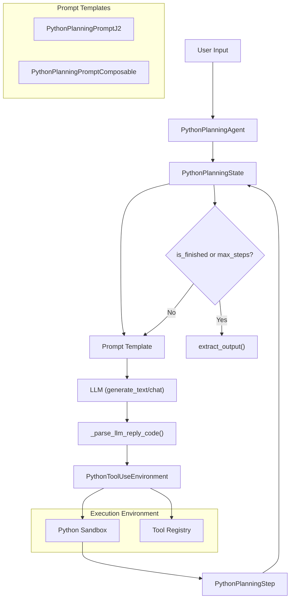
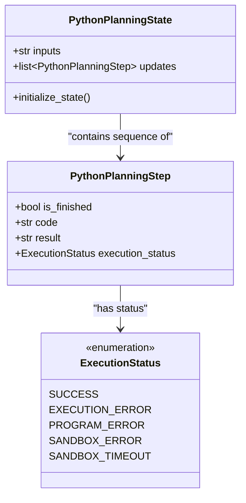
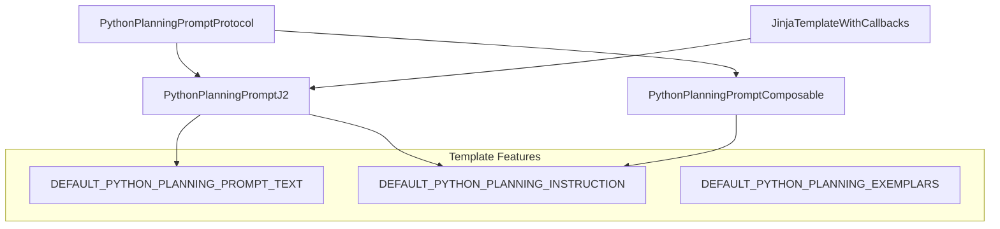
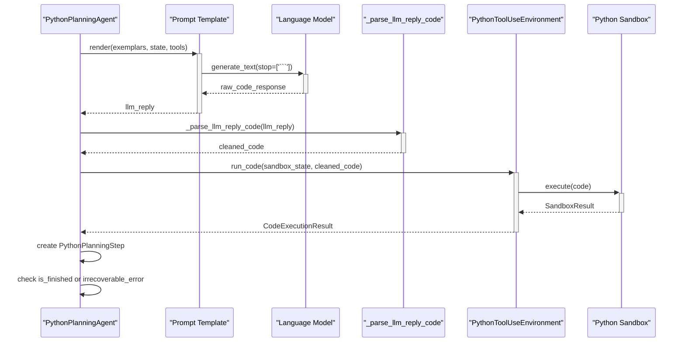
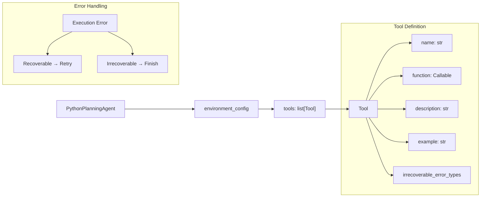
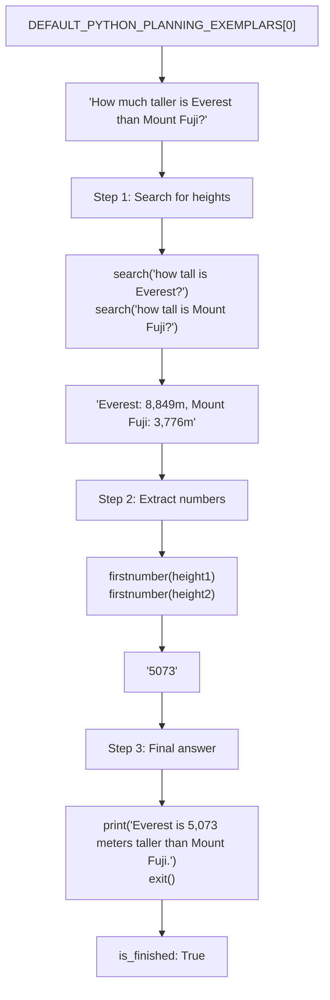

<!-- source: DeepWiki mcp.deepwiki.com · repo google-deepmind/onetwo · extra page Python Planning Agent · fetched 2026-10-26 -->

# Python Planning Agent

<details>
<summary>Relevant source files</summary>

The following files were used as context for generating this wiki page:

- [onetwo/agents/python_planning.py](onetwo/agents/python_planning.py)
- [onetwo/agents/python_planning_test.py](onetwo/agents/python_planning_test.py)

</details>


This document covers the Python Planning Agent implementation, a sophisticated strategy that iteratively generates and executes Python code blocks to solve complex problems using available tools. The agent employs a step-by-step approach where each iteration involves prompting an LLM to generate Python code, executing that code in a sandboxed environment, and using the results to inform the next step.

For information about the underlying Python execution environment, see [Python Tool Environment](#4.2). For details about the ReAct agent alternative, see [ReAct Agent](#4.1.1).

## Purpose and Architecture

The Python Planning Agent implements a code-generation strategy where an LLM iteratively writes Python programs that can call predefined tools to gather information and perform computations. This approach is inspired by research like ViperGPT and AdaPlanner, enabling complex multi-step reasoning through code execution.

### Core Architecture



Sources: [onetwo/agents/python_planning.py:487-675]()

## State Representation

The agent maintains its state through a sequence of executed steps, each containing the generated code and execution results.

### State Structure



The `PythonPlanningState` is defined as an alias: `UpdateListState[str, PythonPlanningStep]`, representing the input question and a chronological sequence of execution steps.

Sources: [onetwo/agents/python_planning.py:68-91]()

## Prompt Templates

The agent supports two prompt template implementations that format the state and tools for LLM consumption.

### Template Hierarchy



### Prompt Components

| Component | Purpose | Implementation |
|-----------|---------|----------------|
| Instruction | Task description and rules | `DEFAULT_PYTHON_PLANNING_INSTRUCTION` |
| Tool Descriptions | Available functions and examples | Rendered from `Tool` objects |
| Exemplars | Few-shot examples | `DEFAULT_PYTHON_PLANNING_EXEMPLARS` |
| Current State | Question and previous steps | Rendered from `PythonPlanningState` |
| Code Fence | Prompt for next code block | Triple backticks with stop sequence |

Sources: [onetwo/agents/python_planning.py:185-483]()

## Execution Flow

The agent follows a structured execution loop that continues until completion or maximum steps are reached.

### Step Execution Process



### Code Parsing Logic

The `_parse_llm_reply_code` function handles various code fence formats that different models may produce:

| Input Format | Parsed Output | Notes |
|--------------|---------------|-------|
| `print("hello")` | `print("hello")` | Plain code |
| `\`\`\`python\nprint("hello")\`\`\`` | `print("hello")` | Python fence |
| `\`\`\`tool_code\nprint("hello")\`\`\`` | `print("hello")` | Tool code fence |
| `python\nprint("hello")` | `print("hello")` | First line identifier |

Sources: [onetwo/agents/python_planning.py:153-183](), [onetwo/agents/python_planning.py:568-648]()

## Tool Integration

The agent integrates with the Python Tool Use Environment to provide access to external tools through Python function calls.

### Tool Configuration



### Error Recovery Mechanism

The agent implements sophisticated error handling:

1. **Recoverable Errors**: Standard Python exceptions prompt the LLM to fix the code
2. **Irrecoverable Errors**: Specific exception types defined in `Tool.irrecoverable_error_types` cause immediate termination
3. **System Errors**: Sandbox timeouts and system failures automatically finish execution

Sources: [onetwo/agents/python_planning.py:605-647]()

## Default Exemplars

The system includes pre-built examples demonstrating the agent's capabilities:

### Exemplar Structure



Sources: [onetwo/agents/python_planning.py:256-292]()

## Configuration and Usage

### Basic Agent Setup

```python
# Basic configuration
agent = PythonPlanningAgent(
    prompt=PythonPlanningPromptJ2(),
    exemplars=DEFAULT_PYTHON_PLANNING_EXEMPLARS,
    environment_config=PythonToolUseEnvironmentConfig(tools=[...]),
    max_steps=10
)

# Execute agent
result = await agent(inputs="What is the population of Tokyo?")
```

### Agent Parameters

| Parameter | Type | Default | Purpose |
|-----------|------|---------|---------|
| `prompt` | `PythonPlanningPromptProtocol` | `PythonPlanningPromptJ2()` | Template for LLM prompts |
| `exemplars` | `list[PythonPlanningState]` | `[]` | Few-shot examples |
| `environment_config` | `PythonToolUseEnvironmentConfig` | `PythonToolUseEnvironmentConfig()` | Tool and sandbox settings |
| `max_steps` | `int` | `10` | Maximum execution steps |

### Termination Conditions

The agent stops execution when:

1. **Explicit Exit**: Code calls `exit()` function ([onetwo/agents/python_planning.py:646]())
2. **Max Steps**: Reaches `max_steps` limit ([onetwo/agents/python_planning.py:657-659]())
3. **Irrecoverable Error**: Tool raises configured exception type ([onetwo/agents/python_planning.py:632-640]())
4. **System Error**: Sandbox timeout or critical failure ([onetwo/agents/python_planning.py:635-640]())

Sources: [onetwo/agents/python_planning.py:487-675](), [onetwo/agents/python_planning_test.py:315-553]()

---

