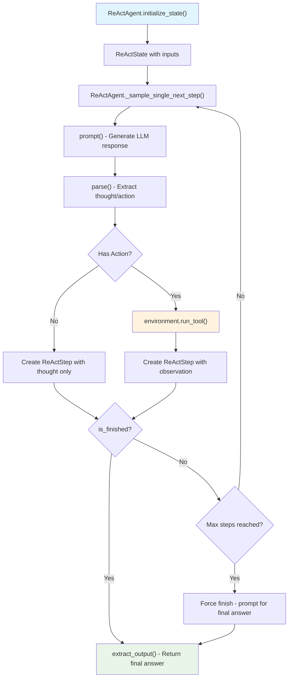
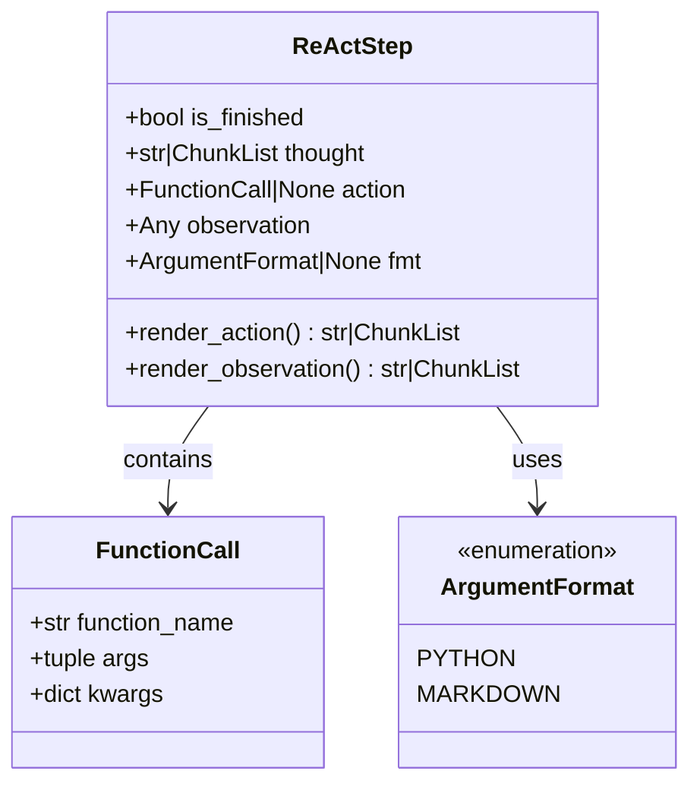
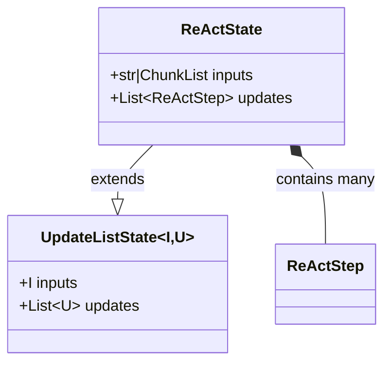
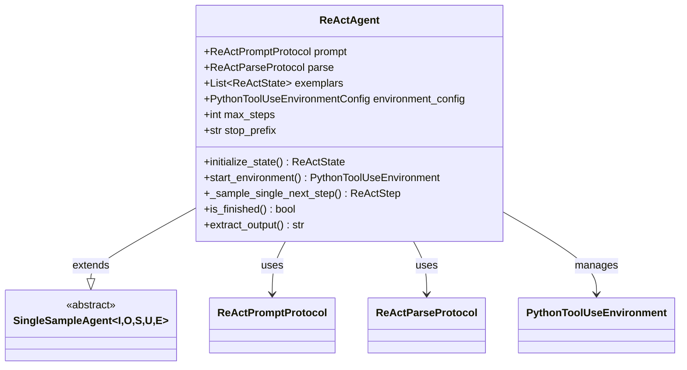
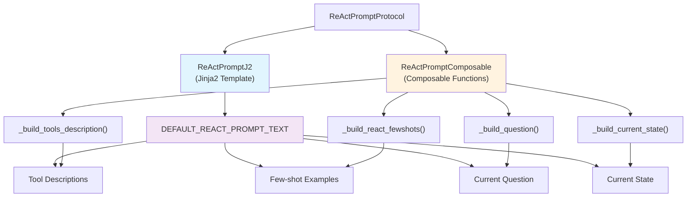
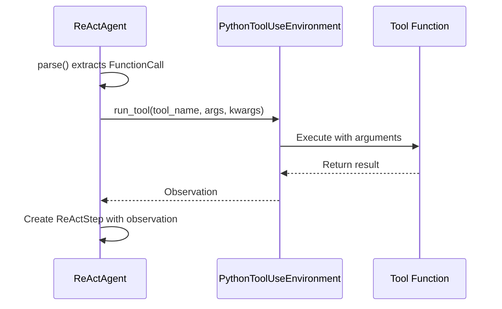
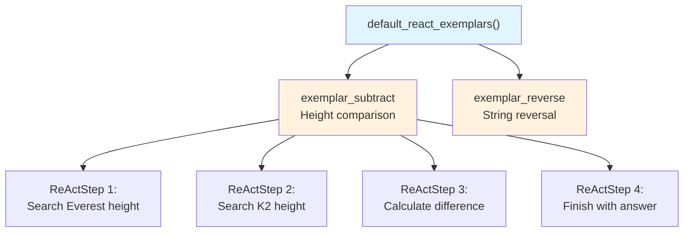

<!-- source: DeepWiki mcp.deepwiki.com · repo google-deepmind/onetwo · extra page ReAct Agent · fetched 2026-10-26 -->

# ReAct Agent

<details>
<summary>Relevant source files</summary>

The following files were used as context for generating this wiki page:

- [onetwo/agents/react.py](onetwo/agents/react.py)
- [onetwo/agents/react_test.py](onetwo/agents/react_test.py)

</details>


This document covers the ReAct (Reasoning and Acting) agent implementation in OneTwo, which enables multi-step reasoning and tool use through a thought-action-observation cycle. The ReAct agent allows LLMs to interleave reasoning steps with tool execution to solve complex problems that require external information or computation.

For information about the Python Tool Environment that ReAct agents use for tool execution, see [Python Tool Environment](#4.2). For broader agent evaluation techniques, see [Agent Evaluation](#5.2).

## Overview

The ReAct agent implements the strategy described in the [ReAct paper](https://arxiv.org/abs/2210.03629), generalized to work within OneTwo's agent framework. The strategy follows a structured cycle where the LLM alternates between:

1. **Thought**: Reasoning about the current situation and next steps
2. **Action**: Executing a specific tool or function call  
3. **Observation**: Receiving and processing the results

This cycle continues until the agent reaches a final answer or exceeds the maximum number of steps.

**ReAct Execution Flow**



Sources: [onetwo/agents/react.py:15-32](), [onetwo/agents/react.py:770-846]()

## Core Components

### ReActStep

The `ReActStep` class represents a single step in the ReAct execution cycle, containing the thought, action, and observation for that step.



Key attributes:
- `is_finished`: Indicates if this is the final step
- `thought`: The reasoning output from the LLM
- `action`: The tool call to execute (if any)
- `observation`: The result of executing the action
- `fmt`: The format used for rendering the action

Sources: [onetwo/agents/react.py:54-96]()

### ReActState

`ReActState` represents the complete state of a ReAct agent execution, containing the original inputs and all steps performed so far.



The state follows an append-only pattern where new steps are added to the `updates` list as the agent progresses.

Sources: [onetwo/agents/react.py:98-100]()

### ReActAgent

The main `ReActAgent` class orchestrates the entire ReAct execution process.



Key configuration:
- `prompt`: Template for generating LLM prompts
- `parse`: Function for parsing LLM responses  
- `exemplars`: Few-shot examples to include in prompts
- `max_steps`: Maximum number of ReAct iterations (default: 10)

Sources: [onetwo/agents/react.py:677-716]()

## Prompt System

The ReAct agent uses a sophisticated prompt system with two main implementations.

### Prompt Templates

**ReAct Prompt Components**



Both implementations generate prompts containing:
1. **Tool descriptions**: Available tools and their usage
2. **Few-shot exemplars**: Example ReAct conversations
3. **Current question**: The user's input
4. **Current state**: Steps completed so far

Sources: [onetwo/agents/react.py:306-343](), [onetwo/agents/react.py:387-554](), [onetwo/agents/react.py:102-167]()

### Response Parsing

The `react_parse` function extracts structured information from LLM responses:

| Pattern | Purpose | Example |
|---------|---------|---------|
| `\[Thought\]:?` | Extract reasoning | `[Thought]: I need to search for information` |
| `\[Act\]:?` | Extract action | `[Act]: search("query")` |
| `\[Finish\]:?` | Extract final answer | `[Finish]: The answer is 42` |

The parser handles various formats and gracefully degrades when parsing fails.

Sources: [onetwo/agents/react.py:580-675]()

## Tool Integration

The ReAct agent integrates with OneTwo's tool system through the `PythonToolUseEnvironment`.

**Tool Execution Flow**



The environment provides access to tools like:
- **Python execution**: For calculations and data processing
- **Search functions**: For retrieving external information  
- **Finish tool**: For returning final answers

Sources: [onetwo/agents/react.py:834-846]()

## Default Exemplars

The agent comes with built-in few-shot examples demonstrating common patterns:

| Exemplar | Demonstrates | Tools Used |
|----------|-------------|------------|
| Height comparison | Multi-step calculation | Search, Python, Finish |
| String reversal | Text processing | Search, Python, Finish |

These exemplars are stored in `REACT_FEWSHOTS` and show complete ReAct conversations from question to final answer.

**Exemplar Structure**



Sources: [onetwo/agents/react.py:170-303]()

## Usage Example

```python
import onetwo as ot
from onetwo.agents import react
from onetwo.stdlib.tool_use import python_tool_use

# Configure the agent
agent = react.ReActAgent(
    exemplars=react.REACT_FEWSHOTS,
    max_steps=10,
    environment_config=python_tool_use.PythonToolUseEnvironmentConfig()
)

# Execute the agent
question = "What is the square root of 144?"
result = ot.run(agent(inputs=question))
print(result)  # "12"
```

The agent will automatically:
1. Generate a thought about using Python for calculation
2. Execute `Python("144 ** 0.5")` 
3. Observe the result `12.0`
4. Finish with the final answer

Sources: [onetwo/agents/react_test.py:385-456]()

## Configuration Options

| Parameter | Type | Default | Purpose |
|-----------|------|---------|---------|
| `prompt` | `ReActPromptProtocol` | `ReActPromptJ2()` | Template for LLM prompts |
| `parse` | `ReActParseProtocol` | `react_parse` | Response parsing function |
| `exemplars` | `list[ReActState]` | `[]` | Few-shot examples |
| `environment_config` | `PythonToolUseEnvironmentConfig` | Default config | Available tools |
| `max_steps` | `int` | `10` | Maximum ReAct iterations |
| `stop_prefix` | `str` | `''` | Prefix for stop sequences |

The agent automatically handles:
- **Force finishing**: When max steps are reached or empty responses occur
- **Error handling**: Tool execution failures are captured as observations
- **State serialization**: Complete execution history is preserved

Sources: [onetwo/agents/react.py:705-718](), [onetwo/agents/react.py:794-809]()

---

