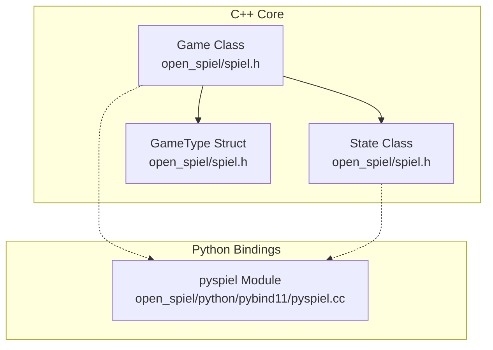
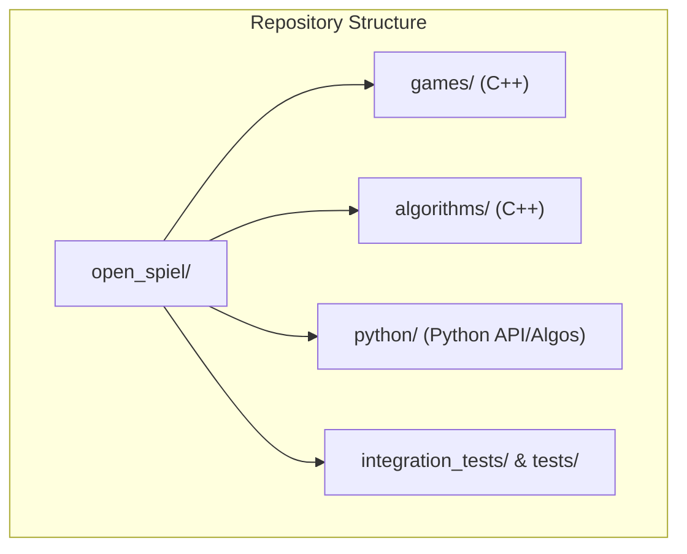

<!-- source: DeepWiki mcp.deepwiki.com · repo google-deepmind/open_spiel · page 1 OpenSpiel Overview · fetched 2026-10-26 -->

# OpenSpiel Overview

Relevant source files

The following files were used as context for generating this wiki page:

- [Dockerfile.base](Dockerfile.base)
- [docs/Makefile](docs/Makefile)
- [docs/alpha_rank.md](docs/alpha_rank.md)
- [docs/api_reference.md](docs/api_reference.md)
- [docs/authors.md](docs/authors.md)
- [docs/concepts.md](docs/concepts.md)
- [docs/contributing.md](docs/contributing.md)
- [docs/developer_guide.md](docs/developer_guide.md)
- [docs/fix_table_links.sh](docs/fix_table_links.sh)
- [docs/install.md](docs/install.md)
- [docs/intro.md](docs/intro.md)
- [docs/library.md](docs/library.md)
- [docs/requirements.readthedocs.txt](docs/requirements.readthedocs.txt)
- [open_spiel/examples/shared_library_example.cc](open_spiel/examples/shared_library_example.cc)
- [open_spiel/game_parameters.cc](open_spiel/game_parameters.cc)
- [open_spiel/game_parameters.h](open_spiel/game_parameters.h)
- [open_spiel/games/rbc/rbc.cc](open_spiel/games/rbc/rbc.cc)
- [open_spiel/games/rbc/rbc.h](open_spiel/games/rbc/rbc.h)
- [open_spiel/games/rbc/rbc_test.cc](open_spiel/games/rbc/rbc_test.cc)
- [open_spiel/integration_tests/playthroughs/rbc(board_size=4).txt](open_spiel/integration_tests/playthroughs/rbc(board_size=4).txt)
- [open_spiel/integration_tests/playthroughs/rbc(sense_border=true,sense_centered=true).txt](open_spiel/integration_tests/playthroughs/rbc(sense_border=true,sense_centered=true).txt)
- [open_spiel/integration_tests/playthroughs/rbc.txt](open_spiel/integration_tests/playthroughs/rbc.txt)
- [open_spiel/julia/CMakeLists.txt](open_spiel/julia/CMakeLists.txt)
- [open_spiel/spiel.cc](open_spiel/spiel.cc)
- [open_spiel/spiel.h](open_spiel/spiel.h)
- [open_spiel/tests/basic_tests.cc](open_spiel/tests/basic_tests.cc)
- [open_spiel/tests/basic_tests.h](open_spiel/tests/basic_tests.h)
- [open_spiel/utils/tensor_view_test.cc](open_spiel/utils/tensor_view_test.cc)
- [readthedocs.yml](readthedocs.yml)

OpenSpiel is a collection of environments and algorithms for research in general reinforcement learning and search/planning in games. This document provides a high-level overview of the OpenSpiel framework, its architecture, and core components.

## Purpose and Scope

OpenSpiel aims to provide a flexible, extensible framework for research in reinforcement learning, game theory, and multi-agent learning [docs/contributing.md:1-19](). It supports:

- Single and multi-player games [open_spiel/spiel.h:123-125]()
- Zero-sum, general-sum, and cooperative (identical) utilities [open_spiel/spiel.h:105-111]()
- Perfect and imperfect information games [open_spiel/spiel.h:97-101]()
- Sequential and simultaneous move dynamics [open_spiel/spiel.h:68-74]()
- Stochastic games via explicit or sampled chance nodes [open_spiel/spiel.h:87-93]()
- Normal-form, extensive-form, and mean-field games [open_spiel/spiel.h:71-98]()

The framework includes implementations of various classic board games, card games, and other environments, along with a suite of algorithms for solving, learning, and analyzing these games.

Sources: [docs/contributing.md:1-19](), [open_spiel/spiel.h:52-120]()

## 1.1. Key Concepts and Architecture

For details, see [Key Concepts and Architecture](#1.1).

OpenSpiel's C++ core defines foundational abstractions: `Game` represents the static rules and parameterization of a game, while `State` represents a mutable point in the game tree [open_spiel/spiel.h:52-120](). Game types, dynamics, and utilities are categorized statically via `GameType` [open_spiel/spiel.h:59-111](). Python bindings expose these core abstractions to Python via pybind11 [open_spiel/python/pybind11/pyspiel.cc]().

Sources: [open_spiel/spiel.h:52-120](), [open_spiel/python/pybind11/pyspiel.cc]()

## 1.2. Repository Layout and Developer Workflow

For details, see [Repository Layout and Developer Workflow](#1.2).

The repository is organized with top-level directories separating C++ implementations (`open_spiel/games/`, `open_spiel/algorithms/`) from Python wrappers and algorithms (`open_spiel/python/`) [docs/developer_guide.md:1-26](). Development workflows rely on script-based builds (`./install.sh`, `build_and_run_tests.sh`) [docs/install.md:80-132]() and adhere to contribution and testing practices [docs/developer_guide.md:35-106]().

Sources: [docs/developer_guide.md:1-26](), [docs/install.md:80-132]()

---

