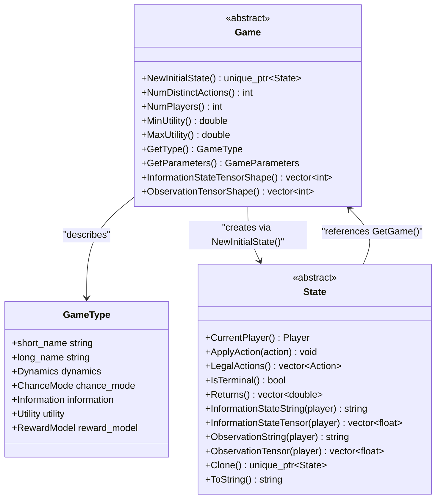
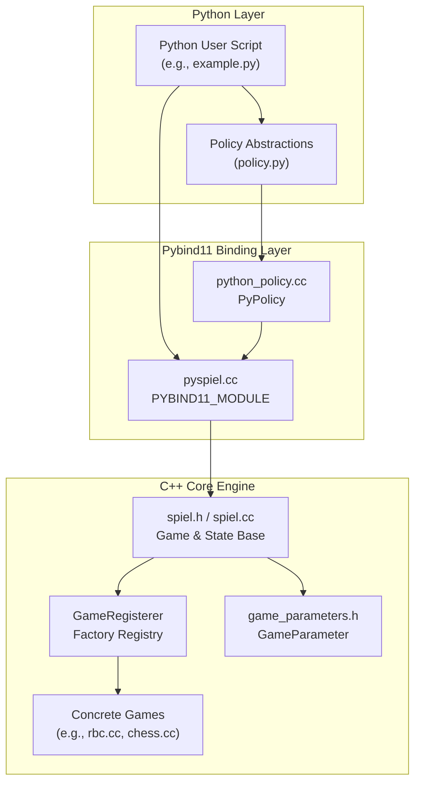

<!-- source: DeepWiki mcp.deepwiki.com · repo google-deepmind/open_spiel · page 1.1 Key Concepts and Architecture · fetched 2026-10-26 -->

# Key Concepts and Architecture

Relevant source files

The following files were used as context for generating this wiki page:

- [Dockerfile.base](Dockerfile.base)
- [docs/Makefile](docs/Makefile)
- [docs/api_reference.md](docs/api_reference.md)
- [docs/concepts.md](docs/concepts.md)
- [docs/fix_table_links.sh](docs/fix_table_links.sh)
- [docs/install.md](docs/install.md)
- [docs/requirements.readthedocs.txt](docs/requirements.readthedocs.txt)
- [open_spiel/game_parameters.cc](open_spiel/game_parameters.cc)
- [open_spiel/game_parameters.h](open_spiel/game_parameters.h)
- [open_spiel/games/rbc/rbc.cc](open_spiel/games/rbc/rbc.cc)
- [open_spiel/games/rbc/rbc.h](open_spiel/games/rbc/rbc.h)
- [open_spiel/games/rbc/rbc_test.cc](open_spiel/games/rbc/rbc_test.cc)
- [open_spiel/integration_tests/playthroughs/rbc(board_size=4).txt](open_spiel/integration_tests/playthroughs/rbc(board_size=4).txt)
- [open_spiel/integration_tests/playthroughs/rbc(sense_border=true,sense_centered=true).txt](open_spiel/integration_tests/playthroughs/rbc(sense_border=true,sense_centered=true).txt)
- [open_spiel/integration_tests/playthroughs/rbc.txt](open_spiel/integration_tests/playthroughs/rbc.txt)
- [open_spiel/spiel.cc](open_spiel/spiel.cc)
- [open_spiel/spiel.h](open_spiel/spiel.h)
- [open_spiel/tests/basic_tests.cc](open_spiel/tests/basic_tests.cc)
- [open_spiel/tests/basic_tests.h](open_spiel/tests/basic_tests.h)
- [open_spiel/utils/tensor_view_test.cc](open_spiel/utils/tensor_view_test.cc)
- [readthedocs.yml](readthedocs.yml)

## Purpose and Scope

This page documents the fundamental concepts and architectural patterns that form the foundation of OpenSpiel. It covers the core abstractions (`Game`, `State`, `Policy`), the two-layer architecture (C++ core with Python bindings layer), game parameterization, registration, and verification testing.

For build instructions and dependencies, see [Build System and Development Environment](#2). For specific game implementations, see [Game Implementations](#5). For algorithm implementations using these abstractions, see [Algorithms and Solution Concepts](#6).

Sources: [open_spiel/spiel.h:1-158](), [open_spiel/spiel.cc:1-199]()

---

## Core Abstractions

OpenSpiel centers around abstract base classes defined in C++ that establish uniform interfaces for all game types, states, and strategies.

### Game and State

The `Game` class (`open_spiel::Game`) defines static properties, metadata, factories, and tensor shapes for a game type. The `State` class (`open_spiel::State`) tracks the trajectory history, current player, legal actions, transitions, and terminal rewards.

**Diagram: Game and State Class Structure (Code Entity Mapping)**

Sources: [open_spiel/spiel.h:1-158](), [open_spiel/spiel.cc:93-136]()

### GameType Properties

The `GameType` struct categorizes games using strict enums to determine compatible algorithms (e.g., CFR, MCTS, Minimax):

- **Dynamics**: `kSequential`, `kSimultaneous`, `kMeanField` [open_spiel/spiel.h:68-75]()
- **ChanceMode**: `kDeterministic`, `kExplicitStochastic`, `kSampledStochastic` [open_spiel/spiel.h:87-93]()
- **Information**: `kOneShot`, `kPerfectInformation`, `kImperfectInformation` [open_spiel/spiel.h:97-101]()
- **Utility**: `kZeroSum`, `kConstantSum`, `kGeneralSum`, `kIdentical` [open_spiel/spiel.h:105-110]()
- **RewardModel**: `kRewards`, `kTerminal` [open_spiel/spiel.h:116-119]()

Sources: [open_spiel/spiel.h:59-121](), [open_spiel/spiel.cc:93-125]()

### GameParameters System

Games are parameterized via `GameParameters` (a `std::map<std::string, GameParameter>`) [open_spiel/game_parameters.h:37](). `GameParameter` supports types `kInt`, `kDouble`, `kString`, `kBool`, and nested `kGame` [open_spiel/game_parameters.h:48](). Parameter validation is enforced during factory loading via `ValidateParams` [open_spiel/spiel.cc:65-89]().

Sources: [open_spiel/game_parameters.h:35-135](), [open_spiel/game_parameters.cc:35-118]()

---

## System Architecture

OpenSpiel relies on a decoupled architecture separating high-performance C++ game implementations from high-level Python research code through a pybind11 binding layer.

**Diagram: System Architecture and Data Flow (Code Entity Mapping)**

Sources: [open_spiel/spiel.h:1-158](), [open_spiel/spiel.cc:146-200](), [open_spiel/game_parameters.h:35-88]()

### C++ Core Engine
- **Game Registration**: Games self-register at startup using the `REGISTER_SPIEL_GAME` macro, adding entries to `GameRegisterer::factories()` [open_spiel/spiel.cc:146-170]().
- **State Traversal**: States support cloning (`Clone()`), undo (`UndoAction()`), and string/tensor serialization.

Sources: [open_spiel/spiel.cc:146-195](), [open_spiel/tests/basic_tests.h:46-64]()

---

## State Representation and Information

OpenSpiel distinguishes between three views of a game trajectory:
1. **History**: Full sequence of actions taken from the root state (`State::History()`) [open_spiel/integration_tests/playthroughs/rbc.txt:36]().
2. **Information State**: Player-specific view incorporating perfect recall (`InformationStateString()`, `InformationStateTensor()`) [open_spiel/spiel.h:130-131]().
3. **Observation**: Current perception vector or string, which may be Markovian (`ObservationString()`, `ObservationTensor()`) [open_spiel/spiel.h:137-138](), [open_spiel/games/rbc/rbc.cc:58-59]().

Sources: [open_spiel/spiel.h:127-139](), [open_spiel/games/rbc/rbc.cc:46-65]()

---

## Testing Infrastructure

The framework includes rigorous C++ testing suites under `open_spiel/tests/basic_tests.h` [open_spiel/tests/basic_tests.h:15-100]().
- `RandomSimTest`: Executes random playthroughs verifying legal actions, cloning, serialization, and observation consistency [open_spiel/tests/basic_tests.h:46-52]().
- `RandomSimTestWithUndo`: Exhaustively rolls back trajectories via `UndoAction()` to validate state reversibility [open_spiel/tests/basic_tests.h:64]().

Sources: [open_spiel/tests/basic_tests.h:30-81](), [open_spiel/tests/basic_tests.cc:66-172]()

---

