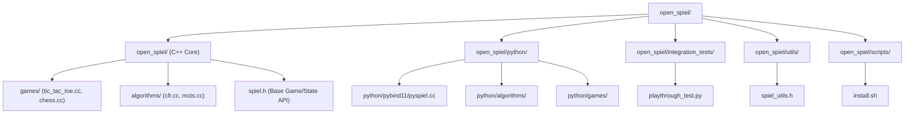
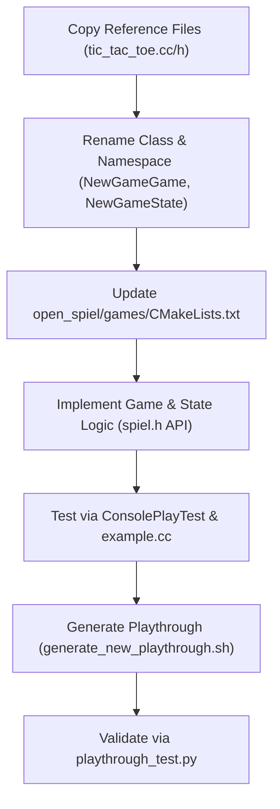

<!-- source: DeepWiki mcp.deepwiki.com · repo google-deepmind/open_spiel · page 1.2 Repository Layout and Developer Workflow · fetched 2026-10-26 -->

# Repository Layout and Developer Workflow

Relevant source files

The following files were used as context for generating this wiki page:

- [docs/alpha_rank.md](docs/alpha_rank.md)
- [docs/authors.md](docs/authors.md)
- [docs/contributing.md](docs/contributing.md)
- [docs/developer_guide.md](docs/developer_guide.md)
- [docs/intro.md](docs/intro.md)
- [docs/library.md](docs/library.md)
- [open_spiel/algorithms/trajectories.cc](open_spiel/algorithms/trajectories.cc)
- [open_spiel/examples/benchmark_game.cc](open_spiel/examples/benchmark_game.cc)
- [open_spiel/examples/example.cc](open_spiel/examples/example.cc)
- [open_spiel/examples/shared_library_example.cc](open_spiel/examples/shared_library_example.cc)
- [open_spiel/julia/CMakeLists.txt](open_spiel/julia/CMakeLists.txt)
- [open_spiel/python/algorithms/discounted_cfr.py](open_spiel/python/algorithms/discounted_cfr.py)
- [open_spiel/python/algorithms/fictitious_play.py](open_spiel/python/algorithms/fictitious_play.py)
- [open_spiel/python/algorithms/fictitious_play_test.py](open_spiel/python/algorithms/fictitious_play_test.py)
- [open_spiel/python/bots/bluechip_bridge_uncontested_bidding.py](open_spiel/python/bots/bluechip_bridge_uncontested_bidding.py)
- [open_spiel/python/bots/bluechip_bridge_uncontested_bidding_test.py](open_spiel/python/bots/bluechip_bridge_uncontested_bidding_test.py)
- [open_spiel/python/examples/bridge_uncontested_bidding_bluechip.py](open_spiel/python/examples/bridge_uncontested_bidding_bluechip.py)
- [open_spiel/python/examples/cfr_example.py](open_spiel/python/examples/cfr_example.py)
- [open_spiel/python/examples/example.py](open_spiel/python/examples/example.py)
- [open_spiel/python/examples/fictitious_play_example.py](open_spiel/python/examples/fictitious_play_example.py)
- [open_spiel/python/examples/get_all_states.py](open_spiel/python/examples/get_all_states.py)
- [open_spiel/python/examples/mccfr_cpp_example.py](open_spiel/python/examples/mccfr_cpp_example.py)

This page maps the directory structure of the OpenSpiel repository and details the developer workflow for extending the framework, contributing new games or algorithms, handling conditional dependencies, and maintaining quality standards.

---

## Directory Structure and Code Organization

OpenSpiel is organized into a C++ core under `open_spiel/` with a parallel and tightly integrated Python wrapper layer located in `open_spiel/python/` [docs/developer_guide.md:1-6](). The directory layout separates game definitions, solution algorithms, utilities, and integration tests.

| Directory Path | Description | Key Components |
| -------------- | ----------- | -------------- |
| `open_spiel/` | C++ core framework root | `spiel.h`, core game/state abstractions [docs/developer_guide.md:16]() |
| `open_spiel/games/` | C++ game implementations | `tic_tac_toe.cc`, `chess.cc`, poker variants [docs/developer_guide.md:17]() |
| `open_spiel/algorithms/` | C++ algorithm implementations | CFR, MCTS, best response, exploitability [docs/developer_guide.md:18]() |
| `open_spiel/python/` | Python binding layer & algorithms | `pyspiel.cc` bindings, `python/algorithms/`, `python/games/` [docs/developer_guide.md:5]() |
| `open_spiel/utils/` | Common C++ utility library | `spiel_utils.h`, file/logging, json, circular buffers [docs/developer_guide.md:10]() |
| `open_spiel/integration_tests/` | Generic Python/C++ integration tests | `playthrough_test.py`, regression suites [docs/developer_guide.md:9]() |
| `open_spiel/scripts/` | Development and build scripts | `install.sh`, `global_variables.sh`, `generate_new_playthrough.sh` [docs/developer_guide.md:11, 99]() |

*Diagram 1: Repository Directory Structure and Core Module Mapping.*

Sources: `docs/developer_guide.md:1-26`, `docs/intro.md:20-32`

---

## Contribution Workflow: Adding a Game

Adding a new game involves copying a reference implementation, updating CMake build targets, registering the game, writing tests, and generating playthroughs for regression detection [docs/developer_guide.md:35-106]().

### Step-by-Step Implementation Procedure

1. **Select a Template**: Choose an existing reference implementation in `open_spiel/games/` or `open_spiel/python/games/` (e.g., `tic_tac_toe.cc` for perfect information or `kuhn_poker.cc` for imperfect information) [docs/developer_guide.md:42-48]().
2. **Copy and Rename**: Copy the header, source, and test files to `new_game.h`, `new_game.cc`, and `new_game_test.cc`. Update header guards, namespaces, class names (`TicTacToeGame` $\rightarrow$ `NewGameGame`, `TicTacToeState` $\rightarrow$ `NewGameState`), and set the short name to `new_game` in `new_game.cc` [docs/developer_guide.md:49-68]().
3. **Configure Build Targets**: Add the new source files and test targets to `open_spiel/games/CMakeLists.txt` (or update `open_spiel/python/CMakeLists.txt` for Python games) [docs/developer_guide.md:52-59]().
4. **Interactive Testing**: Verify game logic interactively via `open_spiel/tests/console_play_test.h` or run random simulations using `open_spiel/examples/example.cc` (`build/examples/example --game=new_game`) [docs/developer_guide.md:73-87](), [open_spiel/examples/example.cc:24-75]().
5. **Generate Playthrough**: Run `./open_spiel/scripts/generate_new_playthrough.sh new_game` to create a reference playthrough file used by `open_spiel/integration_tests/playthrough_test.py` to prevent future regressions [docs/developer_guide.md:98-105]().

*Diagram 2: Game Contribution and Regression Workflow.*

Sources: `docs/developer_guide.md:35-106`, `open_spiel/examples/example.cc:24-75`

---

## Build Integration and Conditional Dependencies

OpenSpiel uses a single-source-of-truth configuration model for optional external dependencies (e.g., Hanabi, ACPC, JAX, PyTorch, OR-Tools) [docs/developer_guide.md:107-114](). 

- **Bash Environment Variables**: External dependencies are controlled via bash variables read by `install.sh` to clone repositories and by CMake to configure targets [docs/developer_guide.md:113-116]().
- **Light Defaults**: Dependencies are excluded by default to maintain fast installation and compilation times [docs/developer_guide.md:118-120]().
- **User Override Protection**: `scripts/global_variables.sh` defines configuration variables only if they are undefined, respecting custom user definitions in `.bashrc` or command-line flags [docs/developer_guide.md:121-125]().

To add a conditional dependency, update the root `CMakeLists.txt` with an `OFF`-default option and add the corresponding flag to `scripts/global_variables.sh` [docs/developer_guide.md:127-130]().

Sources: `docs/developer_guide.md:107-130`

---

## Code Style and Quality Assurance

Contributions must adhere to Google's C++ and Python style guides [docs/contributing.md:33-36](). Code formatting is checked via automated tooling configured in the repository:

- **Formatting Settings**: Managed by `pyink` (configured under `[tool.pyink]` in `pyproject.toml`) for Python and `clang-format` (via `.clang-format`) for C++ [docs/developer_guide.md:91-94]().
- **Linting Hooks**: Local pre-commit hooks can be installed using `pip install pre-commit` followed by `pre-commit install` (referencing `.pre-commit-config.yaml`) [docs/developer_guide.md:88-92](). C++ code can additionally be verified using `cpplint` [docs/developer_guide.md:94-95]().
- **Pull Request Process**: Approved pull requests are batched and merged regularly (typically every two weeks for general features, faster for bug fixes) [docs/contributing.md:49-57](). All contributions require a signed Contributor License Agreement (CLA) [docs/contributing.md:74-77]().

Sources: `docs/developer_guide.md:88-97`, `docs/contributing.md:33-77`

---

