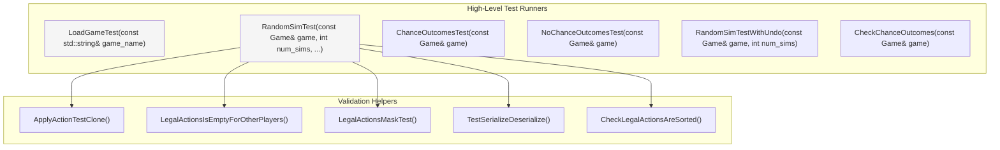
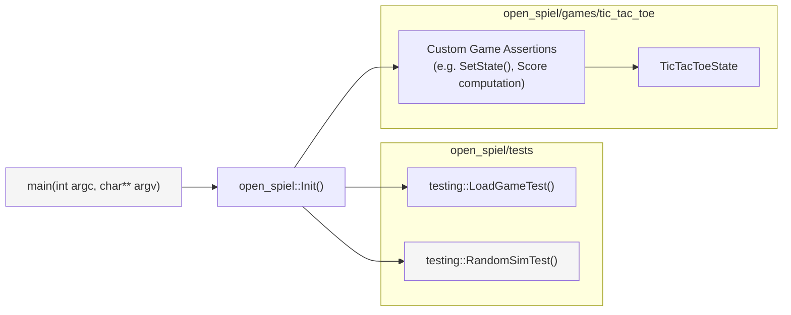

<!-- source: DeepWiki mcp.deepwiki.com · repo google-deepmind/open_spiel · page 10.1 C++ Testing Framework · fetched 2026-10-26 -->

# C++ Testing Framework

<details>
<summary>Relevant source files</summary>

The following files were used as context for generating this wiki page:

- [open_spiel/game_parameters.cc](open_spiel/game_parameters.cc)
- [open_spiel/game_parameters.h](open_spiel/game_parameters.h)
- [open_spiel/games/crossword/crossword.cc](open_spiel/games/crossword/crossword.cc)
- [open_spiel/games/crossword/crossword.h](open_spiel/games/crossword/crossword.h)
- [open_spiel/games/crossword/crossword_board.cc](open_spiel/games/crossword/crossword_board.cc)
- [open_spiel/games/crossword/crossword_board.h](open_spiel/games/crossword/crossword_board.h)
- [open_spiel/games/crossword/crossword_default_puzzle.h](open_spiel/games/crossword/crossword_default_puzzle.h)
- [open_spiel/games/crossword/crossword_test.cc](open_spiel/games/crossword/crossword_test.cc)
- [open_spiel/games/tic_tac_toe/tic_tac_toe.cc](open_spiel/games/tic_tac_toe/tic_tac_toe.cc)
- [open_spiel/games/tic_tac_toe/tic_tac_toe.h](open_spiel/games/tic_tac_toe/tic_tac_toe.h)
- [open_spiel/games/tic_tac_toe/tic_tac_toe_test.cc](open_spiel/games/tic_tac_toe/tic_tac_toe_test.cc)
- [open_spiel/python/pybind11/games_crossword.cc](open_spiel/python/pybind11/games_crossword.cc)
- [open_spiel/python/pybind11/games_tic_tac_toe.cc](open_spiel/python/pybind11/games_tic_tac_toe.cc)
- [open_spiel/python/tests/games_crossword_test.py](open_spiel/python/tests/games_crossword_test.py)
- [open_spiel/python/tests/games_tic_tac_toe_test.py](open_spiel/python/tests/games_tic_tac_toe_test.py)
- [open_spiel/spiel.cc](open_spiel/spiel.cc)
- [open_spiel/spiel.h](open_spiel/spiel.h)
- [open_spiel/tests/CMakeLists.txt](open_spiel/tests/CMakeLists.txt)
- [open_spiel/tests/action_struct_tests.cc](open_spiel/tests/action_struct_tests.cc)
- [open_spiel/tests/action_struct_tests.h](open_spiel/tests/action_struct_tests.h)
- [open_spiel/tests/basic_tests.cc](open_spiel/tests/basic_tests.cc)
- [open_spiel/tests/basic_tests.h](open_spiel/tests/basic_tests.h)
- [open_spiel/utils/tensor_view_test.cc](open_spiel/utils/tensor_view_test.cc)

</details>


## Purpose and Scope

The C++ Testing Framework provides a comprehensive suite of utilities for validating game implementations, state transitions, serialization correctness, and API compliance across OpenSpiel core abstractions. These utilities are primarily defined in `open_spiel/tests/basic_tests.h` [open_spiel/tests/basic_tests.h:1-100]() and `open_spiel/tests/basic_tests.cc` [open_spiel/tests/basic_tests.cc:1-38](), along with action struct validation utilities in `open_spiel/tests/action_struct_tests.h` [open_spiel/tests/CMakeLists.txt:1-10](). 

This page covers the C++ testing infrastructure, validation helper functions, `RandomSimTest` execution flow, action struct tests, per-game test structures, and CTest integration.

Sources: `[open_spiel/tests/basic_tests.h:1-100]()`, `[open_spiel/tests/basic_tests.cc:1-38]()`, `[open_spiel/tests/CMakeLists.txt:1-10]()`

---

## Core Testing Utilities (`basic_tests.h`)

The testing framework is organized under the `open_spiel::testing` namespace and exposes high-level test runners as well as granular state validators.

### Diagram: Testing Utility Architecture

Sources: `[open_spiel/tests/basic_tests.h:25-97]()`, `[open_spiel/tests/basic_tests.cc:40-138]()`

---

## Simulation and Validation Engines (`RandomSimTest`)

### `RandomSimTest`
`RandomSimTest` executes `num_sims` random simulations from the initial state to terminal nodes. At each step, it validates:
* **Legal Actions Sorting:** Verifies that `LegalActions()` returns sorted action vectors via `CheckLegalActionsAreSorted()` [open_spiel/tests/basic_tests.h:94-96]().
* **Turn-Based Invariants:** Ensures non-current players have zero legal actions in sequential games via `LegalActionsIsEmptyForOtherPlayers()` [open_spiel/tests/basic_tests.cc:90-112]().
* **Action Masking:** Validates `LegalActionsMask()` against `LegalActions()` via `LegalActionsMaskTest()` [open_spiel/tests/basic_tests.cc:114-133]().
* **Cloning Integrity:** Asserts that `State::Clone()` preserves `ToString()` and `History()` output identically via `ApplyActionTestClone()` [open_spiel/tests/basic_tests.cc:66-85]().
* **Serialization Round-Trip:** Periodically tests `SerializeGameAndState()` and `DeserializeGameAndState()` [open_spiel/tests/basic_tests.cc:174-180]().

### `RandomSimTestWithUndo`
`RandomSimTestWithUndo` performs random simulations while exercising `State::UndoAction()`. For every step, it rewinds the entire game history back to the root using `UndoAction()` and asserts that reconstructed intermediate states match historical records [open_spiel/tests/basic_tests.cc:161-172](). Due to $O(n^2)$ complexity, it is intended for targeted regression testing rather than bulk execution.

Sources: `[open_spiel/tests/basic_tests.h:42-64]()`, `[open_spiel/tests/basic_tests.cc:66-180]()`

---

## Action Struct Tests

Games that implement structured actions (such as `TicTacToeActionStruct` [open_spiel/games/tic_tac_toe/tic_tac_toe.h:70-75]() or `CrosswordActionStruct` [open_spiel/python/pybind11/games_crossword.cc:53-62]()) use action struct utilities. 

The testing framework verifies conversion consistency between primitive `Action` IDs and structured representations:
* `ActionToStruct(Player player, Action action_id)` [open_spiel/games/tic_tac_toe/tic_tac_toe.h:115-116]()
* `StructToActions(const ActionStruct& action_struct)` [open_spiel/games/tic_tac_toe/tic_tac_toe.h:117-118]()

Action struct test suites validate that deserializing JSON-backed or native struct representations and mapping them back to discrete actions produces identical game transitions.

Sources: `[open_spiel/tests/CMakeLists.txt:1-10]`, `[open_spiel/games/tic_tac_toe/tic_tac_toe.h:70-75]`, `[open_spiel/games/tic_tac_toe/tic_tac_toe.cc:197-212]()`

---

## Per-Game Test Structure

Each concrete game implementation provides a dedicated test binary (e.g., `tic_tac_toe_test.cc`, `yacht_test.cc`) linking against `open_spiel` and the `tests` library object target `open_spiel/tests/CMakeLists.txt` [open_spiel/tests/CMakeLists.txt:1-10]().

### Diagram: Per-Game Test Execution Flow

Sources: `[open_spiel/tests/CMakeLists.txt:1-10]`, `[open_spiel/games/tic_tac_toe/tic_tac_toe.h:78-130]()`

---

## CTest Integration

OpenSpiel integrates its test executables into CMake's CTest framework [open_spiel/tests/CMakeLists.txt:1-28](). 

Each game test is defined as an executable target and registered using `add_test()`:
```cmake
add_executable(spiel_test spiel_test.cc $<TARGET_OBJECTS:tests> ${OPEN_SPIEL_OBJECTS})
add_test(spiel_test spiel_test)
```

Test suites are executed using standard CTest commands:
* `ctest` runs all registered unit tests.
* `ctest -R <game_name>` filters tests matching specific patterns.

Sources: `[open_spiel/tests/CMakeLists.txt:12-19]()`

---

## Test Validation Summary

| Validation Check | Core Function / Routine | Description |
| :--- | :--- | :--- |
| Game Loading | `LoadGameTest()` [open_spiel/tests/basic_tests.h:34]() | Verifies game registration and instantiation. |
| Simulation & Consistency | `RandomSimTest()` [open_spiel/tests/basic_tests.h:46]() | Runs full random playouts, validating clones, legality, masks, and terminal returns. |
| Reversibility | `RandomSimTestWithUndo()` [open_spiel/tests/basic_tests.h:64]() | Replays history backward via `UndoAction()`. |
| Serialization | `TestSerializeDeserialize()` [open_spiel/tests/basic_tests.cc:174]() | Validates round-trip serialization and state reconstruction. |
| Action Structs | `StructToActions()` / `ActionToStruct()` [open_spiel/games/tic_tac_toe/tic_tac_toe.h:115-118]() | Verifies bidirectional mapping between structured objects and action IDs. |

Sources: `[open_spiel/tests/basic_tests.h:34-96]`, `[open_spiel/tests/basic_tests.cc:174-180]`, `[open_spiel/games/tic_tac_toe/tic_tac_toe.h:115-118]()`

---

