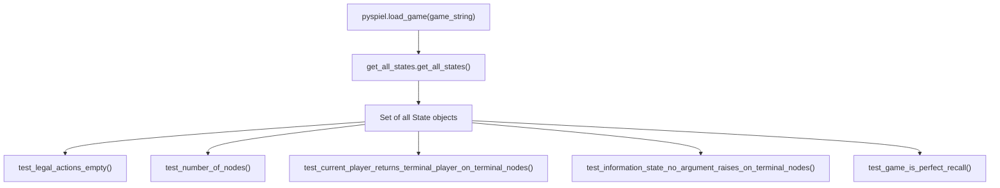
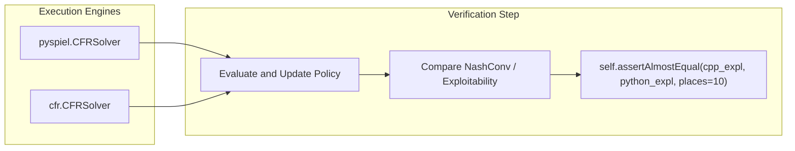

<!-- source: DeepWiki mcp.deepwiki.com · repo google-deepmind/open_spiel · page 10.2 Python Testing Suite · fetched 2026-10-26 -->

# Python Testing Suite

<details>
<summary>Relevant source files</summary>

The following files were used as context for generating this wiki page:

- [docs/games.md](docs/games.md)
- [open_spiel/games/CMakeLists.txt](open_spiel/games/CMakeLists.txt)
- [open_spiel/games/yacht/yacht.cc](open_spiel/games/yacht/yacht.cc)
- [open_spiel/games/yacht/yacht.h](open_spiel/games/yacht/yacht.h)
- [open_spiel/games/yacht/yacht_test.cc](open_spiel/games/yacht/yacht_test.cc)
- [open_spiel/integration_tests/api_test.py](open_spiel/integration_tests/api_test.py)
- [open_spiel/integration_tests/playthroughs/catch.txt](open_spiel/integration_tests/playthroughs/catch.txt)
- [open_spiel/integration_tests/playthroughs/python_pursuit_evasion.txt](open_spiel/integration_tests/playthroughs/python_pursuit_evasion.txt)
- [open_spiel/integration_tests/playthroughs/xiangqi.txt](open_spiel/integration_tests/playthroughs/xiangqi.txt)
- [open_spiel/observer.cc](open_spiel/observer.cc)
- [open_spiel/observer.h](open_spiel/observer.h)
- [open_spiel/python/CMakeLists.txt](open_spiel/python/CMakeLists.txt)
- [open_spiel/python/algorithms/generate_playthrough.py](open_spiel/python/algorithms/generate_playthrough.py)
- [open_spiel/python/games/__init__.py](open_spiel/python/games/__init__.py)
- [open_spiel/python/games/ant_foraging.py](open_spiel/python/games/ant_foraging.py)
- [open_spiel/python/games/ant_foraging_test.py](open_spiel/python/games/ant_foraging_test.py)
- [open_spiel/python/games/pursuit_evasion.py](open_spiel/python/games/pursuit_evasion.py)
- [open_spiel/python/games/pursuit_evasion_test.py](open_spiel/python/games/pursuit_evasion_test.py)
- [open_spiel/python/observation.py](open_spiel/python/observation.py)
- [open_spiel/python/pybind11/observer.cc](open_spiel/python/pybind11/observer.cc)
- [open_spiel/python/pybind11/pyspiel.cc](open_spiel/python/pybind11/pyspiel.cc)
- [open_spiel/python/tests/games_sim_test.py](open_spiel/python/tests/games_sim_test.py)
- [open_spiel/python/tests/observation_test.py](open_spiel/python/tests/observation_test.py)
- [open_spiel/python/tests/pyspiel_test.py](open_spiel/python/tests/pyspiel_test.py)

</details>


## Purpose and Scope

This document describes the Python testing infrastructure in OpenSpiel. The Python testing suite validates the entire Python layer, including:

- Core `pyspiel` bindings and game registration
- Game simulation and serialization (`games_sim_test.py`)
- Python algorithm implementations and CFR convergence (`cfr_test.py`)
- C++/Python implementation equivalence
- Policy classes and conversion utilities
- Integration tests via playthrough files and full-tree API validation (`api_test.py`)

The Python tests primarily use the `absl.testing` framework (which extends `unittest`) and are executed via `pytest` in the CI/CD pipeline. For C++ testing infrastructure, see [C++ Testing Framework](#10.1).

## Python Testing Infrastructure Overview

The Python testing suite is organized into several test modules under `open_spiel/python/tests/` and `open_spiel/integration_tests/`:

| Test Module | Purpose | Key Features |
|-------------|---------|--------------|
| `open_spiel/python/tests/pyspiel_test.py` | Core bindings validation | Game registration, API correctness, parameter parsing |
| `open_spiel/python/tests/games_sim_test.py` | Game simulation tests | Random playouts, serialization, state validation |
| `open_spiel/integration_tests/api_test.py` | Full-tree invariant verification | Exhaustive state traversal, legal action checks, perfect recall |
| `open_spiel/python/algorithms/cfr_test.py` | CFR algorithm tests | Convergence, C++/Python equivalence, exploitability |

**Python Testing Architecture**

```mermaid
flowchart TB
    subgraph "Test Execution"
        Pytest["pytest"] --> AbslTest["absltest.main()"]
        AbslTest --> TestCases["Test Case Classes"]
    end
    
    subgraph "Core Tests"
        PyspielTest["open_spiel/python/tests/pyspiel_test.py"] --> GameRegistry["Game Registration Tests"]
        PyspielTest --> APITests["API Correctness Tests"]
        PyspielTest --> ParamTests["Parameter Parsing Tests"]
        PyspielTest --> SerialTests["Serialization Tests"]
    end
    
    subgraph "Integration and Sim Tests"
        GamesSimTest["open_spiel/python/tests/games_sim_test.py"] --> RandomSim["Random Simulations"]
        GamesSimTest --> StateSerialization["State Serialization"]
        ApiTest["open_spiel/integration_tests/api_test.py"] --> FullTree["EnforceAPIOnFullTreeBase"]
    end
    
    subgraph "Algorithm Tests"
        CFRTest["open_spiel/python/algorithms/cfr_test.py"] --> PythonCFR["Python CFR Tests"]
        CFRTest --> EquivalenceTests["C++/Python Equivalence"]
        CFRTest --> CorrDistTests["Correlation Distance Tests"]
    end
    
    Pytest --> PyspielTest
    Pytest --> CFRTest
    Pytest --> GamesSimTest
    Pytest --> ApiTest
```



Sources:
- [open_spiel/python/tests/pyspiel_test.py:1-455]()
- [open_spiel/python/tests/games_sim_test.py:1-167]()
- [open_spiel/integration_tests/api_test.py:1-187]()
- [open_spiel/python/algorithms/cfr_test.py:1-329]()

## Core pyspiel Tests (`pyspiel_test.py`)

The `open_spiel/python/tests/pyspiel_test.py` module validates fundamental Python bindings, game registration, parameter parsing, and serialization.

### Game Registration Tests

The test suite verifies that all mandatory games are registered and accessible via `pyspiel.registered_names()` [open_spiel/python/tests/pyspiel_test.py:181-205](). Conditional optional games (such as Hanabi or Universal Poker via ACPC) are included conditionally based on environment variables [open_spiel/python/tests/pyspiel_test.py:189-195]().

Sources:
- [open_spiel/python/tests/pyspiel_test.py:34-176]()
- [open_spiel/python/tests/pyspiel_test.py:181-205]()

### Game Simulation and Serialization (`games_sim_test.py`)

The `open_spiel/python/tests/games_sim_test.py` module exercises registered games through random simulations, verifying:
- Native OpenSpiel game and state serialization via `pyspiel.serialize_game_and_state()` [open_spiel/python/tests/games_sim_test.py:127-132]().
- Python `pickle` serialization of both `Game` and `State` objects [open_spiel/python/tests/games_sim_test.py:133-160]().
- Clone consistency, checking that `state.clone()` matches history and string representations [open_spiel/python/tests/games_sim_test.py:110-123]().

Sources:
- [open_spiel/python/tests/games_sim_test.py:101-167]()

## Integration Tests and Full-Tree Verification (`api_test.py`)

The `open_spiel/integration_tests/api_test.py` module provides rigorous validation of game semantics across entire game trees using `EnforceAPIOnFullTreeBase` [open_spiel/integration_tests/api_test.py:107-112]().



Sources:
- [open_spiel/integration_tests/api_test.py:107-187]()

Key checks performed on full game trees include:
- Verifying that terminal states return empty `legal_actions()` for all players [open_spiel/integration_tests/api_test.py:131-141]().
- Ensuring non-current players receive empty legal action lists in sequential games [open_spiel/integration_tests/api_test.py:150-156]().
- Asserting node counts (chance, playable, terminal) match reference dictionaries (`TOTAL_NUM_STATES`) [open_spiel/integration_tests/api_test.py:158-174]().
- Confirming terminal nodes return `pyspiel.PlayerId.TERMINAL` as their current player [open_spiel/integration_tests/api_test.py:175-179]().

Sources:
- [open_spiel/integration_tests/api_test.py:125-187]()

## Python Algorithm Tests and Equivalence Verification

Algorithm implementations in `open_spiel/python/algorithms/` (such as `cfr.py`) are tested for convergence properties and C++/Python equivalence [open_spiel/python/algorithms/cfr_test.py:241-272]().



Sources:
- [open_spiel/python/algorithms/cfr_test.py:241-272]()

## pytest Integration and CI/CD

Python tests are managed via `pytest` and execute standard `absltest` test cases. Local execution is performed as follows:

```bash
# Run all Python tests
pytest open_spiel/python/

# Run specific integration test
pytest open_spiel/integration_tests/api_test.py
```

Sources:
- [open_spiel/python/tests/pyspiel_test.py:19-20]()
- [open_spiel/integration_tests/api_test.py:21-23]()

---

