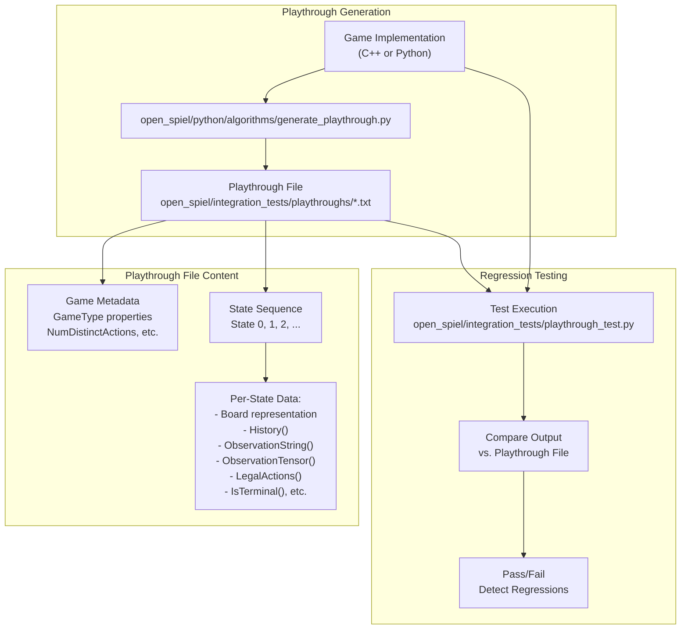
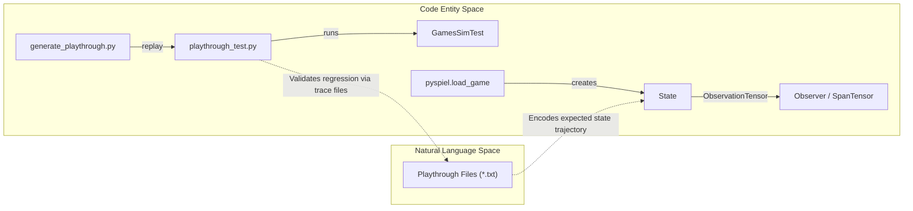
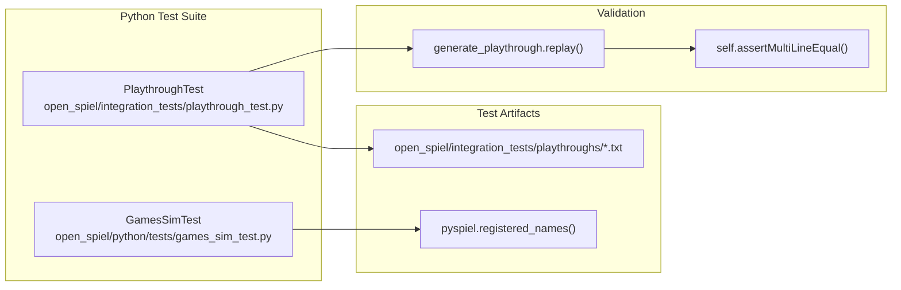
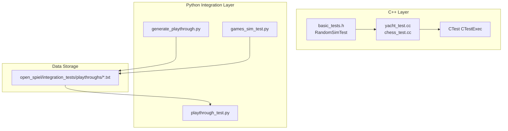

<!-- source: DeepWiki mcp.deepwiki.com · repo google-deepmind/open_spiel · page 10.3 Integration Tests and Playthroughs · fetched 2026-10-26 -->

# Integration Tests and Playthroughs

<details>
<summary>Relevant source files</summary>

The following files were used as context for generating this wiki page:

- [open_spiel/game_transforms/add_noise.cc](open_spiel/game_transforms/add_noise.cc)
- [open_spiel/game_transforms/cached_tree.cc](open_spiel/game_transforms/cached_tree.cc)
- [open_spiel/game_transforms/coop_to_1p.cc](open_spiel/game_transforms/coop_to_1p.cc)
- [open_spiel/game_transforms/misere.cc](open_spiel/game_transforms/misere.cc)
- [open_spiel/game_transforms/normal_form_extensive_game.cc](open_spiel/game_transforms/normal_form_extensive_game.cc)
- [open_spiel/game_transforms/restricted_nash_response.cc](open_spiel/game_transforms/restricted_nash_response.cc)
- [open_spiel/game_transforms/restricted_nash_response.h](open_spiel/game_transforms/restricted_nash_response.h)
- [open_spiel/game_transforms/restricted_nash_response_test.cc](open_spiel/game_transforms/restricted_nash_response_test.cc)
- [open_spiel/game_transforms/turn_based_simultaneous_game.cc](open_spiel/game_transforms/turn_based_simultaneous_game.cc)
- [open_spiel/game_transforms/turn_based_simultaneous_game.h](open_spiel/game_transforms/turn_based_simultaneous_game.h)
- [open_spiel/game_transforms/turn_based_simultaneous_game_test.cc](open_spiel/game_transforms/turn_based_simultaneous_game_test.cc)
- [open_spiel/game_transforms/zerosum.cc](open_spiel/game_transforms/zerosum.cc)
- [open_spiel/games/yacht/yacht.cc](open_spiel/games/yacht/yacht.cc)
- [open_spiel/games/yacht/yacht.h](open_spiel/games/yacht/yacht.h)
- [open_spiel/games/yacht/yacht_test.cc](open_spiel/games/yacht/yacht_test.cc)
- [open_spiel/integration_tests/playthrough_test.py](open_spiel/integration_tests/playthrough_test.py)
- [open_spiel/integration_tests/playthroughs/chess.txt](open_spiel/integration_tests/playthroughs/chess.txt)
- [open_spiel/integration_tests/playthroughs/cliff_walking.txt](open_spiel/integration_tests/playthroughs/cliff_walking.txt)
- [open_spiel/integration_tests/playthroughs/clobber.txt](open_spiel/integration_tests/playthroughs/clobber.txt)
- [open_spiel/integration_tests/playthroughs/cursor_go(board_size=5,max_cursor_moves=7).txt](open_spiel/integration_tests/playthroughs/cursor_go(board_size=5,max_cursor_moves=7).txt)
- [open_spiel/integration_tests/playthroughs/dark_chess(board_size=4).txt](open_spiel/integration_tests/playthroughs/dark_chess(board_size=4).txt)
- [open_spiel/integration_tests/playthroughs/dark_chess.txt](open_spiel/integration_tests/playthroughs/dark_chess.txt)
- [open_spiel/integration_tests/playthroughs/deep_sea.txt](open_spiel/integration_tests/playthroughs/deep_sea.txt)
- [open_spiel/integration_tests/playthroughs/go.txt](open_spiel/integration_tests/playthroughs/go.txt)
- [open_spiel/observer.cc](open_spiel/observer.cc)
- [open_spiel/observer.h](open_spiel/observer.h)
- [open_spiel/python/algorithms/generate_playthrough.py](open_spiel/python/algorithms/generate_playthrough.py)
- [open_spiel/python/observation.py](open_spiel/python/observation.py)
- [open_spiel/python/pybind11/observer.cc](open_spiel/python/pybind11/observer.cc)
- [open_spiel/python/tests/games_sim_test.py](open_spiel/python/tests/games_sim_test.py)
- [open_spiel/python/tests/observation_test.py](open_spiel/python/tests/observation_test.py)

</details>


## Purpose and Scope

This document describes OpenSpiel's integration testing system, with a focus on the **playthrough** mechanism—a comprehensive regression testing framework that captures complete game execution traces. Playthroughs verify that game implementations produce consistent outputs across all observable state properties, including serialization, observation tensors, legal actions, and game metadata.

For information about C++ unit testing utilities and game-specific tests, see [C++ Testing Framework](#10.1) [open_spiel/games/yacht/yacht_test.cc:31-40](). For Python-level unit tests and algorithm validation, see [Python Testing Suite](#10.2) [open_spiel/python/tests/games_sim_test.py:101-167]().

Sources: [open_spiel/integration_tests/playthroughs/chess.txt:1-100](), [open_spiel/integration_tests/playthroughs/go.txt:1-100]()



Sources: [open_spiel/integration_tests/playthroughs/chess.txt:1-100](), [open_spiel/integration_tests/playthrough_test.py:73-96]()

## Playthrough System Overview

The playthrough system provides deterministic regression tests for every game in OpenSpiel via `generate_playthrough.py` and `playthrough_test.py` [open_spiel/python/algorithms/generate_playthrough.py:1-40](), [open_spiel/integration_tests/playthrough_test.py:15-73](). Each playthrough file captures a complete trace of game execution, recording every state transition and all observable properties at each step. These files serve dual purposes: they act as executable documentation showing how games work, and they function as comprehensive regression tests that detect any changes in game behavior.

Sources: [open_spiel/python/algorithms/generate_playthrough.py:137-158](), [open_spiel/integration_tests/playthrough_test.py:73-96]()



Sources: [open_spiel/python/algorithms/generate_playthrough.py:137-158](), [open_spiel/integration_tests/playthrough_test.py:73-96](), [open_spiel/observer.cc:125-181]()

## Playthrough File Format

### File Structure

Each playthrough file follows a standardized format that begins with game metadata and proceeds through a sequence of states [open_spiel/integration_tests/playthroughs/go.txt:1-54]().

**Header Section:**
- Game name and parameters (e.g., `game: chess`, `game: go(board_size=7,komi=4.5)`) [open_spiel/integration_tests/playthroughs/go.txt:1-1](), [open_spiel/integration_tests/playthroughs/chess.txt:1-1]()
- `GameType` properties (`chance_mode`, `dynamics`, `information`, `utility`, etc.) [open_spiel/integration_tests/playthroughs/go.txt:3-17]()
- Game configuration (`NumDistinctActions()`, `PolicyTensorShape()`, `NumPlayers()`, etc.) [open_spiel/integration_tests/playthroughs/go.txt:19-31]()

**State Section:**
Each state in the playthrough captures:
- State number and board representation (for board games) [open_spiel/integration_tests/playthroughs/go.txt:33-43]()
- Core state properties: `IsTerminal()`, `History()`, `IsChanceNode()`, `CurrentPlayer()` [open_spiel/integration_tests/playthroughs/go.txt:44-49]()
- Information state strings per player: `InformationStateString(player)` [open_spiel/integration_tests/playthroughs/go.txt:50-51]()
- Observation strings per player: `ObservationString(player)` [open_spiel/integration_tests/playthroughs/go.txt:52-53]()
- Observation tensors per player: `ObservationTensor(player)` (formatted for readability via `generate_playthrough.py` formatters) [open_spiel/python/algorithms/generate_playthrough.py:102-135](), [open_spiel/integration_tests/playthroughs/go.txt:54-69]()
- Game outcomes: `Rewards()`, `Returns()` [open_spiel/integration_tests/playthroughs/go.txt:70-71]()
- Available actions: `LegalActions()`, `StringLegalActions()` [open_spiel/integration_tests/playthroughs/go.txt:72-73]()

Sources: [open_spiel/integration_tests/playthroughs/go.txt:1-74](), [open_spiel/python/algorithms/generate_playthrough.py:102-135]()

### Example: Go Playthrough

```text
game: go(board_size=7,komi=4.5)

GameType.chance_mode = ChanceMode.DETERMINISTIC
GameType.dynamics = Dynamics.SEQUENTIAL
GameType.information = Information.PERFECT_INFORMATION
...
NumDistinctActions() = 50
NumPlayers() = 2

# State 0
# GoState(komi=4.5, to_play=B, history.size()=0)
IsTerminal() = False
History() = []
CurrentPlayer() = 0
ObservationString(0) = "GoState(komi=4.5, to_play=B, history.size()=0)\n..."
LegalActions() = [0, 1, 2, ..., 49]
StringLegalActions() = ["B a1", "B b1", ..., "B PASS"]

# Apply action "B d4"
action: 24

# State 1
...
```

Sources: [open_spiel/integration_tests/playthroughs/go.txt:1-77]()

## Observation Tensor Format

Observation tensors are rendered in a human-readable format showing the spatial structure of board games using `_format_tensor` and `_format_vec` utilities defined in `generate_playthrough.py` [open_spiel/python/algorithms/generate_playthrough.py:65-135]().

```python
def _format_value(v):
  if v == 0:
    return "◯"
  elif v == 1:
    return "◉"
  else:
    return ValueError("Values must all be 0 or 1")
```

The `◉` symbol indicates the presence of a feature or piece at that position, while `◯` indicates absence. Tensors are decomposed into planes matching shapes defined by `ObservationTensorShape()` [open_spiel/integration_tests/playthroughs/go.txt:27-29]().

Sources: [open_spiel/python/algorithms/generate_playthrough.py:55-83](), [open_spiel/integration_tests/playthroughs/go.txt:27-69]()

## Integration Test Execution



Sources: [open_spiel/integration_tests/playthrough_test.py:73-96](), [open_spiel/python/tests/games_sim_test.py:38-43]()

## Game Registration Tests

Integration tests in `pyspiel_test.py` and `games_sim_test.py` check registry integrity, attribute conformance, serialization round-trips, and simulation safety under random action rollouts up to `MAX_ACTIONS_PER_GAME = 1000` [open_spiel/python/tests/games_sim_test.py:36-67]().

Sources: [open_spiel/python/tests/games_sim_test.py:36-138]()

## Test Organization



Sources: [open_spiel/python/tests/games_sim_test.py:101-167](), [open_spiel/integration_tests/playthrough_test.py:73-109](), [open_spiel/games/yacht/yacht_test.cc:31-40]()

Sources: [open_spiel/python/tests/games_sim_test.py:1-167](), [open_spiel/integration_tests/playthrough_test.py:1-127](), [open_spiel/python/algorithms/generate_playthrough.py:1-158]()

---

