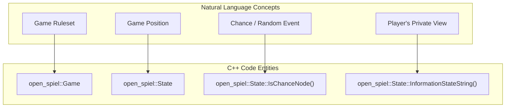
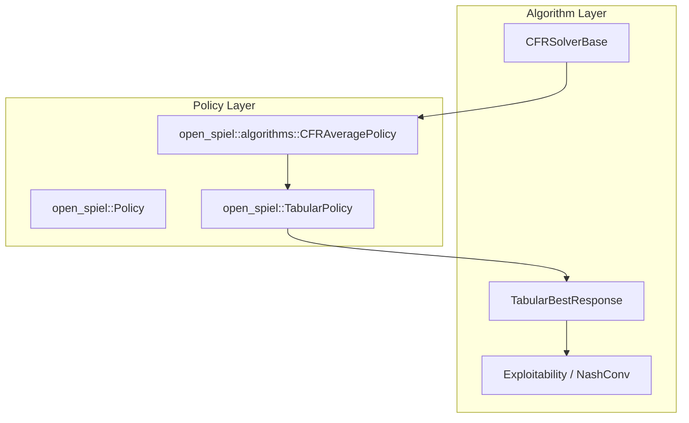

<!-- source: DeepWiki mcp.deepwiki.com · repo google-deepmind/open_spiel · page 11 Glossary · fetched 2026-10-26 -->

# Glossary

Relevant source files

The following files were used as context for generating this wiki page:

- [docs/algorithms.md](docs/algorithms.md)
- [open_spiel/algorithms/CMakeLists.txt](open_spiel/algorithms/CMakeLists.txt)
- [open_spiel/algorithms/cfr.cc](open_spiel/algorithms/cfr.cc)
- [open_spiel/algorithms/cfr.h](open_spiel/algorithms/cfr.h)
- [open_spiel/algorithms/cfr_br.cc](open_spiel/algorithms/cfr_br.cc)
- [open_spiel/algorithms/cfr_br.h](open_spiel/algorithms/cfr_br.h)
- [open_spiel/algorithms/cfr_br_test.cc](open_spiel/algorithms/cfr_br_test.cc)
- [open_spiel/algorithms/cfr_test.cc](open_spiel/algorithms/cfr_test.cc)
- [open_spiel/algorithms/corr_dist.cc](open_spiel/algorithms/corr_dist.cc)
- [open_spiel/algorithms/corr_dist.h](open_spiel/algorithms/corr_dist.h)
- [open_spiel/algorithms/corr_dist_test.cc](open_spiel/algorithms/corr_dist_test.cc)
- [open_spiel/examples/CMakeLists.txt](open_spiel/examples/CMakeLists.txt)
- [open_spiel/game_parameters.cc](open_spiel/game_parameters.cc)
- [open_spiel/game_parameters.h](open_spiel/game_parameters.h)
- [open_spiel/games/universal_poker/CMakeLists.txt](open_spiel/games/universal_poker/CMakeLists.txt)
- [open_spiel/policy.cc](open_spiel/policy.cc)
- [open_spiel/policy.h](open_spiel/policy.h)
- [open_spiel/python/algorithms/cfr.py](open_spiel/python/algorithms/cfr.py)
- [open_spiel/python/algorithms/cfr_test.py](open_spiel/python/algorithms/cfr_test.py)
- [open_spiel/python/bots/policy.py](open_spiel/python/bots/policy.py)
- [open_spiel/python/examples/escher.py](open_spiel/python/examples/escher.py)
- [open_spiel/python/mfg/algorithms/boltzmann_policy_iteration.py](open_spiel/python/mfg/algorithms/boltzmann_policy_iteration.py)
- [open_spiel/python/mfg/algorithms/boltzmann_policy_iteration_test.py](open_spiel/python/mfg/algorithms/boltzmann_policy_iteration_test.py)
- [open_spiel/python/mfg/algorithms/mirror_descent.py](open_spiel/python/mfg/algorithms/mirror_descent.py)
- [open_spiel/python/mfg/algorithms/munchausen_mirror_descent.py](open_spiel/python/mfg/algorithms/munchausen_mirror_descent.py)
- [open_spiel/python/mfg/algorithms/munchausen_mirror_descent_test.py](open_spiel/python/mfg/algorithms/munchausen_mirror_descent_test.py)
- [open_spiel/python/policy.py](open_spiel/python/policy.py)
- [open_spiel/python/pybind11/algorithms_corr_dist.cc](open_spiel/python/pybind11/algorithms_corr_dist.cc)
- [open_spiel/python/pybind11/policy.cc](open_spiel/python/pybind11/policy.cc)
- [open_spiel/python/pybind11/python_policy.cc](open_spiel/python/pybind11/python_policy.cc)
- [open_spiel/python/pybind11/python_policy.h](open_spiel/python/pybind11/python_policy.h)
- [open_spiel/python/pytorch/escher.py](open_spiel/python/pytorch/escher.py)
- [open_spiel/python/pytorch/escher_test.py](open_spiel/python/pytorch/escher_test.py)
- [open_spiel/python/tests/policy_test.py](open_spiel/python/tests/policy_test.py)
- [open_spiel/spiel.cc](open_spiel/spiel.cc)
- [open_spiel/spiel.h](open_spiel/spiel.h)
- [open_spiel/tests/basic_tests.cc](open_spiel/tests/basic_tests.cc)
- [open_spiel/tests/basic_tests.h](open_spiel/tests/basic_tests.h)
- [open_spiel/tests/spiel_test.cc](open_spiel/tests/spiel_test.cc)
- [open_spiel/utils/tensor_view_test.cc](open_spiel/utils/tensor_view_test.cc)

## Purpose and Scope
This page defines codebase-specific terms, jargon, abbreviations, and game-theoretic concepts used across the OpenSpiel C++ core and Python bindings. It maps high-level game theory and infrastructure terminology to their concrete implementations, classes, and functions within the repository.

---

## 1. Core Game Theory and Abstractions

### Action
An integer (`int64_t`) representing a discrete move or choice available to a player or chance entity at a given state. Actions are indexed from `0` to `NumDistinctActions() - 1`.
- **Sources:** `[open_spiel/spiel.h:]()`

### Chance Node
A special state in a game tree where nature or random chance determines the transition (e.g., rolling dice, dealing cards). In OpenSpiel, chance nodes have `CurrentPlayer() == kChancePlayerId` (or can be identified via `State::IsChanceNode()`). Game types specify how chance is handled via `GameType::ChanceMode` (`kDeterministic`, `kExplicitStochastic`, or `kSampledStochastic`).
- **Sources:** `[open_spiel/spiel.h:87-94](), [open_spiel/spiel.cc:115-117]()`

### Game
The static specification and factory for a particular game ruleset. Encapsulated by the abstract base class `Game`, which defines properties like player counts, action bounds, and creates initial states.
- **Sources:** `[open_spiel/spiel.h:]()`

### Information State (Infostate)
A perfect-recall history of the game from the perspective of a single player, containing everything that player has observed and done. Used in imperfect-information games where players do not have full visibility of the true `State`. Accessible via `State::InformationStateString()` and `State::InformationStateTensor()`.
- **Sources:** `[open_spiel/spiel.h:127-131]()`

### Observation
A compressed or partial view of the game state (a subset of the information state) visible to a player. Unlike information states, observations do not strictly require perfect recall unless combined across time, but remembering a sequence of observations and actions must reconstruct the infostate.
- **Sources:** `[open_spiel/spiel.h:134-138](), [open_spiel/observer.h]()`

### State
The dynamic, mutable representation of a game at a specific point in its tree. A `State` tracks the current player, history of actions, legality of moves, rewards, and terminal status.
- **Sources:** `[open_spiel/spiel.h:]()`

---

Diagram: Natural Language Concept to C++ Core Entities

*Sources: `[open_spiel/spiel.h:52-140]()`*

---

## 2. Algorithms and Solution Concepts

### CFR (Counterfactual Regret Minimization)
An iterative gradient-like algorithm designed to compute approximate Nash equilibria in large imperfect-information extensive-form games (such as poker). It accumulates counterfactual regrets for each action at every information state and uses regret matching to update the policy.
- **Sources:** `[open_spiel/algorithms/cfr.h:42-98](), [open_spiel/python/algorithms/cfr.py:15-23]()`

### Exploitability
A measure of how far a strategy profile is from a Nash equilibrium, defined as the sum of the utility gains each player could achieve by unilaterally switching to a best response.
- **Sources:** `[open_spiel/python/pybind11/policy.cc:42-47]()`

### MCTS (Monte Carlo Tree Search) & IS-MCTS
Search algorithms that build a partial game tree using random rollouts or neural network evaluations. Information Set MCTS (`IS-MCTS`) extends standard MCTS to imperfect-information games by determinizing the game state from the perspective of the acting player.
- **Sources:** `[docs/algorithms.md:12-16]()`

### NashConv (Nash Convergence)
The sum over all players of each player's exploitability. In two-player zero-sum games, NashConv is equivalent to total exploitability. A NashConv of `0.0` represents a true Nash equilibrium.
- **Sources:** `[open_spiel/python/pybind11/policy.cc:43]()`

### MFG (Mean Field Games)
A class of games modeling interactions between a very large number of small, anonymous agents. OpenSpiel includes experimental support for MFG via `GameType::Dynamics::kMeanField`, introducing mean-field distribution nodes alongside decision nodes.
- **Sources:** `[open_spiel/spiel.h:71-73](), [open_spiel/spiel.cc:95-98]()`

### PSRO (Policy-Space Response Oracles)
A population-based multi-agent reinforcement learning algorithm that frames game solving as empirical game theory. It iteratively trains best-response policies against a meta-distribution over a growing population of historical policies.
- **Sources:** `[open_spiel/examples/CMakeLists.txt]()`

---

Diagram: Algorithm & Solver Architecture

*Sources: `[open_spiel/algorithms/cfr.h:123-147](), [open_spiel/python/pybind11/policy.cc:39-46]()`*

---

## 3. Formats, Protocols, and Integrations

### ACPC (Annual Computer Poker Competition)
A standard file format and client-server protocol suite for defining and playing imperfect-information poker games. OpenSpiel integrates ACPC game definitions through the `universal_poker` game module.
- **Sources:** `[open_spiel/examples/CMakeLists.txt:7-10]()`

### FEN (Forsyth-Edwards Notation)
A standard text-based notation used to describe a particular board position of a chess game (piece placement, active color, castling availability, en passant target, halfmove clock, and fullmove number). Used heavily in OpenSpiel's chess implementations for serialization and state parsing.

### EFG / NFG
Extensive Form Game (`.efg`) and Normal Form Game (`.nfg`) file formats. OpenSpiel provides parsers and writers to import and export games in these standard tabular/tree formats (often compatible with Gambit).
- **Sources:** `[open_spiel/algorithms/CMakeLists.txt:50-51]()`

---

## 4. Codebase and Testing Infrastructure

### Observer / Observation Tensor
C++ classes responsible for extracting tensor or string representations of observations or information states from a `State`. Allocators and `SpanTensor` structures handle memory efficiently for deep learning pipelines.
- **Sources:** `[open_spiel/spiel.h:39](), [open_spiel/observer.h]()`

### Playthrough
An automated integration testing mechanism consisting of a recorded sequence of states, actions, and expected outputs. Playthroughs are generated using `generate_playthrough.py` and validated during regression tests to ensure game mechanics remain consistent across code changes.

### TabularPolicy
A policy representation that explicitly stores probability distributions for states or information states in a tabular lookup structure (either a hash map in C++ or a dense numpy array in Python).
- **Sources:** `[open_spiel/policy.h:152-155](), [open_spiel/python/policy.py:21-23]()`

---
*Sources:* `[open_spiel/spiel.h](), [open_spiel/policy.h](), [open_spiel/algorithms/cfr.h](), [open_spiel/python/policy.py]()`