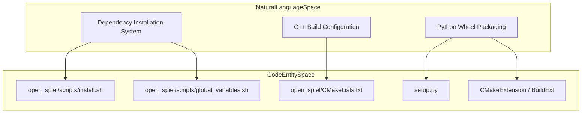
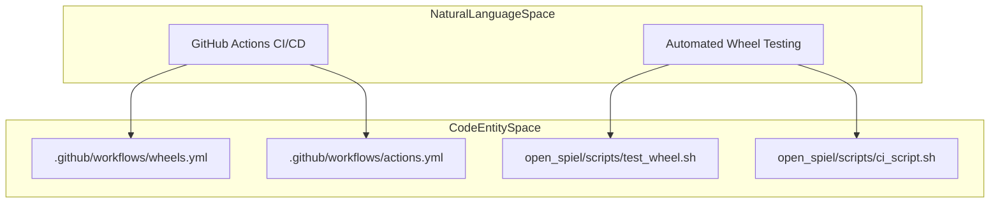

<!-- source: DeepWiki mcp.deepwiki.com · repo google-deepmind/open_spiel · page 2 Build System and Development Environment · fetched 2026-10-26 -->

# Build System and Development Environment

Relevant source files

The following files were used as context for generating this wiki page:

- [.github/workflows/actions.yml](.github/workflows/actions.yml)
- [.github/workflows/wheels.yml](.github/workflows/wheels.yml)
- [.gitignore](.gitignore)
- [MANIFEST.in](MANIFEST.in)
- [README.md](README.md)
- [__init__.py](__init__.py)
- [docs/_static/OpenSpielC.png](docs/_static/OpenSpielC.png)
- [docs/_static/OpenSpielC_w800.png](docs/_static/OpenSpielC_w800.png)
- [docs/windows.md](docs/windows.md)
- [install.sh](install.sh)
- [open_spiel/CMakeLists.txt](open_spiel/CMakeLists.txt)
- [open_spiel/bots/CMakeLists.txt](open_spiel/bots/CMakeLists.txt)
- [open_spiel/games/hanabi/CMakeLists.txt](open_spiel/games/hanabi/CMakeLists.txt)
- [open_spiel/games/hanabi/README.md](open_spiel/games/hanabi/README.md)
- [open_spiel/scripts/build_and_run_tests.sh](open_spiel/scripts/build_and_run_tests.sh)
- [open_spiel/scripts/ci_script.sh](open_spiel/scripts/ci_script.sh)
- [open_spiel/scripts/global_variables.sh](open_spiel/scripts/global_variables.sh)
- [open_spiel/scripts/install.sh](open_spiel/scripts/install.sh)
- [open_spiel/scripts/python_extra_deps.sh](open_spiel/scripts/python_extra_deps.sh)
- [open_spiel/scripts/test_wheel.sh](open_spiel/scripts/test_wheel.sh)
- [pyproject.toml](pyproject.toml)
- [requirements.txt](requirements.txt)
- [setup.py](setup.py)

This page documents OpenSpiel's build system and development environment infrastructure, which serves as the foundation for building, testing, and distributing the framework across multiple platforms. The build system handles C++ compilation via CMake, Python package creation, dependency management, and automated testing through GitHub Actions.

For information about the Python-C++ integration layer specifically, see [Python Integration](#4). For details on the testing framework itself, see [Testing and Validation](#10).

Sources: [.github/workflows/wheels.yml:1-148](), [setup.py:1-145](), [open_spiel/scripts/install.sh:1-352](), [open_spiel/CMakeLists.txt:1-340]()

---

*Figure 1: Bridging high-level build components to underlying code entities.*

Sources: [open_spiel/scripts/install.sh:1-352](), [open_spiel/scripts/global_variables.sh:1-109](), [open_spiel/CMakeLists.txt:1-340](), [setup.py:1-169]()

---

## 2.1 Installation and Dependencies

The OpenSpiel installation infrastructure is orchestrated primarily through `install.sh` and configuration scripts like `global_variables.sh`. It provisions essential third-party repositories—such as `abseil-cpp`, `pybind11`, `nlohmann/json`, and bridge double dummy solvers (`dds`)—while offering optional support for specialized game environments and tools like Hanabi, Universal Poker (ACPC), JAX, PyTorch, and OR-Tools.

For detailed instructions on installing OpenSpiel, managing core and optional dependencies, and configuring system requirements, see [Installation and Dependencies](#2.1).

Sources: [open_spiel/scripts/install.sh:1-190](), [open_spiel/scripts/global_variables.sh:1-109]()

---

## 2.2 CMake Build System

OpenSpiel relies on a hierarchical CMake configuration centered around [open_spiel/CMakeLists.txt](). It implements conditional compilation features via the `openspiel_optional_dependency` macro, allowing developers to selectively include optional games and backend optimizations. The system supports three primary build types (`Debug`, `Testing`, and `Release`) tailored for development, validation, and maximum runtime performance.

For an in-depth explanation of the CMake configuration system, conditional targets, and compilation flags, see [CMake Build System](#2.2).

Sources: [open_spiel/CMakeLists.txt:1-154]()

---

## 2.3 Python Package Building

Python integration and distribution are handled through [setup.py]() using a custom setuptools extension architecture. Instead of relying on distutils to compile sources directly, OpenSpiel defines a `CMakeExtension` and a custom `BuildExt` command class that delegates compilation entirely to CMake, ensuring seamless cross-platform binary wheel generation for Linux and macOS.

For details on custom extension compilation, packaging scripts, and multi-platform wheel building, see [Python Package Building](#2.3).

Sources: [setup.py:1-169]()

---

*Figure 2: Mapping CI/CD concepts to workflow and script entities.*

Sources: [.github/workflows/wheels.yml:1-155](), [.github/workflows/actions.yml:1-109](), [open_spiel/scripts/test_wheel.sh:1-109](), [open_spiel/scripts/ci_script.sh:1-46]()

---

## 2.4 CI/CD and Testing Pipeline

Continuous integration and delivery are governed by GitHub Actions workflows defined in `.github/workflows/wheels.yml` and `.github/workflows/actions.yml`. These workflows automate cross-platform compilation, execution of the comprehensive CTest test suite, and rigorous validation of built Python wheels across different Python versions and ML framework configurations.

For a thorough breakdown of CI workflows, automated testing harnesses, and wheel validation steps, see [CI/CD and Testing Pipeline](#2.4).

Sources: [.github/workflows/wheels.yml:1-155](), [.github/workflows/actions.yml:1-109]()

---

