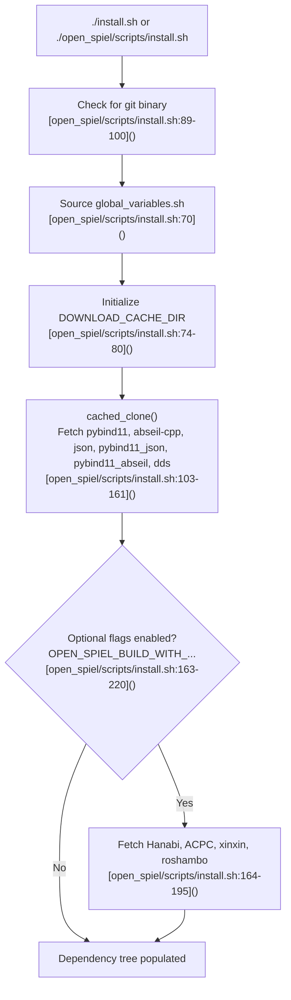
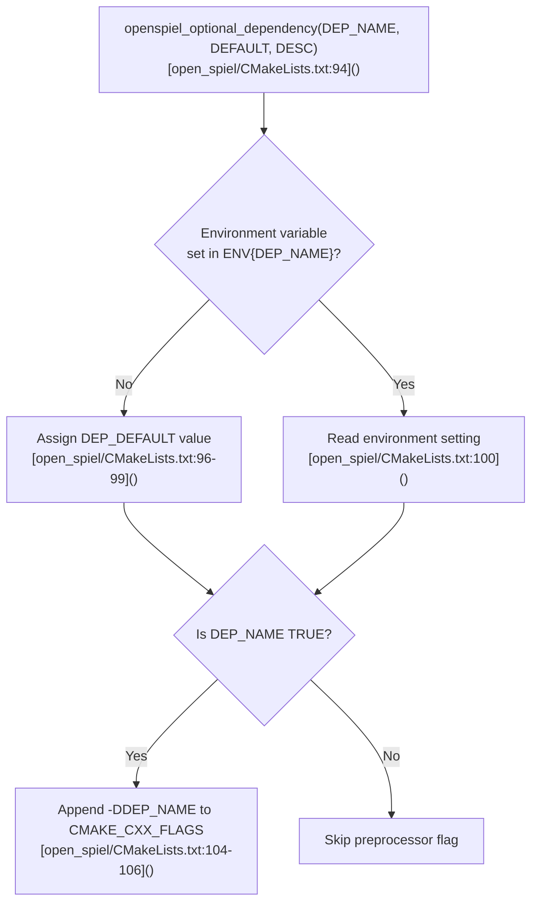
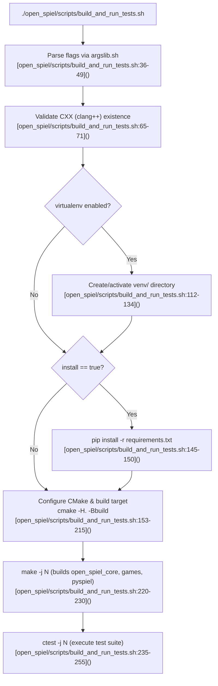

<!-- source: DeepWiki mcp.deepwiki.com · repo google-deepmind/open_spiel · page 2.1 Installation and Dependencies · fetched 2026-10-26 -->

# Installation and Dependencies

<details>
<summary>Relevant source files</summary>

The following files were used as context for generating this wiki page:

- [.gitignore](.gitignore)
- [Dockerfile.base](Dockerfile.base)
- [docs/Makefile](docs/Makefile)
- [docs/api_reference.md](docs/api_reference.md)
- [docs/concepts.md](docs/concepts.md)
- [docs/fix_table_links.sh](docs/fix_table_links.sh)
- [docs/install.md](docs/install.md)
- [docs/requirements.readthedocs.txt](docs/requirements.readthedocs.txt)
- [install.sh](install.sh)
- [open_spiel/CMakeLists.txt](open_spiel/CMakeLists.txt)
- [open_spiel/bots/CMakeLists.txt](open_spiel/bots/CMakeLists.txt)
- [open_spiel/games/hanabi/CMakeLists.txt](open_spiel/games/hanabi/CMakeLists.txt)
- [open_spiel/games/hanabi/README.md](open_spiel/games/hanabi/README.md)
- [open_spiel/games/rbc/rbc.cc](open_spiel/games/rbc/rbc.cc)
- [open_spiel/games/rbc/rbc.h](open_spiel/games/rbc/rbc.h)
- [open_spiel/games/rbc/rbc_test.cc](open_spiel/games/rbc/rbc_test.cc)
- [open_spiel/integration_tests/playthroughs/rbc(board_size=4).txt](open_spiel/integration_tests/playthroughs/rbc(board_size=4).txt)
- [open_spiel/integration_tests/playthroughs/rbc(sense_border=true,sense_centered=true).txt](open_spiel/integration_tests/playthroughs/rbc(sense_border=true,sense_centered=true).txt)
- [open_spiel/integration_tests/playthroughs/rbc.txt](open_spiel/integration_tests/playthroughs/rbc.txt)
- [open_spiel/scripts/build_and_run_tests.sh](open_spiel/scripts/build_and_run_tests.sh)
- [open_spiel/scripts/global_variables.sh](open_spiel/scripts/global_variables.sh)
- [open_spiel/scripts/install.sh](open_spiel/scripts/install.sh)
- [readthedocs.yml](readthedocs.yml)

</details>


## Purpose and Scope

This document provides a comprehensive technical guide to installing OpenSpiel, managing its core and optional dependencies, and configuring the build environment. It details the execution flow of the installation infrastructure (`install.sh`), global build flags (`global_variables.sh`), conditional compilation macros in CMake (`open_spiel/CMakeLists.txt`), and the automated build and test orchestration pipeline (`build_and_run_tests.sh`). 

---

## System Requirements and Environment Setup

OpenSpiel requires a modern C++ compiler supporting C++20 (or C++17 depending on configuration) and a compatible Python 3 environment.

- **CMake**: Version 3.17 or newer is required to utilize modern `FindPython` modules and compiler standard definitions (`[open_spiel/CMakeLists.txt:1-5]()`).
- **C++ Compiler**: Clang (`clang++`) is recommended and enforced in scripts, though recent `g++` versions are also compatible (`[open_spiel/scripts/build_and_run_tests.sh:65-71]()`). On macOS, Xcode Command Line Tools provide `clang++` (`[docs/install.md:61-63]()`).
- **Python**: Python 3.11 or newer is required (`[docs/install.md:70-72]()`).

Sources: [open_spiel/CMakeLists.txt:1-5](), [open_spiel/scripts/build_and_run_tests.sh:65-71](), [docs/install.md:61-72]()

---

## Dependency Management Architecture (`install.sh`)

OpenSpiel handles third-party dependencies by cloning fixed releases or specific commits into subdirectories under `open_spiel/` rather than relying on Git submodules, avoiding metadata conflicts in internal mirroring systems (`[open_spiel/scripts/install.sh:82-87]()`).

### Dependency Download Flow



The script defines a `cached_clone()` utility function that caches git repositories locally in `download_cache/` (`[open_spiel/scripts/install.sh:103-116]()`). If a cached target exists, it copies from the cache rather than re-cloning from remote endpoints.

Sources: [open_spiel/scripts/install.sh:70-220]()

---

## Core Dependencies

The core framework relies on a minimal set of well-versioned C++ libraries and bindings helpers. These are automatically provisioned by `install.sh`.

| Library Entity | Code Directory | Version / Commit | Role in Architecture |
|----------------|----------------|------------------|----------------------|
| `abseil-cpp` | `open_spiel/abseil-cpp` | `$OPEN_SPIEL_ABSL_VERSION` (`20250814.1`) | Fundamental data structures, logging, status types (`[open_spiel/scripts/install.sh:20](), [open_spiel/scripts/global_variables.sh:33]()`) |
| `pybind11` | `pybind11` | `master` branch | C++/Python binding bridge (`[open_spiel/scripts/install.sh:122-125]()`) |
| `nlohmann/json` | `open_spiel/json` | `9cca280a` | JSON parsing and state serialization (`[open_spiel/scripts/install.sh:139-145]()`) |
| `pybind11_json` | `open_spiel/pybind11_json` | `d0bf434b` | Type conversion between `nlohmann::json` and Python dicts (`[open_spiel/scripts/install.sh:147-153]()`) |
| `pybind11_abseil` | `open_spiel/pybind11_abseil` | `73992b5` | Type conversion for Abseil types in Python bindings (`[open_spiel/scripts/install.sh:155-161]()`) |
| `dds` | `open_spiel/games/bridge/double_dummy_solver` | `develop` | Double Dummy Solver for Bridge game (`[open_spiel/scripts/install.sh:129-132]()`) |

Sources: [open_spiel/scripts/install.sh:20-161](), [open_spiel/scripts/global_variables.sh:33]()

---

## Optional Dependencies and CMake Integration

Optional game engines, communication protocols, and machine learning frameworks are managed via global environment variables defined in `global_variables.sh` (`[open_spiel/scripts/global_variables.sh:17-109]()`). These defaults are governed by `DEFAULT_OPTIONAL_DEPENDENCY` (`[open_spiel/scripts/global_variables.sh:27]`).

### CMake Macro Configuration

In `open_spiel/CMakeLists.txt`, conditional compilation is enforced via the `openspiel_optional_dependency` macro (`[open_spiel/CMakeLists.txt:94-107]()`). 



### Key Optional Dependencies

- **Hanabi (`OPEN_SPIEL_BUILD_WITH_HANABI`)**: Clones the Hanabi Learning Environment into `open_spiel/games/hanabi/hanabi-learning-environment` (`[open_spiel/scripts/install.sh:164-173]()`).
- **Universal Poker / ACPC (`OPEN_SPIEL_BUILD_WITH_ACPC`)**: Clones `project_acpc_server` into `open_spiel/games/universal_poker/acpc` (`[open_spiel/scripts/install.sh:178-181]()`).
- **OR-Tools (`OPEN_SPIEL_BUILD_WITH_ORTOOLS`)**: Integrates Google's C++ optimization library for linear programming and sequence-form solvers (`[open_spiel/scripts/global_variables.sh:95-103]()`).
- **LibTorch (`OPEN_SPIEL_BUILD_WITH_LIBTORCH`)**: Downloads precompiled libtorch binaries for C++ front-end neural network execution (`[open_spiel/scripts/global_variables.sh:53-89]()`).
- **Python ML Frameworks (`OPEN_SPIEL_ENABLE_JAX`, `OPEN_SPIEL_ENABLE_PYTORCH`)**: Automatically detected or forced via environment settings to incorporate tensor-based algorithms (`[open_spiel/CMakeLists.txt:131-141]()`).

Sources: [open_spiel/scripts/global_variables.sh:17-109](), [open_spiel/CMakeLists.txt:84-148](), [open_spiel/scripts/install.sh:164-190]()

---

## Build and Test Orchestration (`build_and_run_tests.sh`)

The script `open_spiel/scripts/build_and_run_tests.sh` orchestrates virtual environment setup, requirement installation, CMake configuration, compilation, and test execution (`[open_spiel/scripts/build_and_run_tests.sh:17-262]`).

### Execution Pipeline



Sources: [open_spiel/scripts/build_and_run_tests.sh:1-261]()

---

## Verification and Troubleshooting

To verify that the installation and dependency linkage are successful, run the core test suite or test loading modules in Python:

```bash
# Verify Python bindings registration
python3 -c "import pyspiel; print(pyspiel.registered_games())"

# Run C++ and Python integration tests via CTest
cd build
ctest -V -R example_test
```

### Common Troubleshooting Steps
- **Missing Clang**: If `clang++` is missing, export `CXX=g++` or install clang (`[open_spiel/scripts/build_and_run_tests.sh:65-71]`, `[docs/install.md:28-40]()`).
- **ABI Mismatch with Abseil**: Ensure Abseil version matches `$OPEN_SPIEL_ABSL_VERSION` (`[open_spiel/scripts/install.sh:20]()`).
- **Python Extension Linkage on macOS**: Ensure `-undefined dynamic_lookup` is preserved in CXX flags for `pybind11` modules (`[open_spiel/CMakeLists.txt:63-67]()`).

Sources: [open_spiel/scripts/build_and_run_tests.sh:65-71](), [open_spiel/CMakeLists.txt:63-67](), [docs/install.md:28-57]()

---

