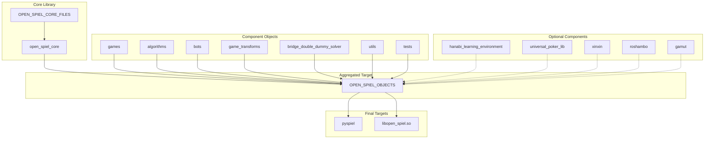
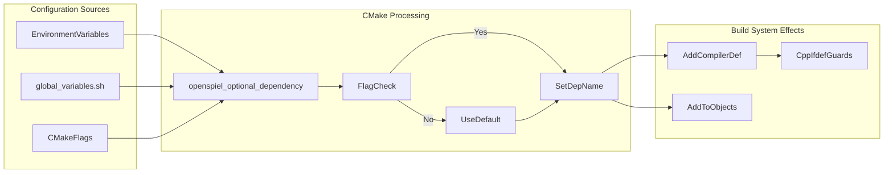
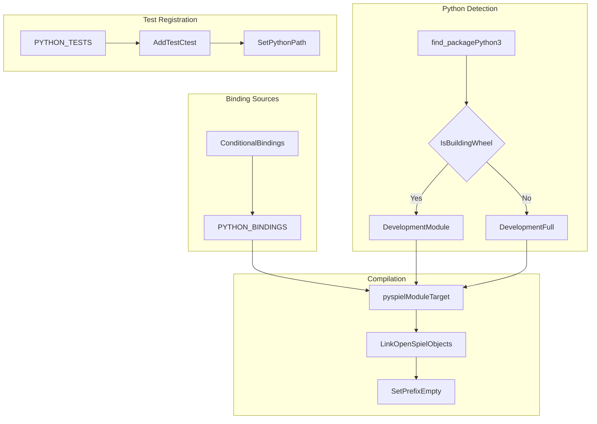

<!-- source: DeepWiki mcp.deepwiki.com · repo google-deepmind/open_spiel · page 2.2 CMake Build System · fetched 2026-10-26 -->

# CMake Build System

<details>
<summary>Relevant source files</summary>

The following files were used as context for generating this wiki page:

- [.gitignore](.gitignore)
- [install.sh](install.sh)
- [open_spiel/CMakeLists.txt](open_spiel/CMakeLists.txt)
- [open_spiel/bots/CMakeLists.txt](open_spiel/bots/CMakeLists.txt)
- [open_spiel/game_transforms/CMakeLists.txt](open_spiel/game_transforms/CMakeLists.txt)
- [open_spiel/game_transforms/game_wrapper.h](open_spiel/game_transforms/game_wrapper.h)
- [open_spiel/games/hanabi/CMakeLists.txt](open_spiel/games/hanabi/CMakeLists.txt)
- [open_spiel/games/hanabi/README.md](open_spiel/games/hanabi/README.md)
- [open_spiel/python/pybind11/algorithms_trajectories.cc](open_spiel/python/pybind11/algorithms_trajectories.cc)
- [open_spiel/python/pybind11/algorithms_trajectories.h](open_spiel/python/pybind11/algorithms_trajectories.h)
- [open_spiel/python/pybind11/bots.h](open_spiel/python/pybind11/bots.h)
- [open_spiel/python/pybind11/game_transforms.cc](open_spiel/python/pybind11/game_transforms.cc)
- [open_spiel/python/pybind11/game_transforms.h](open_spiel/python/pybind11/game_transforms.h)
- [open_spiel/python/pybind11/policy.h](open_spiel/python/pybind11/policy.h)
- [open_spiel/scripts/build_and_run_tests.sh](open_spiel/scripts/build_and_run_tests.sh)
- [open_spiel/scripts/global_variables.sh](open_spiel/scripts/global_variables.sh)
- [open_spiel/scripts/install.sh](open_spiel/scripts/install.sh)
- [open_spiel/utils/CMakeLists.txt](open_spiel/utils/CMakeLists.txt)
- [open_spiel/utils/circular_buffer.h](open_spiel/utils/circular_buffer.h)
- [open_spiel/utils/circular_buffer_test.cc](open_spiel/utils/circular_buffer_test.cc)
- [open_spiel/utils/serializable_circular_buffer.h](open_spiel/utils/serializable_circular_buffer.h)
- [open_spiel/utils/serializable_circular_buffer_test.cc](open_spiel/utils/serializable_circular_buffer_test.cc)

</details>


This page documents the CMake-based build system that compiles OpenSpiel's C++ core library, game implementations, algorithms, and Python bindings. It covers the configuration system, conditional compilation mechanisms, and how different components are assembled into build targets.

For information about installing dependencies before running CMake, see [Installation and Dependencies](#2.1). For details on how Python wheels are packaged using this CMake system, see [Python Package Building](#2.3).

## Purpose and Scope

The CMake build system serves as the primary compilation mechanism for OpenSpiel. It handles:

- Compiling the C++ core library (`open_spiel_core`) and all game/algorithm implementations [open_spiel/CMakeLists.txt:155-184]()
- Managing conditional compilation of optional dependencies (ACPC poker, Hanabi, OR-Tools, etc.) [open_spiel/CMakeLists.txt:94-148]()
- Building Python bindings via pybind11 as the `pyspiel` module [open_spiel/python/CMakeLists.txt:128-136]()
- Registering and running C++ and Python tests via CTest [open_spiel/CMakeLists.txt:153](), [open_spiel/python/CMakeLists.txt:181-372]()
- Supporting different build configurations (`Debug`, `Testing`, `Release`) [open_spiel/CMakeLists.txt:35-61]()

The system is invoked either directly via `cmake` commands or indirectly through `setup.py` when building Python wheels [setup.py:40-101]().

Sources: [open_spiel/CMakeLists.txt:35-61](), [open_spiel/CMakeLists.txt:94-148](), [open_spiel/CMakeLists.txt:155-184](), [open_spiel/python/CMakeLists.txt:128-136](), [open_spiel/python/CMakeLists.txt:181-372](), [setup.py:40-101]()

---

## CMake Configuration Overview

### Directory Structure

The CMake system follows a hierarchical structure with `CMakeLists.txt` files located across the repository subdirectories:

```
open_spiel/
├── CMakeLists.txt              # Top-level configuration
├── algorithms/CMakeLists.txt   # Algorithm implementations
├── bots/CMakeLists.txt         # Bot implementations  
├── games/CMakeLists.txt        # Game implementations
├── python/CMakeLists.txt       # Python bindings
├── utils/CMakeLists.txt        # Utility functions
└── tests/CMakeLists.txt        # Test infrastructure
```

The top-level `CMakeLists.txt` includes all subdirectories via `add_subdirectory()` commands and defines core build settings.

Sources: [open_spiel/CMakeLists.txt:1-340]()

### Build Types

OpenSpiel supports three build types controlled by the `BUILD_TYPE` environment variable:

| Build Type | Flags | Purpose |
|------------|-------|---------|
| **Debug** | `-g -Og` | Basic debugging with minimal optimization [open_spiel/CMakeLists.txt:43-47]() |
| **Testing** | `-O2` | Default for CI; keeps runtime checks but enables speed optimizations [open_spiel/CMakeLists.txt:49-54]() |
| **Release** | `-DNDEBUG -O3` | Production builds; disables debug checks, maximum optimization [open_spiel/CMakeLists.txt:56-61]() |

Sources: [open_spiel/CMakeLists.txt:35-61]()

---

## Core Build Targets

### Diagram: Core Target Architecture



Sources: [open_spiel/CMakeLists.txt:155-262]()

### open_spiel_core Target

The `open_spiel_core` target is an OBJECT library containing the fundamental game engine abstractions defined in `OPEN_SPIEL_CORE_FILES`:

[open_spiel/CMakeLists.txt:155-182]()

Key files include:
- `spiel.h/cc` - Game and State abstract base classes
- `policy.h/cc` - Policy abstraction
- `game_parameters.h/cc` - Game parameter system
- `observer.h/cc` - Game observation system
- `spiel_utils.h/cc` - Utility functions

This target is compiled as position-independent code (`CMAKE_POSITION_INDEPENDENT_CODE ON`) to support Python extension building [open_spiel/CMakeLists.txt:80-81]().

Sources: [open_spiel/CMakeLists.txt:80-81](), [open_spiel/CMakeLists.txt:155-182]()

### OPEN_SPIEL_OBJECTS Collection

The `OPEN_SPIEL_OBJECTS` variable aggregates all compiled object files from core and subdirectories [open_spiel/CMakeLists.txt:222-247](). Conditional dependencies are appended based on build flags [open_spiel/CMakeLists.txt:233-262]().

Sources: [open_spiel/CMakeLists.txt:222-262]()

---

## Conditional Compilation System

### The openspiel_optional_dependency Macro

The core mechanism for conditional compilation is the `openspiel_optional_dependency` CMake macro:

[open_spiel/CMakeLists.txt:94-107]()

This macro:
1. Checks if an environment variable is set (e.g., `OPEN_SPIEL_BUILD_WITH_ACPC`) [open_spiel/CMakeLists.txt:96-100]()
2. Defaults to `DEP_DEFAULT` if not set [open_spiel/CMakeLists.txt:96-99]()
3. Passes the flag as a preprocessor definition (e.g., `-DOPEN_SPIEL_BUILD_WITH_ACPC`) [open_spiel/CMakeLists.txt:104-106]()
4. Prints colored status messages during configuration [open_spiel/CMakeLists.txt:97-101]()

### Diagram: Conditional Compilation Flow



Sources: [open_spiel/CMakeLists.txt:94-107](), [open_spiel/scripts/global_variables.sh:1-109]()

### Optional Dependencies List

The following optional dependencies are defined:

| Dependency | Default | Description |
|------------|---------|-------------|
| `OPEN_SPIEL_BUILD_WITH_ACPC` | OFF | Universal Poker with ACPC server [open_spiel/CMakeLists.txt:110-111]() |
| `OPEN_SPIEL_BUILD_WITH_HANABI` | OFF | Hanabi learning environment [open_spiel/CMakeLists.txt:112-113]() |
| `OPEN_SPIEL_BUILD_WITH_JULIA` | OFF | Julia language bindings [open_spiel/CMakeLists.txt:114-115]() |
| `OPEN_SPIEL_BUILD_WITH_LIBNOP` | OFF | Serialization library support [open_spiel/CMakeLists.txt:116-117]() |
| `OPEN_SPIEL_BUILD_WITH_LIBTORCH` | OFF | PyTorch C++ API integration [open_spiel/CMakeLists.txt:118-119]() |
| `OPEN_SPIEL_BUILD_WITH_PYTHON` | ON | Python bindings (`pyspiel`) [open_spiel/CMakeLists.txt:120-121]() |
| `OPEN_SPIEL_BUILD_WITH_XINXIN` | OFF | XinXin Hearts bot [open_spiel/CMakeLists.txt:122-123]() |
| `OPEN_SPIEL_BUILD_WITH_ROSHAMBO` | OFF | RoShamBo competition bots [open_spiel/CMakeLists.txt:124-125]() |
| `OPEN_SPIEL_BUILD_WITH_GAMUT` | OFF | GAMUT game generator [open_spiel/CMakeLists.txt:126-127]() |
| `OPEN_SPIEL_BUILD_WITH_ORTOOLS` | OFF | OR-Tools optimization library [open_spiel/CMakeLists.txt:128-129]() |
| `OPEN_SPIEL_ENABLE_JAX` | AUTO | Enable JAX tests [open_spiel/CMakeLists.txt:137-138]() |
| `OPEN_SPIEL_ENABLE_PYTORCH` | AUTO | Enable PyTorch tests [open_spiel/CMakeLists.txt:139-140]() |
| `OPEN_SPIEL_ENABLE_PYTHON_MISC` | OFF | Enable misc Python tests [open_spiel/CMakeLists.txt:143-144]() |
| `OPEN_SPIEL_BUILDING_WHEEL` | OFF | Building Python wheel [open_spiel/CMakeLists.txt:146-147]() |

Sources: [open_spiel/CMakeLists.txt:110-148](), [open_spiel/scripts/global_variables.sh:25-109]()

---

## Python Extension Building

### Diagram: Python Extension Build Flow



Sources: [open_spiel/python/CMakeLists.txt:1-388]()

### pyspiel MODULE Target

The final Python extension is built as:

[open_spiel/python/CMakeLists.txt:128-136]()

Key properties:
- **MODULE** type: loadable Python extension (not a shared library)
- **PREFIX ""**: Ensures output is `pyspiel.so` rather than `libpyspiel.so`
- Links all `OPEN_SPIEL_OBJECTS`, making the entire C++ library accessible from Python.

Sources: [open_spiel/python/CMakeLists.txt:128-136]()

---

## Build Invocation Patterns

### Diagram: CMake Invocation Methods

```mermaid
graph TB
    subgraph "Manual Build"
        ManualCMake["cmakeOpenSpiel"]
        ManualMake["makePyspiel"]
        ManualTest["ctest"]
    end
    
    subgraph "Build Script"
        BuildScript["build_and_run_tests.sh"]
        VirtualEnv["VirtualEnvSetup"]
        ScriptCMake["ConfigureCMake"]
        ScriptMake["MakeCompile"]
        ScriptCTest["RunCTest"]
    end
    
    subgraph "Python Wheel Build"
        SetupPy["setup.py"]
        CMakeExtension["CMakeExtension"]
        SubprocessCMake["SubprocessCMake"]
    end
    
    ManualCMake --> ManualMake
    ManualMake --> ManualTest
    
    BuildScript --> VirtualEnv
    VirtualEnv --> ScriptCMake
    ScriptCMake --> ScriptMake
    ScriptMake --> ScriptCTest
    
    SetupPy --> CMakeExtension
    CMakeExtension --> SubprocessCMake
```



Sources: [setup.py:76-101](), [open_spiel/scripts/build_and_run_tests.sh:1-261]()

---

## Summary

The CMake build system provides modular compilation via OBJECT libraries, conditional compilation via `openspiel_optional_dependency`, pybind11 integration for Python extensions, CTest integration, and cross-platform support.

Sources: [open_spiel/CMakeLists.txt:1-340](), [open_spiel/python/CMakeLists.txt:1-388](), [setup.py:1-145]()

---

