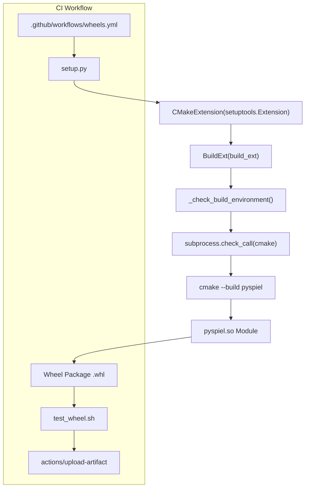
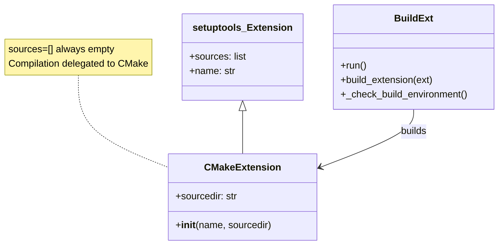
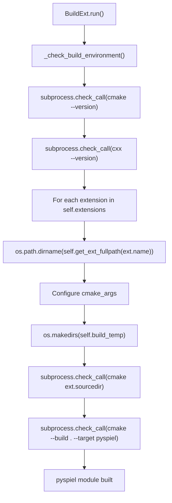
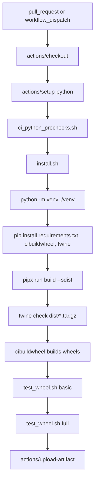
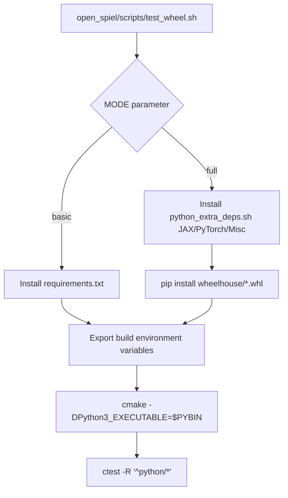

<!-- source: DeepWiki mcp.deepwiki.com · repo google-deepmind/open_spiel · page 2.3 Python Package Building · fetched 2026-10-26 -->

# Python Package Building

<details>
<summary>Relevant source files</summary>

The following files were used as context for generating this wiki page:

- [.github/workflows/actions.yml](.github/workflows/actions.yml)
- [.github/workflows/wheels.yml](.github/workflows/wheels.yml)
- [MANIFEST.in](MANIFEST.in)
- [README.md](README.md)
- [__init__.py](__init__.py)
- [docs/_static/OpenSpielC.png](docs/_static/OpenSpielC.png)
- [docs/_static/OpenSpielC_w800.png](docs/_static/OpenSpielC_w800.png)
- [docs/windows.md](docs/windows.md)
- [open_spiel/scripts/ci_script.sh](open_spiel/scripts/ci_script.sh)
- [open_spiel/scripts/python_extra_deps.sh](open_spiel/scripts/python_extra_deps.sh)
- [open_spiel/scripts/test_wheel.sh](open_spiel/scripts/test_wheel.sh)
- [pyproject.toml](pyproject.toml)
- [requirements.txt](requirements.txt)
- [setup.py](setup.py)

</details>


This page documents how OpenSpiel's Python package is built, including the custom `setup.py` mechanism that integrates CMake builds, the wheel building process for multiple platforms, and the testing infrastructure. For general build system details, see [CMake Build System](#2.2).

## Overview

OpenSpiel's Python package is built using a custom integration between Python's `setuptools` and CMake. The `setup.py` file defines custom extension classes that invoke CMake to compile the C++ core and Python bindings, then package everything into distributable wheel files.

Title: "Python Package Building Flow"

Sources: [setup.py:1-144](), [.github/workflows/wheels.yml:1-148](), [open_spiel/scripts/test_wheel.sh:1-93]()

## setup.py Architecture

The root `setup.py` file implements a custom build process that bridges Python packaging with CMake-based C++ compilation.

### Key Components

| Component | Purpose |
|-----------|---------|
| `CMakeExtension` | Extension class with no sources, delegates to CMake [setup.py:28-37]() |
| `BuildExt` | Custom `build_ext` command that invokes CMake [setup.py:40-101]() |
| `_get_requirements()` | Parses `requirements.txt` for dependencies [setup.py:128-136]() |
| Package metadata | Version, author, description, and extension setup [setup.py:153-169]() |

Sources: [setup.py:28-169]()

### CMakeExtension Class

The `CMakeExtension` class is a custom `setuptools.Extension` that stores the source directory but provides no source files, as all compilation is delegated to CMake:

```python
class CMakeExtension(setuptools.Extension):
  """An extension with no sources.

  We do not want distutils to handle any of the compilation (instead we rely
  on CMake), so we always pass an empty list to the constructor.
  """

  def __init__(self, name, sourcedir=""):
    super().__init__(name, sources=[])
    self.sourcedir = os.path.abspath(sourcedir)
```
Sources: [setup.py:28-37]()

Title: "CMakeExtension Class Hierarchy and Usage"

Sources: [setup.py:28-37](), [setup.py:40-101]()

### BuildExt Command

The `BuildExt` class overrides setuptools' default `build_ext` command to use CMake instead of compiling source files directly:

Title: "BuildExt Execution Flow"

Sources: [setup.py:40-125]()

The implementation in [setup.py:46-125]() performs environment checks, configures CMake arguments (such as `-DPython3_EXECUTABLE={sys.executable}` and `-DCMAKE_BUILD_TYPE=Release`), and builds the target via `cmake --build`.

Sources: [setup.py:46-125]()

### Package Metadata and Dependencies

The setup call at the bottom of `setup.py` defines package metadata and dependencies:

| Parameter | Value |
|-----------|-------|
| `name` | `"open_spiel"` [setup.py:154]() |
| `version` | `"2.0.2"` [setup.py:155]() |
| `python_requires` | `">=3.11"` [setup.py:164]() |
| `install_requires` | Parsed from `requirements.txt` via `_get_requirements()` [setup.py:128-136]() |
| `ext_modules` | `[CMakeExtension("pyspiel", sourcedir="open_spiel")]` [setup.py:165]() |
| `cmdclass` | `{"build_ext": BuildExt}` [setup.py:166]() |
| `packages` | Found via `setuptools.find_packages()` [setup.py:168]() |

Sources: [setup.py:128-169]()

## Python CMake Integration

When `setup.py` invokes CMake, Python-specific binding targets and modules are compiled. The `pyspiel` module target is created as a `MODULE` library [open_spiel/python/CMakeLists.txt]().

Sources: [open_spiel/python/CMakeLists.txt:1-136]()

## Multi-Platform Wheel Building

OpenSpiel builds wheels for multiple platforms and Python versions using `cibuildwheel`, orchestrated by [.github/workflows/wheels.yml]().

Title: "Wheel Building Workflow Architecture"

Sources: [.github/workflows/wheels.yml:10-153]()

### Build Matrix Configuration

The workflow uses a matrix strategy targeting Linux (x86_64 and aarch64 via `manylinux_2_28`) and macOS (arm64) for Python versions 3.11 through 3.14 [.github/workflows/wheels.yml:29-85]().

Sources: [.github/workflows/wheels.yml:29-85]()

## Wheel Testing

Wheels are validated using [open_spiel/scripts/test_wheel.sh]() in two modes: `basic` (core Python functionality) and `full` (with ML libraries like JAX and PyTorch installed) [.github/workflows/wheels.yml:86-145]().

Title: "Wheel Testing Execution Flow in test_wheel.sh"

Sources: [open_spiel/scripts/test_wheel.sh:30-109]()

## Python Version-Specific Dependencies

The script [open_spiel/scripts/python_extra_deps.sh]() manages pinned package versions for JAX, PyTorch, and miscellaneous libraries depending on the detected Python interpreter version [open_spiel/scripts/python_extra_deps.sh:53-73]().

Sources: [open_spiel/scripts/python_extra_deps.sh:1-74]()

## Package Manifest

The [MANIFEST.in]() file specifies source distribution inclusions such as `requirements.txt`, `pybind11` headers, and C++ source files under `open_spiel/` [MANIFEST.in:1-19]().

Sources: [MANIFEST.in:1-19]()

## Artifact Uploading

Built source distributions (`dist/*.tar.gz`) and binary wheels (`./wheelhouse/*.whl`) are uploaded as workflow artifacts using `actions/upload-artifact` [.github/workflows/wheels.yml:147-153]().

Sources: [.github/workflows/wheels.yml:147-153]()

## Installation and Testing Scripts

Key helper scripts include [open_spiel/scripts/install.sh]() for cloning external dependencies and [open_spiel/scripts/build_and_run_tests.sh]() for local compilation and test execution.

Sources: [open_spiel/scripts/install.sh:1-143](), [open_spiel/scripts/build_and_run_tests.sh:1-251]()

## Continuous Integration

Continuous integration is managed via [.github/workflows/actions.yml]() and [open_spiel/scripts/ci_script.sh](), which set up virtual environments and execute test suites across matrix configurations [.github/workflows/actions.yml:1-109]().

Sources: [.github/workflows/actions.yml:1-109](), [open_spiel/scripts/ci_script.sh:1-46]()

## Dependency Management

Core dependencies are defined in [requirements.txt](), while optional machine learning dependencies are dynamically configured via [open_spiel/scripts/python_extra_deps.sh]() [requirements.txt:1-17](), [open_spiel/scripts/python_extra_deps.sh:1-74]().

Sources: [requirements.txt:1-17](), [open_spiel/scripts/python_extra_deps.sh:1-74]()

## Conclusion

OpenSpiel's Python packaging infrastructure seamlessly links setuptools, `CMakeExtension`, and binary wheel generation across platforms, supported by a comprehensive CI testing pipeline.

Sources: [setup.py:1-169](), [.github/workflows/wheels.yml:1-153]()

---

