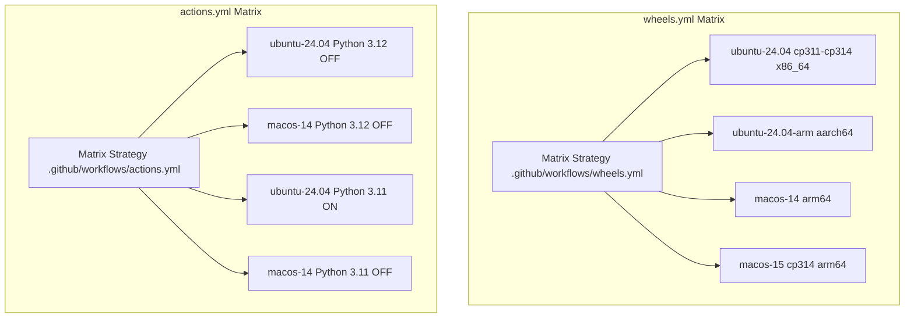
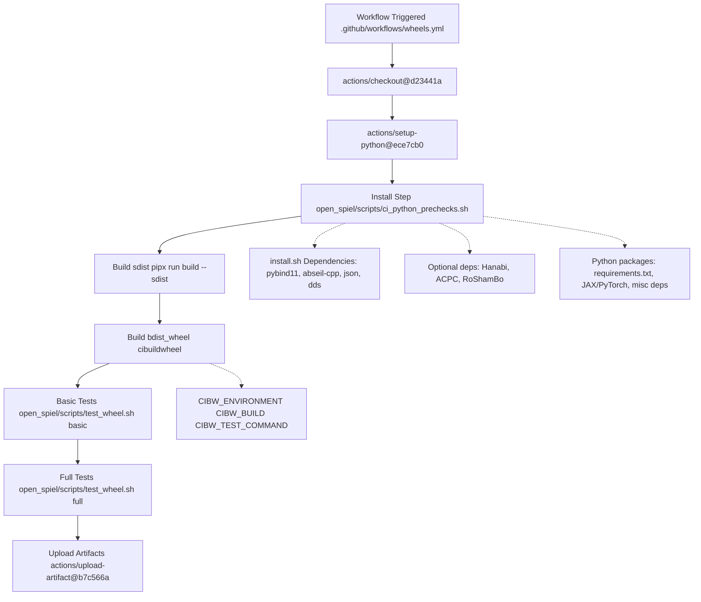
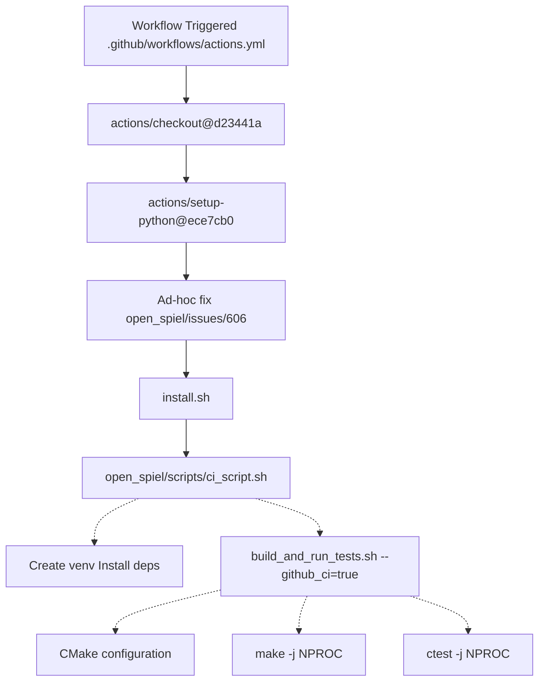
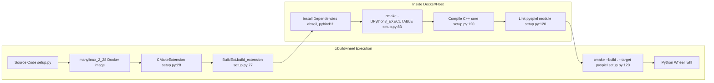
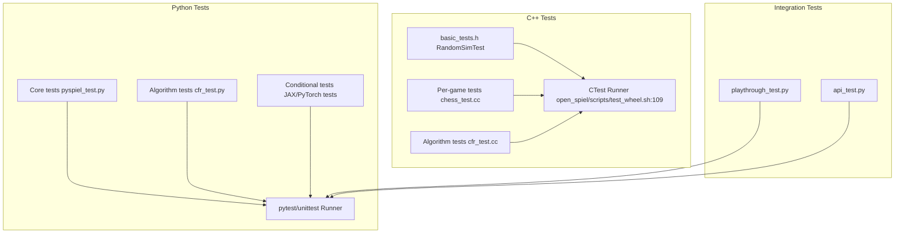
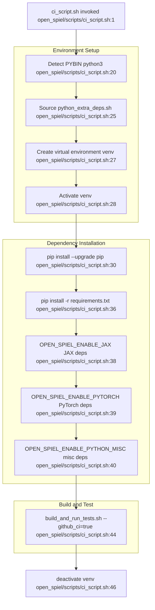
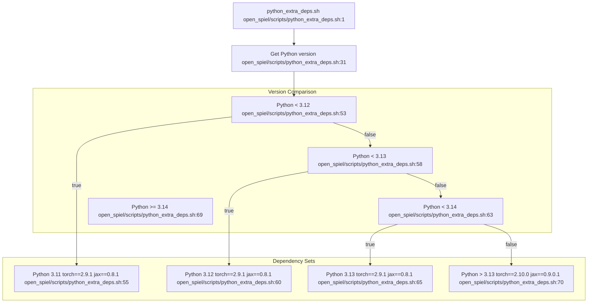
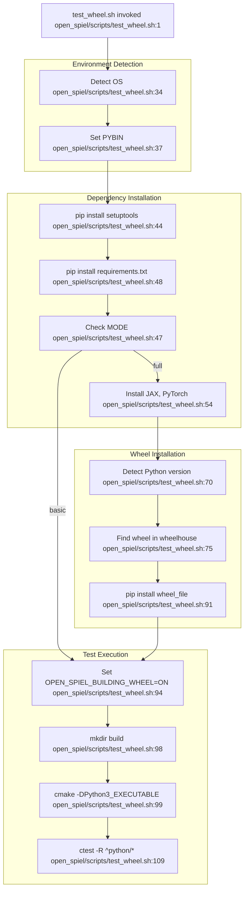
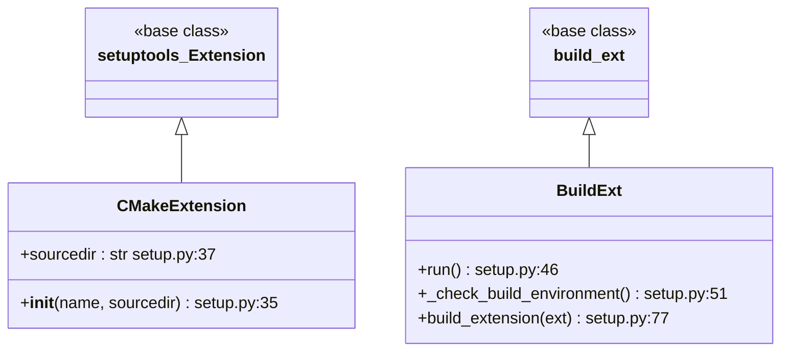
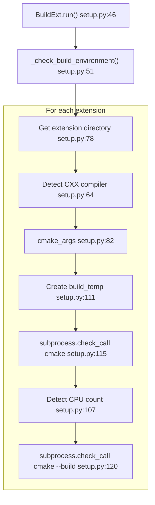

<!-- source: DeepWiki mcp.deepwiki.com · repo google-deepmind/open_spiel · page 2.4 CI/CD and Testing Pipeline · fetched 2026-10-26 -->

# CI/CD and Testing Pipeline

Relevant source files

The following files were used as context for generating this wiki page:

- [.github/workflows/actions.yml](.github/workflows/actions.yml)
- [.github/workflows/wheels.yml](.github/workflows/wheels.yml)
- [MANIFEST.in](MANIFEST.in)
- [README.md](README.md)
- [__init__.py](__init__.py)
- [docs/_static/OpenSpielC.png](docs/_static/OpenSpielC.png)
- [docs/_static/OpenSpielC_w800.png](docs/_static/OpenSpielC_w800.png)
- [docs/windows.md](docs/windows.md)
- [open_spiel/scripts/ci_script.sh](open_spiel/scripts/ci_script.sh)
- [open_spiel/scripts/python_extra_deps.sh](open_spiel/scripts/python_extra_deps.sh)
- [open_spiel/scripts/test_wheel.sh](open_spiel/scripts/test_wheel.sh)
- [pyproject.toml](pyproject.toml)
- [requirements.txt](requirements.txt)
- [setup.py](setup.py)

## Purpose and Scope

This page documents the Continuous Integration and Continuous Deployment (CI/CD) infrastructure and testing pipeline for OpenSpiel. This system is responsible for automated building, testing, and packaging of OpenSpiel across multiple platforms and Python versions [.github/workflows/wheels.yml:1-8, .github/workflows/actions.yml:1-15]().

For information about the build system configuration itself (CMake, optional dependencies), see [CMake Build System](#2.2). For details on Python package structure and `setup.py` mechanics, see [Python Package Building](#2.3). For C++ and Python testing frameworks and test organization, see [Testing and Validation](#10) [.github/workflows/wheels.yml:1-8]().

Sources: [.github/workflows/wheels.yml:1-8](), [.github/workflows/actions.yml:1-15]()

## GitHub Actions Workflows

OpenSpiel uses two primary GitHub Actions workflows for automated testing and wheel building [.github/workflows/wheels.yml:1-16, .github/workflows/actions.yml:1-15]().

### Workflow Configuration

| Workflow | File | Triggers | Purpose |
|----------|------|----------|---------|
| `wheels` | [.github/workflows/wheels.yml:1-148]() | Pull requests, manual dispatch | Build and test Python wheels for distribution [.github/workflows/wheels.yml:1-22]() |
| `build_and_test` | [.github/workflows/actions.yml:1-80]() | Push to master, pull requests | Run comprehensive tests on multiple platforms [.github/workflows/actions.yml:1-15]() |

Sources: [.github/workflows/wheels.yml:1-22](), [.github/workflows/actions.yml:1-15]()

### Matrix Strategy

Both workflows use GitHub Actions matrix strategy to test multiple configurations [.github/workflows/wheels.yml:28-85, .github/workflows/actions.yml:20-69]().

Sources: [.github/workflows/wheels.yml:28-85](), [.github/workflows/actions.yml:20-69]()

### Environment Variables

Key environment variables control build behavior [.github/workflows/wheels.yml:72-88, .github/workflows/actions.yml:71-82]():

| Variable | Purpose | Default/Values |
|----------|---------|----------------|
| `OPEN_SPIEL_BUILDING_WHEEL` | Indicates wheel build mode [.github/workflows/wheels.yml:73]() | ON/OFF [.github/workflows/wheels.yml:73]() |
| `OPEN_SPIEL_BUILD_WITH_ACPC` | Enable ACPC poker support [.github/workflows/wheels.yml:74]() | ON/OFF [.github/workflows/wheels.yml:74]() |
| `OPEN_SPIEL_BUILD_WITH_HANABI` | Enable Hanabi game [.github/workflows/wheels.yml:75]() | ON/OFF [.github/workflows/wheels.yml:75]() |
| `OPEN_SPIEL_BUILD_WITH_ROSHAMBO` | Enable RoShamBo bots [.github/workflows/wheels.yml:76]() | ON/OFF [.github/workflows/wheels.yml:76]() |
| `OPEN_SPIEL_ENABLE_JAX` | Enable JAX framework tests [.github/workflows/actions.yml:72]() | ON/OFF/AUTO [.github/workflows/actions.yml:72]() |
| `OPEN_SPIEL_ENABLE_PYTORCH` | Enable PyTorch tests [.github/workflows/actions.yml:73]() | ON/OFF/AUTO [.github/workflows/actions.yml:73]() |
| `OPEN_SPIEL_ENABLE_PYTHON_MISC` | Enable misc Python deps [.github/workflows/actions.yml:74]() | ON/OFF [.github/workflows/actions.yml:74]() |
| `OPEN_SPIEL_ABSL_VERSION` | Abseil library version [.github/workflows/wheels.yml:77]() | "20250814.1" [.github/workflows/wheels.yml:77]() |

Sources: [.github/workflows/wheels.yml:72-88](), [.github/workflows/actions.yml:71-82]()

## Build Process Flow

### wheels.yml Workflow Steps

Sources: [.github/workflows/wheels.yml:90-153]()

### actions.yml Workflow Steps

Sources: [.github/workflows/actions.yml:83-109](), [open_spiel/scripts/ci_script.sh:1-46]()

## cibuildwheel Configuration

The `wheels.yml` workflow uses `cibuildwheel` to build platform-specific wheels [.github/workflows/wheels.yml:1-8, 132-137]().

### cibuildwheel Environment Variables

| Variable | Purpose | Example Value |
|----------|---------|---------------|
| `CIBW_BUILD` | Specify which wheels to build [.github/workflows/wheels.yml:44]() | `cp311-manylinux_x86_64 cp312-manylinux_x86_64 cp313-manylinux_x86_64 cp314-manylinux_x86_64` [.github/workflows/wheels.yml:44]() |
| `CIBW_MANYLINUX_X86_64_IMAGE` | Linux Docker image [.github/workflows/wheels.yml:83]() | `manylinux_2_28` [.github/workflows/wheels.yml:83]() |
| `CIBW_MANYLINUX_AARCH64_IMAGE` | Linux ARM64 Docker image [.github/workflows/wheels.yml:84]() | `manylinux_2_28` [.github/workflows/wheels.yml:84]() |
| `CIBW_ENVIRONMENT` | Environment for build [.github/workflows/wheels.yml:43]() | `OPEN_SPIEL_BUILDING_WHEEL='ON' OPEN_SPIEL_BUILD_WITH_ACPC='ON' ...` [.github/workflows/wheels.yml:43]() |
| `CIBW_BEFORE_TEST` | Pre-test command [.github/workflows/wheels.yml:86]() | `python -m pip install --upgrade pip` [.github/workflows/wheels.yml:86]() |
| `CIBW_TEST_COMMAND` | Test command [.github/workflows/wheels.yml:87]() | `/bin/bash {project}/open_spiel/scripts/test_wheel.sh basic {project}` [.github/workflows/wheels.yml:87]() |

Sources: [.github/workflows/wheels.yml:43-88]()

### Wheel Build Process

Sources: [.github/workflows/wheels.yml:124-137](), [setup.py:28-126]()

## Testing Infrastructure

### Test Organization

OpenSpiel has a multi-layered testing approach [open_spiel/scripts/test_wheel.sh:109]().

Sources: [open_spiel/scripts/test_wheel.sh:109]()

### Test Execution Modes

The `test_wheel.sh` script supports two test modes [open_spiel/scripts/test_wheel.sh:21-60]():

| Mode | Purpose | Dependencies Installed | Tests Run |
|------|---------|----------------------|-----------|
| `basic` | Validate wheel functionality [open_spiel/scripts/test_wheel.sh:25]() | Core requirements only [open_spiel/scripts/test_wheel.sh:47-48]() | Python tests excluding ML-dependent tests [open_spiel/scripts/test_wheel.sh:25]() |
| `full` | Comprehensive validation [open_spiel/scripts/test_wheel.sh:26]() | Core + JAX + PyTorch + misc [open_spiel/scripts/test_wheel.sh:54-60]() | All Python tests including ML-dependent tests [open_spiel/scripts/test_wheel.sh:26]() |

Sources: [open_spiel/scripts/test_wheel.sh:21-60]()

## CI Script Execution Flow

### ci_script.sh Detailed Flow

Sources: [open_spiel/scripts/ci_script.sh:1-46]()

## Dependency Resolution

### Python Version-Specific Dependencies

The `python_extra_deps.sh` script sets version-specific package versions [open_spiel/scripts/python_extra_deps.sh:17-73]():

Sources: [open_spiel/scripts/python_extra_deps.sh:1-73]()

## Wheel Validation Process

### test_wheel.sh Flow

Sources: [open_spiel/scripts/test_wheel.sh:1-109]()

## setup.py Custom Build Extension

### CMakeExtension and BuildExt Classes

The `setup.py` file defines custom classes to integrate CMake with Python's setuptools [setup.py:28-44]():

**BuildExt.run() Flow:**

Sources: [setup.py:28-126]()

## Summary of Key Scripts and Their Roles

| Script | Primary Purpose | Key Functions |
|--------|----------------|---------------|
| `install.sh` | Install all dependencies (core + optional) [docs/windows.md:122]() | Clone repos, install packages, setup environments [docs/windows.md:122]() |
| `ci_script.sh` | Main CI entry point from GitHub Actions [open_spiel/scripts/ci_script.sh:1-46]() | Create venv, install deps, invoke build_and_run_tests.sh [open_spiel/scripts/ci_script.sh:27-44]() |
| `test_wheel.sh` | Validate Python wheels [.github/workflows/wheels.yml:87]() | Install wheel, run tests in clean environment [.github/workflows/wheels.yml:87](), [open_spiel/scripts/test_wheel.sh:1-109]() |
| `python_extra_deps.sh` | Define Python version-specific dependencies [open_spiel/scripts/python_extra_deps.sh:17-23]() | Export environment variables for JAX, PyTorch, misc packages [open_spiel/scripts/python_extra_deps.sh:53-73]() |

Sources: [docs/windows.md:122](), [open_spiel/scripts/ci_script.sh:1-46](), [.github/workflows/wheels.yml:87](), [open_spiel/scripts/test_wheel.sh:1-109](), [open_spiel/scripts/python_extra_deps.sh:17-73]()

---

