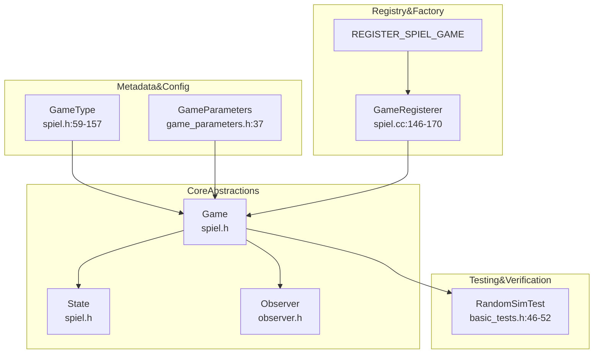

<!-- source: DeepWiki mcp.deepwiki.com · repo google-deepmind/open_spiel · page 3 Core C++ Engine · fetched 2026-10-26 -->

# Core C++ Engine

Relevant source files

The following files were used as context for generating this wiki page:

- [open_spiel/game_parameters.cc](open_spiel/game_parameters.cc)
- [open_spiel/game_parameters.h](open_spiel/game_parameters.h)
- [open_spiel/matrix_game.cc](open_spiel/matrix_game.cc)
- [open_spiel/matrix_game.h](open_spiel/matrix_game.h)
- [open_spiel/normal_form_game.h](open_spiel/normal_form_game.h)
- [open_spiel/simultaneous_move_game.h](open_spiel/simultaneous_move_game.h)
- [open_spiel/spiel.cc](open_spiel/spiel.cc)
- [open_spiel/spiel.h](open_spiel/spiel.h)
- [open_spiel/tensor_game.cc](open_spiel/tensor_game.cc)
- [open_spiel/tensor_game.h](open_spiel/tensor_game.h)
- [open_spiel/tests/basic_tests.cc](open_spiel/tests/basic_tests.cc)
- [open_spiel/tests/basic_tests.h](open_spiel/tests/basic_tests.h)
- [open_spiel/utils/tensor_view_test.cc](open_spiel/utils/tensor_view_test.cc)

## Purpose and Scope

The Core C++ Engine provides the fundamental abstractions and base classes upon which all games, algorithms, and Python bindings are built in OpenSpiel. It defines the runtime interfaces for navigating game trees, evaluating states, handling parameters, serializing states, generating observations, and utilizing core utility libraries.

As a parent page, this document provides a high-level overview of the core engine subsystems. For detailed technical information, see the child pages:
- [Game and State Abstractions](#3.1) — Detailed documentation of the `Game` and `State` base classes, virtual methods, and lifecycle.
- [Game Registration and Parameters](#3.2) — `GameType`, `GameInfo`, `GameParameters`, and the registration factory pattern (`REGISTER_SPIEL_GAME`).
- [Serialization and Testing Framework](#3.3) — State persistence, C++ testing utilities (`basic_tests.h`), and `RandomSimTest`.
- [Observers and Observation Tensors](#3.4) — The `Observer`/`Observation` framework, allocators, `SpanTensor`, and tensors.
- [Core Utilities Library](#3.5) — Utilities under `open_spiel/utils/` (`spiel_utils.h`, logging, JSON, circular buffers, caches).

Sources: [open_spiel/spiel.h:15-158](), [open_spiel/spiel.cc:15-47]()

---

## Architecture Overview

The C++ core architecture connects game metadata, stateful simulation, registration, and verification tools into a cohesive framework.

Sources: [open_spiel/spiel.h:47-158](), [open_spiel/spiel.cc:146-194](), [open_spiel/tests/basic_tests.h:46-52]()

---

## 3.1 Game and State Abstractions

The `Game` and `State` classes serve as the core abstract base classes for every game implemented in OpenSpiel. A `Game` instance represents a static game type defined by parameters, providing factories for initial states (`NewInitialState()`) and query methods for action spaces, player counts, and tensor shapes. A `State` instance represents an ongoing trajectory node, handling action application (`ApplyAction()`, `ApplyActions()`), legality checks (`LegalActions()`), history tracking, and terminal utility returns (`Returns()`, `Rewards()`).

For detailed documentation of virtual methods, lifecycle management, and game mechanics, see [Game and State Abstractions](#3.1).

Sources: [open_spiel/spiel.h:240-923](), [open_spiel/spiel.cc:93-125]()

---

## 3.2 Game Registration and Parameters

OpenSpiel uses a static registration mechanism combined with a factory pattern to discover and instantiate games by name. The `GameType` struct specifies static properties (such as `dynamics`, `chance_mode`, `information`, and `utility`), while `GameParameters` and `GameParameter` provide type-safe configuration parsing and validation. Games register themselves globally using the `REGISTER_SPIEL_GAME` macro during program initialization, enabling dynamic loading via `LoadGame()`.

For complete details on game parameters, validation, and registration factories, see [Game Registration and Parameters](#3.2).

Sources: [open_spiel/spiel.h:47-157](), [open_spiel/game_parameters.h:37-183](), [open_spiel/spiel.cc:146-170]()

---

## 3.3 Serialization and Testing Framework

To support experiment resumption, distributed execution, and rigorous regression testing, OpenSpiel provides state serialization (`SerializeGameAndState()`, `State::Serialize()`) and deserialization routines. Furthermore, the testing framework defined in `basic_tests.h` provides robust validation tools such as `RandomSimTest`, `RandomSimTestWithUndo`, and `ResampleInfostateTest` to verify that game rules, legal action masks, cloning, and serialization invariants hold under random simulation.

For detailed coverage of serialization formats, FEN parsing, and test suites, see [Serialization and Testing Framework](#3.3).

Sources: [open_spiel/spiel.h:45-51](), [open_spiel/tests/basic_tests.h:41-82](), [open_spiel/tests/basic_tests.cc:142-180]()

---

## 3.4 Observers and Observation Tensors

OpenSpiel decouples game state representation from neural network features and string views via the `Observer` and `Observation` framework (`observer.h`). Observers query specific facets of a `State` (such as public information, private cards, or tensor encodings) and write them into flat memory spans (`SpanTensor` or allocators). This modular design allows multiple observation configurations (e.g., perfect recall info states vs. partial observations) to be attached to the same game without modifying the underlying `State` implementation.

For comprehensive documentation on observer allocators, tensor views, compression, and Python bindings, see [Observers and Observation Tensors](#3.4).

Sources: [open_spiel/observer.h](), [open_spiel/spiel.h:39]()

---

## 3.5 Core Utilities Library

The `open_spiel/utils/` directory provides essential foundational utilities used across the C++ core, games, and algorithms. These include `spiel_utils.h` (error handling like `SpielFatalError`, downcasting, and numeric helpers), file logging utilities, JSON parsing wrappers (`nlohmann::json`), circular buffers, thread-safe queues, LRU caches, and multi-dimensional tensor views (`TensorView`).

For documentation on utility classes, tensor view indexing, and helper functions, see [Core Utilities Library](#3.5).

Sources: [open_spiel/spiel_utils.h](), [open_spiel/utils/tensor_view.h](), [open_spiel/utils/tensor_view_test.cc:15-136]()

---

