<!-- source: DeepWiki mcp.deepwiki.com · repo google-deepmind/open_spiel · page 3.1 Game and State Abstractions · fetched 2026-10-26 -->

# Game and State Abstractions

<details>
<summary>Relevant source files</summary>

The following files were used as context for generating this wiki page:

- [open_spiel/game_parameters.cc](open_spiel/game_parameters.cc)
- [open_spiel/game_parameters.h](open_spiel/game_parameters.h)
- [open_spiel/matrix_game.cc](open_spiel/matrix_game.cc)
- [open_spiel/matrix_game.h](open_spiel/matrix_game.h)
- [open_spiel/normal_form_game.h](open_spiel/normal_form_game.h)
- [open_spiel/simultaneous_move_game.h](open_spiel/simultaneous_move_game.h)
- [open_spiel/spiel.cc](open_spiel/spiel.cc)
- [open_spiel/spiel.h](open_spiel/spiel.h)
- [open_spiel/tensor_game.cc](open_spiel/tensor_game.cc)
- [open_spiel/tensor_game.h](open_spiel/tensor_game.h)
- [open_spiel/tests/basic_tests.cc](open_spiel/tests/basic_tests.cc)
- [open_spiel/tests/basic_tests.h](open_spiel/tests/basic_tests.h)
- [open_spiel/utils/tensor_view_test.cc](open_spiel/utils/tensor_view_test.cc)

</details>


This page documents the fundamental C++ abstractions that define game mechanics in OpenSpiel: the `Game` and `State` base classes. These abstractions form the core interface that all games implement, enabling algorithms to work uniformly across different games. For information about how games are registered and loaded, see [Game Registration and Parameters](#3.2). For Python integration details, see [pyspiel Module and Bindings](#4.1).

## Purpose and Scope

The `Game` and `State` classes provide the essential API for:
- Creating initial game states
- Querying the current player and legal actions
- Advancing game states through action application
- Determining terminal states and computing payoffs
- Supporting both perfect and imperfect information games
- Handling deterministic, explicit stochastic, and sampled stochastic games

All concrete game implementations inherit from these base classes and override virtual methods to implement game-specific logic.

## Core Class Architecture

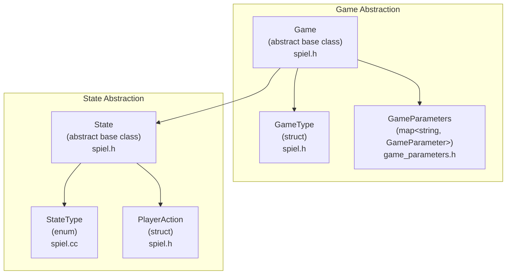

**Relationship Between Game and State**

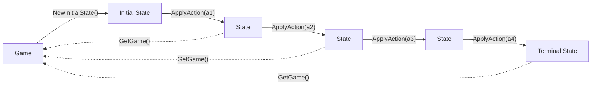

Sources: [open_spiel/spiel.h:210-440](), [open_spiel/game_parameters.h:37]()

## GameType and GameInfo

The `GameType` struct defines static properties of a game that do not depend on parameters:

| Field | Type | Description |
|-------|------|-------------|
| `short_name` | `std::string` | Unique identifier (e.g., "chess", "poker") |
| `long_name` | `std::string` | Human-readable name |
| `dynamics` | `Dynamics` enum | Sequential, Simultaneous, or MeanField |
| `chance_mode` | `ChanceMode` enum | Deterministic, ExplicitStochastic, or SampledStochastic |
| `information` | `Information` enum | OneShot, PerfectInformation, or ImperfectInformation |
| `utility` | `Utility` enum | ZeroSum, ConstantSum, GeneralSum, or Identical |
| `reward_model` | `RewardModel` enum | Rewards (RL-style) or Terminal (game-style) |
| `max_num_players` / `min_num_players` | `int` | Player count bounds |
| `provides_information_state_string` | `bool` | Supports info state strings |
| `provides_information_state_tensor` | `bool` | Supports info state tensors |
| `provides_observation_string` | `bool` | Supports observation strings |
| `provides_observation_tensor` | `bool` | Supports observation tensors |

Sources: [open_spiel/spiel.h:59-157]()

## The Game Class

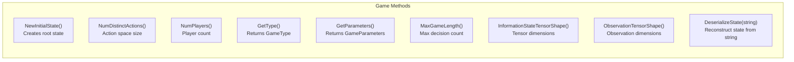

Key `Game` methods:

- **`NewInitialState()`**: Creates the initial state of the game [open_spiel/spiel.h]()
- **`NewInitialState(const std::string&)`**: Creates initial state from a starting position string
- **`NumDistinctActions()`**: Returns the size of the action space for player nodes [open_spiel/spiel.h]()
- **`NumPlayers()`**: Number of players [open_spiel/spiel.h]()
- **`GetType()`**: Returns the `GameType` struct [open_spiel/spiel.h]()
- **`InformationStateTensorShape()` / `ObservationTensorShape()`**: Tensor dimensions for neural networks [open_spiel/spiel.h]()
- **`DeserializeState(const std::string&)`**: Reconstructs a state from serialized form [open_spiel/spiel.cc]()

Sources: [open_spiel/spiel.h:424-488](), [open_spiel/spiel.cc:452-506]()

## The State Class

The `State` class represents a single node in the game tree. Every state maintains:
- A shared pointer to its parent `Game` object
- The history of actions leading to this state
- The current move number

### Essential State Methods

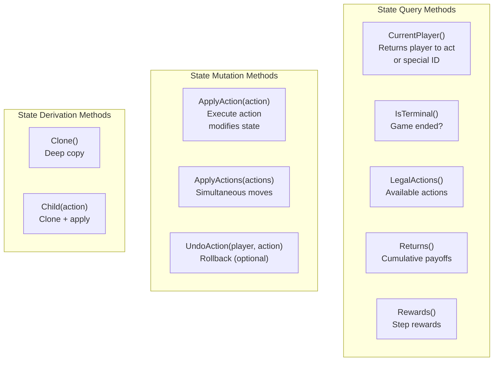

### Core Virtual Methods

| Method | Purpose | Must Override |
|--------|---------|---------------|
| `CurrentPlayer()` | Returns active player or special ID | Yes |
| `LegalActions()` | Returns list of legal actions | Yes |
| `ApplyAction(Action)` | Transitions state (calls `DoApplyAction`) | Via `DoApplyAction` |
| `IsTerminal()` | Checks if game has ended | Yes |
| `Returns()` | Returns cumulative payoffs | Yes |
| `ToString()` | String representation | Yes |
| `ActionToString(Player, Action)` | Human-readable action | Yes |
| `Clone()` | Creates deep copy | Yes |

Sources: [open_spiel/spiel.h:240-730](), [open_spiel/spiel.cc:304-450]()

## Player IDs and Node Types

OpenSpiel uses special player IDs to represent different node types:

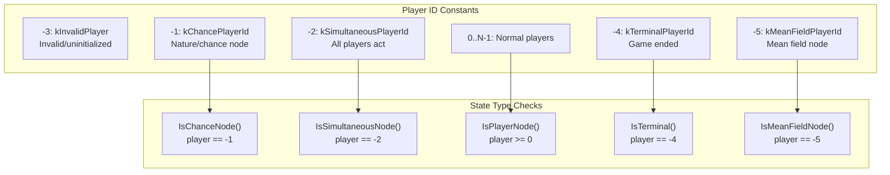

The `StateType` enum provides a categorization: [open_spiel/spiel.cc:93-125]()

```cpp
enum class StateType {
  kTerminal,   // IsTerminal() == true
  kChance,     // IsChanceNode() == true
  kDecision,   // IsPlayerNode() == true
  kMeanField   // IsMeanFieldNode() == true
};
```

Sources: [open_spiel/spiel.cc:93-125](), [open_spiel/spiel.cc:115-125]()

## State Lifecycle and Action Application

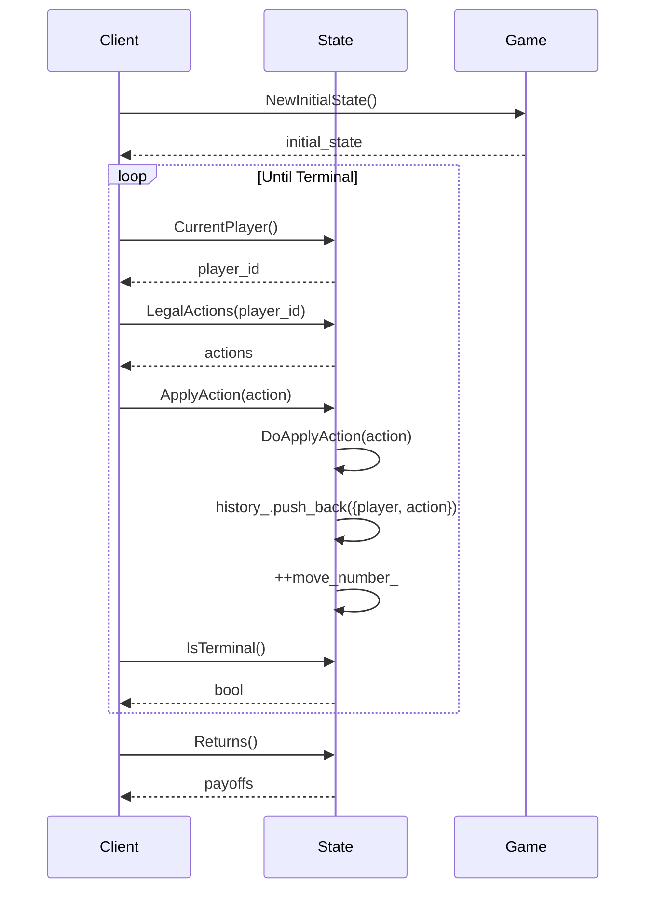

The action application flow:

1. **`ApplyAction(action_id)`** is the public interface
2. Internally calls **`DoApplyAction(action_id)`** (implemented by derived classes)
3. Updates `history_` with `{player, action}` pair
4. Increments `move_number_`

For simultaneous-move games, **`ApplyActions(std::vector<Action>)`** applies joint actions [open_spiel/simultaneous_move_game.h]().

Sources: [open_spiel/simultaneous_move_game.h:66-74](), [open_spiel/spiel.cc:390-443]()

## Legal Actions and Action Space

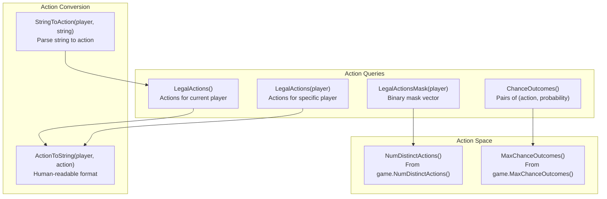

**Key properties:**

- Actions are integers in `[0, NumDistinctActions())` for player nodes
- Actions are integers in `[0, MaxChanceOutcomes())` for chance nodes
- Legal actions must be returned in ascending order
- `LegalActionsMask()` returns a binary vector of length `NumDistinctActions()` or `MaxChanceOutcomes()` [open_spiel/tests/basic_tests.cc:114-133]()

**Chance Nodes:**

At chance nodes (`IsChanceNode() == true`):
- **Explicit stochastic**: `ChanceOutcomes()` returns all possible outcomes with probabilities, and `ApplyAction()` is deterministic
- **Sampled stochastic**: `ChanceOutcomes()` returns a dummy single outcome, and `ApplyAction()` samples internally

Sources: [open_spiel/tests/basic_tests.cc:114-133](), [open_spiel/spiel.h:697-710]()

## Rewards and Returns

OpenSpiel distinguishes between step rewards (RL-style) and cumulative returns:

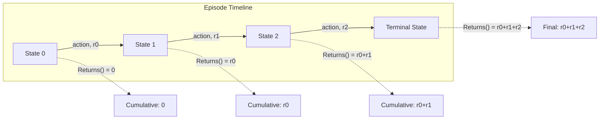

**Key methods:**

- **`Rewards()`**: Returns the immediate reward vector from the most recent transition
  - Default: returns zero except at terminal states (where it returns `Returns()`)
  - Games with intermediate rewards must override this
- **`Returns()`**: Returns the cumulative sum of all rewards up to this state
  - Must be overridden by all games
  - Must satisfy: `Returns(St) = Sum(Rewards(S_0), Rewards(S_1), ..., Rewards(S_t))`
- **`PlayerReward(player)` / `PlayerReturn(player)`**: Single-player versions

**Reward Model:**
- `GameType::RewardModel::kRewards`: RL-style with step rewards
- `GameType::RewardModel::kTerminal`: Only final payoffs at terminal states

Sources: [open_spiel/spiel.h:385-424](), [open_spiel/tests/basic_tests.cc:193-220]()

## Information States and Observations

For imperfect information games, OpenSpiel provides two concepts:

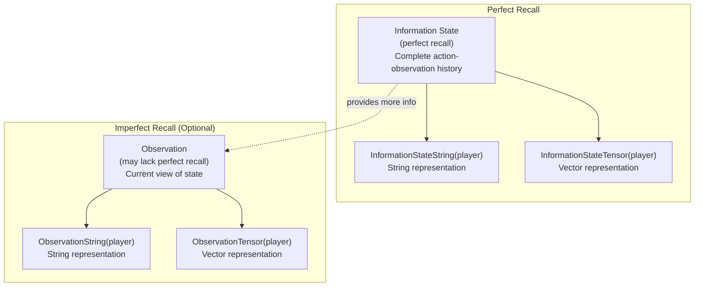

**Information State Requirements:**
- Must be perfect-recall: different information states imply different future trajectories
- Different ground states with identical information for a player have the same information state
- Must be unique across players (e.g., prefix with player ID)
- Must be provided even at terminal states

**Observation Requirements:**
- May lack perfect recall (e.g., current board state in chess)
- Complete action-observation history must reconstruct the information state
- Observations are player-specific

**Tensor Shapes:**
- `Game::InformationStateTensorShape()` returns dimensions (e.g., `{2, 4, 3}`)
- Tensors use lexicographic ordering

Sources: [open_spiel/spiel.h:496-642](), [open_spiel/tests/basic_tests.cc:222-263]()

## State History

Each state maintains a history of actions:

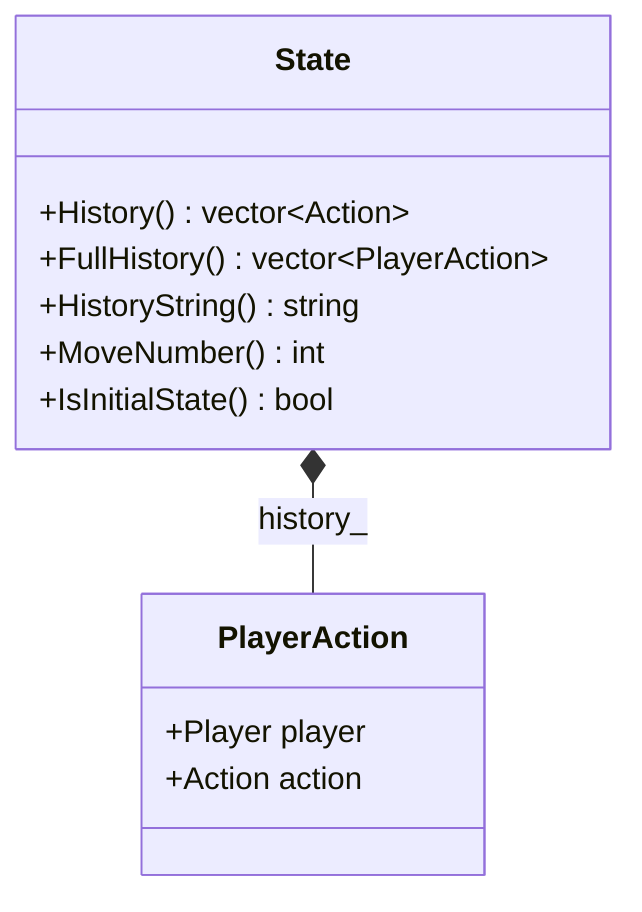

**History tracking:**
- `history_` stores `PlayerAction` structs containing `{player, action}` pairs
- **`History()`** returns action-only list (for backward compatibility)
- **`FullHistory()`** returns full `{player, action}` pairs
- **`MoveNumber()`** counts the number of moves (simultaneous moves count as one)
- **`IsInitialState()`** returns true if history is empty

Sources: [open_spiel/spiel.h:458-489](), [open_spiel/spiel.cc:390-422]()

## Serialization and Deserialization

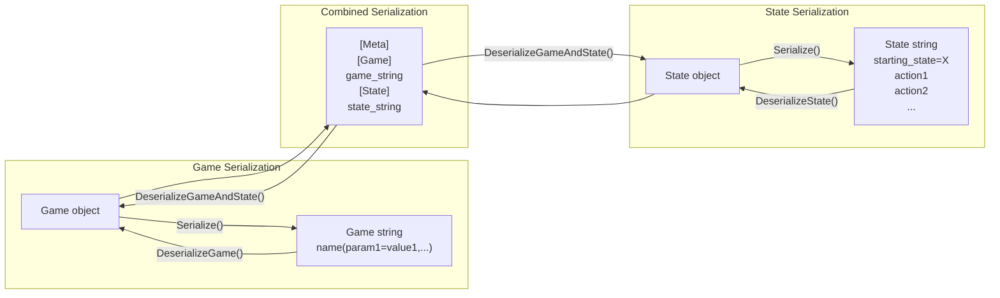

**State serialization**:
- Default implementation replays action history
- Does not work for sampled stochastic games (requires custom serialization)
- Format: optional `starting_state=...` followed by action IDs line-by-line

**Game serialization**:
- Returns game string (e.g., `"poker(players=2,betting=limit)"`)
- For sampled stochastic games, includes RNG state

**Combined serialization**:
- Format includes `[Meta]`, `[Game]`, and `[State]` sections
- Used by pickle in Python interface

Sources: [open_spiel/spiel.cc:360-379](), [open_spiel/spiel.cc:508-573](), [open_spiel/spiel.cc:719-733]()

## Implementing a New Game

To implement a new game, create classes derived from `Game` and `State`:

```mermaid
graph TB
    subgraph "Required Overrides"
        direction TB
        DoApplyAction["DoApplyAction(action)<br/>Update state logic"]
        CurrentPlayer["CurrentPlayer()<br/>Return active player"]
        LegalActions["LegalActions()<br/>Return legal moves"]
        IsTerminal["IsTerminal()<br/>Check if ended"]
        Returns["Returns()<br/>Compute payoffs"]
        ToString["ToString()<br/>String representation"]
        ActionToString["ActionToString(player, action)<br/>Format action"]
        Clone["Clone()<br/>Deep copy"]
    end
    
    subgraph "Optional Overrides"
        direction TB
        DoApplyActions["DoApplyActions(actions)<br/>Simultaneous moves"]
        UndoAction["UndoAction(player, action)<br/>Fast rollback"]
        InformationStateString["InformationStateString(player)<br/>Imperfect info"]
        InformationStateTensor["InformationStateTensor(player, values)<br/>Neural net input"]
        ChanceOutcomes["ChanceOutcomes()<br/>Chance nodes"]
        Serialize["Serialize()<br/>Custom serialization"]
    end
```

**Minimal implementation checklist:**

1. Define a `YourGameState` class inheriting from `State`
2. Define a `YourGame` class inheriting from `Game`
3. Override all pure virtual methods in both classes
4. Register the game using `REGISTER_SPIEL_GAME` macro
5. Implement `NewInitialState()` in your `Game` class to return your state type
6. Ensure action IDs are in range `[0, NumDistinctActions())`
7. Ensure `LegalActions()` returns actions in ascending order

**Testing:**
Use `RandomSimTest()` from [open_spiel/tests/basic_tests.h:46-51]() to validate:
- State transitions work correctly
- Terminal detection is accurate
- Returns satisfy utility constraints
- Legal actions are properly formatted
- Serialization works (if applicable)

Sources: [open_spiel/spiel.h:240-730](), [open_spiel/tests/basic_tests.h:46-51](), [open_spiel/tests/basic_tests.cc:305-537]()

---

