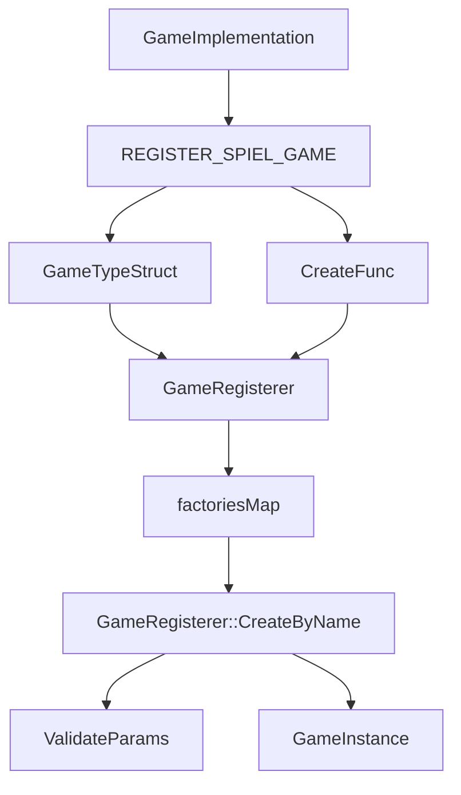
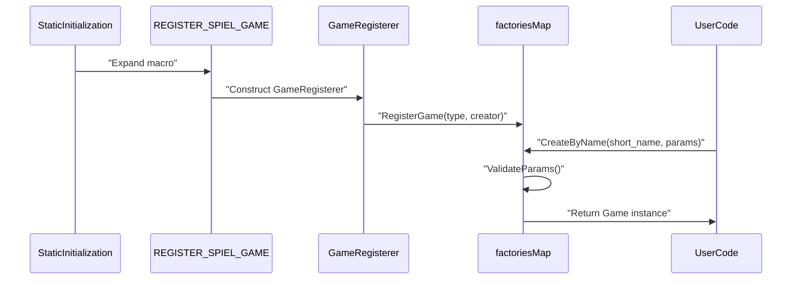
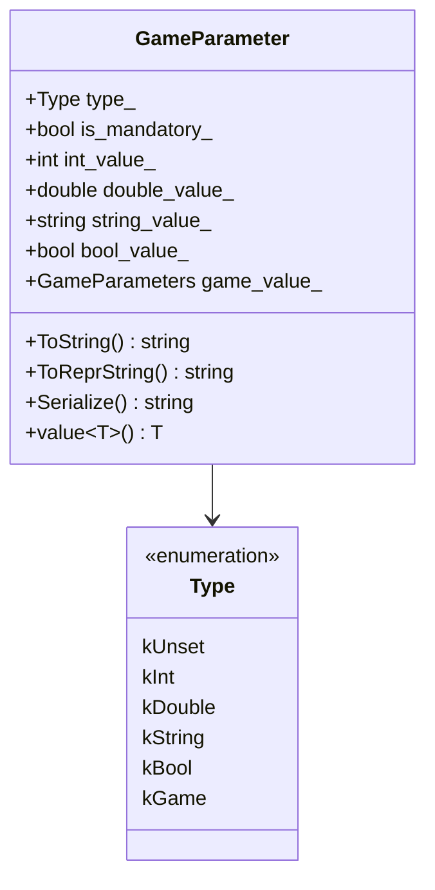
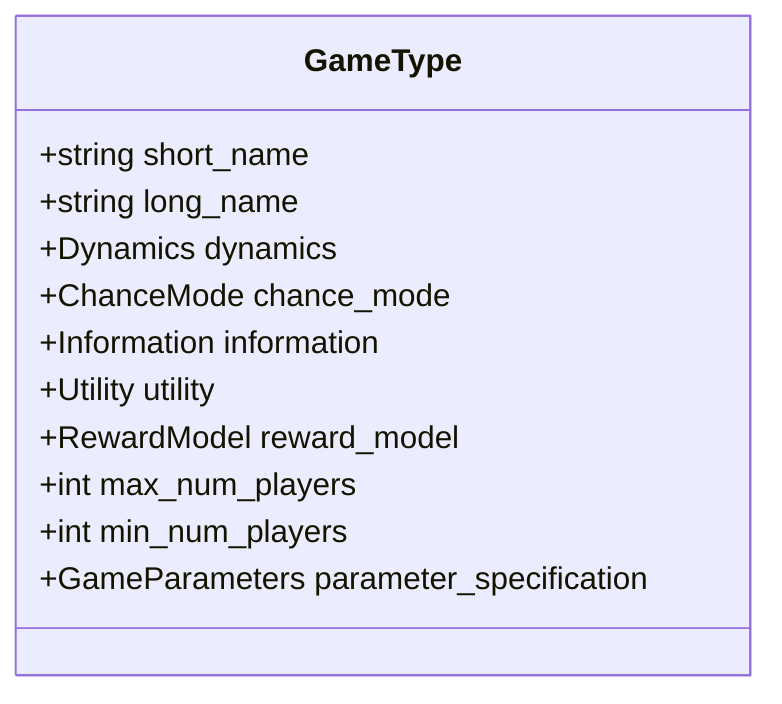
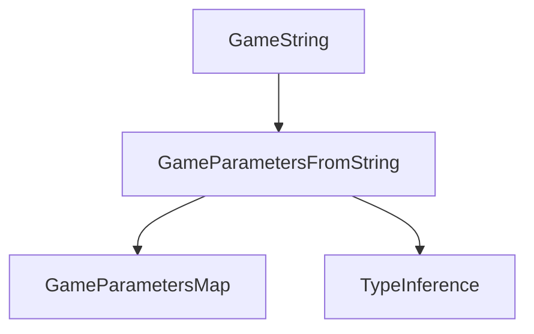
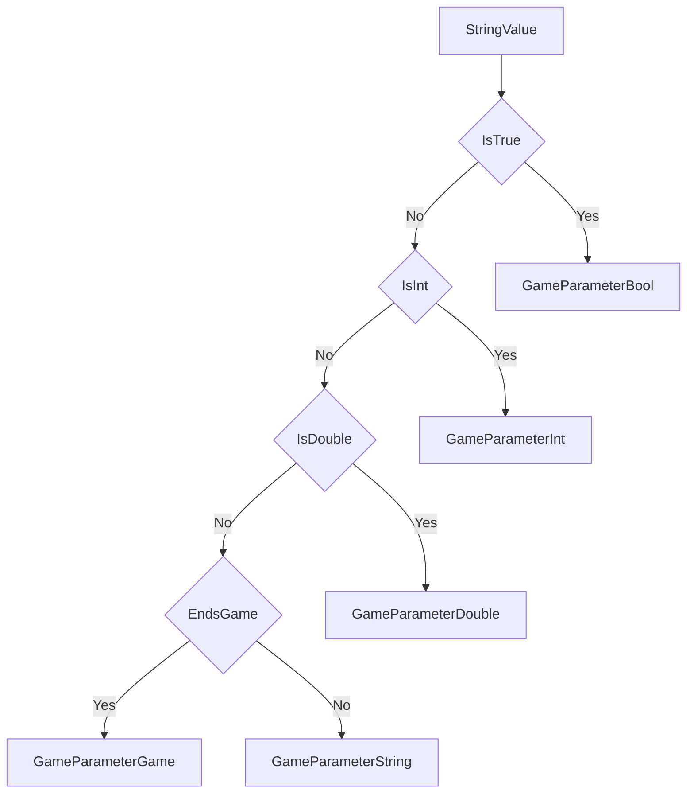
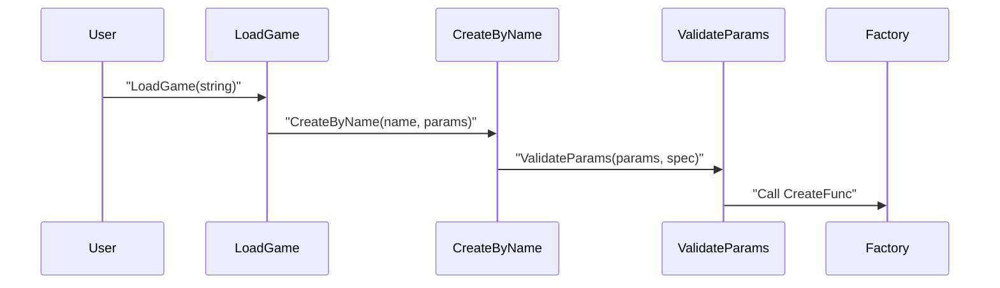

<!-- source: DeepWiki mcp.deepwiki.com · repo google-deepmind/open_spiel · page 3.2 Game Registration and Parameters · fetched 2026-10-26 -->

# Game Registration and Parameters

Relevant source files

The following files were used as context for generating this wiki page:

- [docs/games.md](docs/games.md)
- [open_spiel/game_parameters.cc](open_spiel/game_parameters.cc)
- [open_spiel/game_parameters.h](open_spiel/game_parameters.h)
- [open_spiel/games/CMakeLists.txt](open_spiel/games/CMakeLists.txt)
- [open_spiel/integration_tests/api_test.py](open_spiel/integration_tests/api_test.py)
- [open_spiel/integration_tests/playthroughs/catch.txt](open_spiel/integration_tests/playthroughs/catch.txt)
- [open_spiel/integration_tests/playthroughs/python_pursuit_evasion.txt](open_spiel/integration_tests/playthroughs/python_pursuit_evasion.txt)
- [open_spiel/integration_tests/playthroughs/xiangqi.txt](open_spiel/integration_tests/playthroughs/xiangqi.txt)
- [open_spiel/python/CMakeLists.txt](open_spiel/python/CMakeLists.txt)
- [open_spiel/python/games/__init__.py](open_spiel/python/games/__init__.py)
- [open_spiel/python/games/ant_foraging.py](open_spiel/python/games/ant_foraging.py)
- [open_spiel/python/games/ant_foraging_test.py](open_spiel/python/games/ant_foraging_test.py)
- [open_spiel/python/games/pursuit_evasion.py](open_spiel/python/games/pursuit_evasion.py)
- [open_spiel/python/games/pursuit_evasion_test.py](open_spiel/python/games/pursuit_evasion_test.py)
- [open_spiel/python/pybind11/pyspiel.cc](open_spiel/python/pybind11/pyspiel.cc)
- [open_spiel/python/tests/pyspiel_test.py](open_spiel/python/tests/pyspiel_test.py)
- [open_spiel/spiel.cc](open_spiel/spiel.cc)
- [open_spiel/spiel.h](open_spiel/spiel.h)
- [open_spiel/tests/basic_tests.cc](open_spiel/tests/basic_tests.cc)
- [open_spiel/tests/basic_tests.h](open_spiel/tests/basic_tests.h)
- [open_spiel/utils/tensor_view_test.cc](open_spiel/utils/tensor_view_test.cc)

This page documents the game registration system and parameter handling mechanisms in OpenSpiel. It covers how games declare themselves to the framework, how they specify their configurable parameters, and how users instantiate games with specific configurations.

For information about the Game and State base classes that registered games must implement, see [Game and State Abstractions](#3.1). For information about how games are built and compiled, see [CMake Build System](#2.2).

## Purpose and Scope

The game registration and parameter system provides:

- A **self-registration mechanism** where games automatically register themselves at startup using the `REGISTER_SPIEL_GAME` macro [open_spiel/spiel.h:151-224]()
- A **parameter specification system** that declares valid parameters, their types, and whether they are mandatory or optional [open_spiel/game_parameters.h:46-183]()
- A **factory pattern** that creates game instances from string specifications like `"kuhn_poker(players=3)"` [open_spiel/spiel.cc:150-170]()
- **Parameter validation** that ensures only valid parameters with correct types are passed to games [open_spiel/spiel.cc:65-89]()
- **String parsing and serialization** for converting between game specifications and parameter dictionaries [open_spiel/game_parameters.cc:120-151]()

Sources: [open_spiel/spiel.h:151-224](), [open_spiel/spiel.cc:65-170](), [open_spiel/game_parameters.h:46-183](), [open_spiel/game_parameters.cc:120-151]()

## Game Registration Architecture

### Registration Mechanism

Games register themselves using the `GameRegisterer` class and the `REGISTER_SPIEL_GAME` macro. Registration occurs at static initialization time before `main()` executes [open_spiel/spiel.cc:146-148]().

Sources: [open_spiel/spiel.h:151-224](), [open_spiel/spiel.cc:146-170]()

### GameRegisterer Class

The `GameRegisterer` class maintains a registry of all available games and provides factory methods for creating game instances [open_spiel/spiel.cc:150-170]().

| Method | Purpose |
|--------|---------|
| `CreateByName(short_name, params)` | Creates a game instance with specified parameters [open_spiel/spiel.cc:150-170]() |
| `RegisteredNames()` | Returns list of all registered game names [open_spiel/spiel.cc:182-184]() |
| `RegisteredGames()` | Returns list of all `GameType` objects [open_spiel/spiel.cc:188-194]() |
| `RegisteredConcreteGames()` | Returns only concrete games (excludes wrappers) [open_spiel/spiel.cc:196-202]() |
| `RegisterGame(game_type, creator)` | Registers a new game (called by macro) [open_spiel/spiel.cc:146-148]() |

Sources: [open_spiel/spiel.h:151-224](), [open_spiel/spiel.cc:146-202]()

### Registration Flow

Sources: [open_spiel/spiel.cc:146-170]()

## GameParameter System

### GameParameter Class

The `GameParameter` class represents a single parameter value with type information. It supports five types [open_spiel/game_parameters.h:46-88]():

Sources: [open_spiel/game_parameters.h:46-88]()

### Parameter Type System

| Type | C++ Type | Example String | Usage |
|------|----------|----------------|-------|
| `kInt` | `int` | `"3"` | Player counts, grid sizes [open_spiel/game_parameters.h:53-55]() |
| `kDouble` | `double` | `"0.5"` | Probabilities, utilities [open_spiel/game_parameters.h:56-59]() |
| `kString` | `std::string` | `"nolimit"` | Game variants, file paths [open_spiel/game_parameters.h:60-78]() |
| `kBool` | `bool` | `"True"` or `"False"` | Feature flags [open_spiel/game_parameters.h:80-81]() |
| `kGame` | `GameParameters` | `"subgame(x=2)"` | Nested game specifications [open_spiel/game_parameters.h:83-87]() |

Sources: [open_spiel/game_parameters.h:48-88]()

## GameType and GameInfo

### GameType Structure

`GameType` describes **static** properties of a game that don't depend on parameters [open_spiel/spiel.h:52-58](). It includes a `parameter_specification` field that defines valid parameters [open_spiel/spiel.h:140]().

Sources: [open_spiel/spiel.h:59-140]()

## Parameter String Parsing

### String Format

Game specifications use the format: `game_name(param1=value1,param2=value2)` [open_spiel/game_parameters.cc:153-170]().

Sources: [open_spiel/game_parameters.cc:153-228]()

### Type Inference Rules

The parser infers parameter types from the string representation [open_spiel/game_parameters.cc:172-195]().

Sources: [open_spiel/game_parameters.cc:172-195]()

## Parameter Validation

### Validation Process

When a game is created via `LoadGame()` or `CreateByName()`, parameters are validated against the game's `parameter_specification` [open_spiel/spiel.cc:65-89]().

Sources: [open_spiel/spiel.cc:65-89](), [open_spiel/spiel.cc:150-170]()

## Loading Games

### LoadGame Functions

OpenSpiel provides several functions for loading games in `spiel.cc` [open_spiel/spiel.cc:260-302]().

Sources: [open_spiel/spiel.cc:260-302]()

## Testing Game Registration

### Test Infrastructure

The testing framework verifies game registration and parameter handling via `pyspiel_test.py` [open_spiel/python/tests/pyspiel_test.py:181-220]() and `basic_tests.cc` [open_spiel/tests/basic_tests.cc:142-145]().

Sources: [open_spiel/python/tests/pyspiel_test.py:181-220](), [open_spiel/tests/basic_tests.cc:142-145]()

---

