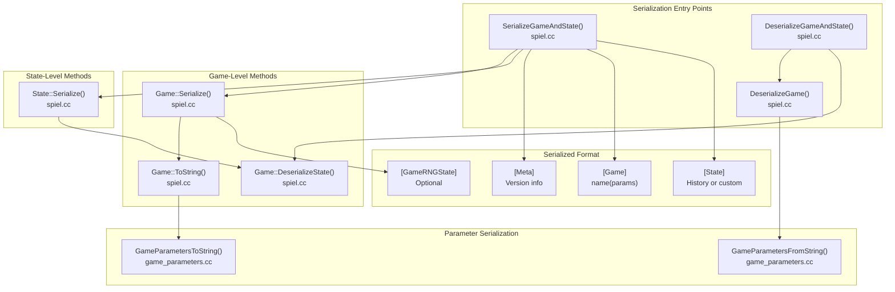
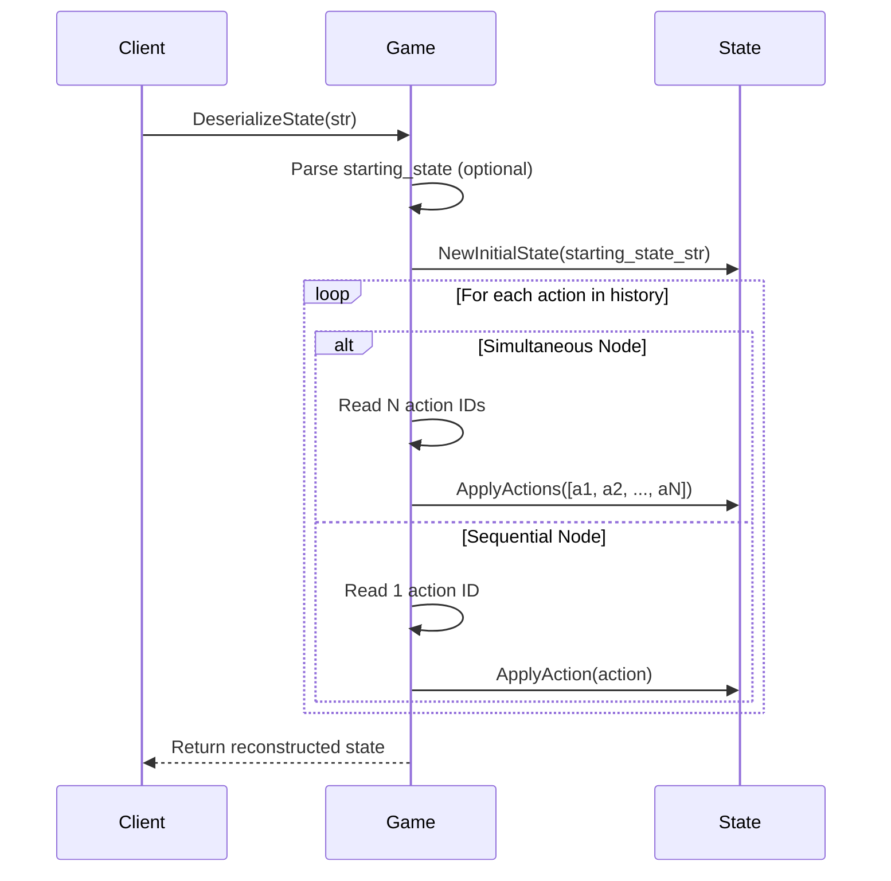
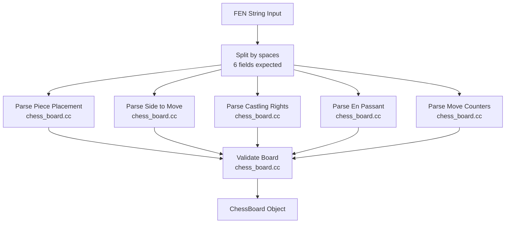
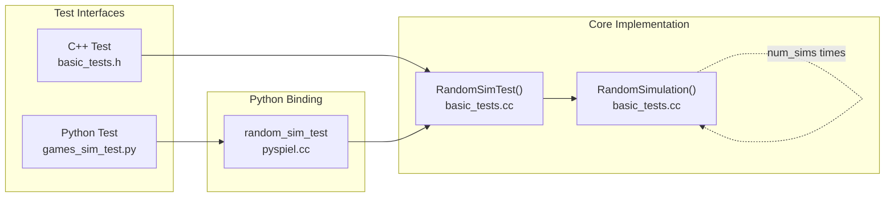
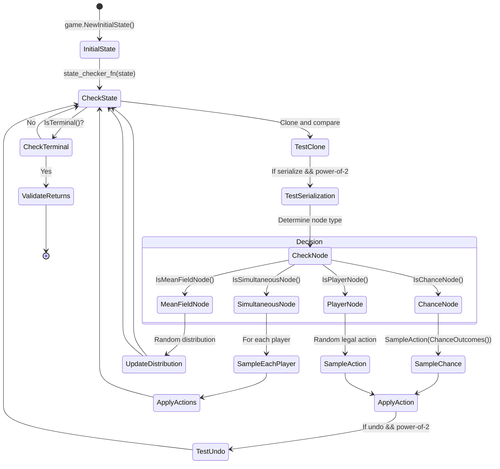
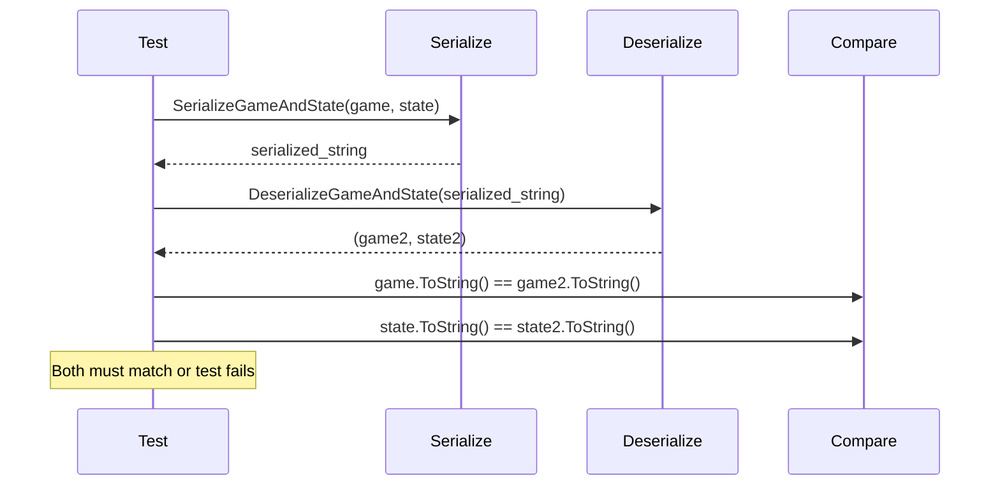
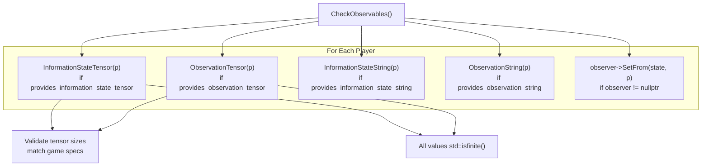

<!-- source: DeepWiki mcp.deepwiki.com · repo google-deepmind/open_spiel · page 3.3 Serialization and Testing Framework · fetched 2026-10-26 -->

# Serialization and Testing Framework

<details>
<summary>Relevant source files</summary>

The following files were used as context for generating this wiki page:

- [open_spiel/game_parameters.cc](open_spiel/game_parameters.cc)
- [open_spiel/game_parameters.h](open_spiel/game_parameters.h)
- [open_spiel/games/crossword/crossword.cc](open_spiel/games/crossword/crossword.cc)
- [open_spiel/games/crossword/crossword.h](open_spiel/games/crossword/crossword.h)
- [open_spiel/games/crossword/crossword_board.cc](open_spiel/games/crossword/crossword_board.cc)
- [open_spiel/games/crossword/crossword_board.h](open_spiel/games/crossword/crossword_board.h)
- [open_spiel/games/crossword/crossword_default_puzzle.h](open_spiel/games/crossword/crossword_default_puzzle.h)
- [open_spiel/games/crossword/crossword_test.cc](open_spiel/games/crossword/crossword_test.cc)
- [open_spiel/games/tic_tac_toe/tic_tac_toe.cc](open_spiel/games/tic_tac_toe/tic_tac_toe.cc)
- [open_spiel/games/tic_tac_toe/tic_tac_toe.h](open_spiel/games/tic_tac_toe/tic_tac_toe.h)
- [open_spiel/games/tic_tac_toe/tic_tac_toe_test.cc](open_spiel/games/tic_tac_toe/tic_tac_toe_test.cc)
- [open_spiel/python/pybind11/games_crossword.cc](open_spiel/python/pybind11/games_crossword.cc)
- [open_spiel/python/pybind11/games_tic_tac_toe.cc](open_spiel/python/pybind11/games_tic_tac_toe.cc)
- [open_spiel/python/tests/games_crossword_test.py](open_spiel/python/tests/games_crossword_test.py)
- [open_spiel/python/tests/games_tic_tac_toe_test.py](open_spiel/python/tests/games_tic_tac_toe_test.py)
- [open_spiel/spiel.cc](open_spiel/spiel.cc)
- [open_spiel/spiel.h](open_spiel/spiel.h)
- [open_spiel/tests/CMakeLists.txt](open_spiel/tests/CMakeLists.txt)
- [open_spiel/tests/action_struct_tests.cc](open_spiel/tests/action_struct_tests.cc)
- [open_spiel/tests/action_struct_tests.h](open_spiel/tests/action_struct_tests.h)
- [open_spiel/tests/basic_tests.cc](open_spiel/tests/basic_tests.cc)
- [open_spiel/tests/basic_tests.h](open_spiel/tests/basic_tests.h)
- [open_spiel/utils/tensor_view_test.cc](open_spiel/utils/tensor_view_test.cc)

</details>


## Overview

The serialization and testing framework provides utilities for persisting game and state information and comprehensively validating game implementations. This system enables debugging, replay functionality, and ensures that all games in OpenSpiel meet quality standards.

For information about the Game and State abstractions themselves, see [Game and State Abstractions](#3.1). For details on game registration, see [Game Registration and Parameters](#3.2).

Sources: [open_spiel/spiel.h](), [open_spiel/spiel.cc]()

## Serialization System

The serialization framework converts games and states to/from string representations for persistence, transmission, and debugging. The system supports both generic history-based serialization and game-specific formats.

### Core Serialization Architecture



Sources: [open_spiel/spiel.cc:360-379](), [open_spiel/spiel.cc:466-528](), [open_spiel/spiel.cc:719-732](), [open_spiel/game_parameters.cc:153-228]()

### Game Serialization

Games serialize to a compact string representation consisting of the game name and parameters. For games with sampled stochastic chance mode, the RNG state is also included.

**Format Structure:**
```
name(param1=value1,param2=value2)
[GameRNGState]
<rng_state_string>
```

**Implementation Details:**

| Method | Location | Purpose |
|--------|----------|---------|
| `Game::Serialize()` | [open_spiel/spiel.cc]() | Main serialization entry point |
| `Game::ToString()` | [open_spiel/spiel.cc]() | Converts game to parameter string |
| `DeserializeGame()` | [open_spiel/spiel.cc]() | Reconstructs game from string |
| `GameParametersToString()` | [open_spiel/game_parameters.cc]() | Converts parameters to string |
| `GameParametersFromString()` | [open_spiel/game_parameters.cc]() | Parses parameter string |

Sources: [open_spiel/spiel.cc:719-732](), [open_spiel/spiel.cc:238-258](), [open_spiel/game_parameters.cc:153-228]()

### State Serialization

State serialization supports two approaches:

1. **History-Based (Default):** Stores the sequence of actions from the initial state
2. **Custom:** Game-specific formats for efficiency or special requirements

**Default History-Based Serialization:**

The default implementation in `State::Serialize()` [open_spiel/spiel.cc]() converts the state history to a newline-separated list of action IDs:

```
starting_state=<optional_initial_state_string>
<action_0>
<action_1>
...
<action_n>
```

For simultaneous games, multiple action IDs appear sequentially (one per player).

**Deserialization Process:**

`Game::DeserializeState()` [open_spiel/spiel.cc]() reconstructs the state by:
1. Creating the initial state (optionally from a custom starting state string)
2. Replaying each action in sequence
3. Handling simultaneous moves by reading multiple action IDs



Sources: [open_spiel/spiel.cc:360-379](), [open_spiel/spiel.cc:466-506]()

### Game-Specific Serialization

Some games implement custom serialization formats for efficiency or compatibility with external tools. Chess uses Forsyth-Edwards Notation (FEN), a standard chess position format.

**Chess FEN Format:**

FEN encodes the complete game state in a single line with six fields:

```
rnbqkbnr/pppppppp/8/8/8/8/PPPPPPPP/RNBQKBNR w KQkq - 0 1
```

| Field | Example | Description |
|-------|---------|-------------|
| Piece Placement | `rnbqkbnr/pppppppp/8/...` | Board state (rank 8 to rank 1) |
| Active Color | `w` | Side to move (w/b) |
| Castling Rights | `KQkq` | Available castling (K/Q/k/q or -) |
| En Passant | `-` or `e3` | En passant target square |
| Halfmove Clock | `0` | Moves since pawn move or capture |
| Fullmove Number | `1` | Full move count |

**Implementation:**

The `ChessBoard::BoardFromFEN()` [open_spiel/games/chess/chess_board.cc]() static method parses FEN strings:



**Castling Rights Handling:**

Chess supports both standard FEN (`KQkq`) and Shredder-FEN notation (file letters like `Hg`) for Chess960 compatibility [open_spiel/games/chess/chess_board.cc]():

- Standard: `K/Q` (white kingside/queenside), `k/q` (black kingside/queenside)
- Shredder: Capital/lowercase letters indicate rook file position

Sources: [open_spiel/games/chess/chess_board.cc](), [open_spiel/games/chess/chess_board.h]()

### Serialization Limitations

The default history-based serialization has important limitations documented in [open_spiel/spiel.cc]():

**Unsupported Game Types:**

| Game Type | Reason | Solution |
|-----------|--------|----------|
| Sampled Stochastic | History doesn't include sampled outcomes | Implement custom `Serialize()`/`DeserializeState()` |
| Mean Field | Distribution history not stored | Implement custom `Serialize()`/`DeserializeState()` |

**Validation Checks:**

```cpp
// From State::Serialize() [open_spiel/spiel.cc]
SPIEL_CHECK_NE(game_->GetType().chance_mode,
               GameType::ChanceMode::kSampledStochastic);
SPIEL_CHECK_NE(game_->GetType().dynamics, GameType::Dynamics::kMeanField);
```

Games requiring custom serialization must override:
- `State::Serialize()` - Convert state to string
- `Game::DeserializeState()` - Reconstruct state from string

Sources: [open_spiel/spiel.cc:360-379](), [open_spiel/spiel.cc:466-506]()

### Complete Serialization Format

`SerializeGameAndState()` [open_spiel/spiel.cc]() produces a structured format with metadata:

```
# Automatically generated by OpenSpiel SerializeGameAndState
[Meta]
Version: 1

[Game]
name(params)

[State]
starting_state=<optional>
<action_history>
```

This format enables:
- Version tracking for backward compatibility
- Human-readable debugging output
- Integration test fixtures (playthrough files)

Sources: [open_spiel/spiel.cc:508-528]()

## Testing Framework

The testing framework provides comprehensive validation of game implementations through randomized simulation. The system is exposed to both C++ and Python tests via utilities defined in `basic_tests.h` [open_spiel/tests/basic_tests.h]().

### RandomSimTest Entry Point



**Function Signature:**

```cpp
void RandomSimTest(
    const Game& game,
    int num_sims,
    bool serialize = true,
    bool verbose = true,
    bool mask_test = true,
    const std::function<void(const State&)>& state_checker_fn = &DefaultStateChecker,
    int mean_field_population = -1,
    std::shared_ptr<Observer> observer = nullptr,
    const State* initial_state = nullptr
);
```

| Parameter | Purpose |
|-----------|---------|
| `game` | Game instance to test |
| `num_sims` | Number of random playthroughs |
| `serialize` | Test serialization at power-of-2 history lengths |
| `verbose` | Print debug information |
| `mask_test` | Validate legal action masks |
| `state_checker_fn` | Custom validation function called at each state |
| `mean_field_population` | Population ID for mean field games (-1 = not MFG) |
| `observer` | Optional observer for observation testing |
| `initial_state` | Optional starting state for simulation |

Sources: [open_spiel/tests/basic_tests.h:46-52](), [open_spiel/tests/basic_tests.cc:540-578]()

### Simulation Flow

The `RandomSimulation()` function [open_spiel/tests/basic_tests.cc]() executes a complete random game playthrough with extensive validation:



Sources: [open_spiel/tests/basic_tests.cc:305-537]()

### Test Coverage

The testing framework validates numerous aspects of game implementations:

**At Every State:**

| Validation | Implementation | Location |
|------------|----------------|----------|
| Clone consistency | Compare `ToString()` and `History()` | [open_spiel/tests/basic_tests.cc]() |
| Legal actions sorted | `CheckLegalActionsAreSorted()` | [open_spiel/tests/basic_tests.cc]() |
| Action string uniqueness | `CheckActionStringsAreUnique()` | [open_spiel/tests/basic_tests.cc]() |
| Empty actions for non-players | Turn-based games only | [open_spiel/tests/basic_tests.cc]() |
| Observables validity | `CheckObservables()` | [open_spiel/tests/basic_tests.cc]() |
| Legal action masks | `LegalActionsMaskTest()` | [open_spiel/tests/basic_tests.cc]() |

**At Terminal States:**

| Validation | Purpose | Location |
|------------|---------|----------|
| Current player is terminal | `SPIEL_CHECK_EQ(state->CurrentPlayer(), kTerminalPlayerId)` | [open_spiel/tests/basic_tests.cc]() |
| Returns sum validation | `CheckReturnsSum()` | [open_spiel/tests/basic_tests.cc]() |
| Returns within bounds | `MinUtility()` ≤ return ≤ `MaxUtility()` | [open_spiel/tests/basic_tests.cc]() |
| Episode returns match | Cumulative rewards equal final returns | [open_spiel/tests/basic_tests.cc]() |
| History consistency | `TestHistoryContainsActions()` | [open_spiel/tests/basic_tests.cc]() |

**Conditional Tests:**

| Test | When Executed | Location |
|------|---------------|----------|
| Serialization | Power-of-2 history lengths | [open_spiel/tests/basic_tests.cc]() |
| Undo | Power-of-2 history lengths | [open_spiel/tests/basic_tests.cc]() |
| Observer | If observer provided | [open_spiel/tests/basic_tests.cc]() |

Sources: [open_spiel/tests/basic_tests.cc:305-537]()

### Clone Testing

Clone validation ensures `State::Clone()` produces identical copies [open_spiel/tests/basic_tests.cc]():

```cpp
void ApplyActionTestClone(const Game& game, State* state, Action action) {
  std::unique_ptr<State> clone = state->Clone();
  state->ApplyActionWithLegalityCheck(action);
  clone->ApplyActionWithLegalityCheck(action);
  SPIEL_CHECK_EQ(state->ToString(), clone->ToString());
  SPIEL_CHECK_EQ(state->History(), clone->History());
}
```

This tests that:
1. Clone creates an independent copy
2. Same actions produce identical results
3. String representation matches
4. History matches

Sources: [open_spiel/tests/basic_tests.cc:66-85]()

### Serialization Testing

When enabled, serialization testing occurs at history lengths that are powers of 2 [open_spiel/tests/basic_tests.cc]():

```cpp
if (serialize && (history.size() < 10 || IsPowerOfTwo(history.size()))) {
  TestSerializeDeserialize(game, state.get());
}
```

**TestSerializeDeserialize Implementation:**



Sources: [open_spiel/tests/basic_tests.cc:174-180](), [open_spiel/tests/basic_tests.cc:374-376]()

### Undo Testing

Undo testing validates that `UndoAction()` correctly reverses moves [open_spiel/tests/basic_tests.cc]():

```cpp
void TestUndo(std::unique_ptr<State> state,
              const std::vector<HistoryItem>& history) {
  for (auto prev = history.rbegin(); prev != history.rend(); ++prev) {
    state->UndoAction(prev->player, prev->action);
    SPIEL_CHECK_EQ(state->ToString(), prev->state->ToString());
    SPIEL_CHECK_EQ(state->History(), prev->state->History());
    SPIEL_CHECK_EQ(state->MoveNumber(), prev->state->MoveNumber());
  }
}
```

The test:
1. Stores a clone at each history position
2. Unwinds the entire history backward
3. Compares each undone state to the stored clone
4. Validates `ToString()`, `History()`, and `MoveNumber()` match

**Note:** Full undo testing via `RandomSimTestWithUndo()` is very expensive ($O(n^2)$ in game length) and should be used sparingly [open_spiel/tests/basic_tests.h]().

Sources: [open_spiel/tests/basic_tests.cc:161-172](), [open_spiel/tests/basic_tests.h:59-64]()

### Observable Validation

`CheckObservables()` [open_spiel/tests/basic_tests.cc]() validates information state and observation methods for all players:



**Tensor Validation:**
- Size must match `Game::InformationStateTensorSize()` or `Game::ObservationTensorSize()`
- All values must be finite (`std::isfinite()`)
- Called at every state including terminals

**String Validation:**
- Functions must not crash/throw
- No specific format requirements (implementation-dependent)

Sources: [open_spiel/tests/basic_tests.cc:234-263]()

### Legal Actions Validation

Multiple validations ensure legal actions are correctly implemented:

**Sorted Order Check:**

Legal actions must be in ascending order [open_spiel/tests/basic_tests.cc]():

```cpp
void CheckLegalActionsAreSorted(const Game& game, State& state) {
  // ... implementation checks actions[i] < actions[i+1]
}
```

**Mask Consistency Check:**

`LegalActionsMaskTest()` [open_spiel/tests/basic_tests.cc]() validates that:
1. Mask length matches `NumDistinctActions()` (player nodes) or `MaxChanceOutcomes()` (chance nodes)
2. Mask contains only 0 or 1
3. Exactly one 1 for each legal action
4. Number of 1s equals `LegalActions().size()`

**Action String Uniqueness:**

`CheckActionStringsAreUnique()` [open_spiel/tests/basic_tests.cc]() ensures no duplicate action strings for a player at a state.

Sources: [open_spiel/tests/basic_tests.cc:114-133](), [open_spiel/tests/basic_tests.cc:552-577](), [open_spiel/tests/basic_tests.cc:265-288]()

### State Checker Pattern

The state checker pattern allows custom validation logic to be injected into simulations:

```cpp
void DefaultStateChecker(const State& state) {}  // No-op

void CustomChecker(const State& state) {
  // Custom validation logic
  SPIEL_CHECK_TRUE(some_property(state));
}

// Usage:
RandomSimTest(game, 100, true, false, true, CustomChecker);
```

**Use Cases:**
- Game-specific invariant checking
- Performance profiling
- Custom logging
- Domain-specific validation

The checker is called at every state in the simulation [open_spiel/tests/basic_tests.cc]().

Sources: [open_spiel/tests/basic_tests.h:30-32](), [open_spiel/tests/basic_tests.cc:139](), [open_spiel/tests/basic_tests.cc:354]()

### Mean Field Game Support

Mean field games require special handling during simulation [open_spiel/tests/basic_tests.cc]():

```cpp
if (mean_field_population == -1) {
  state = game.NewInitialState();
} else {
  state = game.NewInitialStateForPopulation(mean_field_population);
}
```

At mean field nodes, a random distribution is generated and applied [open_spiel/tests/basic_tests.cc]():

```cpp
if (state->CurrentPlayer() == open_spiel::kMeanFieldPlayerId) {
  auto support = state->DistributionSupport();
  state->UpdateDistribution(RandomDistribution(support.size(), rng));
}
```

Sources: [open_spiel/tests/basic_tests.cc:291-303](), [open_spiel/tests/basic_tests.cc:339-345](), [open_spiel/tests/basic_tests.cc:443-445]()

## Python Integration

The serialization and testing framework is fully accessible from Python through pybind11 bindings.

### Pickle Support

OpenSpiel implements Python pickle protocol for `Game` and `State` objects [open_spiel/python/pybind11/games_tic_tac_toe.cc]():

**State Pickle:**

```python
# Pickle automatically calls:
# __getstate__: SerializeGameAndState()
# __setstate__: DeserializeGameAndState()

import pickle
state = game.new_initial_state()
state.apply_action(0)

# Serialize
pickled = pickle.dumps(state)

# Deserialize
restored_state = pickle.loads(pickled)
```

**Game Pickle:**

```python
# Similar protocol for Game objects
pickled_game = pickle.dumps(game)
restored_game = pickle.loads(pickled_game)
```

Sources: [open_spiel/python/pybind11/games_tic_tac_toe.cc:83-104]()

### Python Bindings

Direct access to serialization and testing functions is provided in the `pyspiel` module.

**Python Usage Example:**

```python
import pyspiel

# Serialization
game = pyspiel.load_game("tic_tac_toe")
state = game.new_initial_state()
state.apply_action(0)

serialized = pyspiel.serialize_game_and_state(game, state)

# Deserialization
restored_game, restored_state = pyspiel.deserialize_game_and_state(serialized)

# Testing
pyspiel.random_sim_test(
    game,
    num_sims=100,
    serialize=True,
    verbose=False,
    mask_test=True,
    state_checker_fn=lambda s: None  # Custom checker
)
```

Sources: [open_spiel/python/pybind11/games_tic_tac_toe.cc]()

### Integration Test Playthroughs

OpenSpiel includes integration test fixtures as serialized game playthroughs in text files under `open_spiel/integration_tests/playthroughs/`.

**Structure:**

```
game: chess

GameType.chance_mode = ChanceMode.DETERMINISTIC
GameType.dynamics = Dynamics.SEQUENTIAL
...

# State 0
# rnbqkbnr/pppppppp/8/8/8/8/PPPPPPPP/RNBQKBNR w KQkq - 0 1
IsTerminal() = False
History() = []
...

# Apply action "Nh3"
action: 3576

# State 1
# rnbqkbnr/pppppppp/8/8/8/7N/PPPPPPPP/RNBQKB1R b KQkq - 1 1
IsTerminal() = False
History() = [3576]
...
```

These files serve as:
- Regression tests for game implementations
- Documentation of game behavior
- Debugging reference for state transitions
- Serialization format examples

Sources: [open_spiel/tests/basic_tests.h](), [open_spiel/spiel.h]()

---

