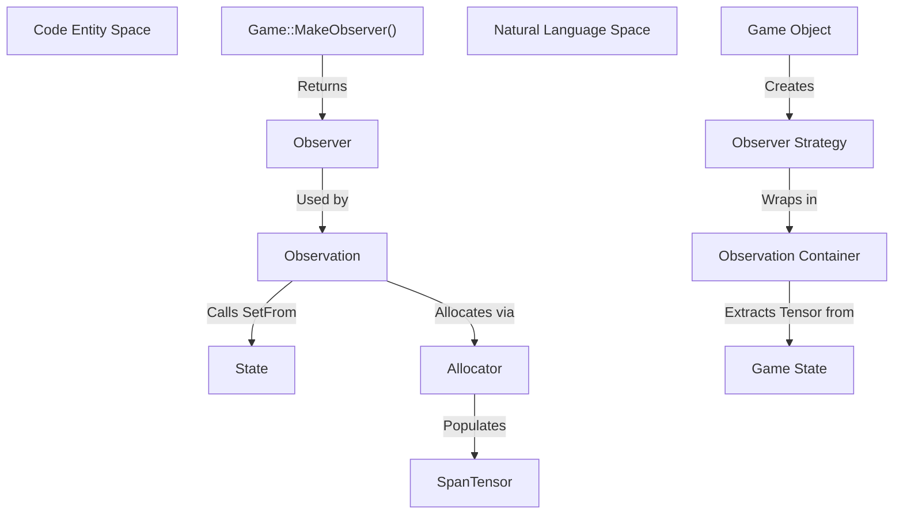
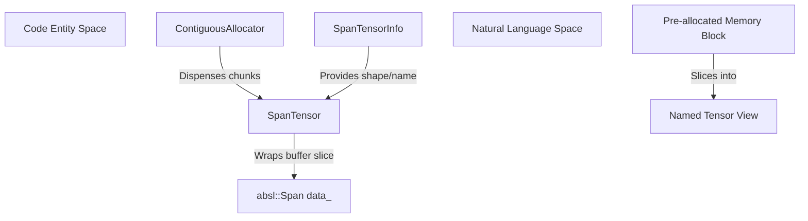
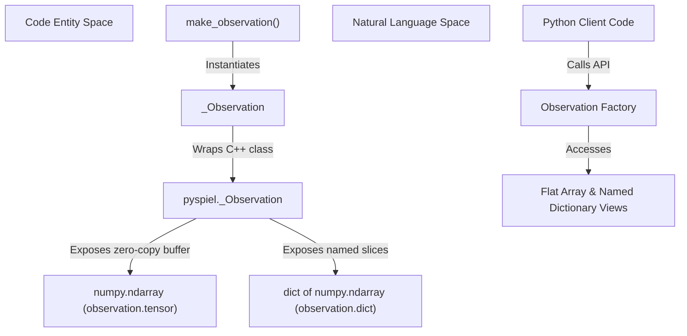

<!-- source: DeepWiki mcp.deepwiki.com · repo google-deepmind/open_spiel · page 3.4 Observers and Observation Tensors · fetched 2026-10-26 -->

# Observers and Observation Tensors

<details>
<summary>Relevant source files</summary>

The following files were used as context for generating this wiki page:

- [open_spiel/games/yacht/yacht.cc](open_spiel/games/yacht/yacht.cc)
- [open_spiel/games/yacht/yacht.h](open_spiel/games/yacht/yacht.h)
- [open_spiel/games/yacht/yacht_test.cc](open_spiel/games/yacht/yacht_test.cc)
- [open_spiel/observer.cc](open_spiel/observer.cc)
- [open_spiel/observer.h](open_spiel/observer.h)
- [open_spiel/python/algorithms/generate_playthrough.py](open_spiel/python/algorithms/generate_playthrough.py)
- [open_spiel/python/observation.py](open_spiel/python/observation.py)
- [open_spiel/python/pybind11/observer.cc](open_spiel/python/pybind11/observer.cc)
- [open_spiel/python/tests/games_sim_test.py](open_spiel/python/tests/games_sim_test.py)
- [open_spiel/python/tests/observation_test.py](open_spiel/python/tests/observation_test.py)

</details>


## Purpose and Scope
This document details the Observer and Observation framework in OpenSpiel (`open_spiel/observer.h` and `open_spiel/observer.cc`), which provides a flexible, modular system for extracting tensor representations and string views of game states. It covers the core C++ abstraction classes (`Observer`, `Observation`, `SpanTensor`, and `Allocator`), observation compression mechanisms, and the Python observation API (`open_spiel/python/observation.py` and `open_spiel/python/pybind11/observer.cc`).

---

## 1. The C++ Observer and Observation Architecture

The Observer framework separates the definition of *how* a game state is observed from the *container* that holds the resulting data. 

*   `Observer`: An abstract base class that defines methods to write tensor representations (`WriteTensor`) and string representations (`StringFrom`) for a given `State` and player [open_spiel/observer.h]().
*   `Observation`: A high-level helper class that aggregates a `Game`, an `Observer`, and a contiguous block of memory to store and manipulate observation outputs [open_spiel/observer.h]().
*   `IIGObservationType`: A configuration structure defining imperfect-information observation requirements, such as `perfect_recall`, `public_info`, and `private_info` (`PrivateInfoType::kNone`, `PrivateInfoType::kSinglePlayer`, `PrivateInfoType::kAllPlayers`) [open_spiel/observer.cc:95-108]().

### C++ Usage Pattern
To extract observations in C++, instantiate an observer via the game factory, create an `Observation` wrapper, and update it per state/player trajectory [open_spiel/observer.h:22-31]():

```cpp
auto observer = game->MakeObserver(iig_obs_type, params);
Observation observation(*game, observer);

// Within trajectory loop:
observation.SetFrom(state, player);
absl::Span<float> tensor_data = observation.Tensor();
std::string str_obs = observation.StringFrom(state, player);
```


*Sources: `open_spiel/observer.h` [18-43](), `open_spiel/observer.cc` [125-175]()*

---

## 2. Allocators and SpanTensor Management

Observations require efficient memory handling without unnecessary allocations during training loops. OpenSpiel accomplishes this using non-owning tensor views and specialized allocators.

*   `SpanTensorInfo`: Encapsulates metadata for a named tensor chunk, including its name and multi-dimensional shape (`absl::InlinedVector<int, 4>`), along with size and memory footprint (`nbytes()`) [open_spiel/observer.h:68-102]().
*   `SpanTensor`: A non-owning view over an external float buffer [open_spiel/observer.h:104-108](). It provides multi-dimensional indexing via `at(...)` accessors up to 4 dimensions [open_spiel/observer.h:126-152]().
*   `Allocator`: An abstract interface for memory providers [open_spiel/observer.h:159-169]().
*   `ContiguousAllocator`: Owns a pre-allocated fixed-size buffer (`absl::Span<float>`), zero-initializes it, and dispenses `SpanTensor` views sequentially upon request [open_spiel/observer.h:174-185](), [open_spiel/observer.cc:28-35]().
*   `TrackingVectorAllocator`: Dynamically tracks tensor names and shapes when observation sizes are variable [open_spiel/observer.h:187-191]().


*Sources: `open_spiel/observer.h` [68-185](), `open_spiel/observer.cc` [28-35]()*

---

## 3. Observation Compression

To support efficient logging, replay storage, and network transport of observations (especially binary information states in games like Leduc Poker), the `Observation` class supports lossless compression and decompression [open_spiel/python/tests/observation_test.py:166-176]().

*   `Observation::Compress()`: Serializes the underlying observation buffer or bitmask into a byte string [open_spiel/python/pybind11/observer.cc:85-86]().
*   `Observation::Decompress()`: Restores the observation state from a compressed byte payload [open_spiel/python/pybind11/observer.cc:87]().

*Sources: `open_spiel/python/pybind11/observer.cc` [85-88](), `open_spiel/python/tests/observation_test.py` [166-176]()*

---

## 4. Python Observation API and Bindings

Python bindings expose the C++ observer framework through pybind11 in `open_spiel/python/pybind11/observer.cc` and wrap them in a user-friendly API via `open_spiel/python/observation.py`.

### Key Python Classes and Functions
*   `pyspiel.Observer`: Binds the C++ `Observer` base class [open_spiel/python/pybind11/observer.cc:30-31]().
*   `pyspiel.SpanTensorInfo`: Exposes `name`, `shape`, and `__str__` properties [open_spiel/python/pybind11/observer.cc:33-39]().
*   `pyspiel.SpanTensor`: Exposes `name`, `shape`, and zero-copy NumPy array views via `observation.tensor` and `observation.dict` [open_spiel/python/pybind11/observer.cc:41-69]().
*   `make_observation(game, imperfect_information_observation_type, params)`: Factory function returning an `_Observation` instance [open_spiel/python/observation.py:94-123]().
*   `_Observation`: Python wrapper providing three primary access patterns [open_spiel/python/observation.py:63-92]():
    1. Flat 1-D NumPy array via `observation.tensor` [open_spiel/python/observation.py:45]().
    2. Dictionary of reshaped NumPy arrays sharing underlying memory via `observation.dict` [open_spiel/python/observation.py:46-48]().
    3. Human-readable string via `observation.string_from(state, player)` [open_spiel/python/observation.py:49]().


*Sources: `open_spiel/python/observation.py` [44-123](), `open_spiel/python/pybind11/observer.cc` [30-97]()*

---

