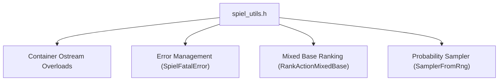
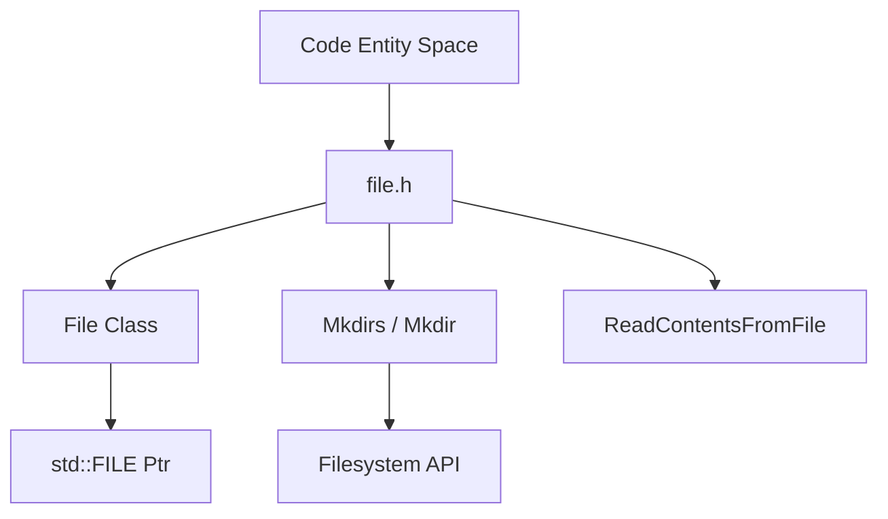
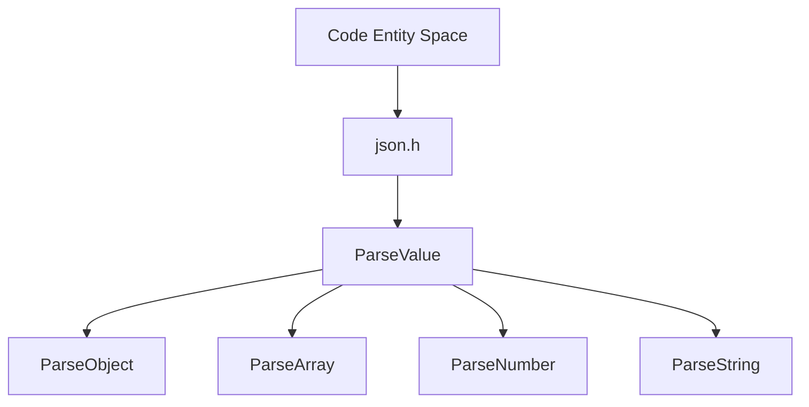
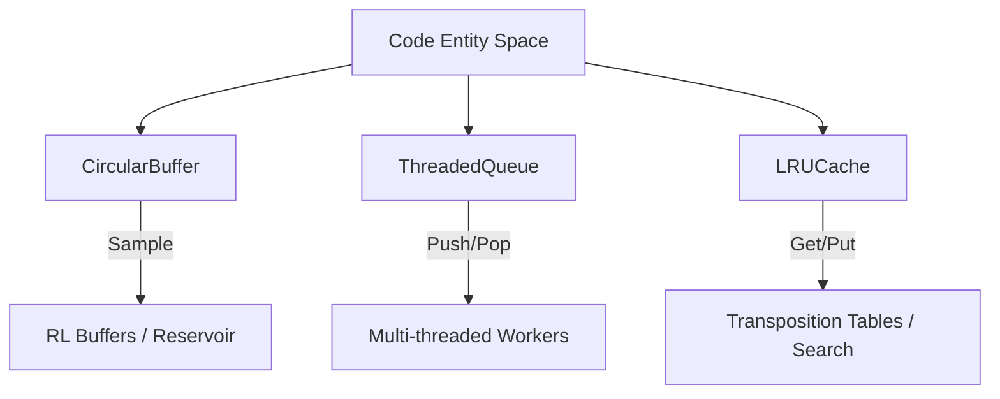

<!-- source: DeepWiki mcp.deepwiki.com · repo google-deepmind/open_spiel · page 3.5 Core Utilities Library · fetched 2026-10-26 -->

# Core Utilities Library

Relevant source files

The following files were used as context for generating this wiki page:

- [open_spiel/algorithms/alpha_zero_torch/README.md](open_spiel/algorithms/alpha_zero_torch/README.md)
- [open_spiel/algorithms/alpha_zero_torch/alpha_zero.h](open_spiel/algorithms/alpha_zero_torch/alpha_zero.h)
- [open_spiel/algorithms/alpha_zero_torch/device_manager.h](open_spiel/algorithms/alpha_zero_torch/device_manager.h)
- [open_spiel/algorithms/state_distribution.cc](open_spiel/algorithms/state_distribution.cc)
- [open_spiel/algorithms/state_distribution.h](open_spiel/algorithms/state_distribution.h)
- [open_spiel/algorithms/state_distribution_test.cc](open_spiel/algorithms/state_distribution_test.cc)
- [open_spiel/spiel_utils.cc](open_spiel/spiel_utils.cc)
- [open_spiel/spiel_utils.h](open_spiel/spiel_utils.h)
- [open_spiel/utils/CMakeLists.txt](open_spiel/utils/CMakeLists.txt)
- [open_spiel/utils/circular_buffer.h](open_spiel/utils/circular_buffer.h)
- [open_spiel/utils/circular_buffer_test.cc](open_spiel/utils/circular_buffer_test.cc)
- [open_spiel/utils/data_logger.cc](open_spiel/utils/data_logger.cc)
- [open_spiel/utils/data_logger.h](open_spiel/utils/data_logger.h)
- [open_spiel/utils/data_logger_test.cc](open_spiel/utils/data_logger_test.cc)
- [open_spiel/utils/file.cc](open_spiel/utils/file.cc)
- [open_spiel/utils/file.h](open_spiel/utils/file.h)
- [open_spiel/utils/file_test.cc](open_spiel/utils/file_test.cc)
- [open_spiel/utils/json.cc](open_spiel/utils/json.cc)
- [open_spiel/utils/json.h](open_spiel/utils/json.h)
- [open_spiel/utils/json_test.cc](open_spiel/utils/json_test.cc)
- [open_spiel/utils/logger.h](open_spiel/utils/logger.h)
- [open_spiel/utils/logger_test.cc](open_spiel/utils/logger_test.cc)
- [open_spiel/utils/lru_cache.h](open_spiel/utils/lru_cache.h)
- [open_spiel/utils/lru_cache_test.cc](open_spiel/utils/lru_cache_test.cc)
- [open_spiel/utils/serializable_circular_buffer.h](open_spiel/utils/serializable_circular_buffer.h)
- [open_spiel/utils/serializable_circular_buffer_test.cc](open_spiel/utils/serializable_circular_buffer_test.cc)
- [open_spiel/utils/threaded_queue.h](open_spiel/utils/threaded_queue.h)
- [open_spiel/utils/threaded_queue_test.cc](open_spiel/utils/threaded_queue_test.cc)

## Purpose and Scope

The `open_spiel/utils` library (`open_spiel/utils/CMakeLists.txt` [open_spiel/utils/CMakeLists.txt:1-29]()) provides foundational, highly optimized, cross-platform utility classes and functions utilized across the OpenSpiel C++ core, game implementations, and algorithms. This package includes file I/O abstractions, error handling mechanisms, container formatting extensions, a lightweight JSON parser, specialized data structures (circular buffers, threaded queues, LRU caches), and tensor view wrappers.

---

## 1. Core General Utilities (`spiel_utils`)

The primary header `open_spiel/spiel_utils.h` [open_spiel/spiel_utils.h:42-140]() defines globally available types, streaming operator overloads for standard containers (`std::vector`, `std::array`, `std::unique_ptr`, `absl::optional`, `absl::Span`) [open_spiel/spiel_utils.h:51-64](), error handlers, and mathematical helpers.

### Key Functions and Abstractions
* **Error Handling**: `SpielFatalError` logs an error message via a configurable `ErrorHandler` function pointer and terminates execution [open_spiel/spiel_utils.cc:119-137]().
* **Action Ranking/Unranking**: Mixed-base indexing functions `RankActionMixedBase` and `UnrankActionMixedBase` convert multi-dimensional action components to and from flat `Action` (`int64_t`) integers [open_spiel/spiel_utils.h:149-153]().
* **Random Sampling**: `SamplerFromRng` draws samples from a discrete probability distribution span using an underlying random number generator [open_spiel/spiel_utils.cc:183-199]().
* **Double Formatting**: `FormatDouble` formats floating-point values to prevent exponential notation and clean up trailing zeros [open_spiel/spiel_utils.cc:100-117]().

*Sources: `open_spiel/spiel_utils.h` [open_spiel/spiel_utils.h:42-181](), `open_spiel/spiel_utils.cc` [open_spiel/spiel_utils.cc:30-201]()*

---

## 2. File Management and I/O (`file`)

The `open_spiel::file` namespace (`open_spiel/utils/file.h` [open_spiel/utils/file.h:28-57]()) provides a portable file stream wrapper (`File`) and directory operations designed for cross-platform compatibility (Linux, macOS, Windows).

### The `File` Class
The `File` class wraps `std::FILE*` behind a move-only RAII interface that automatically handles flushing and closing file descriptors upon destruction [open_spiel/utils/file.h:32-38]():
* `Read(std::int64_t count)`: Reads a fixed number of bytes [open_spiel/utils/file.cc:71-76]().
* `ReadContents()` / `Write()`: Convenience methods for reading or writing full string contents [open_spiel/utils/file.cc:78-86]().
* `Seek()` / `Tell()`: Pointer offset navigation [open_spiel/utils/file.cc:66-69]().

### Directory and Utility Functions
* `Exists(path)`, `IsDirectory(path)`: Check file system node types [open_spiel/utils/file.cc:108-111](), [open_spiel/utils/file.cc:128-131]().
* `Mkdir(path)`, `Mkdirs(path)`: Create single or recursive directory structures [open_spiel/utils/file.cc:133-155]().
* `ListDir(path, recursive)`: Retrieve directory contents sorted alphabetically [open_spiel/utils/file.cc:172-201]().

*Sources: `open_spiel/utils/file.h` [open_spiel/utils/file.h:28-82](), `open_spiel/utils/file.cc` [open_spiel/utils/file.cc:45-203]()*

---

## 3. Lightweight JSON Parser (`json`)

The `open_spiel::json` namespace (`open_spiel/utils/json.h` [open_spiel/utils/json.h:1-100]()) provides a self-contained JSON parser and value container variant supporting nulls, booleans, int64 numbers, doubles, strings, arrays, and string-keyed objects.

### Implementation Details
* **Parsing**: `ParseValue` consumes `absl::string_view` inputs, recursively handling whitespace, objects (`{}`), arrays (`[]`), strings with escape sequence processing, and numeric parsing via Abseil string conversion utilities [open_spiel/utils/json.cc:31-212]().
* **Error Checking**: Malformed inputs trigger assertion checks or return `std::nullopt` depending on parser contexts [open_spiel/utils/json.cc:64-72]().

*Sources: `open_spiel/utils/json.cc` [open_spiel/utils/json.cc:27-231]()*

---

## 4. Specialized Data Structures

OpenSpiel includes specialized high-performance containers tailored for reinforcement learning and search algorithms.

### Circular Buffer (`circular_buffer.h`)
`CircularBuffer<T>` implements a fixed-capacity FIFO buffer [open_spiel/utils/circular_buffer.h:26-70]():
* `Add(const T& value)`: Appends an element, overwriting the oldest entry when capacity (`max_size_`) is exceeded [open_spiel/utils/circular_buffer.h:33-40]().
* `Sample(std::mt19937* rng, int num)`: Draws uniform random samples without replacement from the buffer using `std::sample` [open_spiel/utils/circular_buffer.h:43-48]().

### Threaded Queue (`threaded_queue.h`)
`ThreadedQueue` provides a thread-safe producer-consumer queue supporting blocking and non-blocking insertion and extraction, essential for parallel actor-learner architectures.

### LRU Cache (`lru_cache.h`)
`LRUCache` provides a bounded key-value cache that evicts the least recently accessed items, commonly used in state-space expansion and transposition tables during search.

*Sources: `open_spiel/utils/circular_buffer.h` [open_spiel/utils/circular_buffer.h:26-70](), `open_spiel/utils/CMakeLists.txt` [open_spiel/utils/CMakeLists.txt:1-29]()*

---

## 5. Tensor Views (`tensor_view.h`)

The `tensor_view.h` header provides multidimensional indexing wrappers over raw memory buffers (such as `std::vector<float>`). It allows algorithms and neural network observation builders to index multi-dimensional shapes using standard coordinate tuples without allocating separate nested container structures.

*Sources: `open_spiel/utils/CMakeLists.txt` [open_spiel/utils/CMakeLists.txt:1-29]()*

---

