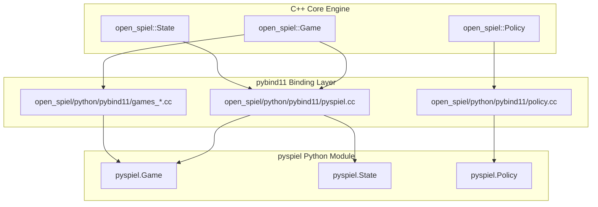

<!-- source: DeepWiki mcp.deepwiki.com · repo google-deepmind/open_spiel · page 4 Python Integration · fetched 2026-10-26 -->

# Python Integration

Relevant source files

The following files were used as context for generating this wiki page:

- [docs/games.md](docs/games.md)
- [open_spiel/games/CMakeLists.txt](open_spiel/games/CMakeLists.txt)
- [open_spiel/integration_tests/api_test.py](open_spiel/integration_tests/api_test.py)
- [open_spiel/integration_tests/playthroughs/catch.txt](open_spiel/integration_tests/playthroughs/catch.txt)
- [open_spiel/integration_tests/playthroughs/python_pursuit_evasion.txt](open_spiel/integration_tests/playthroughs/python_pursuit_evasion.txt)
- [open_spiel/integration_tests/playthroughs/xiangqi.txt](open_spiel/integration_tests/playthroughs/xiangqi.txt)
- [open_spiel/python/CMakeLists.txt](open_spiel/python/CMakeLists.txt)
- [open_spiel/python/examples/query_example.py](open_spiel/python/examples/query_example.py)
- [open_spiel/python/games/__init__.py](open_spiel/python/games/__init__.py)
- [open_spiel/python/games/ant_foraging.py](open_spiel/python/games/ant_foraging.py)
- [open_spiel/python/games/ant_foraging_test.py](open_spiel/python/games/ant_foraging_test.py)
- [open_spiel/python/games/pursuit_evasion.py](open_spiel/python/games/pursuit_evasion.py)
- [open_spiel/python/games/pursuit_evasion_test.py](open_spiel/python/games/pursuit_evasion_test.py)
- [open_spiel/python/pybind11/games_backgammon.cc](open_spiel/python/pybind11/games_backgammon.cc)
- [open_spiel/python/pybind11/games_bridge.cc](open_spiel/python/pybind11/games_bridge.cc)
- [open_spiel/python/pybind11/games_dots_and_boxes.cc](open_spiel/python/pybind11/games_dots_and_boxes.cc)
- [open_spiel/python/pybind11/games_dots_and_boxes.h](open_spiel/python/pybind11/games_dots_and_boxes.h)
- [open_spiel/python/pybind11/games_negotiation.cc](open_spiel/python/pybind11/games_negotiation.cc)
- [open_spiel/python/pybind11/games_negotiation.h](open_spiel/python/pybind11/games_negotiation.h)
- [open_spiel/python/pybind11/games_tarok.cc](open_spiel/python/pybind11/games_tarok.cc)
- [open_spiel/python/pybind11/games_tarok.h](open_spiel/python/pybind11/games_tarok.h)
- [open_spiel/python/pybind11/pybind11.h](open_spiel/python/pybind11/pybind11.h)
- [open_spiel/python/pybind11/pyspiel.cc](open_spiel/python/pybind11/pyspiel.cc)
- [open_spiel/python/tests/pyspiel_test.py](open_spiel/python/tests/pyspiel_test.py)

This page covers section 4 of the OpenSpiel wiki, explaining how Python interfaces with the C++ core through `pybind11`, how bindings and policy classes are structured, how the testing infrastructure validates the Python layer, and how games can be implemented purely in Python using trampoline classes.

As a parent page, this document provides a high-level overview of the Python integration architecture and sub-topics, linking to child pages for in-depth technical details.

## Overview and Child Pages

Python integration in OpenSpiel is centered around the `pyspiel` extension module, which wraps the C++ core structures (`Game`, `State`, `Observer`, `Policy`, `Bot`) into idiomatic Python objects via `pybind11`. 

The Python integration ecosystem is divided into four main areas, detailed in their respective child pages:
- [pyspiel Module and Bindings](#4.1) — Explains the module structure, pybind11 wrapping files (`open_spiel/python/CMakeLists.txt`), type conversions, and per-game binding files (`open_spiel/python/pybind11/pyspiel.cc`).
- [Python Policy Classes](#4.2) — Covers the Python `Policy` abstraction, `TabularPolicy`, `UniformRandomPolicy`, and bidirectional conversion utilities between Python and C++ policies.
- [Python Testing Infrastructure](#4.3) — Documents general unit tests like `pyspiel_test.py`, state traversal tests in `api_test.py`, simulation tests, and C++/Python stack validation.
- [Python-Defined Games](#4.4) — Details `python_games.cc` trampolines and pure Python game implementations (`tic_tac_toe.py`, `kuhn_poker.py`, `liars_poker.py`, chat games, and `pokerkit_wrapper`).

Sources: [open_spiel/python/CMakeLists.txt:1-125](), [open_spiel/python/pybind11/pyspiel.cc:1-118]()

## Architecture of the Python Binding Layer

The binding infrastructure relies on compiling C++ objects into a loadable Python module (`pyspiel`) using custom CMake rules and `pybind11`.

Sources: [open_spiel/python/CMakeLists.txt:28-116](), [open_spiel/python/pybind11/pyspiel.cc:39-80]()

## Child Page Summary

### 4.1 pyspiel Module and Bindings
The `pyspiel` module exposes snake-case wrappers for C++ methods (e.g., `CurrentPlayer()` becomes `current_player()`). Specific games and algorithms have dedicated binding source files under `open_spiel/python/pybind11/` (such as `games_bridge.cc` or `games_dots_and_boxes.cc`), which register subclasses with pickle support and custom tensor buffer protocols.
- For details, see [pyspiel Module and Bindings](#4.1).
- Sources: [open_spiel/python/CMakeLists.txt:28-125](), [open_spiel/python/pybind11/games_bridge.cc:30-79]()

### 4.2 Python Policy Classes
OpenSpiel defines a base `Policy` interface in Python alongside concrete utility classes like `TabularPolicy` and `UniformRandomPolicy`. Converters allow transparent translation between Python dictionary-backed policies and native C++ `Policy` implementations.
- For details, see [Python Policy Classes](#4.2).
- Sources: [open_spiel/python/tests/pyspiel_test.py:23](), [open_spiel/python/CMakeLists.txt:104-105]()

### 4.3 Python Testing Infrastructure
Verification tests like `pyspiel_test.py` and `api_test.py` assert that all registered games (mandatory and optional) conform to the API specifications, support serialization/deserialization, and maintain tree invariant properties across full-tree traversals.
- For details, see [Python Testing Infrastructure](#4.3).
- Sources: [open_spiel/python/tests/pyspiel_test.py:179-205](), [open_spiel/integration_tests/api_test.py:38-75]()

### 4.4 Python-Defined Games
Using C++ trampoline mechanisms defined in `python_games.cc`, developers can implement games entirely in Python (such as `tic_tac_toe.py`, `kuhn_poker.py`, and `pokerkit_wrapper.py`) while retaining full compatibility with C++ search algorithms, reinforcement learning environments, and playthrough checkers.
- For details, see [Python-Defined Games](#4.4).
- Sources: [open_spiel/python/pybind11/python_games.cc](), [open_spiel/python/games/__init__.py:15-39]()

---

