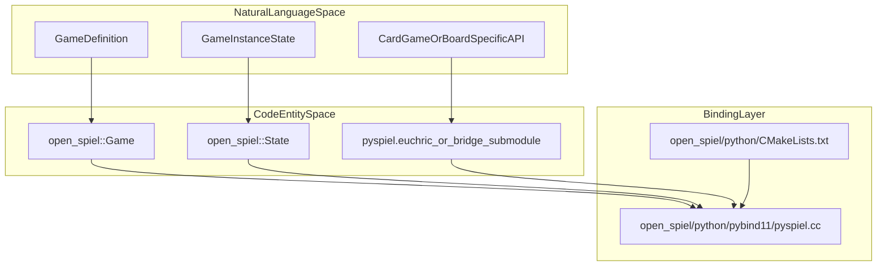
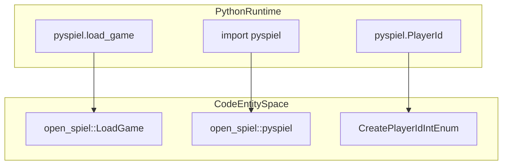
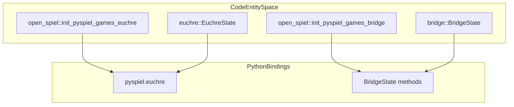

<!-- source: DeepWiki mcp.deepwiki.com · repo google-deepmind/open_spiel · page 4.1 pyspiel Module and Bindings · fetched 2026-10-26 -->

# pyspiel Module and Bindings

Relevant source files

The following files were used as context for generating this wiki page:

- [docs/games.md](docs/games.md)
- [open_spiel/games/CMakeLists.txt](open_spiel/games/CMakeLists.txt)
- [open_spiel/integration_tests/api_test.py](open_spiel/integration_tests/api_test.py)
- [open_spiel/integration_tests/playthroughs/catch.txt](open_spiel/integration_tests/playthroughs/catch.txt)
- [open_spiel/integration_tests/playthroughs/python_pursuit_evasion.txt](open_spiel/integration_tests/playthroughs/python_pursuit_evasion.txt)
- [open_spiel/integration_tests/playthroughs/xiangqi.txt](open_spiel/integration_tests/playthroughs/xiangqi.txt)
- [open_spiel/python/CMakeLists.txt](open_spiel/python/CMakeLists.txt)
- [open_spiel/python/examples/query_example.py](open_spiel/python/examples/query_example.py)
- [open_spiel/python/games/__init__.py](open_spiel/python/games/__init__.py)
- [open_spiel/python/games/ant_foraging.py](open_spiel/python/games/ant_foraging.py)
- [open_spiel/python/games/ant_foraging_test.py](open_spiel/python/games/ant_foraging_test.py)
- [open_spiel/python/games/pursuit_evasion.py](open_spiel/python/games/pursuit_evasion.py)
- [open_spiel/python/games/pursuit_evasion_test.py](open_spiel/python/games/pursuit_evasion_test.py)
- [open_spiel/python/pybind11/games_backgammon.cc](open_spiel/python/pybind11/games_backgammon.cc)
- [open_spiel/python/pybind11/games_bridge.cc](open_spiel/python/pybind11/games_bridge.cc)
- [open_spiel/python/pybind11/games_dots_and_boxes.cc](open_spiel/python/pybind11/games_dots_and_boxes.cc)
- [open_spiel/python/pybind11/games_dots_and_boxes.h](open_spiel/python/pybind11/games_dots_and_boxes.h)
- [open_spiel/python/pybind11/games_euchre.cc](open_spiel/python/pybind11/games_euchre.cc)
- [open_spiel/python/pybind11/games_euchre.h](open_spiel/python/pybind11/games_euchre.h)
- [open_spiel/python/pybind11/games_negotiation.cc](open_spiel/python/pybind11/games_negotiation.cc)
- [open_spiel/python/pybind11/games_negotiation.h](open_spiel/python/pybind11/games_negotiation.h)
- [open_spiel/python/pybind11/games_tarok.cc](open_spiel/python/pybind11/games_tarok.cc)
- [open_spiel/python/pybind11/games_tarok.h](open_spiel/python/pybind11/games_tarok.h)
- [open_spiel/python/pybind11/pybind11.h](open_spiel/python/pybind11/pybind11.h)
- [open_spiel/python/pybind11/pyspiel.cc](open_spiel/python/pybind11/pyspiel.cc)
- [open_spiel/python/tests/games_euchre_test.py](open_spiel/python/tests/games_euchre_test.py)
- [open_spiel/python/tests/pyspiel_test.py](open_spiel/python/tests/pyspiel_test.py)

The `pyspiel` module serves as the primary Python interface to the OpenSpiel framework, providing robust `pybind11` wrappers around the C++ core [open_spiel/python/pybind11/pyspiel.cc:112-117](). This section details the module structure, how core abstractions (`Game`, `State`, policies) and per-game binding files are integrated, and how type conversions bridge C++ and Python ecosystems.

---

## 1. pyspiel Architecture and Module Layout

The `pyspiel` extension module is compiled from a central dispatcher file (`open_spiel/python/pybind11/pyspiel.cc`) combined with numerous modular binding files specified in `open_spiel/python/CMakeLists.txt` [open_spiel/python/CMakeLists.txt:28-116](). 

The architecture bridges high-performance C++ game implementations with Python algorithms and user scripts through `pybind11`.

Sources: [open_spiel/python/CMakeLists.txt:28-116](), [open_spiel/python/pybind11/pyspiel.cc:35-80]()

---

## 2. pybind11 Bindings for Game, State, and Core API

The core C++ engine classes (`Game`, `State`, `Observer`, etc.) are exposed directly to Python with snake_case method naming conventions matching Python standards while preserving the underlying C++ semantics [open_spiel/python/pybind11/pyspiel.cc:112-117]().

### Exception Handling and Player IDs
C++ fatal errors and exceptions are translated into Python exceptions via `SpielException`, ensuring that failures inside C++ code propagate cleanly into Python tracebacks [open_spiel/python/pybind11/pyspiel.cc:127-138](). Special player identifiers are exposed as a Python `IntEnum` called `PlayerId` containing constants like `CHANCE`, `TERMINAL`, `SIMULTANEOUS`, and `INVALID` [open_spiel/python/pybind11/pyspiel.cc:140-159]().

Sources: [open_spiel/python/pybind11/pyspiel.cc:127-159]()

---

## 3. Per-Game Binding Files and Submodules

While general game interactions use the generic `Game` and `State` interfaces, many complex games (such as Euchre, Bridge, and Chess) require game-specific helper functions, action enumerations, and custom pickling logic. These are organized into dedicated files under `open_spiel/python/pybind11/` and registered as submodules or member attributes of `pyspiel`.

For instance, the Euchre game bindings define card ranks, suits, phases, and specific state accessors in `open_spiel/python/pybind11/games_euchre.cc` [open_spiel/python/pybind11/games_euchre.cc:34-133](), while Bridge exposes contract utilities and tensor writing methods in `open_spiel/python/pybind11/games_bridge.cc` [open_spiel/python/pybind11/games_bridge.cc:30-79]().

Sources: [open_spiel/python/pybind11/games_euchre.cc:34-133](), [open_spiel/python/pybind11/games_bridge.cc:30-79]()

---

## 4. Type Conversions and Abseil Integration

To seamlessly move data between C++ and Python, `pyspiel` leverages `pybind11_abseil` type casters [open_spiel/python/pybind11/pyspiel.cc:90-93](). 

- **Optional and Span Types:** C++ structures returning `absl::optional` or accepting `absl::Span` (such as observation tensor writing) are automatically converted to Python `None`, optional values, or NumPy arrays via buffer protocol bindings [open_spiel/python/pybind11/games_bridge.cc:36-46]().
- **JSON and Parameters:** Game parameters and configuration dictionaries leverage `nlohmann/json` integration via `pybind11_json` [open_spiel/python/pybind11/pyspiel.cc:87]().
- **Pickling Support:** Game and state classes implement custom `py::pickle` state get/set handlers [open_spiel/python/pybind11/games_euchre.cc:104-132](), enabling states to be serialized, deep-copied, and saved using Python's standard `pickle` module.

Sources: [open_spiel/python/pybind11/pyspiel.cc:87-93](), [open_spiel/python/pybind11/games_bridge.cc:36-58](), [open_spiel/python/pybind11/games_euchre.cc:104-132]()

---

