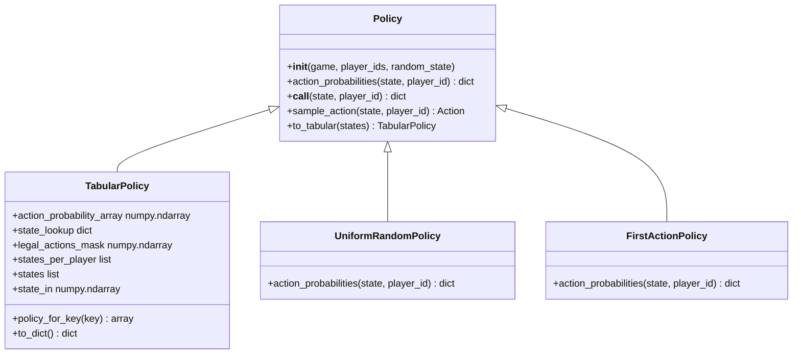
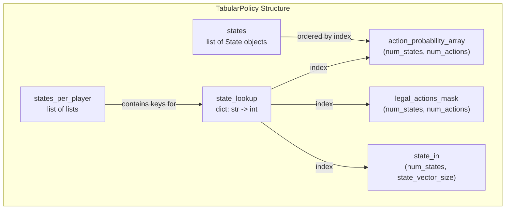
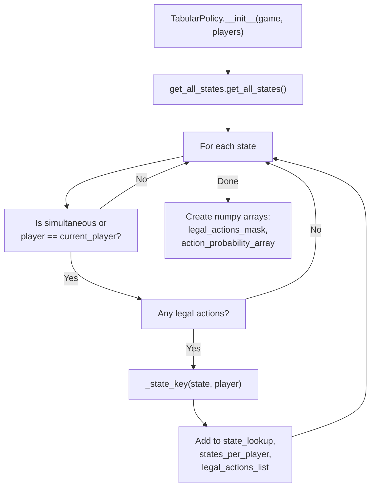
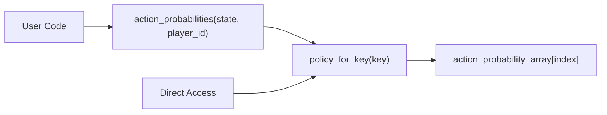
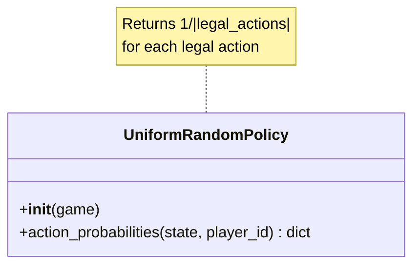
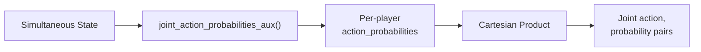
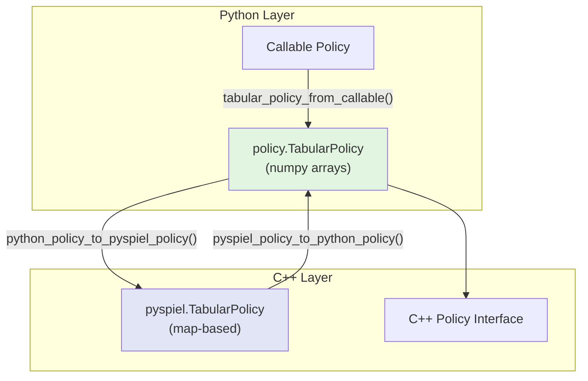
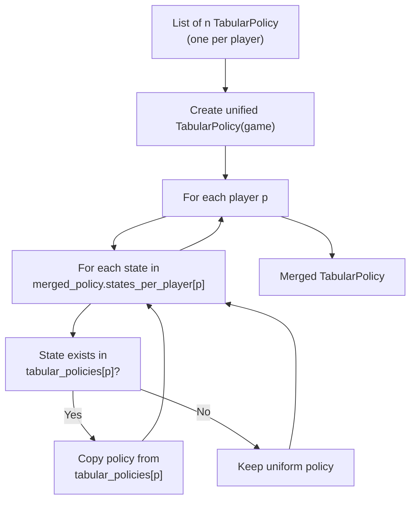
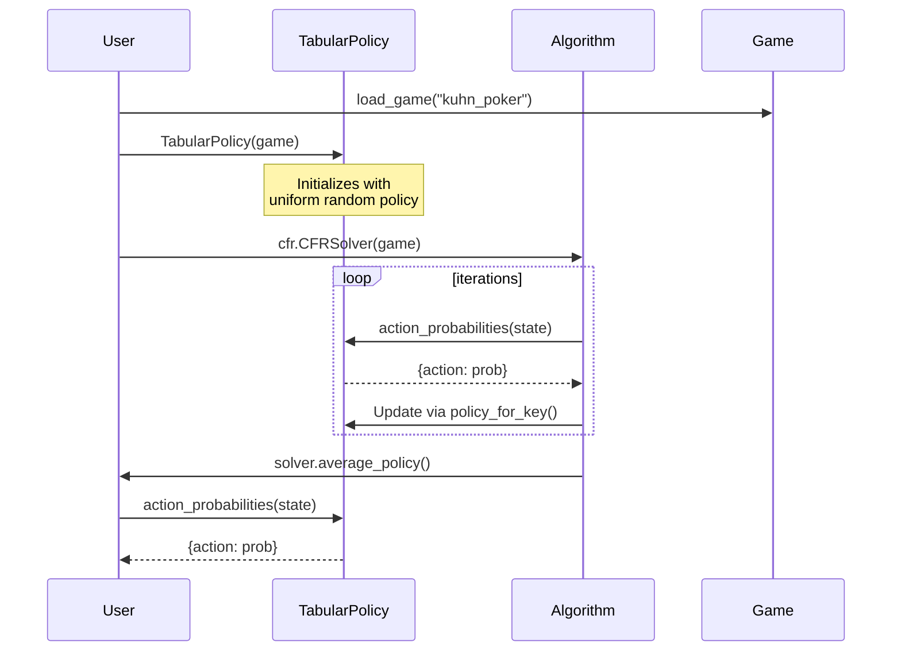

<!-- source: DeepWiki mcp.deepwiki.com · repo google-deepmind/open_spiel · page 4.2 Python Policy Classes · fetched 2026-10-26 -->

# Python Policy Classes

<details>
<summary>Relevant source files</summary>

The following files were used as context for generating this wiki page:

- [open_spiel/algorithms/CMakeLists.txt](open_spiel/algorithms/CMakeLists.txt)
- [open_spiel/algorithms/cfr.cc](open_spiel/algorithms/cfr.cc)
- [open_spiel/algorithms/cfr.h](open_spiel/algorithms/cfr.h)
- [open_spiel/algorithms/cfr_br.cc](open_spiel/algorithms/cfr_br.cc)
- [open_spiel/algorithms/cfr_br.h](open_spiel/algorithms/cfr_br.h)
- [open_spiel/algorithms/cfr_br_test.cc](open_spiel/algorithms/cfr_br_test.cc)
- [open_spiel/algorithms/cfr_test.cc](open_spiel/algorithms/cfr_test.cc)
- [open_spiel/algorithms/corr_dist.cc](open_spiel/algorithms/corr_dist.cc)
- [open_spiel/algorithms/corr_dist.h](open_spiel/algorithms/corr_dist.h)
- [open_spiel/algorithms/corr_dist_test.cc](open_spiel/algorithms/corr_dist_test.cc)
- [open_spiel/examples/CMakeLists.txt](open_spiel/examples/CMakeLists.txt)
- [open_spiel/games/universal_poker/CMakeLists.txt](open_spiel/games/universal_poker/CMakeLists.txt)
- [open_spiel/policy.cc](open_spiel/policy.cc)
- [open_spiel/policy.h](open_spiel/policy.h)
- [open_spiel/python/algorithms/cfr.py](open_spiel/python/algorithms/cfr.py)
- [open_spiel/python/algorithms/cfr_test.py](open_spiel/python/algorithms/cfr_test.py)
- [open_spiel/python/bots/policy.py](open_spiel/python/bots/policy.py)
- [open_spiel/python/policy.py](open_spiel/python/policy.py)
- [open_spiel/python/pybind11/algorithms_corr_dist.cc](open_spiel/python/pybind11/algorithms_corr_dist.cc)
- [open_spiel/python/pybind11/policy.cc](open_spiel/python/pybind11/policy.cc)
- [open_spiel/python/pybind11/python_policy.cc](open_spiel/python/pybind11/python_policy.cc)
- [open_spiel/python/pybind11/python_policy.h](open_spiel/python/pybind11/python_policy.h)
- [open_spiel/python/tests/policy_test.py](open_spiel/python/tests/policy_test.py)
- [open_spiel/tests/spiel_test.cc](open_spiel/tests/spiel_test.cc)

</details>


## Purpose and Scope

This page documents the Python policy classes provided in `open_spiel/python/policy.py` [open_spiel/python/policy.py:1-16](), which define standard representations for policies in OpenSpiel. These classes provide a unified interface for passing policies into algorithms such as CFR, exploitability computation, and best response calculations.

For information about the C++ Policy base class and pybind11 bindings, see [pyspiel Module and Bindings](#4.1). For CFR-specific policy implementations (`CFRAveragePolicy`, `CFRCurrentPolicy`), see [CFR Algorithms](#6.2).

---

## Policy Abstraction

### Base Policy Class

The `Policy` base class defines the standard interface for all policy implementations [open_spiel/python/policy.py:97-107](). The primary method is `action_probabilities(state, player_id=None)` [open_spiel/python/policy.py:122](), which returns a dictionary mapping actions to probabilities.

**Core Interface:**


Sources: [open_spiel/python/policy.py:97-196]()

### Key Methods

The `Policy` class provides several key methods:

| Method | Return Type | Description |
|--------|-------------|-------------|
| `action_probabilities(state, player_id)` [open_spiel/python/policy.py:122]() | `dict` | Returns `{action: probability}` for all legal actions |
| `__call__(state, player_id)` [open_spiel/python/policy.py:147]() | `dict` | Alias for `action_probabilities()` |
| `sample_action(state, player_id)` [open_spiel/python/policy.py:160]() | `Action` | Samples an action from the policy distribution |
| `to_tabular(states)` [open_spiel/python/policy.py:178]() | `TabularPolicy` | Converts this policy to a tabular representation |

**Important Convention:** As of May 2020, `action_probabilities()` should return all legal actions with their probabilities (summing to 1) [open_spiel/python/policy.py:125-135](). However, algorithms should not strictly rely on this convention being enforced for all policy implementations.

Sources: [open_spiel/python/policy.py:122-196]()

---

## TabularPolicy Implementation

### Overview

`TabularPolicy` is the primary concrete policy implementation, storing an explicit policy for each information state as a 2D numpy array of shape `(num_states, num_actions)`. This representation is convenient for tabular solution methods like CFR.

### Data Structure


Sources: [open_spiel/python/policy.py:228-248]()

### Key Attributes

| Attribute | Type | Description |
|-----------|------|-------------|
| `action_probability_array` | `numpy.ndarray` | Shape `(num_states, num_actions)`, stores `P(a|s)` |
| `state_lookup` | `dict` | Maps state key string to index in arrays |
| `legal_actions_mask` | `numpy.ndarray` | Binary mask of legal actions per state |
| `states_per_player` | `list` | Per-player list of state key strings |
| `states` | `list` | Ordered list of `State` objects |
| `state_in` | `numpy.ndarray` or `None` | Information state tensor representations |

Sources: [open_spiel/python/policy.py:228-248]()

### Initialization and State Keys

`TabularPolicy` uses information state strings as keys when available, otherwise observation strings:


Sources: [open_spiel/python/policy.py:250-304](), [open_spiel/python/policy.py:305-315]()

The `_state_key()` method [open_spiel/python/policy.py:305-315]() determines the key based on game capabilities:

1. If `provides_information_state_string`: uses `state.information_state_string(player)`
2. Else if `provides_observation_string`: uses `state.observation_string(player)`
3. Otherwise: uses `str(state)`

### Accessing and Modifying Policies

**Accessing State Policies:**


Sources: [open_spiel/python/policy.py:317-345]()

**Methods:**
- `action_probabilities(state, player_id)`: Returns `{action: prob}` dict for legal actions only
- `policy_for_key(key)`: Returns a slice of `action_probability_array` for a given state key
- `state_index(state)`: Returns the array index for a state

**Modifying Policies:**

The `policy_for_key()` method returns a slice (view) of the backing array, allowing in-place modification:

```python
# Example from docstring
tabular_policy.policy_for_key(s)[:] = [0.1, 0.5, 0.4]
```

### Utility Methods

| Method | Description |
|--------|-------------|
| `to_dict()` | Returns `{infostate_key: [(action, prob), ...]}` dictionary |
| `__copy__(copy_action_probability_array)` | Shallow copy with optional deep copy of probability array |
| `copy_with_noise(alpha, beta, random_state)` | Returns noisy copy with temperature-controlled mixing |

The `copy_with_noise()` method [open_spiel/python/policy.py:389-417]() is particularly useful for exploration:
- Generates random distribution via softmax with temperature `beta`
- Mixes with original policy using `(1-alpha) * old + alpha * random`

Sources: [open_spiel/python/policy.py:347-417]()

---

## Other Policy Implementations

### UniformRandomPolicy

Returns uniform probability over all legal actions [open_spiel/python/policy.py:420-451](). Computed dynamically, so suitable for large games where tabular representation would be infeasible.


Sources: [open_spiel/python/policy.py:420-451]()

```python
# Simplified implementation
def action_probabilities(self, state, player_id=None):
    legal_actions = state.legal_actions() if player_id is None 
                    else state.legal_actions(player_id)
    if not legal_actions:
        return {0: 1.0}
    probability = 1 / len(legal_actions)
    return {action: probability for action in legal_actions}
```

### FirstActionPolicy

Deterministic policy that always selects the lowest-numbered legal action [open_spiel/python/policy.py:454-470]().

```python
def action_probabilities(self, state, player_id=None):
    legal_actions = state.legal_actions() if player_id is None 
                    else state.legal_actions(player_id)
    if not legal_actions:
        return {0: 1.0}
    min_action = min(legal_actions)
    return {action: 1.0 if action == min_action else 0.0 
            for action in legal_actions}
```
Sources: [open_spiel/python/policy.py:454-470]()

---

## Simultaneous Move Game Support

### Joint Action Probabilities

For simultaneous-move games, OpenSpiel provides utilities to compute joint action probabilities [open_spiel/python/policy.py:53-94]():


Sources: [open_spiel/python/policy.py:53-94]()

**Functions:**
- `joint_action_probabilities_aux(state, policy)` [open_spiel/python/policy.py:53-73](): Returns separate lists of actions and probabilities per player
- `joint_action_probabilities(state, policy)` [open_spiel/python/policy.py:76-94](): Yields `(action_tuple, joint_prob)` pairs

### Helper Functions

`child(state, action)` [open_spiel/python/policy.py:43-50](): Handles both sequential and simultaneous nodes by checking if action is iterable.

---

## Python-C++ Policy Conversion

### Conversion Architecture


Sources: [open_spiel/python/policy.py:522-602]()

### Conversion Functions

#### Python to C++

`python_policy_to_pyspiel_policy(python_tabular_policy)` [open_spiel/python/policy.py:550-562]():

Converts Python `TabularPolicy` (numpy array-based) to C++ `pyspiel.TabularPolicy` (map-based).

```python
# Conversion logic (simplified)
infostates_to_probabilities = dict()
for infostate, index in python_tabular_policy.state_lookup.items():
    probs = python_tabular_policy.action_probability_array[index]
    legals = python_tabular_policy.legal_actions_mask[index]
    
    action_probs = []
    for action, (prob, is_legal) in enumerate(zip(probs, legals)):
        if is_legal == 1:
            action_probs.append((action, prob))
    infostates_to_probabilities[infostate] = action_probs
return pyspiel.TabularPolicy(infostates_to_probabilities)
```

#### C++ to Python

`pyspiel_policy_to_python_policy(game, pyspiel_tabular_policy, players=None)` [open_spiel/python/policy.py:522-547]():

Converts C++ `pyspiel.TabularPolicy` to Python `TabularPolicy`.

```python
policy = TabularPolicy(game, players=players)
for item in pyspiel_tabular_policy.policy_table().items():
    info_state_str, actions_probs = item
    if players is not None and info_state_str not in policy.state_lookup:
        continue
    state_policy = policy.policy_for_key(info_state_str)
    if actions_probs:
        state_policy[:] = 0.0  # Ensure policy is zero by default
    for action, prob in actions_probs:
        state_policy[action] = prob
return policy
```

Sources: [open_spiel/python/policy.py:522-562]()

### Callable to TabularPolicy

`tabular_policy_from_callable(game, callable_policy, players=None)` [open_spiel/python/policy.py:495-519]():

Converts a legacy callable (state -> action probabilities) to a `TabularPolicy`.

Sources: [open_spiel/python/policy.py:495-519]()

---

## Policy Merging and Utilities

### Merging Policies

`merge_tabular_policies(tabular_policies, game)` [open_spiel/python/policy.py:577-602]():

Merges per-player policies into a single joint policy. Missing states are filled with uniform random policy.


Sources: [open_spiel/python/policy.py:577-602]()

### State Enumeration

`get_tabular_policy_states(game)` [open_spiel/python/policy.py:473-492]():

Returns all states for a tabular policy, handling special cases:
- For mean field games: uses `observation_string(DEFAULT_PLAYER_ID)`
- For other games: uses `history_str()`

Sources: [open_spiel/python/policy.py:473-492]()

---

## Usage Patterns

### Creating and Using Policies


Sources: [open_spiel/python/policy.py:97-602](), [open_spiel/python/algorithms/cfr.py:227-256]()

### Common Patterns

**Pattern 1: Modifying a TabularPolicy**

```python
# Get state policy
info_state_str = state.information_state_string(player)
state_policy = tabular_policy.policy_for_key(info_state_str)

# Modify in-place
state_policy[:] = new_probabilities  # Assign all
state_policy[action] = probability   # Assign one action
```

**Pattern 2: Converting Between Python and C++**

```python
# Python -> C++ (for use in C++ algorithms)
python_policy = TabularPolicy(game)
cpp_policy = policy.python_policy_to_pyspiel_policy(python_policy)

# C++ -> Python (for analysis)
cpp_solver_policy = cfr_solver.average_policy()
python_policy = policy.pyspiel_policy_to_python_policy(
    game, cpp_solver_policy
)
```

**Pattern 3: Creating Noisy Policies for Exploration**

```python
original_policy = TabularPolicy(game)
# Mix 30% uniform noise with temperature 1.0
noisy_policy = original_policy.copy_with_noise(
    alpha=0.3, 
    beta=1.0,
    random_state=np.random.RandomState(seed)
)
```

Sources: [open_spiel/python/policy.py:213-226](), [open_spiel/python/policy.py:389-417](), [open_spiel/python/policy.py:550-575]()

---

