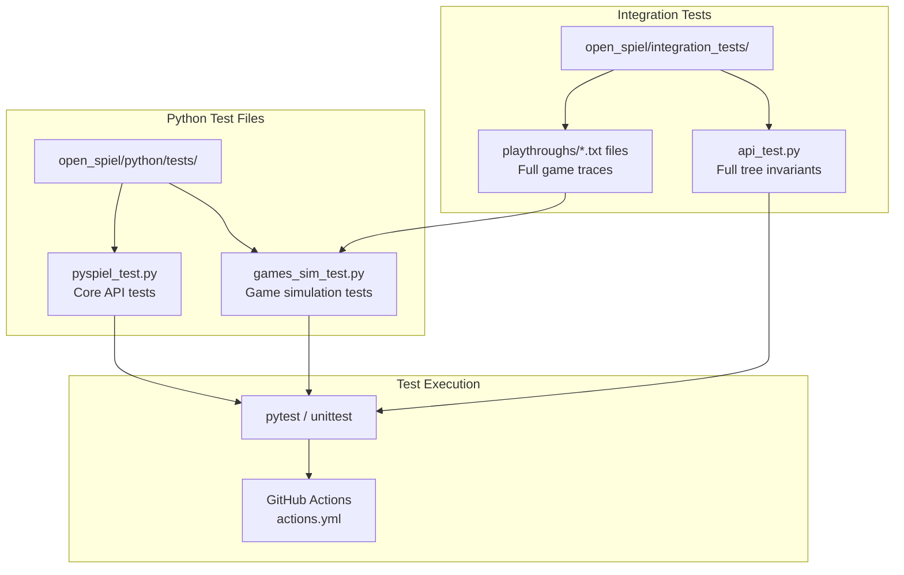
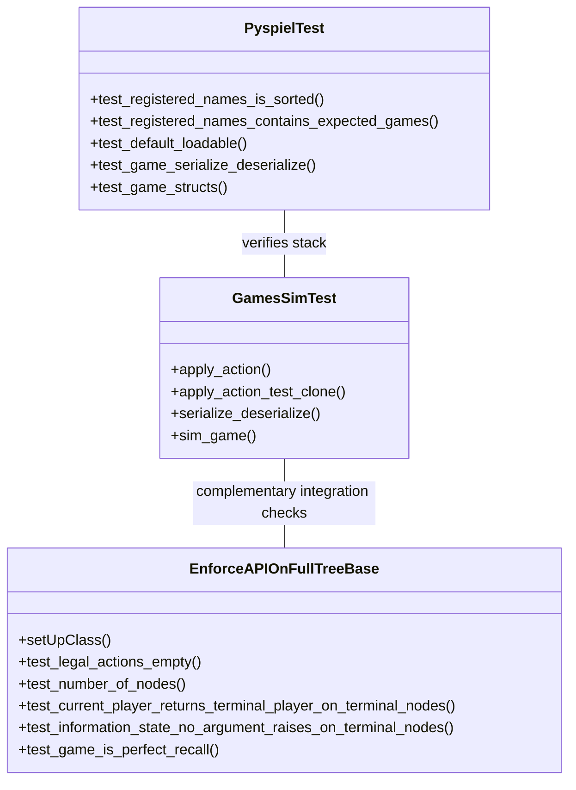
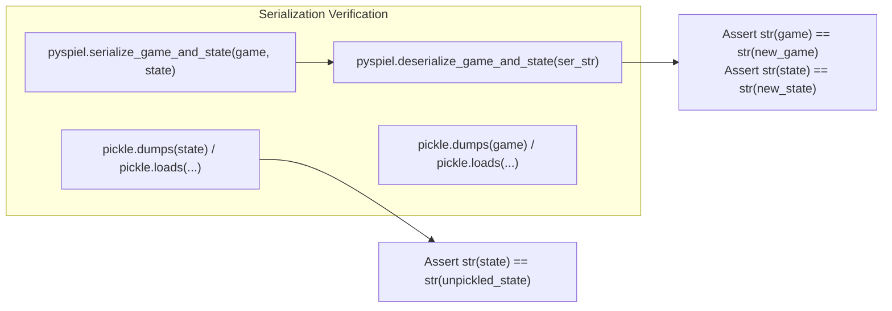

<!-- source: DeepWiki mcp.deepwiki.com · repo google-deepmind/open_spiel · page 4.3 Python Testing Infrastructure · fetched 2026-10-26 -->

# Python Testing Infrastructure

<details>
<summary>Relevant source files</summary>

The following files were used as context for generating this wiki page:

- [docs/games.md](docs/games.md)
- [open_spiel/games/CMakeLists.txt](open_spiel/games/CMakeLists.txt)
- [open_spiel/games/yacht/yacht.cc](open_spiel/games/yacht/yacht.cc)
- [open_spiel/games/yacht/yacht.h](open_spiel/games/yacht/yacht.h)
- [open_spiel/games/yacht/yacht_test.cc](open_spiel/games/yacht/yacht_test.cc)
- [open_spiel/integration_tests/api_test.py](open_spiel/integration_tests/api_test.py)
- [open_spiel/integration_tests/playthroughs/catch.txt](open_spiel/integration_tests/playthroughs/catch.txt)
- [open_spiel/integration_tests/playthroughs/python_pursuit_evasion.txt](open_spiel/integration_tests/playthroughs/python_pursuit_evasion.txt)
- [open_spiel/integration_tests/playthroughs/xiangqi.txt](open_spiel/integration_tests/playthroughs/xiangqi.txt)
- [open_spiel/observer.cc](open_spiel/observer.cc)
- [open_spiel/observer.h](open_spiel/observer.h)
- [open_spiel/python/CMakeLists.txt](open_spiel/python/CMakeLists.txt)
- [open_spiel/python/algorithms/generate_playthrough.py](open_spiel/python/algorithms/generate_playthrough.py)
- [open_spiel/python/games/__init__.py](open_spiel/python/games/__init__.py)
- [open_spiel/python/games/ant_foraging.py](open_spiel/python/games/ant_foraging.py)
- [open_spiel/python/games/ant_foraging_test.py](open_spiel/python/games/ant_foraging_test.py)
- [open_spiel/python/games/pursuit_evasion.py](open_spiel/python/games/pursuit_evasion.py)
- [open_spiel/python/games/pursuit_evasion_test.py](open_spiel/python/games/pursuit_evasion_test.py)
- [open_spiel/python/observation.py](open_spiel/python/observation.py)
- [open_spiel/python/pybind11/observer.cc](open_spiel/python/pybind11/observer.cc)
- [open_spiel/python/pybind11/pyspiel.cc](open_spiel/python/pybind11/pyspiel.cc)
- [open_spiel/python/tests/games_sim_test.py](open_spiel/python/tests/games_sim_test.py)
- [open_spiel/python/tests/observation_test.py](open_spiel/python/tests/observation_test.py)
- [open_spiel/python/tests/pyspiel_test.py](open_spiel/python/tests/pyspiel_test.py)

</details>


## Purpose and Scope

This document describes the Python testing infrastructure in OpenSpiel, focusing on how Python tests validate the entire stack including Python bindings, game implementations, and algorithm correctness. For information about the C++ testing framework, see [C++ Testing Framework](#10.1). For details on the Python bindings themselves, see [pyspiel Module and Bindings](#4.1).

The Python testing infrastructure serves multiple critical functions:
- Validates Python-C++ bindings work correctly via [open_spiel/python/tests/pyspiel_test.py:14-16]()
- Ensures game implementations behave as expected [open_spiel/python/tests/games_sim_test.py:101-167]()
- Tests serialization and deserialization [open_spiel/python/tests/games_sim_test.py:124-138]()
- Verifies algorithm implementations and cross-language equivalence
- Provides regression testing through playthrough files [open_spiel/python/algorithms/generate_playthrough.py:16-22]()

Sources: [open_spiel/python/tests/pyspiel_test.py:1-455](), [open_spiel/python/tests/games_sim_test.py:1-167]()

---

## Test Organization and Structure

### Directory Layout



Sources: [open_spiel/python/tests/pyspiel_test.py:1-455](), [open_spiel/python/tests/games_sim_test.py:38-98](), [open_spiel/integration_tests/api_test.py:33-104]()

### Test Framework

Python tests use two primary testing frameworks:
- **unittest**: Python's built-in testing framework [open_spiel/integration_tests/api_test.py:17-17]()
- **absl.testing**: Google's Abseil testing framework with `absltest` and `parameterized` utilities [open_spiel/python/tests/pyspiel_test.py:19-20]()

Tests are parameterized using `absl.testing.parameterized.TestCase` for running the same test logic across multiple games or configurations [open_spiel/python/tests/pyspiel_test.py:179-180]().

Sources: [open_spiel/python/tests/pyspiel_test.py:18-20](), [open_spiel/integration_tests/api_test.py:21-22]()

---

## Core Test Files

### pyspiel_test.py - Core API Tests

The main test file for validating the `pyspiel` Python module and its bindings to the C++ core [open_spiel/python/tests/pyspiel_test.py:14-14]().

#### Test Class Structure



Sources: [open_spiel/python/tests/pyspiel_test.py:179-183](), [open_spiel/python/tests/games_sim_test.py:101-138](), [open_spiel/integration_tests/api_test.py:107-187]()

#### Key Test Categories in pyspiel_test.py

| Test Method | Purpose | Key Assertions |
|-------------|---------|----------------|
| `test_registered_names_is_sorted` | Ensures game registry is alphabetically sorted | `assertSequenceEqual(names, sorted(names))` [open_spiel/python/tests/pyspiel_test.py:181-183]() |
| `test_registered_names_contains_expected_games` | Verifies mandatory games are present | Checks against `EXPECTED_MANDATORY_GAMES` [open_spiel/python/tests/pyspiel_test.py:185-197]() |
| `test_default_loadable` | Identifies games requiring parameters | Validates `game.default_loadable` property [open_spiel/python/tests/pyspiel_test.py:206-214]() |

Sources: [open_spiel/python/tests/pyspiel_test.py:181-214]()

#### Expected Games Registry

The test defines `EXPECTED_MANDATORY_GAMES`, a frozen set of all games that must be registered in a standard OpenSpiel build [open_spiel/python/tests/pyspiel_test.py:35-176](). This list excludes:
- Optional games controlled by build flags (Hanabi, Universal Poker) [open_spiel/python/tests/pyspiel_test.py:189-195]()
- Fully optional Python games in `_FULLY_OPTIONAL_PYTHON_GAMES` [open_spiel/python/tests/pyspiel_test.py:28-32]()

Sources: [open_spiel/python/tests/pyspiel_test.py:28-176]()

### games_sim_test.py - Game Simulation Tests

Tests game implementations through randomized simulation, ensuring:
- Games can be played from start to finish via `sim_game()` [open_spiel/python/tests/games_sim_test.py:139-151]()
- Serialization/deserialization works correctly across native OpenSpiel and Python `pickle` [open_spiel/python/tests/games_sim_test.py:124-137]()
- Clone methods preserve state string representations and history [open_spiel/python/tests/games_sim_test.py:110-122]()

Sources: [open_spiel/python/tests/games_sim_test.py:101-167]()

---

## Test Categories and Patterns

### Game Registration and Discovery Tests

These tests validate the game registry system exposed via `pyspiel.registered_names()` and `pyspiel.registered_games()` [open_spiel/python/tests/pyspiel_test.py:182-212]().

Sources: [open_spiel/python/tests/pyspiel_test.py:181-214]()

### Serialization and Deserialization Tests

Critical for ensuring game states and configurations can be saved and restored across processes [open_spiel/python/tests/games_sim_test.py:124-138]():



Sources: [open_spiel/python/tests/games_sim_test.py:124-160]()

### Structured Data and Invariant Tests

Tests for verifying structural properties across full game trees [open_spiel/integration_tests/api_test.py:107-130]() (such as in `api_test.py` via `EnforceAPIOnFullTreeBase`), ensuring that terminal nodes report empty legal actions [open_spiel/integration_tests/api_test.py:131-136](), correct terminal players [open_spiel/integration_tests/api_test.py:175-178](), and proper adherence to perfect recall [open_spiel/integration_tests/api_test.py:186-187]().

Sources: [open_spiel/integration_tests/api_test.py:107-187]()

---

## Integration Testing with Playthrough Files

Playthrough files provide complete game traces for deterministic replay and regression testing, located under `open_spiel/integration_tests/playthroughs/` [open_spiel/python/algorithms/generate_playthrough.py:18-22](). They record states, legal actions, histories, rewards, returns, and tensor observations [open_spiel/python/algorithms/generate_playthrough.py:102-134]().

Sources: [open_spiel/python/algorithms/generate_playthrough.py:16-158]()

---

## Test Execution and CI/CD Integration

### Running Tests Locally

```bash
# Run all Python tests via pytest
pytest open_spiel/python/tests/

# Run specific test file
pytest open_spiel/python/tests/pyspiel_test.py

# Run game simulation tests
pytest open_spiel/python/tests/games_sim_test.py
```

Sources: High-level Diagram 6

### CI Integration

The CI pipeline executes both C++ test suites (via CTest) and Python test suites (via `pytest`) across various build options (such as enabling optional flags like `OPEN_SPIEL_BUILD_WITH_ACPC` [open_spiel/python/tests/pyspiel_test.py:192-195]() or `OPEN_SPIEL_BUILD_WITH_HANABI` [open_spiel/python/tests/pyspiel_test.py:189-191]()).

Sources: [open_spiel/python/tests/pyspiel_test.py:179-220]()

---

