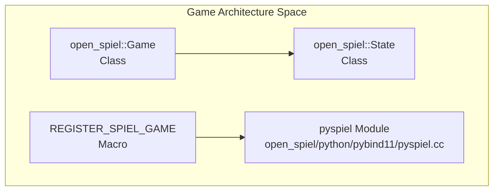
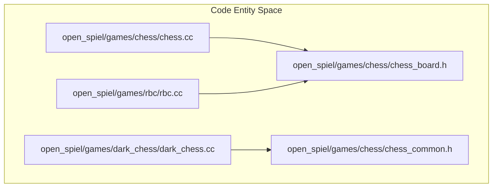
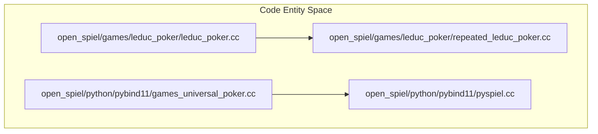

<!-- source: DeepWiki mcp.deepwiki.com · repo google-deepmind/open_spiel · page 5 Game Implementations · fetched 2026-10-26 -->

# Game Implementations

Relevant source files

The following files were used as context for generating this wiki page:

- [docs/games.md](docs/games.md)
- [open_spiel/games/CMakeLists.txt](open_spiel/games/CMakeLists.txt)
- [open_spiel/integration_tests/api_test.py](open_spiel/integration_tests/api_test.py)
- [open_spiel/integration_tests/playthroughs/catch.txt](open_spiel/integration_tests/playthroughs/catch.txt)
- [open_spiel/integration_tests/playthroughs/chess.txt](open_spiel/integration_tests/playthroughs/chess.txt)
- [open_spiel/integration_tests/playthroughs/cliff_walking.txt](open_spiel/integration_tests/playthroughs/cliff_walking.txt)
- [open_spiel/integration_tests/playthroughs/clobber.txt](open_spiel/integration_tests/playthroughs/clobber.txt)
- [open_spiel/integration_tests/playthroughs/cursor_go(board_size=5,max_cursor_moves=7).txt](open_spiel/integration_tests/playthroughs/cursor_go(board_size=5,max_cursor_moves=7).txt)
- [open_spiel/integration_tests/playthroughs/dark_chess(board_size=4).txt](open_spiel/integration_tests/playthroughs/dark_chess(board_size=4).txt)
- [open_spiel/integration_tests/playthroughs/dark_chess.txt](open_spiel/integration_tests/playthroughs/dark_chess.txt)
- [open_spiel/integration_tests/playthroughs/deep_sea.txt](open_spiel/integration_tests/playthroughs/deep_sea.txt)
- [open_spiel/integration_tests/playthroughs/go.txt](open_spiel/integration_tests/playthroughs/go.txt)
- [open_spiel/integration_tests/playthroughs/python_pursuit_evasion.txt](open_spiel/integration_tests/playthroughs/python_pursuit_evasion.txt)
- [open_spiel/integration_tests/playthroughs/xiangqi.txt](open_spiel/integration_tests/playthroughs/xiangqi.txt)
- [open_spiel/python/CMakeLists.txt](open_spiel/python/CMakeLists.txt)
- [open_spiel/python/games/__init__.py](open_spiel/python/games/__init__.py)
- [open_spiel/python/games/ant_foraging.py](open_spiel/python/games/ant_foraging.py)
- [open_spiel/python/games/ant_foraging_test.py](open_spiel/python/games/ant_foraging_test.py)
- [open_spiel/python/games/pursuit_evasion.py](open_spiel/python/games/pursuit_evasion.py)
- [open_spiel/python/games/pursuit_evasion_test.py](open_spiel/python/games/pursuit_evasion_test.py)
- [open_spiel/python/pybind11/pyspiel.cc](open_spiel/python/pybind11/pyspiel.cc)
- [open_spiel/python/tests/pyspiel_test.py](open_spiel/python/tests/pyspiel_test.py)

OpenSpiel hosts a diverse collection of game implementations spanning classic board games, card games, economic auctions, stochastic environments, game transforms, and mean-field/routing games. Every game adheres to the core `Game` and `State` abstractions, ensuring interoperability with the framework's solvers, reinforcement learning environments, and analytical tools.

For details on how individual games are registered and exposed, see `open_spiel/python/pybind11/pyspiel.cc` [open_spiel/python/pybind11/pyspiel.cc:46-74]() and `open_spiel/python/CMakeLists.txt` [open_spiel/python/CMakeLists.txt:28-124]().

Sources: [open_spiel/python/pybind11/pyspiel.cc:46-74](), [open_spiel/python/CMakeLists.txt:28-124]().

## Game Organization and Architecture

Games in OpenSpiel are organized under `open_spiel/games/` [open_spiel/games/CMakeLists.txt:1-241](), where each game implements C++ base classes or Python wrappers [open_spiel/python/games/__init__.py:15-54](). They are thoroughly cataloged and tested through automated integration tests and playthroughs [open_spiel/integration_tests/api_test.py:36-44]().

Diagram: Game Architecture Mapping

Sources: [open_spiel/python/pybind11/pyspiel.cc:46-74](), [open_spiel/games/CMakeLists.txt:1-241]().

---

## 5.1. Chess and Variants

OpenSpiel includes robust implementations of chess and multiple variants, featuring custom move generators, FEN parsing, and specialized board state representations. Supported variants include standard chess, antichess, dark chess, kriegspiel, crazyhouse, and Chess960 (RBC).

For details, see [Chess and Variants](#5.1).

Diagram: Chess Code Entity Association

Sources: [open_spiel/games/CMakeLists.txt:37-43](), [open_spiel/games/CMakeLists.txt:76-77](), [open_spiel/games/CMakeLists.txt:202-203]().

---

## 5.2. Poker Games

Poker implementations range from simplified toy games like Kuhn and Leduc poker to comprehensive universal poker engines with ACPC (Annual Computer Poker Competition) integration, as well as wrappers around external Python libraries like `pokerkit`.

For details, see [Poker Games](#5.2).

Diagram: Poker Implementation Modules

Sources: [open_spiel/python/pybind11/pyspiel.cc:101-104](), [open_spiel/games/CMakeLists.txt:137-140]().

---

## 5.3. Board Games

Board game implementations cover classic games of perfect and imperfect information such as Go, Hex, Connect Four, Gomoku, Twixt, Checkers, Backgammon, 2048, and Ultimate Tic-Tac-Toe, each defining specific action encodings and observation tensors.

For details, see [Board Games](#5.3).

Sources: [open_spiel/games/CMakeLists.txt:6-7](), [open_spiel/games/CMakeLists.txt:33-34](), [open_spiel/games/CMakeLists.txt:53-54](), [open_spiel/games/CMakeLists.txt:106-109](), [open_spiel/games/CMakeLists.txt:123-124](), [open_spiel/games/CMakeLists.txt:238-241]().

---

## 5.4. Card Games

Trick-taking and card games are well-represented with Bridge (and Tiny Bridge), Hearts, Gin Rummy, Euchre, Dou Dizhu, Crazy Eights, Go Fish, Blackjack, and Yacht. These implementations handle complex dealing, hand evaluation, and scoring rules.

For details, see [Card Games](#5.4).

Sources: [open_spiel/games/CMakeLists.txt:17-18](), [open_spiel/games/CMakeLists.txt:23-28](), [open_spiel/games/CMakeLists.txt:66-67](), [open_spiel/games/CMakeLists.txt:88-91](), [open_spiel/games/CMakeLists.txt:96-97]().

---

## 5.5. Game Transforms

OpenSpiel provides a powerful game transformation system using the `WrappedGame` and `WrappedState` pattern. Transforms include turning simultaneous games into sequential ones (`turn_based_simultaneous`), creating repeated games, misère play, zero-sum conversions, adding noise, cached game trees, starting at specific states, and computing restricted Nash responses.

For details, see [Game Transforms](#5.5).

Sources: [open_spiel/python/pybind11/pyspiel.cc:32](), [open_spiel/python/tests/pyspiel_test.py:150-153]().

---

## 5.6. Mean Field and Routing Games

Mean-field game (MFG) implementations model large populations of interacting agents, including crowd modelling, predator-prey dynamics, periodic aversion, and linear-quadratic MFG models, alongside dynamic routing games implemented in both C++ and Python.

For details, see [Mean Field and Routing Games](#5.6).

Sources: [open_spiel/games/CMakeLists.txt:84-87](), [open_spiel/games/CMakeLists.txt:156-163](), [open_spiel/python/tests/pyspiel_test.py:111-115]().

---

## 5.7. Imperfect-Information and Misc Games

This category covers imperfect-information board games (such as Phantom Tic-Tac-Toe and Go, Dark Hex), economic and bargaining games, and generic extensive-form/normal-form game formats (EFG, NFG, GAMUT, matrix, and tensor games).

For details, see [Imperfect-Information and Misc Games](#5.7).

Sources: [open_spiel/games/CMakeLists.txt:78-79](), [open_spiel/games/CMakeLists.txt:92-95](), [open_spiel/games/CMakeLists.txt:190-193]().

---

