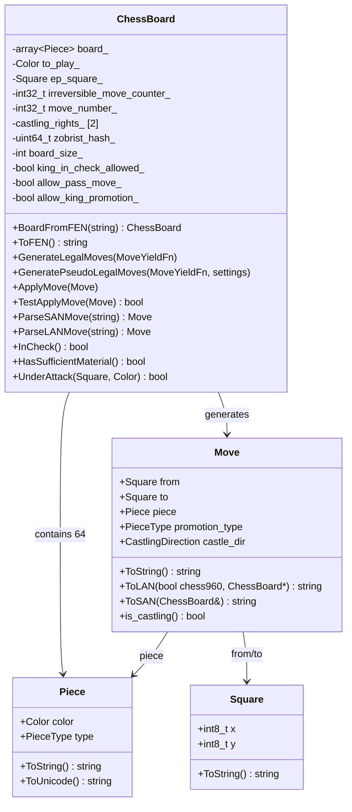
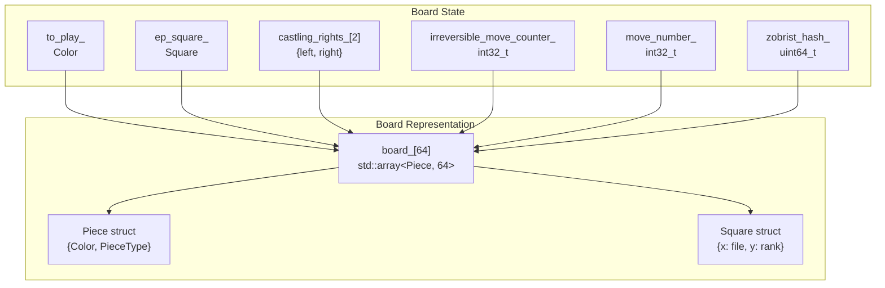
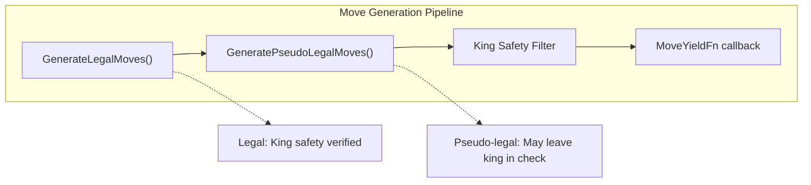
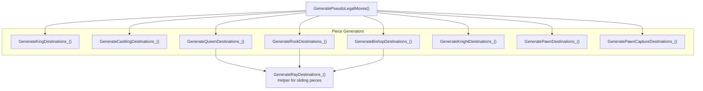
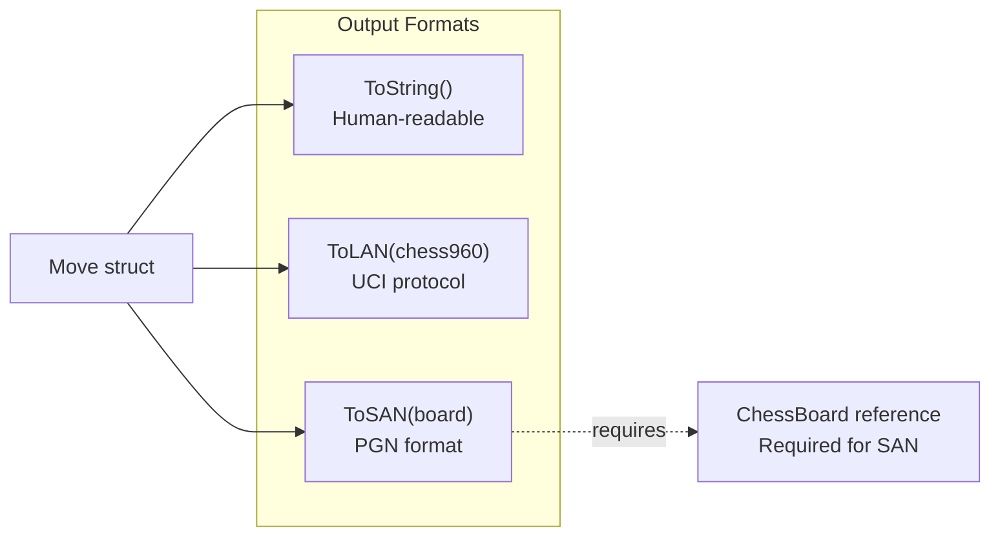
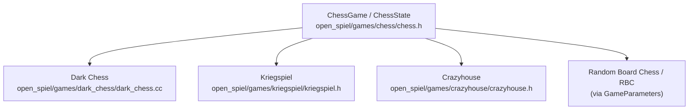
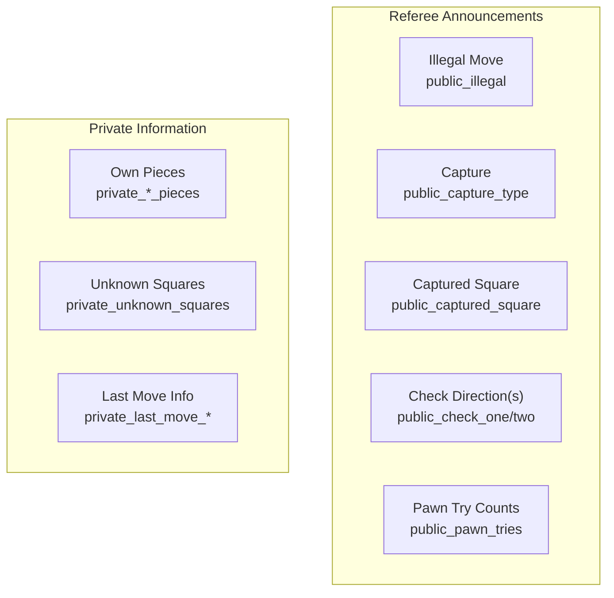

<!-- source: DeepWiki mcp.deepwiki.com · repo google-deepmind/open_spiel · page 5.1 Chess and Variants · fetched 2026-10-26 -->

# Chess and Variants

<details>
<summary>Relevant source files</summary>

The following files were used as context for generating this wiki page:

- [open_spiel/bots/uci/CMakeLists.txt](open_spiel/bots/uci/CMakeLists.txt)
- [open_spiel/bots/uci/random_uci_bot.cc](open_spiel/bots/uci/random_uci_bot.cc)
- [open_spiel/bots/uci/uci_bot.cc](open_spiel/bots/uci/uci_bot.cc)
- [open_spiel/bots/uci/uci_bot.h](open_spiel/bots/uci/uci_bot.h)
- [open_spiel/bots/uci/uci_bot_test.cc](open_spiel/bots/uci/uci_bot_test.cc)
- [open_spiel/games/chess/chess.cc](open_spiel/games/chess/chess.cc)
- [open_spiel/games/chess/chess.h](open_spiel/games/chess/chess.h)
- [open_spiel/games/chess/chess_board.cc](open_spiel/games/chess/chess_board.cc)
- [open_spiel/games/chess/chess_board.h](open_spiel/games/chess/chess_board.h)
- [open_spiel/games/chess/chess_common.h](open_spiel/games/chess/chess_common.h)
- [open_spiel/games/chess/chess_test.cc](open_spiel/games/chess/chess_test.cc)
- [open_spiel/games/crazyhouse/crazyhouse.cc](open_spiel/games/crazyhouse/crazyhouse.cc)
- [open_spiel/games/crazyhouse/crazyhouse.h](open_spiel/games/crazyhouse/crazyhouse.h)
- [open_spiel/games/crazyhouse/crazyhouse_board.cc](open_spiel/games/crazyhouse/crazyhouse_board.cc)
- [open_spiel/games/crazyhouse/crazyhouse_board.h](open_spiel/games/crazyhouse/crazyhouse_board.h)
- [open_spiel/games/crazyhouse/crazyhouse_common.cc](open_spiel/games/crazyhouse/crazyhouse_common.cc)
- [open_spiel/games/crazyhouse/crazyhouse_common.h](open_spiel/games/crazyhouse/crazyhouse_common.h)
- [open_spiel/games/crazyhouse/crazyhouse_test.cc](open_spiel/games/crazyhouse/crazyhouse_test.cc)
- [open_spiel/games/dark_chess/dark_chess.cc](open_spiel/games/dark_chess/dark_chess.cc)
- [open_spiel/games/deep_sea/deep_sea.cc](open_spiel/games/deep_sea/deep_sea.cc)
- [open_spiel/games/kriegspiel/kriegspiel.cc](open_spiel/games/kriegspiel/kriegspiel.cc)
- [open_spiel/games/kriegspiel/kriegspiel.h](open_spiel/games/kriegspiel/kriegspiel.h)
- [open_spiel/games/kriegspiel/kriegspiel_test.cc](open_spiel/games/kriegspiel/kriegspiel_test.cc)
- [open_spiel/games/laser_tag/laser_tag.cc](open_spiel/games/laser_tag/laser_tag.cc)
- [open_spiel/games/shogi/shogi.cc](open_spiel/games/shogi/shogi.cc)
- [open_spiel/games/shogi/shogi.h](open_spiel/games/shogi/shogi.h)
- [open_spiel/games/shogi/shogi_board.cc](open_spiel/games/shogi/shogi_board.cc)
- [open_spiel/games/shogi/shogi_board.h](open_spiel/games/shogi/shogi_board.h)
- [open_spiel/games/shogi/shogi_test.cc](open_spiel/games/shogi/shogi_test.cc)
- [open_spiel/integration_tests/playthroughs/kriegspiel(board_size=4).txt](open_spiel/integration_tests/playthroughs/kriegspiel(board_size=4).txt)
- [open_spiel/integration_tests/playthroughs/shogi.txt](open_spiel/integration_tests/playthroughs/shogi.txt)
- [open_spiel/python/pybind11/games_chess.cc](open_spiel/python/pybind11/games_chess.cc)
- [open_spiel/python/pybind11/games_crazyhouse.cc](open_spiel/python/pybind11/games_crazyhouse.cc)
- [open_spiel/python/pybind11/games_crazyhouse.h](open_spiel/python/pybind11/games_crazyhouse.h)
- [open_spiel/python/pybind11/games_shogi.cc](open_spiel/python/pybind11/games_shogi.cc)
- [open_spiel/python/pybind11/games_shogi.h](open_spiel/python/pybind11/games_shogi.h)
- [open_spiel/python/tests/games_chess_test.py](open_spiel/python/tests/games_chess_test.py)
- [open_spiel/python/tests/games_crazyhouse_test.py](open_spiel/python/tests/games_crazyhouse_test.py)
- [open_spiel/python/tests/games_shogi_test.py](open_spiel/python/tests/games_shogi_test.py)

</details>


This document covers the Chess implementation in OpenSpiel, including the core `ChessBoard` class [open_spiel/games/chess/chess_board.h:137](), move generation algorithms, notation parsing, and chess variants (Dark Chess, Kriegspiel, Crazyhouse, and Random Board Chess / RBC). The implementation provides a complete, high-performance chess engine with support for standard rules, Chess960, and various game configurations.

For general game implementation patterns, see [Game Implementations](#5). For integration with algorithms like CFR, see [Algorithms and Solution Concepts](#6).

---

## Core Architecture

The chess implementation is built around a self-contained `ChessBoard` class [open_spiel/games/chess/chess_board.h:137]() that encapsulates all board state and move generation logic. This class is independent of OpenSpiel's `Game` and `State` abstractions, making it reusable and testable in isolation.

### ChessBoard Class Structure



**Sources:** [open_spiel/games/chess/chess_board.h:257-570](), [open_spiel/games/chess/chess_board.h:86-105](), [open_spiel/games/chess/chess_board.h:139-219]()

---

## Piece and Square Representation

### Core Data Structures

The implementation uses compact data structures for efficient board representation:

| Type | Definition | Values | Purpose |
|------|-----------|--------|---------|
| `Color` | `enum class` | `kBlack=0`, `kWhite=1`, `kEmpty=2` | Player color and empty squares |
| `PieceType` | `enum class` | `kEmpty=0`, `kKing=1`, `kQueen=2`, `kRook=3`, `kBishop=4`, `kKnight=5`, `kPawn=6` | Type of chess piece |
| `Square` | `struct` | `int8_t x, y` | Board position (file, rank) |
| `Offset` | `struct` | `int8_t x_offset, y_offset` | Relative movement vector |
| `Piece` | `struct` | `Color color, PieceType type` | Complete piece representation |



**Sources:** [open_spiel/games/chess/chess_board.h:41-67](), [open_spiel/games/chess/chess_board.h:86-98](), [open_spiel/games/chess/chess_common.h:28-70]()

### FEN Notation Support

The `ChessBoard` class provides comprehensive Forsyth-Edwards Notation (FEN) support for serialization and deserialization:

**FEN String Format:**
```
<piece placement> <side to move> <castling> <en passant> <halfmove clock> <fullmove number>
```

**Example:** `rnbqkbnr/pppppppp/8/8/8/8/PPPPPPPP/RNBQKBNR w KQkq - 0 1`

Key functions:
- `BoardFromFEN(const std::string& fen, ...)` - Static factory method [open_spiel/games/chess/chess_board.cc:376-530]()
- `ToFEN(bool shredder)` - Serialize to FEN string [open_spiel/games/chess/chess_board.h:445]()
- Supports both standard FEN and Shredder-FEN for Chess960 castling notation [open_spiel/games/chess/chess_board.cc:453-509]()

**Sources:** [open_spiel/games/chess/chess_board.h:263-268](), [open_spiel/games/chess/chess_board.h:443-445](), [open_spiel/games/chess/chess_board.cc:376-530]()

---

## Move Generation

### Legal vs Pseudo-Legal Moves

The implementation distinguishes between legal and pseudo-legal moves:



**Pseudo-legal moves** are moves that follow piece movement rules but may leave the king in check. They are generated efficiently without king safety verification.

**Legal moves** filter out pseudo-legal moves that would result in the moving player's king being in check. The filtering is done by:
1. Applying each pseudo-legal move to a board copy [open_spiel/games/chess/chess_board.cc:559]()
2. Checking if the king is under attack [open_spiel/games/chess/chess_board.cc:565]()
3. Only yielding moves where the king is safe [open_spiel/games/chess/chess_board.cc:568]()

**Sources:** [open_spiel/games/chess/chess_board.cc:545-573](), [open_spiel/games/chess/chess_board.cc:575-680](), [open_spiel/games/chess/chess_board.h:309-316]()

### Move Generation Settings

The `PseudoLegalMoveSettings` enum controls how moves interact with opponent pieces:

| Setting | Behavior | Use Case |
|---------|----------|----------|
| `kAcknowledgeEnemyPieces` | Standard legal moves - pieces blocked by opponents | Normal chess |
| `kBreachEnemyPieces` | Pieces can "move through" unseen opponents | Kriegspiel, RBC variants |

**Sources:** [open_spiel/games/chess/chess_board.h:238-249]()

### Piece-Specific Move Generation

The implementation uses templated private methods for each piece type:



**Key implementation details:**
- **Callback-based generation:** All methods accept a `MoveYieldFn` callback that receives each generated move [open_spiel/games/chess/chess_board.h:308]()
- **Early termination:** Callbacks return `bool` to indicate whether to continue generation [open_spiel/games/chess/chess_board.h:580-583]()
- **Ray-based sliding:** Rooks, bishops, and queens use `GenerateRayDestinations_()` helper [open_spiel/games/chess/chess_board.h:540-542]()

**Sources:** [open_spiel/games/chess/chess_board.h:490-542](), [open_spiel/games/chess/chess_board.cc:575-680]()

---

## Special Moves and Rules

### Castling

Castling is fully supported including Chess960 (Fischer Random Chess):

**Features:**
- Separate castling rights tracking for each player and direction [open_spiel/games/chess/chess_board.h:564-567]()
- `castling_rights_[2]` stores optional rook square for each direction [open_spiel/games/chess/chess_board.h:564-567]()
- Validation includes:
  - King and rook haven't moved
  - Squares between are empty [open_spiel/games/chess/chess_board.cc:498-505]()
  - King not in check and doesn't pass through check
  - Supports both standard FEN (`KQkq`) and Shredder-FEN (`AHah`) notation [open_spiel/games/chess/chess_board.cc:463-509]()

**Sources:** [open_spiel/games/chess/chess_board.cc:463-509](), [open_spiel/games/chess/chess_board.h:495-504](), [open_spiel/games/chess/chess_board.h:564-567]()

### En Passant

En passant captures are tracked through the `ep_square_` member:

- Set to the square a pawn passes over during a double-move [open_spiel/games/chess/chess_board.h:279]()
- Only set if actually threatened by an opponent pawn [open_spiel/games/chess/chess_board.cc:518-523]()
- Reset after any non-pawn move or any capture [open_spiel/games/chess/chess_board.h:279]()

**Sources:** [open_spiel/games/chess/chess_board.h:279-280](), [open_spiel/games/chess/chess_board.cc:511-524]()

### Pawn Promotion

Promotions are encoded in the `Move` struct with `promotion_type`:

**Supported promotion types:**
- Queen, Rook, Bishop, Knight (standard)
- King promotion (optional, for variants like Antichess) [open_spiel/games/chess/chess_board.h:435]()

**Generation:** When a pawn reaches promotion rank, multiple moves are generated—one for each valid promotion type [open_spiel/games/chess/chess_board.cc:643-650]()

**Sources:** [open_spiel/games/chess/chess_board.cc:643-665](), [open_spiel/games/chess/chess_board.h:435]()

### Irreversible Move Counter (50-Move Rule)

The `irreversible_move_counter_` tracks half-moves since last pawn move or capture for the 50-move draw rule:

- Incremented on each move [open_spiel/games/chess/chess_board.h:282]()
- Reset to 0 on pawn moves or captures
- Used to determine draws by repetition

**Sources:** [open_spiel/games/chess/chess_board.h:282](), [open_spiel/games/chess/chess_board.cc:526]()

---

## Move Notation Parsing

The implementation supports both Standard Algebraic Notation (SAN) and Long Algebraic Notation (LAN).

### Standard Algebraic Notation (SAN)

SAN is human-readable and concise, used in PGN files:

**Format Components:**
| Component | Example | Notes |
|-----------|---------|-------|
| Piece type | `N`, `B`, `R`, `Q`, `K` | Omitted for pawns |
| Disambiguation | `Nbd7`, `R1a3`, `Qh4e1` | File, rank, or both if needed |
| Capture indicator | `x` | Optional |
| Destination square | `e4`, `d5` | Always present |
| Promotion | `=Q`, `=N` | For pawn promotions |
| Check/Checkmate | `+`, `#` | Annotations |
| Castling | `O-O`, `O-O-O` | Kingside, Queenside |

**Examples:** `e4`, `Nf3`, `Bxf7+`, `exd8=Q#`, `O-O-O`

**Parsing Algorithm:**
1. Handle castling notation first [open_spiel/games/chess/chess_board.cc:915-941]()
2. Strip annotations (check/mate markers) [open_spiel/games/chess/chess_board.cc:943]()
3. Extract piece type (default to pawn) [open_spiel/games/chess/chess_board.cc:951-961]()
4. Parse destination square from end [open_spiel/games/chess/chess_board.cc:964-980]()
5. Extract disambiguation (file/rank) if present [open_spiel/games/chess/chess_board.cc:989-1002]()
6. Match against all legal moves [open_spiel/games/chess/chess_board.cc:1016-1026]()

**Sources:** [open_spiel/games/chess/chess_board.cc:909-1032](), [open_spiel/games/chess/chess_board.h:170-210]()

### Long Algebraic Notation (LAN)

LAN is unambiguous and used by UCI chess engines:

**Format:** `<from><to>[promotion]`
- Examples: `e2e4`, `g1f3`, `e7e8q`
- Chess960 castling: `e1h1` (king square to rook square) [open_spiel/games/chess/chess_board.cc:1067-1076]()

**Parsing:** Direct square extraction with optional promotion character [open_spiel/games/chess/chess_board.cc:1034-1093]()

**Sources:** [open_spiel/games/chess/chess_board.cc:1034-1093](), [open_spiel/games/chess/chess_board.h:159-162]()

### Move Serialization

The `Move` class provides multiple serialization formats:



**Sources:** [open_spiel/games/chess/chess_board.cc:194-226](), [open_spiel/games/chess/chess_board.cc:228-360]()

---

## Optimization Features

### Zobrist Hashing

The implementation uses Zobrist hashing for efficient position comparison and repetition detection:

**Hash Composition:**
- Each piece type, color, and square has a random 64-bit value
- Board state hashed via XOR of component values
- Incremental updates on move application [open_spiel/games/chess/chess_board.h:569]()

**Zobrist table structure:**
```cpp
ZobristTableU64<kPieceTypes, kColors, kMaxBoardSize, kMaxBoardSize>
```

**Sources:** [open_spiel/games/chess/chess_board.h:38-39](), [open_spiel/games/chess/chess_board.h:569](), [open_spiel/games/chess/chess_common.h:123-170]()

### Breaching Moves (Kriegspiel and RBC Support)

For imperfect information variants, the implementation supports "breaching moves" where pieces can attempt to move through unseen opponents:

**Key functions:**
- `IsBreachingMove(Move)` - Detects if move passes through occupied squares [open_spiel/games/chess/chess_board.cc:746-780]()
- `BreachingMoveToCaptureMove(Move*)` - Converts breaching move to actual capture [open_spiel/games/chess/chess_board.cc:782-802]()

**Usage:** In Kriegspiel, a player can attempt `Rc1c8` even if blocked by an opponent at `c4`. The system detects this and converts it to `Rc1c4` (capture).

**Sources:** [open_spiel/games/chess/chess_board.cc:746-802](), [open_spiel/games/chess/chess_board.h:462-463]()

### Sufficient Material Detection

The `HasSufficientMaterial()` method implements FIDE's insufficient material rules:

**Draw conditions detected:**
1. King vs King
2. King + Bishop vs King
3. King + Knight vs King  
4. King + Bishops vs King + Bishops (all same color squares) [open_spiel/games/chess/chess_board.cc:804-887]()

**Sources:** [open_spiel/games/chess/chess_board.cc:804-887](), [open_spiel/games/chess/chess_board.h:346-358]()

---

## Chess Variants

OpenSpiel provides implementations for several popular chess variants:



**Sources:** [open_spiel/games/chess/chess.h](), [open_spiel/games/dark_chess/dark_chess.cc](), [open_spiel/games/kriegspiel/kriegspiel.h](), [open_spiel/games/crazyhouse/crazyhouse.h]()

### Dark Chess

Dark Chess is an imperfect information variant where players only observe squares their pieces can attack or move to.

**Key Features:**
- Players see their own pieces completely
- Enemy pieces only visible if attacked/observable [open_spiel/integration_tests/playthroughs/dark_chess.txt:41-42]()
- Observation representation includes `public_*_pieces` and `private_*_pieces` planes [open_spiel/integration_tests/playthroughs/dark_chess.txt:27]()
- Uses `ToDarkFEN()` for position serialization with `?` for unknown squares [open_spiel/games/chess/chess_board.h:459]()

**Observation Structure:**

| Plane Type | Purpose |
|------------|---------|
| `public_K_pieces` through `public_empty_pieces` | Pieces visible to both players |
| `private_K_pieces` through `private_empty_pieces` | Current player's known pieces |
| `private_unknown_squares` | Squares with unknown content |
| `private_left_castling`, `private_right_castling` | Per-player castling rights |

**Example observation string:**
```
rnbqkbnr/pppppppp/8/8/????????/????????/????????/???????? w kq - 0 1
```
(Black's perspective - only sees opponent's back ranks)

**Sources:** [open_spiel/integration_tests/playthroughs/dark_chess.txt:1-42](), [open_spiel/games/chess/chess_board.h:459-460]()

### Kriegspiel

Kriegspiel is a double-blind chess variant where players cannot see opponent pieces at all. A referee announces certain information.

**Information Types:**



**Observation Tensor Components:**
- **Public Information** (shared between players):
  - `public_illegal`: Last move was illegal [open_spiel/integration_tests/playthroughs/kriegspiel(board_size=4).txt:46]()
  - `public_capture_type`: None/Normal/EnPassant [open_spiel/integration_tests/playthroughs/kriegspiel(board_size=4).txt:47]()
  - `public_check_one`, `public_check_two`: Check directions [open_spiel/integration_tests/playthroughs/kriegspiel(board_size=4).txt:52-53]()
  - `public_pawn_tries`: Count of pawn diagonal tries [open_spiel/integration_tests/playthroughs/kriegspiel(board_size=4).txt:55]()

- **Private Information** (per-player):
  - Own piece positions
  - Unknown square mask
  - Last move details (for inference)

**Breaching Moves:** Players can attempt moves through unknown squares. The system handles this via `IsBreachingMove()` and converts to actual captures.

**Sources:** [open_spiel/integration_tests/playthroughs/kriegspiel(board_size=4).txt:1-55](), [open_spiel/integration_tests/playthroughs/kriegspiel(board_size=4).txt:221-236]()

### Crazyhouse

Crazyhouse is a chess variant where captured pieces change color and can be dropped back onto the board as a move.

**Key Features:**
- **Pockets:** Each player maintains a pocket of captured pieces (`open_spiel/games/crazyhouse/crazyhouse_board.h`) [open_spiel/games/crazyhouse/crazyhouse.cc]().
- **Drops:** In addition to standard board moves, players can drop a piece from their pocket onto any empty square (with restrictions on pawn drops on rank 1/8).
- **Promotions & Drops:** When promoted pieces are captured, they revert to unpromoted pawns/pieces when added to a pocket.
- **Game Parameters:** Supports parameters such as `insanity`, `sticky_promotions`, and `king_of_hill` [open_spiel/games/crazyhouse/crazyhouse.cc:66-69]().

**Sources:** [open_spiel/games/crazyhouse/crazyhouse.cc:51-70](), [open_spiel/games/crazyhouse/crazyhouse_board.cc](), [open_spiel/python/pybind11/games_crazyhouse.cc]()

### Random Board Chess (RBC) and Chess960

OpenSpiel supports randomized initial piece placements via Chess960 and Random Board Chess configurations.

**Key Features:**
- **Chance Nodes:** In Chess960, if an initial FEN is not explicitly provided, the root state is a chance node [open_spiel/games/chess/chess.cc:121-123]() with 960 equally probable outcomes (`ChanceOutcomes()`) corresponding to the standard 960 Fischer Random starting positions [open_spiel/games/chess/chess.cc:127-136]().
- **Castling Notation:** Supports Shredder-FEN notation (`AHah` or file-based rights) to specify asymmetric or non-standard castling rook positions [open_spiel/games/chess/chess_board.cc:41-43]().
- **LAN / SAN Integration:** `Move::ToLAN()` and move parsers accept a `chess960` flag to correctly interpret castling moves as king-to-rook squares [open_spiel/games/chess/chess_board.h:161-162]().

**Sources:** [open_spiel/games/chess/chess.cc:60-62](), [open_spiel/games/chess/chess.cc:121-136](), [open_spiel/games/chess/chess_board.cc:41-43](), [open_spiel/python/pybind11/games_chess.cc:112]()

---

## Configuration Options

The `ChessBoard` constructor accepts several configuration parameters:

| Parameter | Type | Default | Purpose |
|-----------|------|---------|---------|
| `board_size` | `int` | 8 | Board dimension (supports 4-8) |
| `king_in_check_allowed` | `bool` | `false` | Allow king to stay in check (variants) |
| `allow_pass_move` | `bool` | `false` | Enable pass action (RBC variant) |
| `allow_king_promotion` | `bool` | `false` | Allow pawn→king promotion (Antichess) |

**Sources:** [open_spiel/games/chess/chess_board.h:259-261](), [open_spiel/games/chess/chess_board.cc:362-374]()

### Board Size Support

The implementation supports board sizes from 4x4 to 8x8:
- Constants defined in [open_spiel/games/chess/chess_board.h:229-234]()
- Default FENs provided for 8x8 and 4x4 boards [open_spiel/games/chess/chess_board.h:232-234]()
- Smaller boards used primarily for testing and faster computation

**Sources:** [open_spiel/games/chess/chess_board.h:229-234]()

---

## Integration Testing

The implementation includes comprehensive integration tests via playthrough files:

**Test Coverage:**
- **Standard Chess**: Full game sequences with move validation [open_spiel/integration_tests/playthroughs/chess.txt]()
- **Dark Chess**: Observation string validation [open_spiel/integration_tests/playthroughs/dark_chess.txt]()
- **Dark Chess (4x4)**: Smaller board variant [open_spiel/integration_tests/playthroughs/dark_chess(board_size=4).txt]()
- **Kriegspiel (4x4)**: Imperfect information with referee announcements [open_spiel/integration_tests/playthroughs/kriegspiel(board_size=4).txt]()

Each playthrough file contains:
- Game parameters and configuration
- State-by-state progression
- Observation tensors (full numeric arrays)
- Legal actions at each state
- String representations of board positions

**Sources:** [open_spiel/integration_tests/playthroughs/chess.txt:1-32](), [open_spiel/integration_tests/playthroughs/dark_chess.txt:1-32](), [open_spiel/integration_tests/playthroughs/kriegspiel(board_size=4).txt:1-32]()

---

