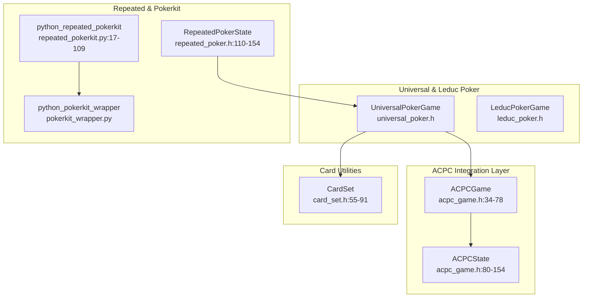
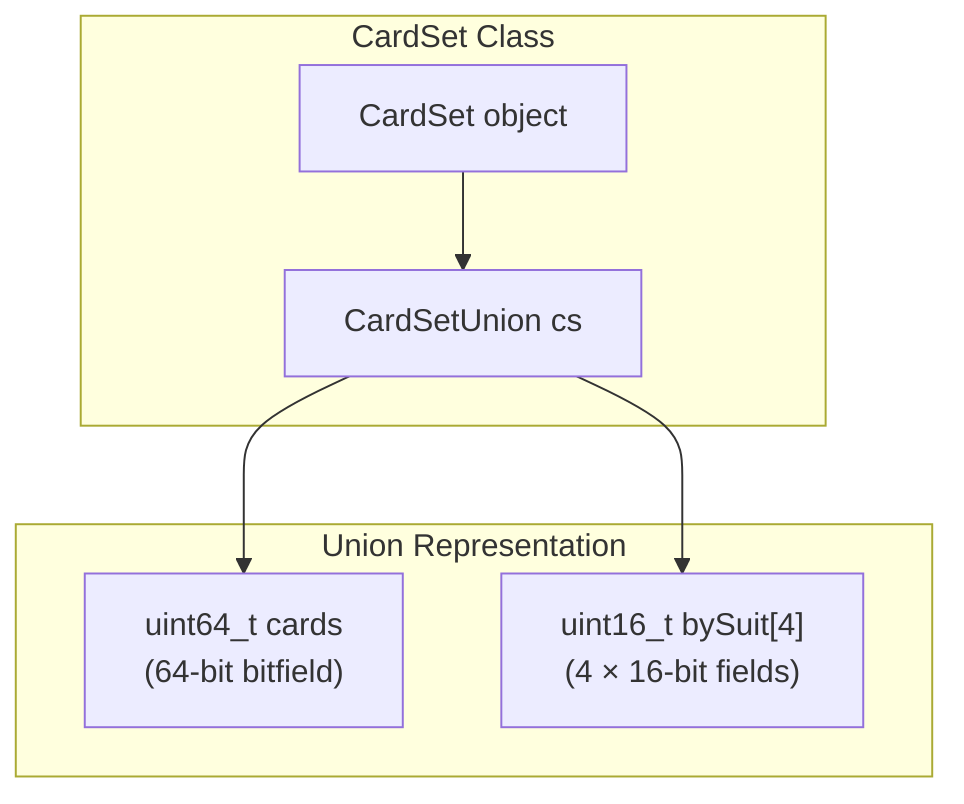

<!-- source: DeepWiki mcp.deepwiki.com · repo google-deepmind/open_spiel · page 5.2 Poker Games · fetched 2026-10-26 -->

# Poker Games

Relevant source files

The following files were used as context for generating this wiki page:

- [open_spiel/canonical_game_strings.cc](open_spiel/canonical_game_strings.cc)
- [open_spiel/canonical_game_strings.h](open_spiel/canonical_game_strings.h)
- [open_spiel/examples/universal_poker_mccfr_acpc_gamedef_example.cc](open_spiel/examples/universal_poker_mccfr_acpc_gamedef_example.cc)
- [open_spiel/games/hearts/hearts.h](open_spiel/games/hearts/hearts.h)
- [open_spiel/games/leduc_poker/leduc_poker.cc](open_spiel/games/leduc_poker/leduc_poker.cc)
- [open_spiel/games/leduc_poker/leduc_poker.h](open_spiel/games/leduc_poker/leduc_poker.h)
- [open_spiel/games/leduc_poker/leduc_poker_test.cc](open_spiel/games/leduc_poker/leduc_poker_test.cc)
- [open_spiel/games/universal_poker/acpc_cpp/acpc_game.cc](open_spiel/games/universal_poker/acpc_cpp/acpc_game.cc)
- [open_spiel/games/universal_poker/acpc_cpp/acpc_game.h](open_spiel/games/universal_poker/acpc_cpp/acpc_game.h)
- [open_spiel/games/universal_poker/acpc_cpp/acpc_game_test.cc](open_spiel/games/universal_poker/acpc_cpp/acpc_game_test.cc)
- [open_spiel/games/universal_poker/logic/card_set.cc](open_spiel/games/universal_poker/logic/card_set.cc)
- [open_spiel/games/universal_poker/logic/card_set.h](open_spiel/games/universal_poker/logic/card_set.h)
- [open_spiel/games/universal_poker/logic/card_set_test.cc](open_spiel/games/universal_poker/logic/card_set_test.cc)
- [open_spiel/games/universal_poker/logic/gamedef.cc](open_spiel/games/universal_poker/logic/gamedef.cc)
- [open_spiel/games/universal_poker/logic/gamedef.h](open_spiel/games/universal_poker/logic/gamedef.h)
- [open_spiel/games/universal_poker/logic/gamedef_test.cc](open_spiel/games/universal_poker/logic/gamedef_test.cc)
- [open_spiel/games/universal_poker/repeated_poker.cc](open_spiel/games/universal_poker/repeated_poker.cc)
- [open_spiel/games/universal_poker/repeated_poker.h](open_spiel/games/universal_poker/repeated_poker.h)
- [open_spiel/games/universal_poker/repeated_poker_test.cc](open_spiel/games/universal_poker/repeated_poker_test.cc)
- [open_spiel/games/universal_poker/universal_poker.cc](open_spiel/games/universal_poker/universal_poker.cc)
- [open_spiel/games/universal_poker/universal_poker.h](open_spiel/games/universal_poker/universal_poker.h)
- [open_spiel/games/universal_poker/universal_poker_test.cc](open_spiel/games/universal_poker/universal_poker_test.cc)
- [open_spiel/integration_tests/playthroughs/bridge_uncontested_bidding-2NT.txt](open_spiel/integration_tests/playthroughs/bridge_uncontested_bidding-2NT.txt)
- [open_spiel/integration_tests/playthroughs/bridge_uncontested_bidding.txt](open_spiel/integration_tests/playthroughs/bridge_uncontested_bidding.txt)
- [open_spiel/integration_tests/playthroughs/leduc_poker_1540482260.txt](open_spiel/integration_tests/playthroughs/leduc_poker_1540482260.txt)
- [open_spiel/integration_tests/playthroughs/leduc_poker_3977671846.txt](open_spiel/integration_tests/playthroughs/leduc_poker_3977671846.txt)
- [open_spiel/integration_tests/playthroughs/leduc_poker_3p.txt](open_spiel/integration_tests/playthroughs/leduc_poker_3p.txt)
- [open_spiel/integration_tests/playthroughs/leduc_poker_3p_single_tensor.txt](open_spiel/integration_tests/playthroughs/leduc_poker_3p_single_tensor.txt)
- [open_spiel/integration_tests/playthroughs/leduc_poker_773740114.txt](open_spiel/integration_tests/playthroughs/leduc_poker_773740114.txt)
- [open_spiel/integration_tests/playthroughs/negotiation(rng_seed=100,utterance_dim=2,num_symbols=3).txt](open_spiel/integration_tests/playthroughs/negotiation(rng_seed=100,utterance_dim=2,num_symbols=3).txt)
- [open_spiel/integration_tests/playthroughs/repeated_poker(max_num_hands=10,reset_stacks=True,rotate_dealer=True,universal_poker_game_string=universal_poker(betting=nolimit,bettingAbstraction=fullgame,blind=100](open_spiel/integration_tests/playthroughs/repeated_poker(max_num_hands=10,reset_stacks=True,rotate_dealer=True,universal_poker_game_string=universal_poker(betting=nolimit,bettingAbstraction=fullgame,blind=100)
- [open_spiel/integration_tests/playthroughs/repeated_pokerkit_nolimit_holdem_cash_game.txt](open_spiel/integration_tests/playthroughs/repeated_pokerkit_nolimit_holdem_cash_game.txt)
- [open_spiel/integration_tests/playthroughs/repeated_pokerkit_nolimit_holdem_tournament.txt](open_spiel/integration_tests/playthroughs/repeated_pokerkit_nolimit_holdem_tournament.txt)
- [open_spiel/integration_tests/playthroughs/repeated_pokerkit_plo_cash_game.txt](open_spiel/integration_tests/playthroughs/repeated_pokerkit_plo_cash_game.txt)
- [open_spiel/integration_tests/playthroughs/repeated_pokerkit_plo_tournament.txt](open_spiel/integration_tests/playthroughs/repeated_pokerkit_plo_tournament.txt)
- [open_spiel/integration_tests/playthroughs/repeated_pokerkit_razz_cash_game.txt](open_spiel/integration_tests/playthroughs/repeated_pokerkit_razz_cash_game.txt)
- [open_spiel/integration_tests/playthroughs/repeated_pokerkit_razz_tournament.txt](open_spiel/integration_tests/playthroughs/repeated_pokerkit_razz_tournament.txt)
- [open_spiel/integration_tests/playthroughs/repeated_pokerkit_seven_card_stud_cash_game.txt](open_spiel/integration_tests/playthroughs/repeated_pokerkit_seven_card_stud_cash_game.txt)
- [open_spiel/integration_tests/playthroughs/repeated_pokerkit_seven_card_stud_tournament.txt](open_spiel/integration_tests/playthroughs/repeated_pokerkit_seven_card_stud_tournament.txt)
- [open_spiel/integration_tests/playthroughs/universal_poker(bettingAbstraction=fullgame).txt](open_spiel/integration_tests/playthroughs/universal_poker(bettingAbstraction=fullgame).txt)
- [open_spiel/integration_tests/playthroughs/universal_poker.txt](open_spiel/integration_tests/playthroughs/universal_poker.txt)
- [open_spiel/python/games/repeated_pokerkit.py](open_spiel/python/games/repeated_pokerkit.py)
- [open_spiel/python/games/repeated_pokerkit_test.py](open_spiel/python/games/repeated_pokerkit_test.py)
- [open_spiel/python/pybind11/games_hearts.cc](open_spiel/python/pybind11/games_hearts.cc)
- [open_spiel/python/pybind11/games_repeated_poker.cc](open_spiel/python/pybind11/games_repeated_poker.cc)
- [open_spiel/python/pybind11/games_repeated_poker.h](open_spiel/python/pybind11/games_repeated_poker.h)
- [open_spiel/python/pybind11/games_universal_poker.cc](open_spiel/python/pybind11/games_universal_poker.cc)
- [open_spiel/python/pybind11/games_universal_poker.h](open_spiel/python/pybind11/games_universal_poker.h)
- [open_spiel/python/tests/games_hearts_test.py](open_spiel/python/tests/games_hearts_test.py)
- [open_spiel/python/tests/games_repeated_poker_test.py](open_spiel/python/tests/games_repeated_poker_test.py)
- [open_spiel/python/tests/games_universal_poker_test.py](open_spiel/python/tests/games_universal_poker_test.py)

## Purpose and Scope
This page documents the poker game implementations in OpenSpiel, focusing on Universal Poker with ACPC integration, ACPCGame/ACPCState, CardSet, Leduc poker, repeated poker, and Python pokerkit wrappers.

Sources: [open_spiel/games/universal_poker/universal_poker.cc:1-171](), [open_spiel/games/leduc_poker/leduc_poker.cc:1-50]()

---

## Architecture Overview
OpenSpiel's poker framework comprises C++ core games (Universal Poker, Leduc Poker, Repeated Poker) and Python-based wrappers (Pokerkit wrappers, Repeated Pokerkit).

Sources: [open_spiel/games/universal_poker/acpc_cpp/acpc_game.h:34-154](), [open_spiel/games/universal_poker/logic/card_set.h:55-91](), [open_spiel/python/games/repeated_pokerkit.py:17-109]()

---

## ACPC Integration (Universal Poker)

### ACPCGame and ACPCState
Universal Poker wraps the Annual Computer Poker Competition (ACPC) server project to support highly configurable poker variants (limit/no-limit Texas Hold'em, Kuhn poker, etc.).

`ACPCGame` parses game definitions (`GAMEDEF`) and wraps `project_acpc_server::Game`. `ACPCState` manages the betting sequence, pot sizes, chip stacks, and round transitions.

**Key Methods and Data Members**

| Class | Method/Member | Purpose | File Reference |
|-------|---------------|---------|----------------|
| `ACPCGame` | `ACPCGame(const std::string& gameDef)` | Constructs game from GAMEDEF string | [acpc_game.cc:73-75]() |
| `ACPCGame` | `IsLimitGame()` | Returns true for limit betting | [acpc_game.h:41-43]() |
| `ACPCGame` | `NumRounds()` | Total number of betting rounds | [acpc_game.h:46]() |
| `ACPCState` | `CurrentPlayer()` | Player to act or first player in new round | [acpc_game.h:93]() |
| `ACPCState` | `Money(const uint8_t player)` | Remaining chips for player | [acpc_game.h:95]() |
| `ACPCState` | `IsFinished()` | Returns true if state is terminal | [acpc_game.h:106]() |

Sources: [open_spiel/games/universal_poker/acpc_cpp/acpc_game.h:34-154](), [open_spiel/games/universal_poker/acpc_cpp/acpc_game.cc:73-126]()

---

## Card Representation (`CardSet`)
`CardSet` provides an efficient bitfield-based representation for sets of poker cards using 64 bits (`uint64_t cards`), partitioned by suit (`uint16_t bySuit[kMaxSuits]`). It integrates with ACPC's `evalHandTables` for hand ranking.

Sources: [open_spiel/games/universal_poker/logic/card_set.h:55-91](), [open_spiel/games/universal_poker/logic/card_set.cc:50-64]()

---

## Leduc Poker
Leduc Poker is a simplified poker game implemented natively in C++ (`open_spiel/games/leduc_poker/leduc_poker.cc`) featuring a 6-card deck (2 suits, 3 ranks: King, Queen, Jack) across two betting rounds with pot limit rules.

Sources: [open_spiel/games/leduc_poker/leduc_poker.cc:1-100](), [open_spiel/integration_tests/playthroughs/leduc_poker_3977671846.txt:1-35]()

---

## Repeated Poker and Pokerkit Wrappers
OpenSpiel supports multi-hand repeated poker and tournament simulation through `RepeatedPokerState` [open_spiel/games/universal_poker/repeated_poker.h:110-154]() and Python wrappers (`python_repeated_pokerkit` in `open_spiel/python/games/repeated_pokerkit.py`) wrapping the `pokerkit` library for various poker variants.

Sources: [open_spiel/games/universal_poker/repeated_poker.h:92-154](), [open_spiel/python/games/repeated_pokerkit.py:17-109]()

---

