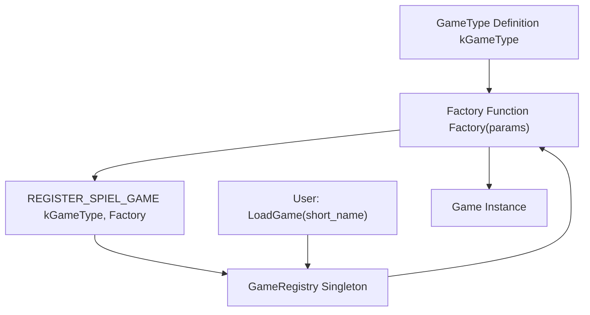
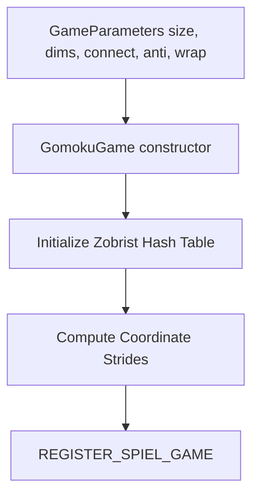

<!-- source: DeepWiki mcp.deepwiki.com · repo google-deepmind/open_spiel · page 5.3 Board Games · fetched 2026-10-26 -->

# Board Games

Relevant source files

The following files were used as context for generating this wiki page:

- [open_spiel/game_transforms/add_noise.h](open_spiel/game_transforms/add_noise.h)
- [open_spiel/game_transforms/add_noise_test.cc](open_spiel/game_transforms/add_noise_test.cc)
- [open_spiel/games/backgammon/backgammon.cc](open_spiel/games/backgammon/backgammon.cc)
- [open_spiel/games/backgammon/backgammon.h](open_spiel/games/backgammon/backgammon.h)
- [open_spiel/games/backgammon/backgammon_test.cc](open_spiel/games/backgammon/backgammon_test.cc)
- [open_spiel/games/checkers/checkers.cc](open_spiel/games/checkers/checkers.cc)
- [open_spiel/games/checkers/checkers.h](open_spiel/games/checkers/checkers.h)
- [open_spiel/games/connect_four/connect_four.cc](open_spiel/games/connect_four/connect_four.cc)
- [open_spiel/games/connect_four/connect_four.h](open_spiel/games/connect_four/connect_four.h)
- [open_spiel/games/connect_four/connect_four_test.cc](open_spiel/games/connect_four/connect_four_test.cc)
- [open_spiel/games/dark_hex/dark_hex.cc](open_spiel/games/dark_hex/dark_hex.cc)
- [open_spiel/games/go/go.cc](open_spiel/games/go/go.cc)
- [open_spiel/games/go/go.h](open_spiel/games/go/go.h)
- [open_spiel/games/go/go_board.cc](open_spiel/games/go/go_board.cc)
- [open_spiel/games/go/go_board.h](open_spiel/games/go/go_board.h)
- [open_spiel/games/gomoku/gomoku.cc](open_spiel/games/gomoku/gomoku.cc)
- [open_spiel/games/gomoku/gomoku.h](open_spiel/games/gomoku/gomoku.h)
- [open_spiel/games/gomoku/gomoku_grid.h](open_spiel/games/gomoku/gomoku_grid.h)
- [open_spiel/games/gomoku/gomoku_test.cc](open_spiel/games/gomoku/gomoku_test.cc)
- [open_spiel/games/hex/hex.cc](open_spiel/games/hex/hex.cc)
- [open_spiel/games/hex/hex.h](open_spiel/games/hex/hex.h)
- [open_spiel/games/hex/hex_test.cc](open_spiel/games/hex/hex_test.cc)
- [open_spiel/games/mancala/mancala.cc](open_spiel/games/mancala/mancala.cc)
- [open_spiel/games/mancala/mancala.h](open_spiel/games/mancala/mancala.h)
- [open_spiel/games/twenty_forty_eight/2048.cc](open_spiel/games/twenty_forty_eight/2048.cc)
- [open_spiel/games/twenty_forty_eight/2048.h](open_spiel/games/twenty_forty_eight/2048.h)
- [open_spiel/games/twenty_forty_eight/2048_test.cc](open_spiel/games/twenty_forty_eight/2048_test.cc)
- [open_spiel/games/twixt/twixt.cc](open_spiel/games/twixt/twixt.cc)
- [open_spiel/games/twixt/twixt.h](open_spiel/games/twixt/twixt.h)
- [open_spiel/games/twixt/twixt_test.cc](open_spiel/games/twixt/twixt_test.cc)
- [open_spiel/games/twixt/twixtboard.cc](open_spiel/games/twixt/twixtboard.cc)
- [open_spiel/games/twixt/twixtboard.h](open_spiel/games/twixt/twixtboard.h)
- [open_spiel/games/twixt/twixtcell.h](open_spiel/games/twixt/twixtcell.h)
- [open_spiel/games/ultimate_tic_tac_toe/ultimate_tic_tac_toe.cc](open_spiel/games/ultimate_tic_tac_toe/ultimate_tic_tac_toe.cc)
- [open_spiel/games/ultimate_tic_tac_toe/ultimate_tic_tac_toe.h](open_spiel/games/ultimate_tic_tac_toe/ultimate_tic_tac_toe.h)
- [open_spiel/games/ultimate_tic_tac_toe/ultimate_tic_tac_toe_test.cc](open_spiel/games/ultimate_tic_tac_toe/ultimate_tic_tac_toe_test.cc)
- [open_spiel/integration_tests/playthroughs/2048.txt](open_spiel/integration_tests/playthroughs/2048.txt)
- [open_spiel/integration_tests/playthroughs/add_noise(epsilon=1.,seed=1,game=kuhn_poker()).txt](open_spiel/integration_tests/playthroughs/add_noise(epsilon=1.,seed=1,game=kuhn_poker()).txt)
- [open_spiel/integration_tests/playthroughs/backgammon.txt](open_spiel/integration_tests/playthroughs/backgammon.txt)
- [open_spiel/integration_tests/playthroughs/breakthrough.txt](open_spiel/integration_tests/playthroughs/breakthrough.txt)
- [open_spiel/integration_tests/playthroughs/checkers.txt](open_spiel/integration_tests/playthroughs/checkers.txt)
- [open_spiel/integration_tests/playthroughs/connect_four.txt](open_spiel/integration_tests/playthroughs/connect_four.txt)
- [open_spiel/integration_tests/playthroughs/connect_four_start_at.txt](open_spiel/integration_tests/playthroughs/connect_four_start_at.txt)
- [open_spiel/integration_tests/playthroughs/dark_hex(num_rows=5,num_cols=3).txt](open_spiel/integration_tests/playthroughs/dark_hex(num_rows=5,num_cols=3).txt)
- [open_spiel/integration_tests/playthroughs/dark_hex_ir(board_size=3).txt](open_spiel/integration_tests/playthroughs/dark_hex_ir(board_size=3).txt)
- [open_spiel/integration_tests/playthroughs/dark_hex_reveal_turn_long.txt](open_spiel/integration_tests/playthroughs/dark_hex_reveal_turn_long.txt)
- [open_spiel/integration_tests/playthroughs/gomoku.txt](open_spiel/integration_tests/playthroughs/gomoku.txt)
- [open_spiel/integration_tests/playthroughs/hex(board_size=5).txt](open_spiel/integration_tests/playthroughs/hex(board_size=5).txt)
- [open_spiel/integration_tests/playthroughs/laser_tag(horizon=20).txt](open_spiel/integration_tests/playthroughs/laser_tag(horizon=20).txt)
- [open_spiel/integration_tests/playthroughs/mancala.txt](open_spiel/integration_tests/playthroughs/mancala.txt)
- [open_spiel/integration_tests/playthroughs/markov_soccer.txt](open_spiel/integration_tests/playthroughs/markov_soccer.txt)
- [open_spiel/integration_tests/playthroughs/misere(game=pig(players=3,horizon=20,winscore=6)).txt](open_spiel/integration_tests/playthroughs/misere(game=pig(players=3,horizon=20,winscore=6)).txt)
- [open_spiel/integration_tests/playthroughs/oware.txt](open_spiel/integration_tests/playthroughs/oware.txt)
- [open_spiel/integration_tests/playthroughs/pig_3p.txt](open_spiel/integration_tests/playthroughs/pig_3p.txt)
- [open_spiel/integration_tests/playthroughs/pig_4p.txt](open_spiel/integration_tests/playthroughs/pig_4p.txt)
- [open_spiel/integration_tests/playthroughs/pig_5p.txt](open_spiel/integration_tests/playthroughs/pig_5p.txt)
- [open_spiel/integration_tests/playthroughs/twixt.txt](open_spiel/integration_tests/playthroughs/twixt.txt)
- [open_spiel/integration_tests/playthroughs/ultimate_tic_tac_toe.txt](open_spiel/integration_tests/playthroughs/ultimate_tic_tac_toe.txt)
- [open_spiel/python/pybind11/games_connect_four.cc](open_spiel/python/pybind11/games_connect_four.cc)
- [open_spiel/python/pybind11/games_go.cc](open_spiel/python/pybind11/games_go.cc)
- [open_spiel/python/pybind11/games_gomoku.cc](open_spiel/python/pybind11/games_gomoku.cc)
- [open_spiel/python/pybind11/games_gomoku.h](open_spiel/python/pybind11/games_gomoku.h)
- [open_spiel/python/tests/games_connect_four_test.py](open_spiel/python/tests/games_connect_four_test.py)
- [open_spiel/python/tests/games_go_test.py](open_spiel/python/tests/games_go_test.py)
- [open_spiel/python/tests/games_gomoku_test.py](open_spiel/python/tests/games_gomoku_test.py)

## Purpose and Scope

This page documents the board game implementations in OpenSpiel, covering **Go**, **Hex**, **Connect Four**, **Gomoku**, **Twixt**, **Checkers**, **Backgammon**, **2048**, and **Ultimate Tic-Tac-Toe**, along with their respective action encodings and mechanics. For poker games, see [Poker Games](#5.2). For chess variants, see [Chess and Variants](#5.1). For card games, see [Card Games](#5.4).

Board games in OpenSpiel are characterized by:
- Deterministic or stochastic turn-based dynamics
- Explicit board/grid structures with topological constraints (e.g., hexagonal grids, gravity, bridge connections)
- Well-defined action encoding schemes mapped to board coordinates or game choices
- Terminal win/loss/draw evaluation or numeric score aggregation

Sources: [open_spiel/games/go/go.h](), [open_spiel/games/hex/hex.h](), [open_spiel/games/connect_four/connect_four.h](), [open_spiel/games/gomoku/gomoku.h](), [open_spiel/games/twixt/twixtboard.h](), [open_spiel/games/twenty_forty_eight/2048.h](), [open_spiel/games/checkers/checkers.h]()

## Common Architecture

All board game implementations in OpenSpiel inherit from the core `Game` and `State` abstractions defined in [open_spiel/spiel.h](). Each game implements:

| Component | Purpose | Example Methods |
|-----------|---------|-----------------|
| Game class | Factory and metadata | `NewInitialState()`, `NumDistinctActions()`, `MaxGameLength()` |
| State class | Game state and logic | `LegalActions()`, `ApplyAction()`, `IsTerminal()`, `Returns()` |
| Registration | Self-registration in game registry | `REGISTER_SPIEL_GAME` macro |
| Observation | Tensor representations | `ObservationTensor()`, `ObservationString()` |

Sources: [open_spiel/games/gomoku/gomoku.cc:39-64](), [open_spiel/games/connect_four/connect_four.cc:36-61](), [open_spiel/games/twenty_forty_eight/2048.cc:36-59]()

### Game Registration Pattern

**Game Registration Flow**

Sources: [open_spiel/games/gomoku/gomoku.cc:39-64](), [open_spiel/games/connect_four/connect_four.cc:36-61]()

---

## Grid, Connection, and Board Games

### Go
Go is implemented in `open_spiel/games/go/`. Internally, the board uses a padded representation (`21*21` virtual points with guard rails around the edge) to simplify neighbor traversal and boundary checking [open_spiel/games/go/go_board.cc:141-156]().
- **Action Space**: `board_size * board_size + 1` (where the final action index represents a pass).
- **Liberties & Captures**: Handled via group tracking algorithms that monitor stone groups and their shared liberties.
- **Rules**: Supports Tromp-Taylor scoring and komi parameters.

Sources: [open_spiel/games/go/go.h](), [open_spiel/games/go/go_board.h:38-67](), [open_spiel/games/go/go_board.cc:141-156]()

### Gomoku
Gomoku (Five in a Row) is implemented in `open_spiel/games/gomoku/` and supports multi-dimensional grids, arbitrary connect lengths, anti-gomoku rules, and wrap-around topology [open_spiel/games/gomoku/gomoku.cc:39-57]().
- **Zobrist Hashing**: `GomokuGame` initializes a Zobrist transposition table during construction to maintain state hash values incrementally [open_spiel/games/gomoku/gomoku.cc:109-116]().
- **Action Unflattening**: Multi-dimensional actions are flattened to a single integer and unflattened via coordinate strides [open_spiel/games/gomoku/gomoku.cc:118-128]().

**Gomoku Initialization Flow**

Sources: [open_spiel/games/gomoku/gomoku.cc:39-116]()

### Hex
Hex is a connection game played on a rhombus grid of hexagons [open_spiel/games/hex/hex.cc]().
- **State Evaluation**: `HexState::PlayerAndActionToState` tracks edge connectedness (`CellState::kBlackNorth`, `CellState::kBlackSouth`, `CellState::kWhiteWest`, `CellState::kWhiteEast`) to determine winning paths upon placing a stone [open_spiel/games/hex/hex.cc:108-171]().
- **Swap Rule**: Supports the "pie rule" (`swap` parameter) allowing the second player to swap positions with the first player after the first move.

Sources: [open_spiel/games/hex/hex.h](), [open_spiel/games/hex/hex.cc:108-171]()

### Connect Four
Connect Four is implemented in `open_spiel/games/connect_four/` [open_spiel/games/connect_four/connect_four.cc]().
- **Gravity Mechanics**: When a column action is applied, the piece drops to the lowest unoccupied row in that column [open_spiel/games/connect_four/connect_four.cc:130-136]().
- **Line Detection**: `HasLineFrom` checks horizontal, vertical, and both diagonal directions for `x_in_row` consecutive matching pieces [open_spiel/games/connect_four/connect_four.cc:163-185]().

Sources: [open_spiel/games/connect_four/connect_four.h](), [open_spiel/games/connect_four/connect_four.cc:130-196]()

### Twixt
Twixt is a connection game involving pegs and bridging links [open_spiel/games/twixt/twixtboard.h]().
- **Link Descriptors**: Manages diagonal jumps (like knight moves in chess) and checks crossing links via `BlockerMap` [open_spiel/games/twixt/twixtboard.h:38-42](), [open_spiel/games/twixt/twixtboard.h:142-151]().
- **Pathfinding**: Explores local graphs to verify unbroken connections between opposite board borders.

Sources: [open_spiel/games/twixt/twixtboard.h:38-151](), [open_spiel/games/twixt/twixtboard.cc]()

### Ultimate Tic-Tac-Toe
Ultimate Tic-Tac-Toe combines a 3×3 meta-board with nine 3×3 local Tic-Tac-Toe board instances [open_spiel/games/ultimate_tic_tac_toe/ultimate_tic_tac_toe.cc]().
- **Composed States**: `UltimateTTTState` wraps nine local states (`local_states_`) and evaluates local terminal conditions to update the `meta_board_` [open_spiel/games/ultimate_tic_tac_toe/ultimate_tic_tac_toe.cc:61-109]().
- **Forced Board Routing**: If the local board played in is already terminal, the player may choose any non-terminal local board (`current_state_ < 0`) [open_spiel/games/ultimate_tic_tac_toe/ultimate_tic_tac_toe.cc:68-75](), [open_spiel/games/ultimate_tic_tac_toe/ultimate_tic_tac_toe.cc:113-121]().

Sources: [open_spiel/games/ultimate_tic_tac_toe/ultimate_tic_tac_toe.h](), [open_spiel/games/ultimate_tic_tac_toe/ultimate_tic_tac_toe.cc:61-125]()

---

## Classic Board, Tile, and Stochastic Games

### Checkers
Checkers is implemented in `open_spiel/games/checkers/`. 
- **Mandatory Captures**: Move generation enforces capturing rules; if any capture is available, non-capturing moves are excluded [open_spiel/integration_tests/playthroughs/checkers.txt:19-75]().
- **Action Encoding**: Packs source and destination coordinates into a single integer in the range `[0, 511]` for an 8×8 board.

Sources: [open_spiel/games/checkers/checkers.h](), [open_spiel/integration_tests/playthroughs/checkers.txt:1-75]()

### Backgammon
Backgammon is a stochastic board game implemented in `open_spiel/games/backgammon/` [open_spiel/games/backgammon/backgammon.cc]().
- **Chance Nodes**: Dice rolls are modeled explicitly via chance nodes (`GameType::ChanceMode::kExplicitStochastic`) with 36 possible outcomes for 2 dice [open_spiel/integration_tests/playthroughs/backgammon.txt:3-21]().
- **Action Space**: 1,352 distinct actions representing legal checkers movements for a given dice roll [open_spiel/integration_tests/playthroughs/backgammon.txt:19-20]().

Sources: [open_spiel/games/backgammon/backgammon.cc](), [open_spiel/integration_tests/playthroughs/backgammon.txt:1-65]()

### 2048
2048 is a single-player sliding tile puzzle game on a 4×4 grid [open_spiel/games/twenty_forty_eight/2048.h]().
- **Chance Outcomes**: After each valid slide, a chance node spawns a new tile (2 with 90% probability, 4 with 10% probability) across available empty cells (up to 33 distinct chance outcomes) [open_spiel/integration_tests/playthroughs/2048.txt:21-49]().
- **Action Encoding**: 4 discrete actions (`kMoveUp`, `kMoveRight`, `kMoveDown`, `kMoveLeft`) [open_spiel/integration_tests/playthroughs/2048.txt:19-20]().

Sources: [open_spiel/games/twenty_forty_eight/2048.h:18-51](), [open_spiel/integration_tests/playthroughs/2048.cc:33-51](), [open_spiel/integration_tests/playthroughs/2048.txt:1-51]()

---

## Action Encodings Across Board Games

The following table summarizes the action encoding strategies used across the core board game implementations:

| Game | Action Space Size | Encoding Scheme | Example Actions |
|------|-------------------|-----------------|-----------------|
| **Go** | `board_size^2 + 1` | Flat grid index + Pass | `0` to `80` (9x9 grid), `81` = Pass |
| **Gomoku** | `size^dims` | Multi-dimensional stride flattening | Flat index mapped via coordinate strides |
| **Hex** | `num_rows * num_cols` | Row-major cell index | `0` to `24` (5x5 grid) |
| **Connect Four** | `columns` | Column index | `0` to `6` |
| **Twixt** | `board_size^2` | Board cell index (excluding corners) | Peg placement coordinates |
| **Checkers** | `columns * rows * 2 * columns * rows * 2` | Packed coordinate integer | `336` (`c3b4`) |
| **Backgammon** | 1,352 | Compound move index for dice roll | `24` (roll: 45) |
| **2048** | 4 | Directional enum | `0` (Up), `1` (Right), `2` (Down), `3` (Left) |
| **Ultimate TTT** | 9 (meta) or 9 (local) | Local board selection or cell index | Choose board or play cell |

Sources: [open_spiel/games/go/go_board.cc:144-156](), [open_spiel/games/gomoku/gomoku.cc:118-128](), [open_spiel/games/connect_four/connect_four.cc:147-156](), [open_spiel/integration_tests/playthroughs/checkers.txt:19-75](), [open_spiel/integration_tests/playthroughs/backgammon.txt:19-20](), [open_spiel/integration_tests/playthroughs/2048.txt:19-20]()

---

