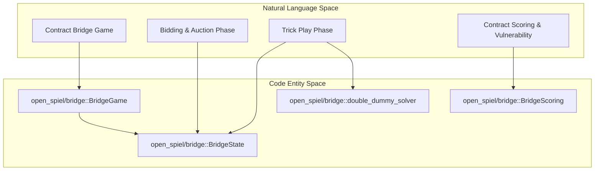
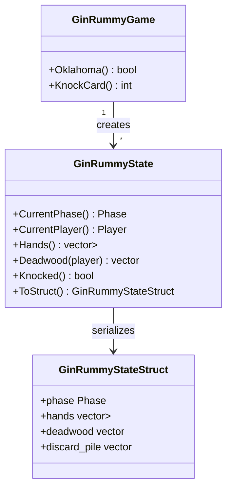
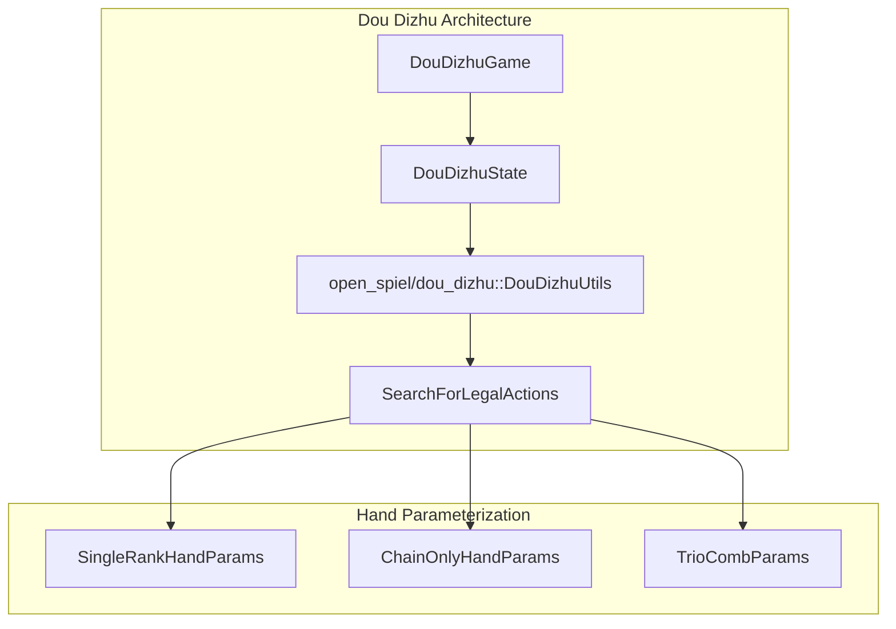

<!-- source: DeepWiki mcp.deepwiki.com · repo google-deepmind/open_spiel · page 5.4 Card Games · fetched 2026-10-26 -->

# Card Games

Relevant source files

The following files were used as context for generating this wiki page:

- [open_spiel/algorithms/get_all_states.cc](open_spiel/algorithms/get_all_states.cc)
- [open_spiel/examples/value_iteration_example.cc](open_spiel/examples/value_iteration_example.cc)
- [open_spiel/games/blackjack/blackjack.cc](open_spiel/games/blackjack/blackjack.cc)
- [open_spiel/games/blackjack/blackjack.h](open_spiel/games/blackjack/blackjack.h)
- [open_spiel/games/blackjack/blackjack_test.cc](open_spiel/games/blackjack/blackjack_test.cc)
- [open_spiel/games/bridge/bridge.cc](open_spiel/games/bridge/bridge.cc)
- [open_spiel/games/bridge/bridge.h](open_spiel/games/bridge/bridge.h)
- [open_spiel/games/bridge/bridge_test.cc](open_spiel/games/bridge/bridge_test.cc)
- [open_spiel/games/crazy_eights/crazy_eights.cc](open_spiel/games/crazy_eights/crazy_eights.cc)
- [open_spiel/games/crazy_eights/crazy_eights.h](open_spiel/games/crazy_eights/crazy_eights.h)
- [open_spiel/games/crazy_eights/crazy_eights_test.cc](open_spiel/games/crazy_eights/crazy_eights_test.cc)
- [open_spiel/games/dou_dizhu/dou_dizhu.cc](open_spiel/games/dou_dizhu/dou_dizhu.cc)
- [open_spiel/games/dou_dizhu/dou_dizhu_test.cc](open_spiel/games/dou_dizhu/dou_dizhu_test.cc)
- [open_spiel/games/dou_dizhu/dou_dizhu_utils.cc](open_spiel/games/dou_dizhu/dou_dizhu_utils.cc)
- [open_spiel/games/dou_dizhu/dou_dizhu_utils.h](open_spiel/games/dou_dizhu/dou_dizhu_utils.h)
- [open_spiel/games/dou_dizhu/dou_dizhu_utils_test.cc](open_spiel/games/dou_dizhu/dou_dizhu_utils_test.cc)
- [open_spiel/games/gin_rummy/gin_rummy.cc](open_spiel/games/gin_rummy/gin_rummy.cc)
- [open_spiel/games/gin_rummy/gin_rummy.h](open_spiel/games/gin_rummy/gin_rummy.h)
- [open_spiel/games/gin_rummy/gin_rummy_test.cc](open_spiel/games/gin_rummy/gin_rummy_test.cc)
- [open_spiel/games/gin_rummy/gin_rummy_utils.cc](open_spiel/games/gin_rummy/gin_rummy_utils.cc)
- [open_spiel/games/gin_rummy/gin_rummy_utils.h](open_spiel/games/gin_rummy/gin_rummy_utils.h)
- [open_spiel/games/go_fish/go_fish.cc](open_spiel/games/go_fish/go_fish.cc)
- [open_spiel/games/go_fish/go_fish.h](open_spiel/games/go_fish/go_fish.h)
- [open_spiel/games/go_fish/go_fish_test.cc](open_spiel/games/go_fish/go_fish_test.cc)
- [open_spiel/integration_tests/playthroughs/blackjack.txt](open_spiel/integration_tests/playthroughs/blackjack.txt)
- [open_spiel/integration_tests/playthroughs/bridge(use_double_dummy_result=false).txt](open_spiel/integration_tests/playthroughs/bridge(use_double_dummy_result=false).txt)
- [open_spiel/integration_tests/playthroughs/bridge.txt](open_spiel/integration_tests/playthroughs/bridge.txt)
- [open_spiel/integration_tests/playthroughs/coop_to_1p(game=tiny_bridge_2p()).txt](open_spiel/integration_tests/playthroughs/coop_to_1p(game=tiny_bridge_2p()).txt)
- [open_spiel/integration_tests/playthroughs/coop_to_1p(game=tiny_hanabi()).txt](open_spiel/integration_tests/playthroughs/coop_to_1p(game=tiny_hanabi()).txt)
- [open_spiel/integration_tests/playthroughs/crazy_eights.txt](open_spiel/integration_tests/playthroughs/crazy_eights.txt)
- [open_spiel/integration_tests/playthroughs/dou_dizhu.txt](open_spiel/integration_tests/playthroughs/dou_dizhu.txt)
- [open_spiel/integration_tests/playthroughs/gin_rummy.txt](open_spiel/integration_tests/playthroughs/gin_rummy.txt)
- [open_spiel/integration_tests/playthroughs/go_fish.txt](open_spiel/integration_tests/playthroughs/go_fish.txt)
- [open_spiel/integration_tests/playthroughs/hearts.txt](open_spiel/integration_tests/playthroughs/hearts.txt)
- [open_spiel/integration_tests/playthroughs/oh_hell.txt](open_spiel/integration_tests/playthroughs/oh_hell.txt)
- [open_spiel/integration_tests/playthroughs/skat.txt](open_spiel/integration_tests/playthroughs/skat.txt)
- [open_spiel/integration_tests/playthroughs/tiny_bridge_2p(abstracted=true).txt](open_spiel/integration_tests/playthroughs/tiny_bridge_2p(abstracted=true).txt)
- [open_spiel/integration_tests/playthroughs/tiny_bridge_2p.txt](open_spiel/integration_tests/playthroughs/tiny_bridge_2p.txt)
- [open_spiel/integration_tests/playthroughs/tiny_bridge_4p.txt](open_spiel/integration_tests/playthroughs/tiny_bridge_4p.txt)
- [open_spiel/python/algorithms/boltzmann_tabular_qlearner.py](open_spiel/python/algorithms/boltzmann_tabular_qlearner.py)
- [open_spiel/python/algorithms/boltzmann_tabular_qlearner_test.py](open_spiel/python/algorithms/boltzmann_tabular_qlearner_test.py)
- [open_spiel/python/algorithms/tabular_qlearner.py](open_spiel/python/algorithms/tabular_qlearner.py)
- [open_spiel/python/algorithms/tabular_qlearner_test.py](open_spiel/python/algorithms/tabular_qlearner_test.py)
- [open_spiel/python/examples/independent_tabular_qlearning.py](open_spiel/python/examples/independent_tabular_qlearning.py)
- [open_spiel/python/examples/tic_tac_toe_qlearner.py](open_spiel/python/examples/tic_tac_toe_qlearner.py)
- [open_spiel/python/pybind11/games_blackjack.cc](open_spiel/python/pybind11/games_blackjack.cc)
- [open_spiel/python/pybind11/games_blackjack.h](open_spiel/python/pybind11/games_blackjack.h)
- [open_spiel/python/pybind11/games_crazy_eights.cc](open_spiel/python/pybind11/games_crazy_eights.cc)
- [open_spiel/python/pybind11/games_crazy_eights.h](open_spiel/python/pybind11/games_crazy_eights.h)
- [open_spiel/python/pybind11/games_gin_rummy.cc](open_spiel/python/pybind11/games_gin_rummy.cc)
- [open_spiel/python/pybind11/games_go_fish.cc](open_spiel/python/pybind11/games_go_fish.cc)
- [open_spiel/python/pybind11/games_go_fish.h](open_spiel/python/pybind11/games_go_fish.h)
- [open_spiel/python/rl_tools.py](open_spiel/python/rl_tools.py)
- [open_spiel/python/tests/games_blackjack_test.py](open_spiel/python/tests/games_blackjack_test.py)
- [open_spiel/python/tests/games_bridge_test.py](open_spiel/python/tests/games_bridge_test.py)
- [open_spiel/python/tests/games_crazy_eights_test.py](open_spiel/python/tests/games_crazy_eights_test.py)
- [open_spiel/python/tests/games_gin_rummy_test.py](open_spiel/python/tests/games_gin_rummy_test.py)
- [open_spiel/python/tests/games_go_fish_test.py](open_spiel/python/tests/games_go_fish_test.py)
- [open_spiel/utils/tensor_view.h](open_spiel/utils/tensor_view.h)

The purpose and scope of this page is to document non-poker trick-taking and card game implementations within OpenSpiel. This includes complex multi-player trick-taking games like Bridge (and Tiny Bridge), climbing games like Dou Dizhu, melding games like Gin Rummy, and simpler or single-player card games such as Blackjack, Go Fish, Hearts, Crazy Eights, Euchre, and Yacht.

---

## 1. Contract Bridge and Tiny Bridge

Contract Bridge is a complex four-player partnership trick-taking game with explicit stochastic chance nodes (card dealing), imperfect information, and an extensive action space (bidding and card play). OpenSpiel provides a full implementation in C++ (`bridge.cc`/`bridge.h`) along with smaller variants (`tiny_bridge_2p`, `tiny_bridge_4p`).

### Key Classes and Data Flow

The C++ core defines `BridgeGame` and `BridgeState` [open_spiel/games/bridge/bridge.cc:93-94](). The game can optionally replace the full play phase with a double-dummy solver result via the `use_double_dummy_result` parameter [open_spiel/games/bridge/bridge.cc:80-82], leveraging an embedded double-dummy solver library [open_spiel/games/bridge/bridge.cc:39-42].

Sources:
- [open_spiel/games/bridge/bridge.cc:39-98]()
- [open_spiel/games/bridge/bridge_scoring.h:1-30]()

### Configuration Parameters

The `BridgeGame` accepts several game parameters defined in `kGameType`:
* `use_double_dummy_result` (bool, default `true`): Replaces the play phase with a computed perfect-information result [open_spiel/games/bridge/bridge.cc:80-82].
* `dealer` (int, 0..3, default `0`): Specifies the dealing seat [open_spiel/games/bridge/bridge.cc:83-84].
* `dealer_vul` / `non_dealer_vul` (bool): Vulnerability configurations [open_spiel/games/bridge/bridge.cc:85-88].
* `num_tricks_in_observation` (int, default `2`): History length captured in observation tensors [open_spiel/games/bridge/bridge.cc:89-90].

Python bindings and tests validate contract strings, scoring computations, and public/private observation tensors [open_spiel/python/tests/games_bridge_test.py:29-182]().

Sources:
- [open_spiel/games/bridge/bridge.cc:65-91]()
- [open_spiel/python/tests/games_bridge_test.py:27-182]()

---

## 2. Gin Rummy

Gin Rummy is a two-player card game where players aim to form melds (sets and runs) and minimize unmatched cards (deadwood). 

### Python Bindings and Data Structures

The Python interface is exposed via pybind11 in `games_gin_rummy.cc` [open_spiel/python/pybind11/games_gin_rummy.cc:35-63](). It defines structured wrappers for state and observation properties:
* `GinRummyStateStruct` and `GinRummyObservationStruct`: Expose `phase`, `current_player`, `knock_card`, `upcard`, `stock_size`, `hands`, `discard_pile`, `deadwood`, and `knocked` [open_spiel/python/pybind11/games_gin_rummy.cc:45-60].
* `Phase` Enum: Tracks progression through `DEAL`, `FIRST_UPCARD`, `DRAW`, `DISCARD`, `KNOCK`, `LAYOFF`, `WALL`, and `GAME_OVER` [open_spiel/python/pybind11/games_gin_rummy.cc:91-100].

Sources:
- [open_spiel/python/pybind11/games_gin_rummy.cc:35-153]()

Sources:
- [open_spiel/python/pybind11/games_gin_rummy.cc:35-153]()

---

## 3. Dou Dizhu

Dou Dizhu is a popular three-player Chinese climbing card game played with a 54-card deck (including two jokers). 

### Utilities and Action Encoding

Because Dou Dizhu has an extremely large action space (over 26,000 distinct actions), its logic relies heavily on helper utilities defined in `dou_dizhu_utils.h` [open_spiel/games/dou_dizhu/dou_dizhu_utils.h:15-28]:
* **Phases**: `Phase::kDeal`, `Phase::kAuction`, `Phase::kPlay`, `Phase::kGameOver` [open_spiel/games/dou_dizhu/dou_dizhu_utils.h:24].
* **Hand Parameter Structs**:
  * `SingleRankHandParams`: Encapsulates single-rank combinations (solos, pairs, trios, bombs) [open_spiel/games/dou_dizhu/dou_dizhu_utils.h:108-113].
  * `ChainOnlyHandParams`: Encapsulates consecutive rank chains (solo chains, pair chains, airplanes) [open_spiel/games/dou_dizhu/dou_dizhu_utils.h:117-124].
  * `TrioCombParams`: Encapsulates composite combinations like trios or airplanes with kickers [open_spiel/games/dou_dizhu/dou_dizhu_utils.h:127-138].

Sources:
- [open_spiel/games/dou_dizhu/dou_dizhu_utils.h:24-175]()

Sources:
- [open_spiel/games/dou_dizhu/dou_dizhu_utils.h:24-175]()

---

## 4. Blackjack

Blackjack is implemented as a single-player game against a dealer, incorporating chance nodes for card dealing and imperfect information (the dealer's down card) [open_spiel/games/blackjack/blackjack.h:28-30].

### Implementation Details

The core logic resides in `BlackjackGame` and `BlackjackState` [open_spiel/games/blackjack/blackjack.h:46-112]:
* **Phases**: `kInitialDeal`, `kPlayerTurn`, `kDealerTurn` [open_spiel/games/blackjack/blackjack.h:44].
* **Actions**: `ActionType::kHit` (0) and `ActionType::kStand` (1) [open_spiel/games/blackjack/blackjack.h:42].
* **Resampling**: Supports `ResampleFromInfostate` to sample consistent hidden dealer cards given the player's information state [open_spiel/games/blackjack/blackjack.cc:155-185].

| Class / Function | Role / Description |
|------------------|--------------------|
| `BlackjackGame` | Factory class configuring 1 player, general sum utility, and observation tensor shape [open_spiel/games/blackjack/blackjack.h:112-135]. |
| `BlackjackState` | Manages game turns, hand totals (`GetBestPlayerTotal`), dealer interaction, and terminal returns [open_spiel/games/blackjack/blackjack.h:48-110]. |
| `ResampleFromInfostate` | Resamples the unobserved dealer down card consistent with history [open_spiel/games/blackjack/blackjack.cc:155-185]. |

Sources:
- [open_spiel/games/blackjack/blackjack.cc:52-185]()
- [open_spiel/games/blackjack/blackjack.h:35-135]()

---

## 5. Go Fish

Go Fish is a multi-player matching card game supporting 2 to 10 players [open_spiel/games/go_fish/go_fish.cc:44-45]. 

### State Machine and Phases

`GoFishState` manages the round progression through specific internal phases [open_spiel/games/go_fish/go_fish.cc:71-83]:
* `kDeal`: Initial distribution of cards.
* `kFish`: Fishing phase when a requested card is absent.
* `kAsk`: Active player asking another player for a rank.
* `kEmptyDraw`: Handling empty stock scenarios.
* `kTerminal`: Game over / scoring.

Configuration parameters include `players`, `ranks`, `suits`, `initial_cards`, `most_books_wins`, `end_on_first_out`, and `ask_after_empty_draw` [open_spiel/games/go_fish/go_fish.cc:50-57].

Sources:
- [open_spiel/games/go_fish/go_fish.cc:37-142]()

---

## 6. Other Card Games

OpenSpiel also includes modular implementations for several other classic card games:
* **Hearts**: Multi-player trick-taking game penalizing specific penalty cards (queen of spades and hearts).
* **Crazy Eights**: Shedding-style card game where players match rank or suit of the top discard.
* **Euchre**: Trump-based trick-taking card game for four players in partnerships.
* **Yacht**: Dice/card hybrid scoring game included in recreation suites.

Sources:
- [open_spiel/integration_tests/playthroughs/hearts.txt:1-30]()
- [open_spiel/integration_tests/playthroughs/crazy_eights.txt:1-30]()

---

