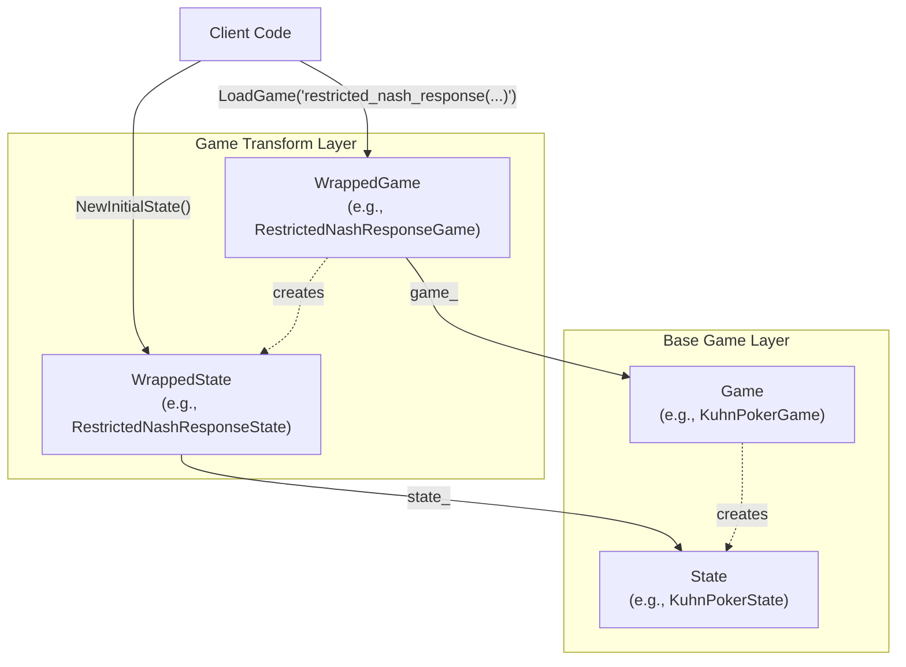
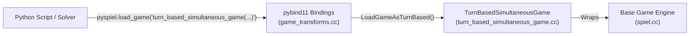

<!-- source: DeepWiki mcp.deepwiki.com · repo google-deepmind/open_spiel · page 5.5 Game Transforms · fetched 2026-10-26 -->

# Game Transforms

Relevant source files

The following files were used as context for generating this wiki page:

- [open_spiel/game_transforms/CMakeLists.txt](open_spiel/game_transforms/CMakeLists.txt)
- [open_spiel/game_transforms/add_noise.cc](open_spiel/game_transforms/add_noise.cc)
- [open_spiel/game_transforms/cached_tree.cc](open_spiel/game_transforms/cached_tree.cc)
- [open_spiel/game_transforms/cached_tree.h](open_spiel/game_transforms/cached_tree.h)
- [open_spiel/game_transforms/cached_tree_test.cc](open_spiel/game_transforms/cached_tree_test.cc)
- [open_spiel/game_transforms/coop_to_1p.cc](open_spiel/game_transforms/coop_to_1p.cc)
- [open_spiel/game_transforms/game_wrapper.h](open_spiel/game_transforms/game_wrapper.h)
- [open_spiel/game_transforms/misere.cc](open_spiel/game_transforms/misere.cc)
- [open_spiel/game_transforms/normal_form_extensive_game.cc](open_spiel/game_transforms/normal_form_extensive_game.cc)
- [open_spiel/game_transforms/repeated_game.cc](open_spiel/game_transforms/repeated_game.cc)
- [open_spiel/game_transforms/repeated_game.h](open_spiel/game_transforms/repeated_game.h)
- [open_spiel/game_transforms/repeated_game_test.cc](open_spiel/game_transforms/repeated_game_test.cc)
- [open_spiel/game_transforms/restricted_nash_response.cc](open_spiel/game_transforms/restricted_nash_response.cc)
- [open_spiel/game_transforms/restricted_nash_response.h](open_spiel/game_transforms/restricted_nash_response.h)
- [open_spiel/game_transforms/restricted_nash_response_test.cc](open_spiel/game_transforms/restricted_nash_response_test.cc)
- [open_spiel/game_transforms/start_at.cc](open_spiel/game_transforms/start_at.cc)
- [open_spiel/game_transforms/start_at.h](open_spiel/game_transforms/start_at.h)
- [open_spiel/game_transforms/start_at_test.cc](open_spiel/game_transforms/start_at_test.cc)
- [open_spiel/game_transforms/turn_based_simultaneous_game.cc](open_spiel/game_transforms/turn_based_simultaneous_game.cc)
- [open_spiel/game_transforms/turn_based_simultaneous_game.h](open_spiel/game_transforms/turn_based_simultaneous_game.h)
- [open_spiel/game_transforms/turn_based_simultaneous_game_test.cc](open_spiel/game_transforms/turn_based_simultaneous_game_test.cc)
- [open_spiel/game_transforms/zerosum.cc](open_spiel/game_transforms/zerosum.cc)
- [open_spiel/integration_tests/playthrough_test.py](open_spiel/integration_tests/playthrough_test.py)
- [open_spiel/integration_tests/playthroughs/cached_tree(game=tic_tac_toe()).txt](open_spiel/integration_tests/playthroughs/cached_tree(game=tic_tac_toe()).txt)
- [open_spiel/integration_tests/playthroughs/repeated_game(stage_game=matrix_rps(),num_repetitions=10).txt](open_spiel/integration_tests/playthroughs/repeated_game(stage_game=matrix_rps(),num_repetitions=10).txt)
- [open_spiel/python/pybind11/algorithms_trajectories.cc](open_spiel/python/pybind11/algorithms_trajectories.cc)
- [open_spiel/python/pybind11/algorithms_trajectories.h](open_spiel/python/pybind11/algorithms_trajectories.h)
- [open_spiel/python/pybind11/bots.h](open_spiel/python/pybind11/bots.h)
- [open_spiel/python/pybind11/game_transforms.cc](open_spiel/python/pybind11/game_transforms.cc)
- [open_spiel/python/pybind11/game_transforms.h](open_spiel/python/pybind11/game_transforms.h)
- [open_spiel/python/pybind11/policy.h](open_spiel/python/pybind11/policy.h)
- [open_spiel/python/tests/game_transforms_test.py](open_spiel/python/tests/game_transforms_test.py)

## Purpose and Scope

Game transforms are a system in OpenSpiel that allows existing games to be modified or extended without changing the original game implementation. They use a wrapper pattern to intercept and modify game behavior, such as altering utilities, changing observations, converting simultaneous games to turn-based format, creating repeated games, or adding noise and restricted Nash response structures.

This page documents the game transformation system, focusing on the `WrappedGame` and `WrappedState` base classes, concrete transform implementations (`turn_based_simultaneous`, `repeated_game`, `misere`, `zerosum`, `add_noise`, `cached_tree`, `start_at`, and `restricted_nash_response`), and their Python bindings. For information about specific base game implementations, see [Game Implementations](#5).

**Sources:** [open_spiel/game_transforms/game_wrapper.h:30-165](), [open_spiel/game_transforms/turn_based_simultaneous_game.cc:38-63]()

---

## Architecture Overview

The game transform system is built on a wrapper pattern that allows composition of game modifications. A transformed game wraps an underlying base game and delegates most operations to it while selectively overriding specific behaviors.

### Core Components

| Component | Purpose | Location |
|-----------|---------|----------|
| `WrappedGame` | Base class for transformed games | [open_spiel/game_transforms/game_wrapper.h:121-165]() |
| `WrappedState` | Base class for transformed game states | [open_spiel/game_transforms/game_wrapper.h:35-119]() |
| Transform implementations | Specific transforms (e.g., `TurnBasedSimultaneousState`, `RepeatedState`) | [open_spiel/game_transforms/]() |

**Wrapper Pattern Diagram**

**Sources:** [open_spiel/game_transforms/game_wrapper.h:35-165]()

---

## The WrappedGame and WrappedState Pattern

### WrappedState

The `WrappedState` class is the base class for all transformed game states (`[open_spiel/game_transforms/game_wrapper.h:35-119]()`). It contains a `std::unique_ptr<State> state_` pointing to the underlying base state and delegates most operations to it.

**Key Characteristics:**
- **Delegation**: Methods such as `CurrentPlayer()`, `LegalActions()`, `ActionToString()`, `ToString()`, `IsTerminal()`, `Rewards()`, and `Returns()` forward directly to `state_` [open_spiel/game_transforms/game_wrapper.h:42-63]().
- **Selective Override**: Transform implementations override only the methods they need to modify (e.g., altering chance outcomes or player turn ordering).
- **Cloning & Undo**: Methods like `Clone()` and `UndoAction()` manage the wrapped state lifecycle safely [open_spiel/game_transforms/game_wrapper.h:82-87]().

**Sources:** [open_spiel/game_transforms/game_wrapper.h:35-119]()

### WrappedGame

The `WrappedGame` class wraps an entire game (`[open_spiel/game_transforms/game_wrapper.h:121-165]()`), delegating structural properties like `NumDistinctActions()`, `MaxChanceOutcomes()`, `NumPlayers()`, `MinUtility()`, and `MaxUtility()` to `game_`.

**Sources:** [open_spiel/game_transforms/game_wrapper.h:121-165]()

---

## Key Game Transforms

OpenSpiel provides a rich set of built-in game transforms defined under `open_spiel/game_transforms/` [open_spiel/game_transforms/CMakeLists.txt:1-24]().

### 1. Turn-Based Simultaneous Game (`turn_based_simultaneous_game`)
Converts a simultaneous-move game into a sequential, turn-based extensive-form game with imperfect information (`[open_spiel/game_transforms/turn_based_simultaneous_game.cc:38-63]()`).
- **Implementation**: `TurnBasedSimultaneousState` buffers individual players' actions during simultaneous nodes using an `action_vector_` until all players have moved, after which it applies the joint action to the underlying simultaneous game state (`[open_spiel/game_transforms/turn_based_simultaneous_game.cc:65-130]()`).
- **Loading**: Loaded via `load_game_as_turn_based` or `turn_based_simultaneous_game(game=...)` (`[open_spiel/python/pybind11/game_transforms.cc:34-41]()`).

**Sources:** [open_spiel/game_transforms/turn_based_simultaneous_game.cc:1-130](), [open_spiel/python/pybind11/game_transforms.cc:34-52]()

### 2. Repeated Game (`repeated_game`)
Creates an n-step repeated game from a normal-form stage game (`[open_spiel/game_transforms/repeated_game.h:25-37]()`).
- **Parameters**: `stage_game` (the base game), `num_repetitions` (int), `recall` (int, default 1), and `enable_infostate` (bool) (`[open_spiel/game_transforms/repeated_game.cc:33-60]()`).
- **State Tracking**: `RepeatedState` maintains `actions_history_` and `rewards_history_` across rounds, providing custom observation strings and tensors reflecting the sliding window of past actions (`[open_spiel/game_transforms/repeated_game.cc:71-167]()`).

**Sources:** [open_spiel/game_transforms/repeated_game.h:25-111](), [open_spiel/game_transforms/repeated_game.cc:33-167]()

### 3. Restricted Nash Response (`restricted_nash_response`)
Implements the Restricted Nash Response (RNR) model by Johanson et al. (`[open_spiel/game_transforms/restricted_nash_response.h:28-36]()`).
- **Mechanism**: Introduces an initial chance node that decides with probability $p$ whether a specified `fixed_player` plays a fixed baseline strategy or remains free (`[open_spiel/game_transforms/restricted_nash_response.cc:35-189]()`).
- **Parameters**: `game`, `fixed_player`, and `p` (`[open_spiel/game_transforms/restricted_nash_response.cc:49-51]`).

**Sources:** [open_spiel/game_transforms/restricted_nash_response.h:28-122](), [open_spiel/game_transforms/restricted_nash_response.cc:35-189]()

### 4. Other Standard Transforms
- **`misere`**: Modifies win/loss conditions (e.g., losing instead of winning in games like Nim).
- **`zerosum`**: Forces utility sums to zero or enforces zero-sum properties.
- **`add_noise`**: Adds uniform random noise $\epsilon$ to terminal utilities for robustness testing (`[open_spiel/integration_tests/playthroughs/add_noise(epsilon=1.,seed=1,game=kuhn_poker()).txt:1-34]()`).
- **`cached_tree`**: Pre-caches game trees to accelerate traversal during search and reinforcement learning algorithms.
- **`start_at`**: Truncates or initializes games starting from a specific state in the game history.

**Sources:** [open_spiel/game_transforms/CMakeLists.txt:1-24](), [open_spiel/python/pybind11/game_transforms.cc:66-80]()

---

## Python Bindings and Integration

Game transforms are fully exposed to Python through `pybind11` in `open_spiel/python/pybind11/game_transforms.cc` (`[open_spiel/python/pybind11/game_transforms.cc:33-81]()`).

**Sources:** [open_spiel/python/pybind11/game_transforms.cc:33-81]()

---

## Testing and Validation

Game transforms are tested using both C++ test binaries and Python integration test suites:
- **C++ Tests**: Each transform has dedicated test executables registered in CMake, such as `turn_based_simultaneous_game_test` and `repeated_game_test` (`[open_spiel/game_transforms/CMakeLists.txt:33-91]()`).
- **Python Tests**: `open_spiel/python/tests/game_transforms_test.py` validates creation, simulation, and CFR execution on transformed games (`[open_spiel/python/tests/game_transforms_test.py:30-134]()`).
- **Playthroughs**: Regression tests compare gameplay playthrough outputs against expected text logs (`[open_spiel/integration_tests/playthrough_test.py:26-35]()`).

**Sources:** [open_spiel/game_transforms/CMakeLists.txt:27-91](), [open_spiel/python/tests/game_transforms_test.py:30-134](), [open_spiel/integration_tests/playthrough_test.py:26-35]()

---

