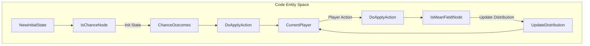
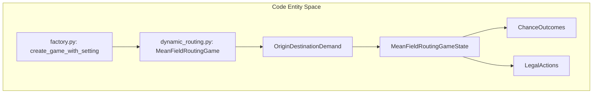

<!-- source: DeepWiki mcp.deepwiki.com · repo google-deepmind/open_spiel · page 5.6 Mean Field and Routing Games · fetched 2026-10-26 -->

# Mean Field and Routing Games

Relevant source files

The following files were used as context for generating this wiki page:

- [open_spiel/games/dynamic_routing/dynamic_routing_data.cc](open_spiel/games/dynamic_routing/dynamic_routing_data.cc)
- [open_spiel/games/dynamic_routing/dynamic_routing_data.h](open_spiel/games/dynamic_routing/dynamic_routing_data.h)
- [open_spiel/games/dynamic_routing/dynamic_routing_data_test.cc](open_spiel/games/dynamic_routing/dynamic_routing_data_test.cc)
- [open_spiel/games/dynamic_routing/dynamic_routing_utils.cc](open_spiel/games/dynamic_routing/dynamic_routing_utils.cc)
- [open_spiel/games/dynamic_routing/dynamic_routing_utils.h](open_spiel/games/dynamic_routing/dynamic_routing_utils.h)
- [open_spiel/games/dynamic_routing/dynamic_routing_utils_test.cc](open_spiel/games/dynamic_routing/dynamic_routing_utils_test.cc)
- [open_spiel/games/mfg/README.md](open_spiel/games/mfg/README.md)
- [open_spiel/games/mfg/crowd_modelling.cc](open_spiel/games/mfg/crowd_modelling.cc)
- [open_spiel/games/mfg/crowd_modelling.h](open_spiel/games/mfg/crowd_modelling.h)
- [open_spiel/games/mfg/crowd_modelling_2d.cc](open_spiel/games/mfg/crowd_modelling_2d.cc)
- [open_spiel/games/mfg/crowd_modelling_2d.h](open_spiel/games/mfg/crowd_modelling_2d.h)
- [open_spiel/games/mfg/crowd_modelling_2d_test.cc](open_spiel/games/mfg/crowd_modelling_2d_test.cc)
- [open_spiel/games/mfg/crowd_modelling_test.cc](open_spiel/games/mfg/crowd_modelling_test.cc)
- [open_spiel/games/mfg/dynamic_routing.cc](open_spiel/games/mfg/dynamic_routing.cc)
- [open_spiel/games/mfg/dynamic_routing.h](open_spiel/games/mfg/dynamic_routing.h)
- [open_spiel/games/mfg/dynamic_routing_test.cc](open_spiel/games/mfg/dynamic_routing_test.cc)
- [open_spiel/integration_tests/playthroughs/mfg_crowd_modelling.txt](open_spiel/integration_tests/playthroughs/mfg_crowd_modelling.txt)
- [open_spiel/integration_tests/playthroughs/mfg_crowd_modelling_2d.txt](open_spiel/integration_tests/playthroughs/mfg_crowd_modelling_2d.txt)
- [open_spiel/integration_tests/playthroughs/mfg_dynamic_routing.txt](open_spiel/integration_tests/playthroughs/mfg_dynamic_routing.txt)
- [open_spiel/integration_tests/playthroughs/python_dynamic_routing.txt](open_spiel/integration_tests/playthroughs/python_dynamic_routing.txt)
- [open_spiel/integration_tests/playthroughs/python_mfg_crowd_modelling.txt](open_spiel/integration_tests/playthroughs/python_mfg_crowd_modelling.txt)
- [open_spiel/integration_tests/playthroughs/python_mfg_dynamic_routing.txt](open_spiel/integration_tests/playthroughs/python_mfg_dynamic_routing.txt)
- [open_spiel/integration_tests/playthroughs/python_mfg_periodic_aversion.txt](open_spiel/integration_tests/playthroughs/python_mfg_periodic_aversion.txt)
- [open_spiel/integration_tests/playthroughs/python_mfg_predator_prey.txt](open_spiel/integration_tests/playthroughs/python_mfg_predator_prey.txt)
- [open_spiel/python/games/dynamic_routing.py](open_spiel/python/games/dynamic_routing.py)
- [open_spiel/python/games/dynamic_routing_data.py](open_spiel/python/games/dynamic_routing_data.py)
- [open_spiel/python/games/dynamic_routing_test.py](open_spiel/python/games/dynamic_routing_test.py)
- [open_spiel/python/games/dynamic_routing_to_mean_field_game.py](open_spiel/python/games/dynamic_routing_to_mean_field_game.py)
- [open_spiel/python/games/dynamic_routing_to_mean_field_game_test.py](open_spiel/python/games/dynamic_routing_to_mean_field_game_test.py)
- [open_spiel/python/games/dynamic_routing_utils.py](open_spiel/python/games/dynamic_routing_utils.py)
- [open_spiel/python/games/dynamic_routing_utils_test.py](open_spiel/python/games/dynamic_routing_utils_test.py)
- [open_spiel/python/mfg/games/__init__.py](open_spiel/python/mfg/games/__init__.py)
- [open_spiel/python/mfg/games/crowd_avoidance.py](open_spiel/python/mfg/games/crowd_avoidance.py)
- [open_spiel/python/mfg/games/crowd_modelling.py](open_spiel/python/mfg/games/crowd_modelling.py)
- [open_spiel/python/mfg/games/crowd_modelling_test.py](open_spiel/python/mfg/games/crowd_modelling_test.py)
- [open_spiel/python/mfg/games/dynamic_routing.py](open_spiel/python/mfg/games/dynamic_routing.py)
- [open_spiel/python/mfg/games/dynamic_routing_test.py](open_spiel/python/mfg/games/dynamic_routing_test.py)
- [open_spiel/python/mfg/games/factory.py](open_spiel/python/mfg/games/factory.py)
- [open_spiel/python/mfg/games/factory_test.py](open_spiel/python/mfg/games/factory_test.py)
- [open_spiel/python/mfg/games/linear_quadratic.py](open_spiel/python/mfg/games/linear_quadratic.py)
- [open_spiel/python/mfg/games/linear_quadratic_test.py](open_spiel/python/mfg/games/linear_quadratic_test.py)
- [open_spiel/python/mfg/games/periodic_aversion.py](open_spiel/python/mfg/games/periodic_aversion.py)
- [open_spiel/python/mfg/games/periodic_aversion_test.py](open_spiel/python/mfg/games/periodic_aversion_test.py)
- [open_spiel/python/mfg/games/predator_prey.py](open_spiel/python/mfg/games/predator_prey.py)
- [open_spiel/python/mfg/games/predator_prey_test.py](open_spiel/python/mfg/games/predator_prey_test.py)

## Purpose and Scope
This page documents the Mean Field Game (MFG) and dynamic routing game frameworks implemented in both C++ and Python within OpenSpiel. Mean Field Games model interactions between a representative agent and a mass of symmetric or multi-population agents characterized by a state distribution. Dynamic routing games extend these concepts to traffic networks where vehicles choose routes based on network congestion.

---

## 1. Mean Field Game Architecture & Abstractions

OpenSpiel represents MFGs using specialized `GameType` flags, distinct player IDs for chance and mean field distributions, and lifecycle hooks that alternate between agent actions, stochastic transitions, and population distribution updates.

- `GameType::Dynamics::kMeanField` specifies that the game incorporates a mean-field component [open_spiel/games/mfg/crowd_modelling.cc:38]().
- `kMeanFieldPlayerId` designates the phase where the environment updates the population distribution [open_spiel/games/mfg/crowd_modelling.cc:66]().
- `UpdateDistribution()` passes the current population distribution vector into the state [open_spiel/games/mfg/crowd_modelling.cc:163-169]().

### MFG Sequence Diagram

*Sources: [open_spiel/games/mfg/crowd_modelling.cc:83-169](), [open_spiel/python/mfg/games/crowd_modelling.py:81-170]()*

Sources: [open_spiel/games/mfg/crowd_modelling.cc:38-169](), [open_spiel/python/mfg/games/crowd_modelling.py:81-170]()

---

## 2. Crowd Modelling Games (C++ & Python)

Crowd modelling games simulate agents moving on a 1D grid or 2D area trying to reach targets while avoiding congestion and overcrowding.

### 1D Crowd Modelling
- C++ implementation: `mfg_crowd_modelling` [open_spiel/games/mfg/crowd_modelling.cc:36-37]()
- Python implementation: `python_mfg_crowd_modelling` [open_spiel/python/mfg/games/crowd_modelling.py:38-41]()
- State transitions handle movement actions `{-1, 0, 1}` and incorporate negative log-density congestion penalties: `r_mu = -std::log(distribution_[x_] + kEpsilon)` [open_spiel/games/mfg/crowd_modelling.cc:173-181]().

### 2D Crowd Modelling
- C++ implementation: `mfg_crowd_modelling_2d` [open_spiel/games/mfg/crowd_modelling_2d.cc:61-63]()
- Supports advanced configuration parameters such as `size`, `horizon`, `forbidden_states`, `initial_distribution`, `positional_reward`, `noise_intensity`, and `crowd_aversion_coef` [open_spiel/games/mfg/crowd_modelling_2d.cc:75-91]().

Sources: [open_spiel/games/mfg/crowd_modelling.cc:36-185](), [open_spiel/games/mfg/crowd_modelling_2d.cc:61-93](), [open_spiel/python/mfg/games/crowd_modelling.py:38-53]()

---

## 3. Multi-Population & Complex Interaction Games

OpenSpiel includes several multi-population and specialized MFG benchmarks implemented in Python:

### Predator-Prey MFG
- Registered as `python_mfg_predator_prey` [open_spiel/python/mfg/games/predator_prey.py:153-169]().
- Simulates multiple populations with asymmetric reward matrices where populations are attracted to or avoid other populations (e.g., three or four population setups) [open_spiel/python/mfg/games/predator_prey.py:48-104]().
- Supports geometries like basic squares and tori (`Geometry.SQUARE`, `Geometry.TORUS`) [open_spiel/python/mfg/games/predator_prey.py:40-43]().

### Periodic Aversion and Linear-Quadratic Games
- Registered as `python_mfg_periodic_aversion` and `mean_field_lin_quad` [open_spiel/python/mfg/games/factory.py:82-86]().
- `linear_quadratic.py` implements linear-quadratic mean-field games with analytical or iterative solutions [open_spiel/python/mfg/games/linear_quadratic.py:1-40]().

Sources: [open_spiel/python/mfg/games/predator_prey.py:40-169](), [open_spiel/python/mfg/games/factory.py:32-88](), [open_spiel/python/mfg/games/linear_quadratic.py:1-50]()

---

## 4. Dynamic Routing Games

Dynamic routing games model traffic equilibrium where population blocks (origin-destination demands) choose paths through a network over time.

- C++ implementation: `mfg_dynamic_routing` [open_spiel/games/mfg/dynamic_routing.cc:44-46]()
- Python implementation: `python_mfg_dynamic_routing` [open_spiel/python/mfg/games/dynamic_routing.py:50-66]()
- Utilizes network structures and origin-destination demand definitions from `dynamic_routing_data.py` and `dynamic_routing_utils.py` [open_spiel/python/games/dynamic_routing_data.py:1-30](), [open_spiel/python/games/dynamic_routing_utils.py:1-40]().

### Routing Game Flow

*Sources: [open_spiel/python/mfg/games/factory.py:103-131](), [open_spiel/python/mfg/games/dynamic_routing.py:119-170]()*

Sources: [open_spiel/games/mfg/dynamic_routing.cc:44-65](), [open_spiel/python/mfg/games/dynamic_routing.py:50-66](), [open_spiel/python/mfg/games/factory.py:103-131]()

---

## 5. Factory and Configuration Infrastructure

MFG games and benchmarks are centrally managed via `open_spiel/python/mfg/games/factory.py`, which maps configuration names to parameter dictionaries and network definitions.

- `GAME_SETTINGS` stores preset parameters for `crowd_avoidance`, `crowd_modelling_2d_10x10`, `dynamic_routing_braess`, `predator_prey_5x5x3`, `linear_quadratic`, and `periodic_aversion` [open_spiel/python/mfg/games/factory.py:32-77]().
- `create_game_with_setting()` instantiates either C++ or Python MFG games with custom parameters or network configurations [open_spiel/python/mfg/games/factory.py:103-131]().

Sources: [open_spiel/python/mfg/games/factory.py:32-131]()

---

