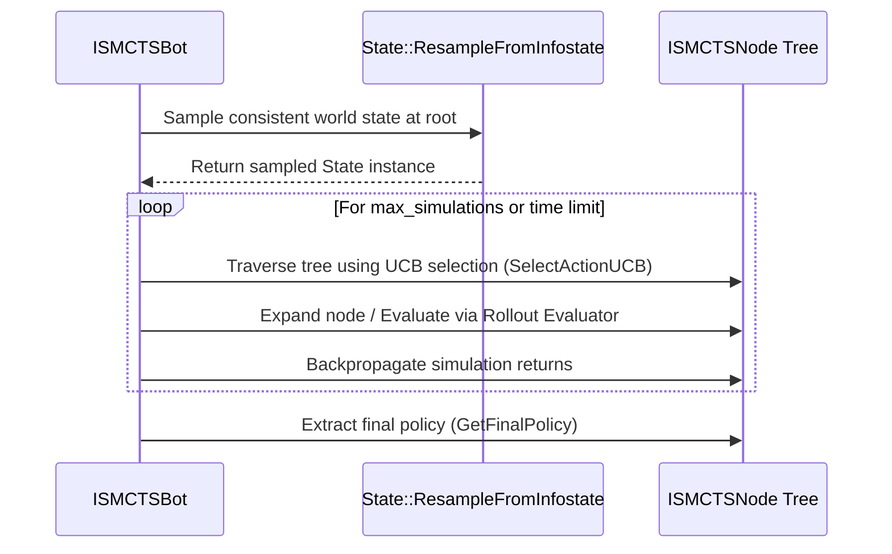

<!-- source: DeepWiki mcp.deepwiki.com · repo google-deepmind/open_spiel · page 5.7 Imperfect-Information and Misc Games · fetched 2026-10-26 -->

# Imperfect-Information and Misc Games

<details>
<summary>Relevant source files</summary>

The following files were used as context for generating this wiki page:

- [open_spiel/algorithms/fsicfr.cc](open_spiel/algorithms/fsicfr.cc)
- [open_spiel/algorithms/fsicfr.h](open_spiel/algorithms/fsicfr.h)
- [open_spiel/algorithms/is_mcts.cc](open_spiel/algorithms/is_mcts.cc)
- [open_spiel/algorithms/is_mcts.h](open_spiel/algorithms/is_mcts.h)
- [open_spiel/algorithms/is_mcts_test.cc](open_spiel/algorithms/is_mcts_test.cc)
- [open_spiel/examples/fsicfr_liars_dice.cc](open_spiel/examples/fsicfr_liars_dice.cc)
- [open_spiel/examples/imperfect_recall_mccfr.cc](open_spiel/examples/imperfect_recall_mccfr.cc)
- [open_spiel/games/bargaining/bargaining.cc](open_spiel/games/bargaining/bargaining.cc)
- [open_spiel/games/bargaining/bargaining.h](open_spiel/games/bargaining/bargaining.h)
- [open_spiel/games/bargaining/bargaining_instance_generator.cc](open_spiel/games/bargaining/bargaining_instance_generator.cc)
- [open_spiel/games/bargaining/bargaining_instances1000.txt](open_spiel/games/bargaining/bargaining_instances1000.txt)
- [open_spiel/games/bargaining/bargaining_test.cc](open_spiel/games/bargaining/bargaining_test.cc)
- [open_spiel/games/phantom_go/phantom_go_board.cc](open_spiel/games/phantom_go/phantom_go_board.cc)
- [open_spiel/games/phantom_go/phantom_go_board.h](open_spiel/games/phantom_go/phantom_go_board.h)
- [open_spiel/integration_tests/playthroughs/bargaining.txt](open_spiel/integration_tests/playthroughs/bargaining.txt)
- [open_spiel/integration_tests/playthroughs/goofspiel.txt](open_spiel/integration_tests/playthroughs/goofspiel.txt)
- [open_spiel/integration_tests/playthroughs/goofspiel_egocentric.txt](open_spiel/integration_tests/playthroughs/goofspiel_egocentric.txt)
- [open_spiel/integration_tests/playthroughs/goofspiel_random_points_order.txt](open_spiel/integration_tests/playthroughs/goofspiel_random_points_order.txt)
- [open_spiel/integration_tests/playthroughs/goofspiel_turn_based.txt](open_spiel/integration_tests/playthroughs/goofspiel_turn_based.txt)
- [open_spiel/integration_tests/playthroughs/liars_dice_ir.txt](open_spiel/integration_tests/playthroughs/liars_dice_ir.txt)
- [open_spiel/integration_tests/playthroughs/phantom_go.txt](open_spiel/integration_tests/playthroughs/phantom_go.txt)
- [open_spiel/integration_tests/playthroughs/phantom_ttt.txt](open_spiel/integration_tests/playthroughs/phantom_ttt.txt)
- [open_spiel/integration_tests/playthroughs/phantom_ttt_ir.txt](open_spiel/integration_tests/playthroughs/phantom_ttt_ir.txt)
- [open_spiel/matrix_game.cc](open_spiel/matrix_game.cc)
- [open_spiel/matrix_game.h](open_spiel/matrix_game.h)
- [open_spiel/normal_form_game.h](open_spiel/normal_form_game.h)
- [open_spiel/python/bots/is_mcts_test.py](open_spiel/python/bots/is_mcts_test.py)
- [open_spiel/python/pybind11/games_bargaining.cc](open_spiel/python/pybind11/games_bargaining.cc)
- [open_spiel/python/pybind11/games_bargaining.h](open_spiel/python/pybind11/games_bargaining.h)
- [open_spiel/python/pybind11/utils.h](open_spiel/python/pybind11/utils.h)
- [open_spiel/python/tests/games_bargaining_test.py](open_spiel/python/tests/games_bargaining_test.py)
- [open_spiel/simultaneous_move_game.h](open_spiel/simultaneous_move_game.h)
- [open_spiel/tensor_game.cc](open_spiel/tensor_game.cc)
- [open_spiel/tensor_game.h](open_spiel/tensor_game.h)

</details>


## Purpose and Scope
This page covers the implementation details of imperfect-information games (such as Phantom Tic-Tac-Toe, Phantom Go, Bargaining, and Goofspiel) and generic game representations (including Matrix games, Tensor games, Normal-Form games, and standard Extensive-Form/GAMUT formats). These games evaluate algorithms dealing with hidden information, incomplete belief states, and simultaneous or sequential imperfect-recall structures.

---

## 1. Tactical and Board Games with Hidden Information (Phantom Games)

Phantom games extend perfect-information board games (like Tic-Tac-Toe, Go, and Hex) by introducing hidden moves or referee-enforced capture validation. For instance, in **Phantom Tic-Tac-Toe** (`phantom_ttt`) and **Phantom Go** (`phantom_go`), players attempt to place stones on a board, but conflicting or illegal moves result in hidden failures (e.g., trying to play on an occupied square where the opponent secretly placed a stone reports an invalid move or a miss, depending on the observation type).

In **Phantom Go**, the board is represented internally via a virtual coordinate system with guard rails to avoid bounds checking [open_spiel/games/phantom_go/phantom_go_board.h:36-39]():
- `PhantomGoBoard` manages liberties, chains, ko points, and player observation masks [open_spiel/games/phantom_go/phantom_go_board.h:105-188]().
- The translation between OpenSpiel flat actions and virtual board indices is handled via `VirtualActionToAction` and `ActionToVirtualAction` [open_spiel/games/phantom_go/phantom_go_board.h:76-79]().

### Natural Language Space to Code Entity Space: Phantom Go & Board Architecture

```mermaid
graph TD
    A["Natural Language: Phantom Go Game"] --> B["OpenSpiel Game Wrapper: phantom_go"]
    B --> C["Virtual Coordinate System: PhantomGoBoard"]
    C --> D["Liberties & Chains Engine: PhantomGoBoard::PseudoLiberty"]
    C --> E["Observation Masking: PhantomGoBoard::GetObservationByID"]
    
    sub: "Code Entities"
    B --> F["open_spiel/games/phantom_go/phantom_go_board.h"]
    C --> G["open_spiel/games/phantom_go/phantom_go_board.cc"]
```
*Sources: `open_spiel/games/phantom_go/phantom_go_board.h`, `open_spiel/games/phantom_go/phantom_go_board.cc`*

---

## 2. Economic and Bidding Games

### Bargaining
The **Bargaining** game (`bargaining`) models two players dividing a pool of items under private valuations [open_spiel/games/bargaining/bargaining.cc:40-60](). 
- **Game Type**: Sequential dynamics, explicit stochastic chance mode, imperfect information, and general-sum utility [open_spiel/games/bargaining/bargaining.cc:41-60]().
- **Instances**: Game instances containing item pools and player valuations are loaded from text files or generated via `bargaining_instance_generator.cc` [open_spiel/games/bargaining/bargaining.cc:56-60]().
- **State Class**: `BargainingState` tracks offers, agreements, turns, and implements `ResampleFromInfostate` to allow Bayesian updates and information-set-based search [open_spiel/games/bargaining/bargaining.cc:171-193]().
- **Python Bindings**: Exposed via `open_spiel/python/pybind11/games_bargaining.cc`, providing serialization, `Instance`, and `Offer` helper classes [open_spiel/python/pybind11/games_bargaining.cc:29-87]().

### Goofspiel
**Goofspiel** (Game of Strategy) is a bidding card game where players compete for point cards using secret hands of matching rank [open_spiel/integration_tests/playthroughs/goofspiel.txt:1-17]().
- Configurable via parameters such as `num_cards`, `points_order` (ascending/descending), and `imp_info` (enabling imperfect information where hidden hands or bidding histories are partially masked) [open_spiel/integration_tests/playthroughs/goofspiel.txt:9]().
- Can be wrapped in `turn_based_simultaneous_game` to transform its simultaneous bidding phase into sequential turns [open_spiel/integration_tests/playthroughs/goofspiel_turn_based.txt:1]().

---

## 3. Generic Game Formats, Matrix, and Tensor Games

OpenSpiel provides structured classes for normal-form and matrix representations.

- **NormalFormGame**: Base class for games where players move simultaneously and utilities depend directly on the joint action vector [open_spiel/matrix_game.h:25]().
- **MatrixGame**: Specialization for 2-player normal-form games backed by explicit row and column payoff matrices [open_spiel/matrix_game.h:43-54](). It provides helper utilities like `FlattenMatrix`, `RowUtility`, `ColUtility`, and `ApproxEqual` [open_spiel/matrix_game.h:40-162]().
- **TensorGame**: Extends matrix games to multi-player settings using multi-dimensional tensors for utility representations [open_spiel/tensor_game.h]().

### Natural Language Space to Code Entity Space: Matrix and Tensor Game Structure

```mermaid
graph TD
    A["Natural Language: 2-Player Normal Form Payoff Matrix"] --> B["C++ Class: MatrixGame"]
    B --> C["Base Class: NormalFormGame"]
    B --> D["Row/Col Utilities Storage: row_utilities_, col_utilities_"]
    B --> E["State Evaluation: MatrixState"]
    
    sub: "Code Entities"
    B --> F["open_spiel/matrix_game.h"]
    E --> G["open_spiel/matrix_game.cc"]
    C --> H["open_spiel/normal_form_game.h"]
```
*Sources: `open_spiel/matrix_game.h`, `open_spiel/normal_form_game.h`*

---

## 4. Algorithms for Imperfect Information: IS-MCTS

Information Set Monte Carlo Tree Search (**IS-MCTS**) is a prominent search algorithm for imperfect-information games implemented in `open_spiel/algorithms/is_mcts.cc` and `open_spiel/algorithms/is_mcts.h` [open_spiel/algorithms/is_mcts.h:29-30]().

- **Key Classes**:
  - `ISMCTSBot`: Implements the `Bot` interface, supporting search runs over sampled world states [open_spiel/algorithms/is_mcts.h:63-98]().
  - `ISMCTSNode`: Maintains visit counts and return sums across tree nodes keyed by information states or observation strings (`ISMCTSStateKey`) [open_spiel/algorithms/is_mcts.h:38-58]().
- **Resampling**: Requires `State::ResampleFromInfostate` to generate consistent world samples compatible with the current player's information state during tree exploration [open_spiel/algorithms/is_mcts.h:75-76]().
- **Final Policies**: Supports multiple policy derivation types via `ISMCTSFinalPolicyType` (`kNormalizedVisitCount`, `kMaxVisitCount`, `kMaxValue`) [open_spiel/algorithms/is_mcts.h:43-47]().


*Sources: `open_spiel/algorithms/is_mcts.h`, `open_spiel/algorithms/is_mcts.cc`*

---

