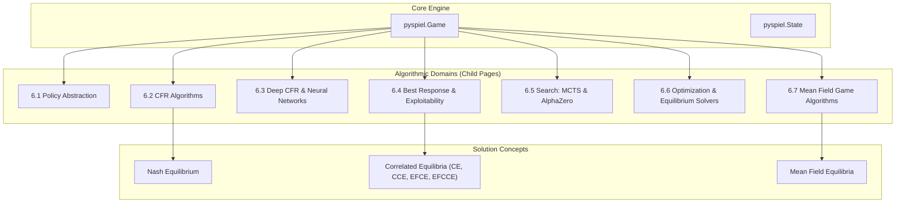

<!-- source: DeepWiki mcp.deepwiki.com · repo google-deepmind/open_spiel · page 6 Algorithms and Solution Concepts · fetched 2026-10-26 -->

# Algorithms and Solution Concepts

Relevant source files

The following files were used as context for generating this wiki page:

- [docs/algorithms.md](docs/algorithms.md)
- [open_spiel/algorithms/CMakeLists.txt](open_spiel/algorithms/CMakeLists.txt)
- [open_spiel/algorithms/corr_dist.cc](open_spiel/algorithms/corr_dist.cc)
- [open_spiel/algorithms/corr_dist.h](open_spiel/algorithms/corr_dist.h)
- [open_spiel/algorithms/corr_dist_test.cc](open_spiel/algorithms/corr_dist_test.cc)
- [open_spiel/examples/CMakeLists.txt](open_spiel/examples/CMakeLists.txt)
- [open_spiel/games/universal_poker/CMakeLists.txt](open_spiel/games/universal_poker/CMakeLists.txt)
- [open_spiel/python/algorithms/cfr.py](open_spiel/python/algorithms/cfr.py)
- [open_spiel/python/algorithms/cfr_test.py](open_spiel/python/algorithms/cfr_test.py)
- [open_spiel/python/examples/escher.py](open_spiel/python/examples/escher.py)
- [open_spiel/python/mfg/algorithms/boltzmann_policy_iteration.py](open_spiel/python/mfg/algorithms/boltzmann_policy_iteration.py)
- [open_spiel/python/mfg/algorithms/boltzmann_policy_iteration_test.py](open_spiel/python/mfg/algorithms/boltzmann_policy_iteration_test.py)
- [open_spiel/python/mfg/algorithms/mirror_descent.py](open_spiel/python/mfg/algorithms/mirror_descent.py)
- [open_spiel/python/mfg/algorithms/munchausen_mirror_descent.py](open_spiel/python/mfg/algorithms/munchausen_mirror_descent.py)
- [open_spiel/python/mfg/algorithms/munchausen_mirror_descent_test.py](open_spiel/python/mfg/algorithms/munchausen_mirror_descent_test.py)
- [open_spiel/python/policy.py](open_spiel/python/policy.py)
- [open_spiel/python/pybind11/algorithms_corr_dist.cc](open_spiel/python/pybind11/algorithms_corr_dist.cc)
- [open_spiel/python/pytorch/escher.py](open_spiel/python/pytorch/escher.py)
- [open_spiel/python/pytorch/escher_test.py](open_spiel/python/pytorch/escher_test.py)

This page provides a high-level overview of the algorithms, solution concepts, and analysis tools implemented in OpenSpiel for solving, evaluating, and studying games. OpenSpiel contains a wide variety of algorithms ranging from classical search and tabular counterfactual regret minimization to deep reinforcement learning, mean-field game solvers, and correlation device distance metrics.

As a parent page, this document summarizes each major algorithmic domain and links to detailed child pages for in-end implementations and technical depth.

## Algorithm Ecosystem Overview

The algorithms in OpenSpiel bridge core game representations (`Game`, `State`) with high-level evaluation metrics and optimization solvers.

Sources: [open_spiel/python/policy.py:97-122](), [open_spiel/algorithms/cfr.h:15-50](), [open_spiel/algorithms/corr_dist.h:24-75]()

---

## 6.1 Policy Abstraction

Policies define how players make decisions, mapping game states or information states to probability distributions over legal actions. OpenSpiel provides both C++ and Python policy abstractions supporting tabular representations, uniform random baselines, aggregated policies, and utility functions for sampling and conversion.

For details and concrete implementations, see [Policy Abstraction](#6.1).

Sources: [open_spiel/python/policy.py:97-186](), [open_spiel/policy.h:30-100]()

---

## 6.2 CFR Algorithms

Counterfactual Regret Minimization (CFR) is a foundational family of iterative algorithms for computing approximate Nash equilibria in extensive-form imperfect-information games. OpenSpiel implements standard CFR, CFR+, CFR-BR, discounted CFR, and Monte Carlo Counterfactual Regret Minimization (MCCFR) using external and outcome sampling in both C++ and Python.

For details on solvers, update rules, and sampling strategies, see [CFR Algorithms](#6.2).

Sources: [open_spiel/algorithms/cfr.h:30-147](), [open_spiel/python/algorithms/cfr.py:126-186]()

---

## 6.3 Deep CFR with Neural Networks

For games with state spaces too large for tabular storage, OpenSpiel provides deep learning-based approximations of CFR, such as Deep CFR implemented in JAX and PyTorch, alongside related methods like RCFR and Neural Replicator Dynamics (NeuRD). These systems utilize Multi-Layer Perceptrons (MLPs), reservoir replay buffers (`ReservoirBuffer`), and customized training loops.

For neural network architectures, buffer mechanics, and training flows, see [Deep CFR with Neural Networks](#6.3).

Sources: [open_spiel/python/pytorch/escher.py:37-128]()

---

## 6.4 Best Response and Exploitability

To quantify how far an arbitrary policy is from a Nash equilibrium, OpenSpiel implements `TabularBestResponse`, MDP-based best response solvers (`tabular_best_response_mdp.cc`), exploitability metrics, NashConv, infostate trees, state distributions, and correlation device metrics (CE, CCE, EFCE, EFCCE).

For mathematical definitions, distance functions, and correlation device builders, see [Best Response and Exploitability](#6.4).

Sources: [open_spiel/algorithms/corr_dist.h:27-115](), [open_spiel/algorithms/corr_dist.cc:44-140]()

---

## 6.5 Search Algorithms: MCTS and AlphaZero

For online decision-making and planning, OpenSpiel supplies Monte Carlo Tree Search (MCTS), Information Set MCTS (IS-MCTS), Minimax with Alpha-Beta pruning, and full AlphaZero stacks implemented in JAX (`model_linen`/`model_nnx`) and libtorch.

For search node expansions, evaluator integrations, and neural network game loops, see [Search Algorithms: MCTS and AlphaZero](#6.5).

Sources: [docs/algorithms.md:10-26](), [open_spiel/algorithms/CMakeLists.txt:46-55]()

---

## 6.6 Optimization and Equilibrium Solvers

For normal-form and restricted sequential games, OpenSpiel includes linear programming (LP) solvers via OR-Tools backends (`lp_solver`, sequence-form LP), matrix Nash solvers, Stackelberg equilibrium solvers, nash averaging, Magnetic Mirror Descent (MMD) with dilated entropy, and coalitional game modules.

For LP formulation details and game-theoretic optimization tools, see [Optimization and Equilibrium Solvers](#6.6).

Sources: [docs/algorithms.md:17-26](), [open_spiel/algorithms/CMakeLists.txt:83-85]()

---

## 6.7 Mean Field Game Algorithms

Mean Field Games (MFGs) model interactions between a very large population of symmetric agents. OpenSpiel implements specialized MFG algorithms including fictitious play, mirror descent, Munchausen deep mirror descent, best response value calculations, Nash convergence evaluations, and distribution propagation.

For MFG-specific state dynamics and iterative solvers, see [Mean Field Game Algorithms](#6.7).

Sources: [open_spiel/python/mfg/algorithms/mirror_descent.py:33-171]()

---

