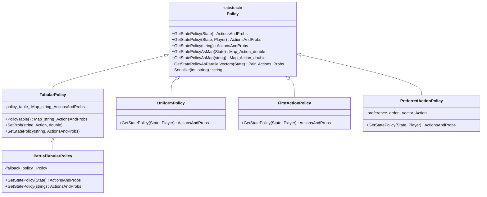
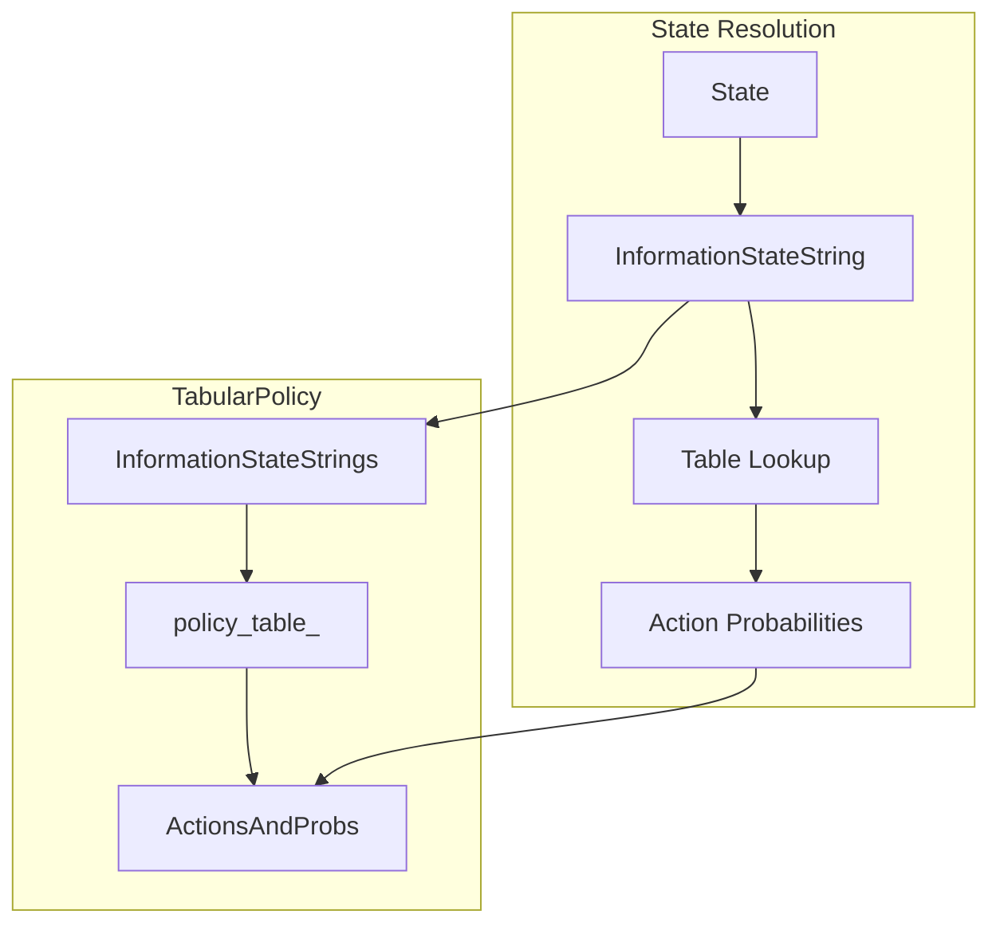
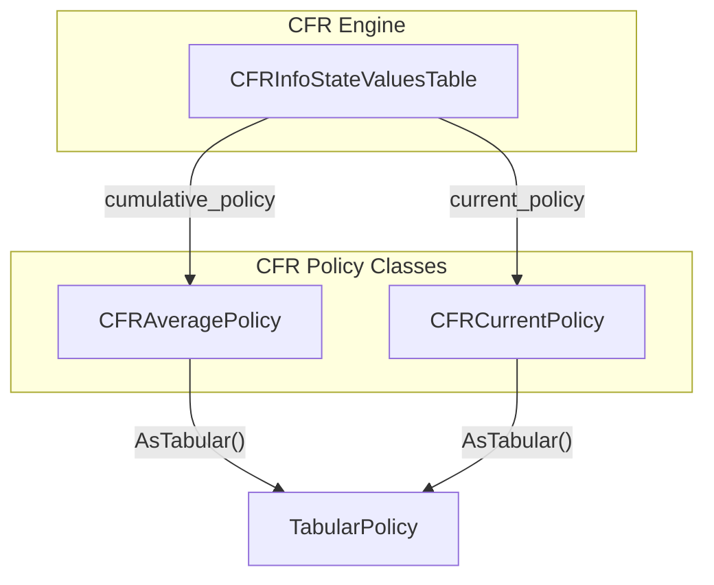
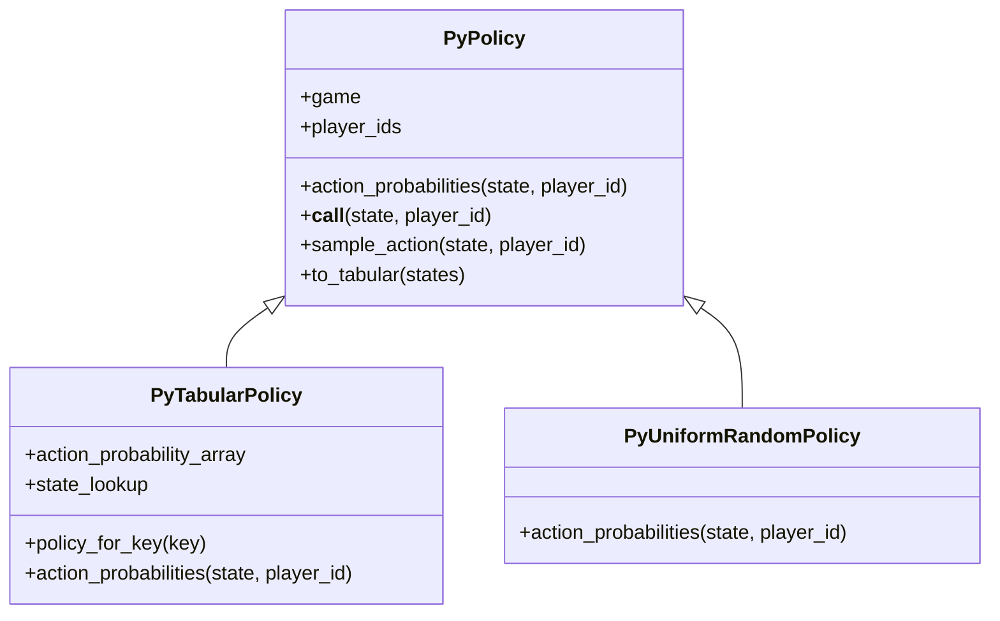

<!-- source: DeepWiki mcp.deepwiki.com · repo google-deepmind/open_spiel · page 6.1 Policy Abstraction · fetched 2026-10-26 -->

# Policy Abstraction

Relevant source files

The following files were used as context for generating this wiki page:

- [open_spiel/algorithms/CMakeLists.txt](open_spiel/algorithms/CMakeLists.txt)
- [open_spiel/algorithms/cfr.cc](open_spiel/algorithms/cfr.cc)
- [open_spiel/algorithms/cfr.h](open_spiel/algorithms/cfr.h)
- [open_spiel/algorithms/cfr_br.cc](open_spiel/algorithms/cfr_br.cc)
- [open_spiel/algorithms/cfr_br.h](open_spiel/algorithms/cfr_br.h)
- [open_spiel/algorithms/cfr_br_test.cc](open_spiel/algorithms/cfr_br_test.cc)
- [open_spiel/algorithms/cfr_test.cc](open_spiel/algorithms/cfr_test.cc)
- [open_spiel/algorithms/corr_dist.cc](open_spiel/algorithms/corr_dist.cc)
- [open_spiel/algorithms/corr_dist.h](open_spiel/algorithms/corr_dist.h)
- [open_spiel/algorithms/corr_dist_test.cc](open_spiel/algorithms/corr_dist_test.cc)
- [open_spiel/examples/CMakeLists.txt](open_spiel/examples/CMakeLists.txt)
- [open_spiel/games/universal_poker/CMakeLists.txt](open_spiel/games/universal_poker/CMakeLists.txt)
- [open_spiel/policy.cc](open_spiel/policy.cc)
- [open_spiel/policy.h](open_spiel/policy.h)
- [open_spiel/python/algorithms/best_response.py](open_spiel/python/algorithms/best_response.py)
- [open_spiel/python/algorithms/best_response_test.py](open_spiel/python/algorithms/best_response_test.py)
- [open_spiel/python/algorithms/cfr.py](open_spiel/python/algorithms/cfr.py)
- [open_spiel/python/algorithms/cfr_test.py](open_spiel/python/algorithms/cfr_test.py)
- [open_spiel/python/algorithms/discounted_cfr_test.py](open_spiel/python/algorithms/discounted_cfr_test.py)
- [open_spiel/python/algorithms/exploitability.py](open_spiel/python/algorithms/exploitability.py)
- [open_spiel/python/algorithms/get_all_states.py](open_spiel/python/algorithms/get_all_states.py)
- [open_spiel/python/algorithms/get_all_states_test.py](open_spiel/python/algorithms/get_all_states_test.py)
- [open_spiel/python/algorithms/noisy_policy.py](open_spiel/python/algorithms/noisy_policy.py)
- [open_spiel/python/algorithms/noisy_policy_test.py](open_spiel/python/algorithms/noisy_policy_test.py)
- [open_spiel/python/algorithms/policy_aggregator.py](open_spiel/python/algorithms/policy_aggregator.py)
- [open_spiel/python/algorithms/policy_aggregator_joint.py](open_spiel/python/algorithms/policy_aggregator_joint.py)
- [open_spiel/python/algorithms/policy_aggregator_joint_test.py](open_spiel/python/algorithms/policy_aggregator_joint_test.py)
- [open_spiel/python/algorithms/policy_aggregator_test.py](open_spiel/python/algorithms/policy_aggregator_test.py)
- [open_spiel/python/bots/policy.py](open_spiel/python/bots/policy.py)
- [open_spiel/python/examples/policy_aggregator_example.py](open_spiel/python/examples/policy_aggregator_example.py)
- [open_spiel/python/mfg/algorithms/distribution_test.py](open_spiel/python/mfg/algorithms/distribution_test.py)
- [open_spiel/python/policy.py](open_spiel/python/policy.py)
- [open_spiel/python/pybind11/algorithms_corr_dist.cc](open_spiel/python/pybind11/algorithms_corr_dist.cc)
- [open_spiel/python/pybind11/policy.cc](open_spiel/python/pybind11/policy.cc)
- [open_spiel/python/pybind11/python_policy.cc](open_spiel/python/pybind11/python_policy.cc)
- [open_spiel/python/pybind11/python_policy.h](open_spiel/python/pybind11/python_policy.h)
- [open_spiel/python/tests/policy_test.py](open_spiel/python/tests/policy_test.py)
- [open_spiel/tests/spiel_test.cc](open_spiel/tests/spiel_test.cc)

## Purpose and Scope

Policies in OpenSpiel represent strategies that players follow when making decisions in games. A policy maps game states (or information states) to probability distributions over available actions. This page documents the policy interfaces and concrete implementations in OpenSpiel (`TabularPolicy`, `UniformPolicy`, `FirstActionPolicy`, `PreferredActionPolicy`, `PartialTabularPolicy`, and algorithm-specific CFR policies like `CFRAveragePolicy` and `CFRCurrentPolicy`), policy utility functions, and their Python bindings and interoperability.

Sources: [open_spiel/policy.h:1-29](), [open_spiel/python/policy.py:16-32]()

## Policy Interfaces and Core Concepts

At the core of OpenSpiel's policy system is the abstract `Policy` class defined in `open_spiel/policy.h`. It defines the interface that all C++ policy implementations must follow. Policies can work with either `State` objects or information state strings.

Sources: [open_spiel/policy.h:69-147](), [open_spiel/policy.h:158-311]()

### Key Types and Methods

- **`ActionsAndProbs`**: Defined as `std::vector<std::pair<Action, double>>`, representing a policy distribution over legal actions.
- **`Policy` Virtual Methods**:
  - `GetStatePolicy(const State& state)`: Returns action probabilities for the current player at the given state [open_spiel/policy.h:116-118]().
  - `GetStatePolicy(const State& state, Player player)`: Returns action probabilities for a specified player at the given state [open_spiel/policy.h:123-126]().
  - `GetStatePolicy(const std::string& info_state)`: Returns action probabilities for an information state string [open_spiel/policy.h:132-134]().
  - `GetStatePolicyAsMap`: Returns the policy as an `std::unordered_map<Action, double>` [open_spiel/policy.h:95-102]().
  - `Serialize(int double_precision, std::string delimiter)`: Serializes the policy to a string [open_spiel/policy.h:143-146]().

Sources: [open_spiel/policy.h:69-147]()

## Concrete Policy Implementations

### TabularPolicy

`TabularPolicy` explicitly stores action probabilities for every information state in an internal hash map (`policy_table_`) [open_spiel/policy.h:158-200](). It is suitable for games with a manageable number of information states.

Sources: [open_spiel/policy.h:158-200](), [open_spiel/policy.cc:158-230]()

Key features of `TabularPolicy`:
- Maps information state strings (`std::string`) to `ActionsAndProbs` [open_spiel/policy.h:158-180]().
- Supports serialization and deserialization via `DeserializeTabularPolicy` [open_spiel/policy.h:185-210]().

### Other Standard Policy Types

1. **`UniformPolicy`**: Returns equal probabilities for all legal actions via `UniformStatePolicy` [open_spiel/policy.h:318-340]().
2. **`FirstActionPolicy`**: Always assigns probability 1.0 to the first legal action and 0.0 to others [open_spiel/policy.h:342-360]().
3. **`PreferredActionPolicy`**: Takes actions according to a provided preference order vector [open_spiel/policy.h:362-380]().
4. **`PartialTabularPolicy`**: Uses a tabular policy where defined, falling back to a secondary `fallback_policy_` for unvisited or unknown information states [open_spiel/policy.h:382-418]().

Sources: [open_spiel/policy.h:318-418](), [open_spiel/policy.cc:231-273]()

### CFR Policy Implementations

Algorithms such as Counterfactual Regret Minimization (`CFRSolver`) maintain cumulative regrets and policies in `CFRInfoStateValues` tables [open_spiel/algorithms/cfr.h:42-104](). These are exposed via two specialized policy wrappers:
- **`CFRAveragePolicy`**: Extracts the average policy accumulated over iterations, which converges to a Nash equilibrium [open_spiel/algorithms/cfr.h:123-147]().
- **`CFRCurrentPolicy`**: Extracts the current policy derived from regret-matching at the latest iteration [open_spiel/algorithms/cfr.h:149-171]().

Sources: [open_spiel/algorithms/cfr.h:103-171](), [open_spiel/algorithms/cfr.cc:68-189]()

Sources: [open_spiel/algorithms/cfr.h:42-171](), [open_spiel/algorithms/cfr.cc:68-189]()

## Policy Utility Functions

Openspiel provides utility functions in `open_spiel/policy.h` and `open_spiel/policy.cc`:
- **Policy Creation**: `UniformStatePolicy`, `FirstActionStatePolicy`, `GetDeterministicPolicy`, `ToDeterministicPolicy` [open_spiel/policy.h:41-60]().
- **Policy Comparison**: `StatePoliciesEqual` checks if two `ActionsAndProbs` match within a float tolerance [open_spiel/policy.h:63-65]().
- **Serialization**: `DeserializePolicy` parses serialized policy strings back into concrete policy instances [open_spiel/policy.h:149-150]().

Sources: [open_spiel/policy.h:31-66](), [open_spiel/policy.cc:41-156]()

## Python Policy Framework and Interoperability

OpenSpiel exposes its policy framework to Python via `pyspiel` and `open_spiel.python.policy` [open_spiel/python/policy.py:16-32](), [open_spiel/python/pybind11/policy.cc:51-101]().

Sources: [open_spiel/python/policy.py:97-176](), [open_spiel/python/policy.py:178-397]()

### C++ and Python Interoperability

Python policies can inherit from `pyspiel.Policy` (utilizing pybind11 trampolines) [open_spiel/python/pybind11/policy.cc:52](), and translation helpers allow converting between Python tabular policies and C++ tabular policies [open_spiel/python/pybind11/python_policy.cc]().

Sources: [open_spiel/python/pybind11/policy.cc:51-137](), [open_spiel/python/tests/policy_test.py:52-137]()

---

