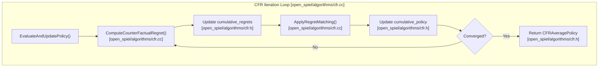
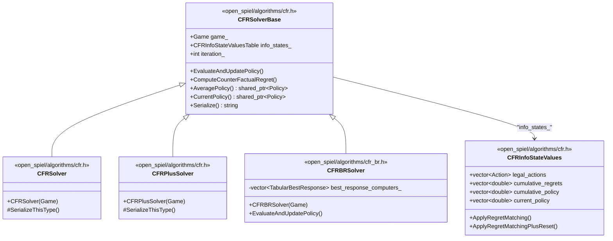
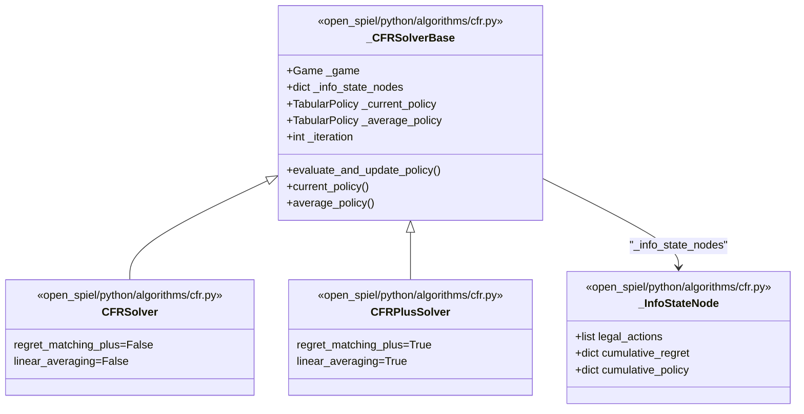
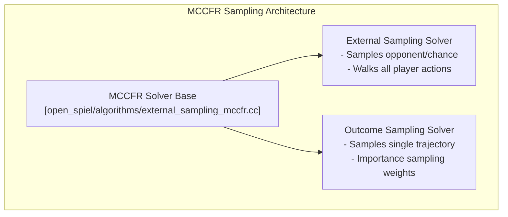

<!-- source: DeepWiki mcp.deepwiki.com · repo google-deepmind/open_spiel · page 6.2 CFR Algorithms · fetched 2026-10-26 -->

# CFR Algorithms

<details>
<summary>Relevant source files</summary>

The following files were used as context for generating this wiki page:

- [open_spiel/algorithms/cfr.cc](open_spiel/algorithms/cfr.cc)
- [open_spiel/algorithms/cfr.h](open_spiel/algorithms/cfr.h)
- [open_spiel/algorithms/cfr_br.cc](open_spiel/algorithms/cfr_br.cc)
- [open_spiel/algorithms/cfr_br.h](open_spiel/algorithms/cfr_br.h)
- [open_spiel/algorithms/cfr_br_test.cc](open_spiel/algorithms/cfr_br_test.cc)
- [open_spiel/algorithms/cfr_test.cc](open_spiel/algorithms/cfr_test.cc)
- [open_spiel/algorithms/external_sampling_mccfr.cc](open_spiel/algorithms/external_sampling_mccfr.cc)
- [open_spiel/algorithms/external_sampling_mccfr.h](open_spiel/algorithms/external_sampling_mccfr.h)
- [open_spiel/algorithms/external_sampling_mccfr_test.cc](open_spiel/algorithms/external_sampling_mccfr_test.cc)
- [open_spiel/algorithms/outcome_sampling_mccfr.cc](open_spiel/algorithms/outcome_sampling_mccfr.cc)
- [open_spiel/algorithms/outcome_sampling_mccfr.h](open_spiel/algorithms/outcome_sampling_mccfr.h)
- [open_spiel/algorithms/outcome_sampling_mccfr_test.cc](open_spiel/algorithms/outcome_sampling_mccfr_test.cc)
- [open_spiel/examples/cfr_example.cc](open_spiel/examples/cfr_example.cc)
- [open_spiel/examples/cfr_multi_equilibria_example.cc](open_spiel/examples/cfr_multi_equilibria_example.cc)
- [open_spiel/policy.cc](open_spiel/policy.cc)
- [open_spiel/policy.h](open_spiel/policy.h)
- [open_spiel/python/algorithms/efr.py](open_spiel/python/algorithms/efr.py)
- [open_spiel/python/algorithms/efr_test.py](open_spiel/python/algorithms/efr_test.py)
- [open_spiel/python/algorithms/external_sampling_mccfr.py](open_spiel/python/algorithms/external_sampling_mccfr.py)
- [open_spiel/python/algorithms/external_sampling_mccfr_test.py](open_spiel/python/algorithms/external_sampling_mccfr_test.py)
- [open_spiel/python/algorithms/mccfr.py](open_spiel/python/algorithms/mccfr.py)
- [open_spiel/python/algorithms/outcome_sampling_mccfr.py](open_spiel/python/algorithms/outcome_sampling_mccfr.py)
- [open_spiel/python/algorithms/outcome_sampling_mccfr_test.py](open_spiel/python/algorithms/outcome_sampling_mccfr_test.py)
- [open_spiel/python/bots/policy.py](open_spiel/python/bots/policy.py)
- [open_spiel/python/examples/mccfr_example.py](open_spiel/python/examples/mccfr_example.py)
- [open_spiel/python/pybind11/policy.cc](open_spiel/python/pybind11/policy.cc)
- [open_spiel/python/pybind11/python_policy.cc](open_spiel/python/pybind11/python_policy.cc)
- [open_spiel/python/pybind11/python_policy.h](open_spiel/python/pybind11/python_policy.h)
- [open_spiel/python/tests/policy_test.py](open_spiel/python/tests/policy_test.py)
- [open_spiel/tests/spiel_test.cc](open_spiel/tests/spiel_test.cc)

</details>


This document details OpenSpiel's implementation of Counterfactual Regret Minimization (CFR) algorithms and their variants (CFR+, CFR-BR, Discounted CFR, and Monte Carlo CFR with external and outcome sampling) for computing approximate Nash equilibria in sequential imperfect-information games. OpenSpiel provides robust implementations in both C++ and Python.

Sources: [open_spiel/algorithms/cfr.h:1-383](), [open_spiel/algorithms/cfr.cc:1-781]().

## Overview of CFR

Counterfactual Regret Minimization (CFR) is an iterative self-play algorithm that minimizes counterfactual regret at each information state to converge to a Nash equilibrium policy in two-player zero-sum (and select multi-player/general-sum) games.

The core loop involves:
1. Traversing the game tree to compute counterfactual values for each legal action at each information state.
2. Updating cumulative regrets based on the difference between action values and state values.
3. Applying regret-matching to generate the current iteration's strategy.
4. Accumulating policies over iterations to form an average policy that converges to a Nash equilibrium.



Sources: [open_spiel/algorithms/cfr.h:42-147](), [open_spiel/algorithms/cfr.cc:263-408]().

---

## C++ CFR Class Hierarchy and Implementations

OpenSpiel's C++ CFR engine is rooted in the base class `CFRSolverBase` defined in `open_spiel/algorithms/cfr.h`. Subclasses implement specific algorithmic variants like `CFRSolver`, `CFRPlusSolver`, and `CFRBRSolver`.

### Class Diagram



Sources: [open_spiel/algorithms/cfr.h:42-383](), [open_spiel/algorithms/cfr_br.h:15-52]().

### Solver Variants in C++

1. **Standard CFR (`CFRSolver`)**: Uses standard regret matching, uniform or linear averaging, and alternating updates across players [open_spiel/algorithms/cfr.h:310-327]().
2. **CFR+ (`CFRPlusSolver`)**: Configured with `regret_matching_plus = true`, `linear_averaging = true`, and alternating updates [open_spiel/algorithms/cfr.h:336-356](). Negative regrets are reset to zero after each update via `ApplyRegretMatchingPlusReset()` [open_spiel/algorithms/cfr.cc:683-697]().
3. **CFR-BR (`CFRBRSolver`)**: Integrates `TabularBestResponse` computers for each player [open_spiel/algorithms/cfr_br.h:34-52](). At each iteration, players best-respond to the opponents' current policies, accelerating convergence in specific game classes [open_spiel/algorithms/cfr_br.cc:23-93]().

Sources: [open_spiel/algorithms/cfr.h:310-356](), [open_spiel/algorithms/cfr_br.cc:23-93]().

---

## Python CFR Implementations

Python counterparts are implemented in `open_spiel/python/algorithms/cfr.py` mirroring the C++ logic.

### Python Class Hierarchy



Sources: [open_spiel/python/algorithms/cfr.py:126-528]().

---

## Monte Carlo CFR (MCCFR)

For large games where full game tree traversal is intractable, OpenSpiel provides Monte Carlo Counterfactual Regret Minimization (MCCFR) in both C++ and Python. MCCFR samples subsets of the game tree per iteration.

### Sampling Strategies

1. **External Sampling (`ExternalSamplingMCCFRSolver`)**:
   - Opponent and chance nodes are sampled (one action is chosen according to the current policy or chance probabilities).
   - The update player traverses *all* legal actions at their own information states.
   - Implemented in C++ [open_spiel/algorithms/external_sampling_mccfr.cc:40-80]() and Python [open_spiel/python/algorithms/mccfr.py]().

2. **Outcome Sampling (`OutcomeSamplingSolver`)**:
   - Only a single trajectory (outcome) is sampled per episode across all players and chance events.
   - Uses importance sampling weights (tail reaches divided by sample reaches) to provide unbiased estimates of counterfactual values.
   - Implemented in Python (`open_spiel/python/algorithms/outcome_sampling_mccfr.py`) [open_spiel/python/algorithms/outcome_sampling_mccfr.py:22-47]() and C++ (`open_spiel/algorithms/outcome_sampling_mccfr.cc`).



Sources: [open_spiel/algorithms/external_sampling_mccfr.cc:40-80](), [open_spiel/python/algorithms/outcome_sampling_mccfr.py:22-47]().

---

## Discounted CFR and Advanced Options

OpenSpiel supports **Discounted CFR (DCFR)** through parameters in `CFRSolverBase` [open_spiel/algorithms/cfr.h:188-307](). DCFR discounts regrets and cumulative strategies across iterations using parameters $\alpha$, $\beta$, and $\gamma$:
- **Regret discounting**: $R^T = \frac{T^\alpha}{T^\alpha + 1} R^{T-1} + \Delta R^T$
- **Strategy discounting**: $\sigma^T = \frac{T^\beta}{(T^\beta + \gamma)} \sigma^{T-1} + \sigma_t$

Additional configuration options include:
- `linear_averaging`: Weights iteration $t$ strategy by $t$ [open_spiel/algorithms/cfr.cc:263-282]().
- `random_initial_regrets`: Initializes cumulative regrets with small random noise to break symmetry in self-play [open_spiel/algorithms/cfr.cc:31-32]().

Sources: [open_spiel/algorithms/cfr.h:188-307](), [open_spiel/algorithms/cfr.cc:31-32, 263-282]().

---

## Policy Extraction, Serialization, and Usage

### Policy Classes
Solvers expose policies via two primary classes inheriting from `Policy` (`open_spiel/policy.h`):
- `CFRAveragePolicy`: Extracts the time-averaged strategy, converging to Nash equilibrium [open_spiel/algorithms/cfr.h:123-147]().
- `CFRCurrentPolicy`: Extracts the strategy from the most recent iteration [open_spiel/algorithms/cfr.h:150-171]().

### Serialization
CFR solvers support full serialization of the game, solver type, iteration count, and `CFRInfoStateValuesTable` [open_spiel/algorithms/cfr.cc:34-120]().

### C++ Usage Example
```cpp
#include "open_spiel/algorithms/cfr.h"
#include "open_spiel/algorithms/tabular_exploitability.h"

std::shared_ptr<const Game> game = LoadGame("kuhn_poker");
algorithms::CFRSolver solver(*game);
for (int i = 0; i < 300; ++i) {
  solver.EvaluateAndUpdatePolicy();
}
std::shared_ptr<Policy> avg_policy = solver.AveragePolicy();
double expl = algorithms::Exploitability(*game, *avg_policy);
```

Sources: [open_spiel/algorithms/cfr.h:123-171](), [open_spiel/algorithms/cfr.cc:34-120](), [open_spiel/algorithms/cfr_test.cc:53-62]().

---

