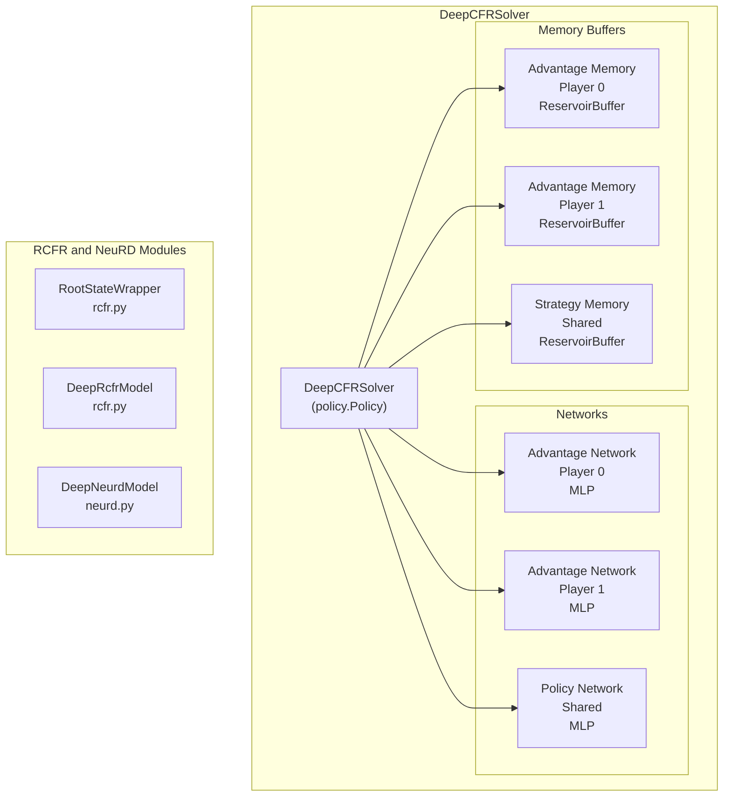

<!-- source: DeepWiki mcp.deepwiki.com · repo google-deepmind/open_spiel · page 6.3 Deep CFR with Neural Networks · fetched 2026-10-26 -->

# Deep CFR with Neural Networks

<details>
<summary>Relevant source files</summary>

The following files were used as context for generating this wiki page:

- [open_spiel/colabs/rcfr_pytorch_flax.ipynb](open_spiel/colabs/rcfr_pytorch_flax.ipynb)
- [open_spiel/python/coalitional_games/least_core_lagrangian_test.py](open_spiel/python/coalitional_games/least_core_lagrangian_test.py)
- [open_spiel/python/examples/deep_cfr_jax.py](open_spiel/python/examples/deep_cfr_jax.py)
- [open_spiel/python/examples/deep_cfr_pytorch.py](open_spiel/python/examples/deep_cfr_pytorch.py)
- [open_spiel/python/jax/deep_cfr.py](open_spiel/python/jax/deep_cfr.py)
- [open_spiel/python/jax/deep_cfr_jax_test.py](open_spiel/python/jax/deep_cfr_jax_test.py)
- [open_spiel/python/jax/rcfr.py](open_spiel/python/jax/rcfr.py)
- [open_spiel/python/jax/rcfr_jax_test.py](open_spiel/python/jax/rcfr_jax_test.py)
- [open_spiel/python/pytorch/__init__.py](open_spiel/python/pytorch/__init__.py)
- [open_spiel/python/pytorch/deep_cfr.py](open_spiel/python/pytorch/deep_cfr.py)
- [open_spiel/python/pytorch/deep_cfr_pytorch_test.py](open_spiel/python/pytorch/deep_cfr_pytorch_test.py)
- [open_spiel/python/pytorch/neurd.py](open_spiel/python/pytorch/neurd.py)
- [open_spiel/python/pytorch/neurd_pytorch_test.py](open_spiel/python/pytorch/neurd_pytorch_test.py)
- [open_spiel/python/pytorch/rcfr.py](open_spiel/python/pytorch/rcfr.py)
- [open_spiel/python/pytorch/rcfr_pytorch_test.py](open_spiel/python/pytorch/rcfr_pytorch_test.py)

</details>


## Purpose and Scope

This document describes the Deep Counterfactual Regret Minimization (Deep CFR) algorithm implementations in OpenSpiel, alongside related function-approximation regret minimization and policy gradient techniques such as Regression Counterfactual Regret Minimization (RCFR) and Neural Replicator Dynamics (NeuRD). These algorithms replace tabular data structures with neural networks to handle large games.

For information about tabular CFR algorithms, see [CFR Algorithms](#6.2). For policy abstractions and best response computations, see [Policy Abstraction](#6.1) and [Best Response and Exploitability](#6.4).

**Sources:** [open_spiel/python/jax/deep_cfr.py:15-30](), [open_spiel/python/pytorch/deep_cfr.py:15-24](), [open_spiel/python/pytorch/rcfr.py:15-38](), [open_spiel/python/pytorch/neurd.py:14-25]()

## Algorithm Overview

### Deep CFR
Deep CFR extends Counterfactual Regret Minimization by using neural networks to generalize across information sets [open_spiel/python/jax/deep_cfr.py:15-23](). The algorithm maintains:
- **Advantage Networks**: One per player, predicting counterfactual regrets for each action.
- **Policy Network**: A single shared network predicting the average strategy across players.
- **Reservoir Buffers**: Experience replay buffers storing training samples.

### RCFR (Regression Counterfactual Regret Minimization)
RCFR replaces the table of regrets with a profile of regression models mapping sequence features to regrets [open_spiel/python/pytorch/rcfr.py:15-24](). The average policy is still tracked exactly with a full game-size table, and average exploitability decreases as model accuracy improves.

### NeuRD (Neural Replicator Dynamics)
NeuRD incorporates deep function approximation into policy gradient-like extensions of replicator dynamics and the hedge algorithm [open_spiel/python/pytorch/neurd.py:14-24]().

**Sources:** [open_spiel/python/jax/deep_cfr.py:15-30](), [open_spiel/python/pytorch/deep_cfr.py:15-24](), [open_spiel/python/pytorch/rcfr.py:15-38](), [open_spiel/python/pytorch/neurd.py:14-25]()

## Implementation Architecture

OpenSpiel provides independent implementations of Deep CFR in JAX and PyTorch, plus RCFR and NeuRD support:

| Algorithm / Framework | Path | Key Components |
|----------------------|------|----------------|
| Deep CFR (JAX) | `open_spiel/python/jax/deep_cfr.py` | `DeepCFRSolver`, `MLP`, `ReservoirBuffer` |
| Deep CFR (PyTorch) | `open_spiel/python/pytorch/deep_cfr.py` | `DeepCFRSolver`, `MLP`, `ReservoirBuffer` |
| RCFR (PyTorch/JAX) | `open_spiel/python/pytorch/rcfr.py` | `RootStateWrapper`, `DeepRcfrModel`, `ReservoirBuffer` |
| NeuRD (PyTorch) | `open_spiel/python/pytorch/neurd.py` | `DeepNeurdModel`, `CounterfactualNeurdSolver`, `train` |

**Sources:** [open_spiel/python/jax/deep_cfr.py:1-50](), [open_spiel/python/pytorch/deep_cfr.py:1-50](), [open_spiel/python/pytorch/rcfr.py:40-120](), [open_spiel/python/pytorch/neurd.py:50-118]()

### High-Level Component Architecture



**Sources:** [open_spiel/python/jax/deep_cfr.py:224-358](), [open_spiel/python/pytorch/deep_cfr.py:209-324](), [open_spiel/python/pytorch/rcfr.py:94-165](), [open_spiel/python/pytorch/neurd.py:50-118]()

## Core Components

### MLP Architectures

Both Deep CFR implementations use Multi-Layer Perceptrons (MLPs) with hidden layers, ReLU activations, and layer normalization prior to the output layer [open_spiel/python/jax/deep_cfr.py:174-214](), [open_spiel/python/pytorch/deep_cfr.py:66-108]().

- **JAX MLP (`open_spiel/python/jax/deep_cfr.py`)**: Built using `flax.nnx` with Glorot uniform initialization and `nn.LayerNorm` [open_spiel/python/jax/deep_cfr.py:174-214]().
- **PyTorch MLP (`open_spiel/python/pytorch/deep_cfr.py`)**: Built using `torch.nn.Sequential` with a `reset()` method supporting weight reinitialization [open_spiel/python/pytorch/deep_cfr.py:66-119]().
- **RCFR & NeuRD Models (`open_spiel/python/pytorch/rcfr.py` & `neurd.py`)**: Provide support for residual blocks, factorized linear layers, and autoencoding variants [open_spiel/python/pytorch/neurd.py:50-118]().

**Sources:** [open_spiel/python/jax/deep_cfr.py:174-214](), [open_spiel/python/pytorch/deep_cfr.py:66-119](), [open_spiel/python/pytorch/neurd.py:50-118]()

### ReservoirBuffer

The reservoir sampling buffer enables uniform sampling over streaming data to prevent overfitting [open_spiel/python/jax/deep_cfr.py:84-172](), [open_spiel/python/pytorch/deep_cfr.py:121-207]().

- **JAX `ReservoirBuffer`**: Functional implementation returning immutable `ReservoirBufferState` via `jax.jit` compiled static methods (`init`, `append`, `sample`) [open_spiel/python/jax/deep_cfr.py:84-172]().
- **PyTorch `ReservoirBuffer`**: Object-oriented implementation with in-place `append`, `sample`, `shuffle`, and `clear` methods [open_spiel/python/pytorch/deep_cfr.py:121-214]().

**Sources:** [open_spiel/python/jax/deep_cfr.py:84-172](), [open_spiel/python/pytorch/deep_cfr.py:121-207]()

### RCFR Root State Wrapper

`RootStateWrapper` in `open_spiel/python/pytorch/rcfr.py` analyzes subgames at a root state, enumerates player sequence features, maps information states to sequence indices, and caches terminal values [open_spiel/python/pytorch/rcfr.py:94-165]().

**Sources:** [open_spiel/python/pytorch/rcfr.py:94-165]()

## Training Processes

### Deep CFR Training Loop
The Deep CFR training loop alternates between:
1. **Tree Traversal**: External sampling tree traversal (`_traverse_game_tree`) collecting `AdvantageMemory` and `StrategyMemory` samples [open_spiel/python/jax/deep_cfr.py:538-600](), [open_spiel/python/pytorch/deep_cfr.py:406-474]().
2. **Advantage Training**: Training advantage networks on collected samples, optionally reinitializing network weights each iteration [open_spiel/python/jax/deep_cfr.py:363-391](), [open_spiel/python/pytorch/deep_cfr.py:533-573]().
3. **Policy Training**: Training the average policy network on collected strategy memory at the final step [open_spiel/python/jax/deep_cfr.py:395-430](), [open_spiel/python/pytorch/deep_cfr.py:575-611]().

**Sources:** [open_spiel/python/jax/deep_cfr.py:506-600](), [open_spiel/python/pytorch/deep_cfr.py:349-474]()

### NeuRD Training
`neurd.train()` trains neural replicator dynamics models using cross-entropy loss over thresholded counterfactual regrets with optional autoencoder regularization [open_spiel/python/pytorch/neurd.py:139-166]().

**Sources:** [open_spiel/python/pytorch/neurd.py:139-166]()

## Usage Examples

### Deep CFR with PyTorch Example

```python
import pyspiel
from open_spiel.python.pytorch import deep_cfr
from open_spiel.python import policy

game = pyspiel.load_game("kuhn_poker")
solver = deep_cfr.DeepCFRSolver(
    game,
    policy_network_layers=(64,),
    advantage_network_layers=(64,),
    num_iterations=10,
    num_traversals=100,
    learning_rate=1e-3,
)
solver.solve()
```

**Sources:** [open_spiel/python/examples/deep_cfr_pytorch.py:52-72]()

### Deep CFR with JAX Example

```python
import pyspiel
from open_spiel.python.jax import deep_cfr

game = pyspiel.load_game("kuhn_poker")
solver = deep_cfr.DeepCFRSolver(
    game,
    policy_network_layers=(64,),
    advantage_network_layers=(64,),
    num_iterations=10,
    num_traversals=100,
    learning_rate=1e-3,
)
solver.solve()
```

**Sources:** [open_spiel/python/examples/deep_cfr_jax.py:52-72]()

## Testing

Comprehensive test suites validate Deep CFR, RCFR, and NeuRD implementations:
- **JAX Deep CFR Tests**: `open_spiel/python/jax/deep_cfr_jax_test.py` [open_spiel/python/jax/deep_cfr_jax_test.py:24-68]()
- **PyTorch Deep CFR Tests**: `open_spiel/python/pytorch/deep_cfr_pytorch_test.py` [open_spiel/python/pytorch/deep_cfr_pytorch_test.py:28-68]()
- **RCFR & NeuRD Tests**: `open_spiel/python/pytorch/rcfr_pytorch_test.py`, `neurd_pytorch_test.py` [open_spiel/python/pytorch/rcfr_pytorch_test.py:45-94](), [open_spiel/python/pytorch/neurd_pytorch_test.py:36-64]()

**Sources:** [open_spiel/python/jax/deep_cfr_jax_test.py:24-68](), [open_spiel/python/pytorch/deep_cfr_pytorch_test.py:28-68](), [open_spiel/python/pytorch/rcfr_pytorch_test.py:45-94](), [open_spiel/python/pytorch/neurd_pytorch_test.py:36-64]()

---

