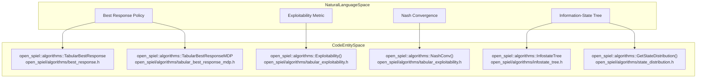
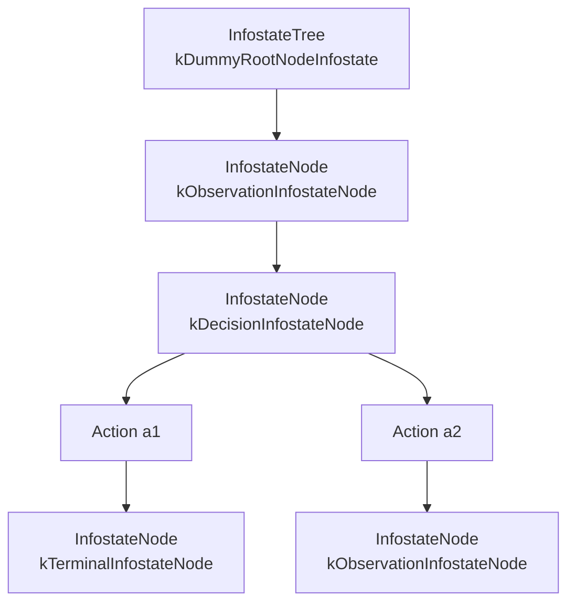

<!-- source: DeepWiki mcp.deepwiki.com · repo google-deepmind/open_spiel · page 6.4 Best Response and Exploitability · fetched 2026-10-26 -->

# Best Response and Exploitability

<details>
<summary>Relevant source files</summary>

The following files were used as context for generating this wiki page:

- [.clang-format](.clang-format)
- [.cmake-format.yaml](.cmake-format.yaml)
- [.pre-commit-config.yaml](.pre-commit-config.yaml)
- [open_spiel/algorithms/best_response.cc](open_spiel/algorithms/best_response.cc)
- [open_spiel/algorithms/best_response.h](open_spiel/algorithms/best_response.h)
- [open_spiel/algorithms/best_response_test.cc](open_spiel/algorithms/best_response_test.cc)
- [open_spiel/algorithms/expected_returns.cc](open_spiel/algorithms/expected_returns.cc)
- [open_spiel/algorithms/expected_returns.h](open_spiel/algorithms/expected_returns.h)
- [open_spiel/algorithms/history_tree.cc](open_spiel/algorithms/history_tree.cc)
- [open_spiel/algorithms/history_tree.h](open_spiel/algorithms/history_tree.h)
- [open_spiel/algorithms/history_tree_test.cc](open_spiel/algorithms/history_tree_test.cc)
- [open_spiel/algorithms/infostate_tree.cc](open_spiel/algorithms/infostate_tree.cc)
- [open_spiel/algorithms/infostate_tree.h](open_spiel/algorithms/infostate_tree.h)
- [open_spiel/algorithms/infostate_tree_test.cc](open_spiel/algorithms/infostate_tree_test.cc)
- [open_spiel/algorithms/observation_history.cc](open_spiel/algorithms/observation_history.cc)
- [open_spiel/algorithms/observation_history.h](open_spiel/algorithms/observation_history.h)
- [open_spiel/algorithms/observation_history_test.cc](open_spiel/algorithms/observation_history_test.cc)
- [open_spiel/algorithms/oos.cc](open_spiel/algorithms/oos.cc)
- [open_spiel/algorithms/oos.h](open_spiel/algorithms/oos.h)
- [open_spiel/algorithms/oos_test.cc](open_spiel/algorithms/oos_test.cc)
- [open_spiel/algorithms/state_distribution.cc](open_spiel/algorithms/state_distribution.cc)
- [open_spiel/algorithms/state_distribution.h](open_spiel/algorithms/state_distribution.h)
- [open_spiel/algorithms/state_distribution_test.cc](open_spiel/algorithms/state_distribution_test.cc)
- [open_spiel/algorithms/tabular_best_response_mdp.cc](open_spiel/algorithms/tabular_best_response_mdp.cc)
- [open_spiel/algorithms/tabular_best_response_mdp.h](open_spiel/algorithms/tabular_best_response_mdp.h)
- [open_spiel/algorithms/tabular_best_response_mdp_test.cc](open_spiel/algorithms/tabular_best_response_mdp_test.cc)
- [open_spiel/algorithms/tabular_exploitability.cc](open_spiel/algorithms/tabular_exploitability.cc)
- [open_spiel/algorithms/tabular_exploitability.h](open_spiel/algorithms/tabular_exploitability.h)
- [open_spiel/algorithms/tabular_exploitability_test.cc](open_spiel/algorithms/tabular_exploitability_test.cc)
- [open_spiel/examples/count_all_states.cc](open_spiel/examples/count_all_states.cc)
- [open_spiel/games/pathfinding/pathfinding.cc](open_spiel/games/pathfinding/pathfinding.cc)
- [open_spiel/python/algorithms/action_value.py](open_spiel/python/algorithms/action_value.py)
- [open_spiel/python/algorithms/action_value_test.py](open_spiel/python/algorithms/action_value_test.py)
- [open_spiel/python/algorithms/action_value_vs_best_response.py](open_spiel/python/algorithms/action_value_vs_best_response.py)
- [open_spiel/python/algorithms/action_value_vs_best_response_test.py](open_spiel/python/algorithms/action_value_vs_best_response_test.py)
- [open_spiel/python/algorithms/best_response.py](open_spiel/python/algorithms/best_response.py)
- [open_spiel/python/algorithms/best_response_test.py](open_spiel/python/algorithms/best_response_test.py)
- [open_spiel/python/algorithms/cfr_br.py](open_spiel/python/algorithms/cfr_br.py)
- [open_spiel/python/algorithms/cfr_br_test.py](open_spiel/python/algorithms/cfr_br_test.py)
- [open_spiel/python/algorithms/discounted_cfr_test.py](open_spiel/python/algorithms/discounted_cfr_test.py)
- [open_spiel/python/algorithms/exploitability.py](open_spiel/python/algorithms/exploitability.py)
- [open_spiel/python/algorithms/exploitability_test.py](open_spiel/python/algorithms/exploitability_test.py)
- [open_spiel/python/algorithms/get_all_states.py](open_spiel/python/algorithms/get_all_states.py)
- [open_spiel/python/algorithms/get_all_states_test.py](open_spiel/python/algorithms/get_all_states_test.py)
- [open_spiel/python/algorithms/infostate_tree_test.py](open_spiel/python/algorithms/infostate_tree_test.py)
- [open_spiel/python/algorithms/noisy_policy.py](open_spiel/python/algorithms/noisy_policy.py)
- [open_spiel/python/algorithms/noisy_policy_test.py](open_spiel/python/algorithms/noisy_policy_test.py)
- [open_spiel/python/algorithms/policy_aggregator.py](open_spiel/python/algorithms/policy_aggregator.py)
- [open_spiel/python/algorithms/policy_aggregator_joint.py](open_spiel/python/algorithms/policy_aggregator_joint.py)
- [open_spiel/python/algorithms/policy_aggregator_joint_test.py](open_spiel/python/algorithms/policy_aggregator_joint_test.py)
- [open_spiel/python/algorithms/policy_aggregator_test.py](open_spiel/python/algorithms/policy_aggregator_test.py)
- [open_spiel/python/algorithms/policy_utils.py](open_spiel/python/algorithms/policy_utils.py)
- [open_spiel/python/examples/policy_aggregator_example.py](open_spiel/python/examples/policy_aggregator_example.py)
- [open_spiel/python/games/data.py](open_spiel/python/games/data.py)
- [open_spiel/python/mfg/algorithms/distribution_test.py](open_spiel/python/mfg/algorithms/distribution_test.py)
- [open_spiel/python/pybind11/algorithms_infostate_tree.cc](open_spiel/python/pybind11/algorithms_infostate_tree.cc)
- [open_spiel/python/pybind11/algorithms_infostate_tree.h](open_spiel/python/pybind11/algorithms_infostate_tree.h)
- [open_spiel/spiel_utils.cc](open_spiel/spiel_utils.cc)
- [open_spiel/spiel_utils.h](open_spiel/spiel_utils.h)

</details>


## Purpose and Scope

This document details the implementation and mathematical foundations of **best response** computation, **exploitability**, **NashConv**, **information-state trees**, **state distributions**, and **correlation device concepts** (such as Correlated Equilibrium and Coarse Correlated Equilibrium distances) within OpenSpiel. These tools are critical for evaluating policy convergence, analyzing multi-agent strategies, and assessing distances from game-theoretic solution concepts.

Sources: [open_spiel/algorithms/best_response.h](), [open_spiel/algorithms/tabular_exploitability.h](), [open_spiel/algorithms/infostate_tree.h](), [open_spiel/algorithms/state_distribution.h]()

---

## Core Concepts

### Best Response

A **best response** for player $i$ against a fixed joint opponent policy $\pi_{-i}$ is a policy $\pi_i^*$ that maximizes player $i$'s expected utility:

$$\pi_i^* = \arg\max_{\pi_i} U_i(\pi_i, \pi_{-i})$$

In imperfect-information games, OpenSpiel computes best responses by traversing the game tree, aggregating action values across information states, and selecting the actions yielding maximal returns.

### Exploitability and NashConv

*   **Exploitability**: Defined for two-player zero-sum (or constant-sum) games, measuring the sum of the value gains that each player can achieve by unilaterally deviating to a best response:
    $$\text{Exploitability}(\pi) = \sum_{i=1}^{n} \left( V_i^{\text{BR}}(\pi_{-i}) - V_i^{\pi}(\pi) \right)$$
*   **NashConv**: A generalization of exploitability to n-player general-sum games, computing the sum of deviation incentives without requiring zero-sum conditions.

Sources: [open_spiel/python/pybind11/policy.cc:391-443](), [open_spiel/algorithms/cfr_test.cc:49-51]()

---

## Architecture and Code Entity Mapping

The following diagram bridges natural language game-theoretic concepts to the concrete C++ and Python classes and functions in the OpenSpiel repository.



Sources: [open_spiel/algorithms/best_response.h](), [open_spiel/algorithms/tabular_best_response_mdp.h](), [open_spiel/algorithms/infostate_tree.h](), [open_spiel/algorithms/state_distribution.h]()

---

## Information-State Trees and State Distributions

### Infostate Trees

Imperfect-information algorithms often require structured representations of games from an acting player's perspective. `InfostateTree` organizes histories into a tree structure composed of `InfostateNode` instances (`[open_spiel/algorithms/infostate_tree.h:27-62]()`, `[open_spiel/algorithms/infostate_tree.cc:42-68]()`).

Nodes are categorized via `InfostateNodeType` (`[open_spiel/algorithms/infostate_tree.h:84-88]()`):
*   `kDecisionInfostateNode`: Nodes where the acting player selects actions.
*   `kObservationInfostateNode`: Nodes where observations are received (chance outcomes, opponent actions, or private state updates).
*   `kTerminalInfostateNode`: Leaf nodes storing terminal utilities and cumulative chance reach probabilities.



Sources: [open_spiel/algorithms/infostate_tree.h:27-88](), [open_spiel/algorithms/infostate_tree.cc:42-68]()

### State Distributions and Beliefs

Computing best responses and counterfactual values requires evaluating beliefs over histories consistent with a given information state. `GetStateDistribution` and `UpdateIncrementalStateDistribution` perform this task (`[open_spiel/algorithms/state_distribution.h:26-63]()`).


Sources: [open_spiel/algorithms/state_distribution.h:26-63](), [open_spiel/algorithms/state_distribution.cc:142-172]()

---

## C++ Implementation

### TabularBestResponse Class

`TabularBestResponse` computes the best response for a designated player against an arbitrary opponent policy (`[open_spiel/python/pybind11/policy.cc:138-161]()`).

**Key Methods:**
*   `Value(const State& state)`: Returns the value of the best response from a given state.
*   `GetBestResponsePolicy()`: Returns the computed best response wrapped in a `TabularPolicy`.
*   `GetBestResponseActions()`: Maps information state strings to optimal actions.

Sources: [open_spiel/python/pybind11/policy.cc:138-161]()

### TabularBestResponseMDP and Metrics

`TabularBestResponseMDP` evaluates all players simultaneously, outputting a `TabularBestResponseMDPInfo` structure containing individual best response values, deviation incentives, `nash_conv`, and `exploitability` (`[open_spiel/python/pybind11/policy.cc:336-354]()`).

```cpp
struct TabularBestResponseMDPInfo {
  std::vector<double> br_values;
  std::vector<TabularPolicy> br_policies;
  std::vector<double> on_policy_values;
  std::vector<double> deviation_incentives;
  double nash_conv;
  double exploitability;
};
```

Sources: [open_spiel/python/pybind11/policy.cc:336-354]()

---

## Python Interface and Wrappers

Python bindings expose `TabularBestResponse`, `TabularBestResponseMDP`, `exploitability`, and `nash_conv` via `pyspiel` and helper modules in `open_spiel.python.algorithms` (`[open_spiel/python/algorithms/best_response.py]`, `[open_spiel/python/algorithms/exploitability.py]()`).

```python
import pyspiel

game = pyspiel.load_game("kuhn_poker")
policy = pyspiel.TabularPolicy(game)

# Compute exploitability and NashConv in Python
exploit = pyspiel.exploitability(game, policy)
nashconv = pyspiel.nash_conv(game, policy)
```

Sources: [open_spiel/python/pybind11/policy.cc:391-443](), [open_spiel/python/algorithms/best_response.py]()

---

## Correlation Devices and Equilibrium Distances

Beyond standard Nash equilibrium metrics, OpenSpiel implements distance measures to various correlation devices in `open_spiel/algorithms/corr_dist.h`:
*   **CCE (Coarse Correlated Equilibrium)**
*   **CE (Correlated Equilibrium)**
*   **EFCE (Extensive-Form Correlated Equilibrium)**
*   **EFCCE (Extensive-Form Coarse Correlated Equilibrium)**

These solvers use linear programming or best-response verification over augmented game structures to calculate the minimum deviation incentive.

Sources: [open_spiel/algorithms/corr_dist.h:1-120]()

---

## Testing and Validation

Both C++ and Python testing suites validate best response and exploitability calculations against known game values (such as Kuhn and Leduc poker):

*   C++ tests: `[open_spiel/algorithms/state_distribution_test.cc]()`, `[open_spiel/algorithms/cfr_test.cc:49-62]()`
*   Python tests: `[open_spiel/python/algorithms/best_response_test.py:30-119]()`, `[open_spiel/python/algorithms/exploitability_test.py]()`

Sources: [open_spiel/algorithms/state_distribution_test.cc](), [open_spiel/python/algorithms/best_response_test.py:30-119]()

---

