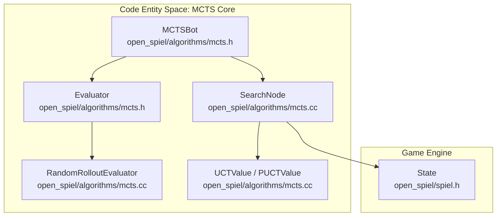
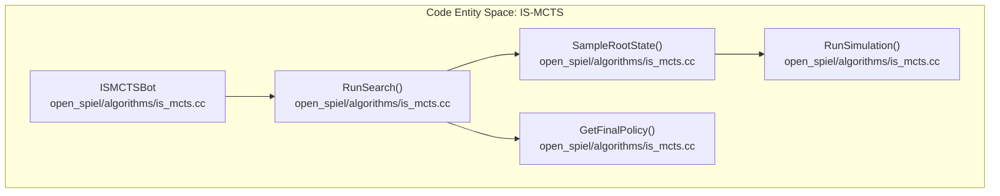
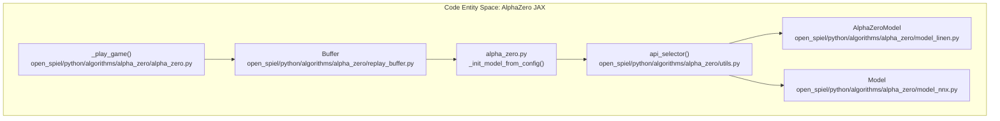

<!-- source: DeepWiki mcp.deepwiki.com · repo google-deepmind/open_spiel · page 6.5 Search Algorithms: MCTS and AlphaZero · fetched 2026-10-26 -->

# Search Algorithms: MCTS and AlphaZero

Relevant source files

The following files were used as context for generating this wiki page:

- [open_spiel/algorithms/alpha_zero_torch/alpha_zero.cc](open_spiel/algorithms/alpha_zero_torch/alpha_zero.cc)
- [open_spiel/algorithms/alpha_zero_torch/model.cc](open_spiel/algorithms/alpha_zero_torch/model.cc)
- [open_spiel/algorithms/alpha_zero_torch/model.h](open_spiel/algorithms/alpha_zero_torch/model.h)
- [open_spiel/algorithms/alpha_zero_torch/model_test.cc](open_spiel/algorithms/alpha_zero_torch/model_test.cc)
- [open_spiel/algorithms/alpha_zero_torch/vpevaluator.cc](open_spiel/algorithms/alpha_zero_torch/vpevaluator.cc)
- [open_spiel/algorithms/alpha_zero_torch/vpnet.cc](open_spiel/algorithms/alpha_zero_torch/vpnet.cc)
- [open_spiel/algorithms/alpha_zero_torch/vpnet.h](open_spiel/algorithms/alpha_zero_torch/vpnet.h)
- [open_spiel/algorithms/alpha_zero_torch/vpnet_test.cc](open_spiel/algorithms/alpha_zero_torch/vpnet_test.cc)
- [open_spiel/algorithms/evaluate_bots.cc](open_spiel/algorithms/evaluate_bots.cc)
- [open_spiel/algorithms/evaluate_bots.h](open_spiel/algorithms/evaluate_bots.h)
- [open_spiel/algorithms/is_mcts.cc](open_spiel/algorithms/is_mcts.cc)
- [open_spiel/algorithms/is_mcts.h](open_spiel/algorithms/is_mcts.h)
- [open_spiel/algorithms/is_mcts_test.cc](open_spiel/algorithms/is_mcts_test.cc)
- [open_spiel/algorithms/mcts.cc](open_spiel/algorithms/mcts.cc)
- [open_spiel/algorithms/mcts.h](open_spiel/algorithms/mcts.h)
- [open_spiel/algorithms/mcts_test.cc](open_spiel/algorithms/mcts_test.cc)
- [open_spiel/examples/alpha_zero_torch_example.cc](open_spiel/examples/alpha_zero_torch_example.cc)
- [open_spiel/examples/alpha_zero_torch_game_example.cc](open_spiel/examples/alpha_zero_torch_game_example.cc)
- [open_spiel/examples/mcts_example.cc](open_spiel/examples/mcts_example.cc)
- [open_spiel/games/phantom_go/phantom_go_board.cc](open_spiel/games/phantom_go/phantom_go_board.cc)
- [open_spiel/games/phantom_go/phantom_go_board.h](open_spiel/games/phantom_go/phantom_go_board.h)
- [open_spiel/integration_tests/playthroughs/phantom_go.txt](open_spiel/integration_tests/playthroughs/phantom_go.txt)
- [open_spiel/python/algorithms/alpha_zero/README.md](open_spiel/python/algorithms/alpha_zero/README.md)
- [open_spiel/python/algorithms/alpha_zero/alpha_zero.py](open_spiel/python/algorithms/alpha_zero/alpha_zero.py)
- [open_spiel/python/algorithms/alpha_zero/evaluator.py](open_spiel/python/algorithms/alpha_zero/evaluator.py)
- [open_spiel/python/algorithms/alpha_zero/evaluator_test.py](open_spiel/python/algorithms/alpha_zero/evaluator_test.py)
- [open_spiel/python/algorithms/alpha_zero/export_model.py](open_spiel/python/algorithms/alpha_zero/export_model.py)
- [open_spiel/python/algorithms/alpha_zero/model_linen.py](open_spiel/python/algorithms/alpha_zero/model_linen.py)
- [open_spiel/python/algorithms/alpha_zero/model_nnx.py](open_spiel/python/algorithms/alpha_zero/model_nnx.py)
- [open_spiel/python/algorithms/alpha_zero/model_test.py](open_spiel/python/algorithms/alpha_zero/model_test.py)
- [open_spiel/python/algorithms/alpha_zero/replay_buffer.py](open_spiel/python/algorithms/alpha_zero/replay_buffer.py)
- [open_spiel/python/algorithms/alpha_zero/utils.py](open_spiel/python/algorithms/alpha_zero/utils.py)
- [open_spiel/python/algorithms/ismcts.py](open_spiel/python/algorithms/ismcts.py)
- [open_spiel/python/algorithms/ismcts_agent_test.py](open_spiel/python/algorithms/ismcts_agent_test.py)
- [open_spiel/python/algorithms/ismcts_test.py](open_spiel/python/algorithms/ismcts_test.py)
- [open_spiel/python/algorithms/mcts.py](open_spiel/python/algorithms/mcts.py)
- [open_spiel/python/algorithms/mcts_test.py](open_spiel/python/algorithms/mcts_test.py)
- [open_spiel/python/bots/human.py](open_spiel/python/bots/human.py)
- [open_spiel/python/bots/is_mcts_test.py](open_spiel/python/bots/is_mcts_test.py)
- [open_spiel/python/examples/alpha_zero.py](open_spiel/python/examples/alpha_zero.py)
- [open_spiel/python/examples/mcts.py](open_spiel/python/examples/mcts.py)

This page documents the search algorithms implemented in OpenSpiel, specifically focusing on Monte Carlo Tree Search (MCTS), Information Set MCTS (IS-MCTS) in both C++ and Python, and the AlphaZero training framework implemented in JAX (supporting both Flaz Linen and NNX APIs) and LibTorch.

## Monte Carlo Tree Search (MCTS) in C++ and Python

OpenSpiel provides both C++ and Python implementations of vanilla MCTS and PUCT-guided MCTS with support for MCTS-Solver. The core abstractions include an evaluation interface, rollouts, search nodes, and bot wrappers.

### Core Classes and Data Flow

The MCTS framework revolves around several core components defined in `open_spiel/algorithms/mcts.h` [open_spiel/algorithms/mcts.h:1-164]() and `open_spiel/python/algorithms/mcts.py` [open_spiel/python/algorithms/mcts.py:1-187]():

*   `Evaluator`: An abstract interface [open_spiel/algorithms/mcts.h:83-92]() defining `Evaluate(const State& state)` (returning player values) and `Prior(const State& state)` (returning action probabilities).
*   `RandomRolloutEvaluator`: A concrete `Evaluator` subclass that performs random playouts until terminal states to estimate leaf values [open_spiel/algorithms/mcts.h:97-111]().
*   `SearchNode`: Represents a node in the search tree, storing the `explore_count`, `total_reward`, `outcome`, child nodes, and priority values [open_spiel/algorithms/mcts.h:114-146]().
*   `MCTSBot`: A `Bot` implementation that executes MCTS search upon receiving a state observation [open_spiel/algorithms/mcts.h:149-164]().

Sources: [open_spiel/algorithms/mcts.h:74-164](), [open_spiel/algorithms/mcts.cc:37-112]()

### Selection Formulas: UCT and PUCT

`SearchNode` implements both the Upper Confidence Bound applied to Trees (UCT) and Polynomial Upper Confidence Trees (PUCT) formulas:

*   **UCT Value**: `total_reward / explore_count + uct_c * std::sqrt(std::log(parent_explore_count) / explore_count)` [open_spiel/algorithms/mcts.cc:90-101]()
*   **PUCT Value**: `(total_reward / explore_count) + uct_c * prior * std::sqrt(parent_explore_count) / (explore_count + 1)` [open_spiel/algorithms/mcts.cc:103-112]()

Unseen actions (`explore_count == 0`) return infinity in UCT, ensuring exploration priority [open_spiel/algorithms/mcts.cc:95-95](). MCTS-Solver logic backs up proven terminal states (wins, losses, draws) across max^n tree backups [open_spiel/algorithms/mcts.h:53-60]().

Sources: [open_spiel/algorithms/mcts.cc:90-112](), [open_spiel/algorithms/mcts.h:29-60]()

## Information Set MCTS (IS-MCTS)

For imperfect-information games (e.g., Kuhn Poker, Leduc Poker), OpenSpiel implements Information Set MCTS (`ISMCTS`) in C++ (`open_spiel/algorithms/is_mcts.cc`) [open_spiel/algorithms/is_mcts.cc:1-390]() and Python (`open_spiel/python/algorithms/ismcts.py`).

### Key Abstractions in IS-MCTS

*   `ISMCTSBot`: Coordinates search by sampling consistent world states from the current player's information set and building a search tree keyed on information states or observation strings [open_spiel/algorithms/is_mcts.cc:35-50]().
*   `GetStateKey`: Generates lookup keys using either `state.InformationStateString()` or `state.ObservationString()` depending on configuration [open_spiel/algorithms/is_mcts.cc:59-65]().
*   `ISMCTSFinalPolicyType`: Determines how the final policy is extracted from visit counts or values (`kNormalizedVisitCount`, `kMaxVisitCount`, `kMaxValue`) [open_spiel/algorithms/is_mcts.cc:124-176]().

Sources: [open_spiel/algorithms/is_mcts.cc:35-106]()

## AlphaZero Architecture in JAX

OpenSpiel provides a comprehensive JAX-based AlphaZero implementation (`open_spiel/python/algorithms/alpha_zero/`) supporting multi-process actors, asynchronous learners, replay buffers, and neural network model architectures.

### System Architecture and Data Flow

The training pipeline spawns multiple actors running MCTS with neural network evaluation, feeding trajectories into a centralized replay buffer consumed by a JAX learner [open_spiel/python/algorithms/alpha_zero/alpha_zero.py:15-32]().

Sources: [open_spiel/python/algorithms/alpha_zero/alpha_zero.py:15-155](), [open_spiel/python/algorithms/alpha_zero/replay_buffer.py:122-172]()

### Neural Network Backends (`model_linen` and `model_nnx`)

AlphaZero supports two primary Flax API backends selected via `Config.nn_api_version` (`"linen"` or `"nnx"`) [open_spiel/python/algorithms/alpha_zero/alpha_zero.py:140-140]():

*   **Linen API (`model_linen.py`)**: Uses functional Flax modules (`nn.Module`) with explicit state and parameter passing for training steps (`AlphaZeroModel`) [open_spiel/python/algorithms/alpha_zero/model_linen.py:159-208]().
*   **NNX API (`model_nnx.py`)**: Uses object-oriented stateful Flax NNX modules with integrated optimizers (`optax`) and batch normalization stats (`ConvBlock`, `ResidualBlock`, `PolicyHead`, `ValueHead`) [open_spiel/python/algorithms/alpha_zero/model_nnx.py:114-227]().

Sources: [open_spiel/python/algorithms/alpha_zero/model_linen.py:159-208](), [open_spiel/python/algorithms/alpha_zero/model_nnx.py:114-176]()

### Replay Buffer (`replay_buffer.py`)

The buffer implementation (`Buffer`) provides fixed-size storage with uniform sampling and JAX JIT-compiled operations (`init`, `append`, `sample`) [open_spiel/python/algorithms/alpha_zero/replay_buffer.py:122-172]().

Sources: [open_spiel/python/algorithms/alpha_zero/replay_buffer.py:30-172]()

## AlphaZero in C++ and LibTorch

In addition to the JAX implementation, OpenSpiel includes a C++ native AlphaZero implementation backed by LibTorch (`open_spiel/algorithms/alpha_zero_torch/`) [open_spiel/algorithms/alpha_zero_torch/alpha_zero.cc]().

### C++ Torch Components

*   `VPNet`: The Value-Policy Neural Network module defined in `vpnet.h` and `vpnet.cc`, handling forward passes and weight serialization.
*   `VPEvaluator`: Wraps `VPNet` as an MCTS evaluator (`Evaluator` interface counterpart in C++).
*   `Model`: Manages optimizer updates and training batches using LibTorch tensors.

Sources: [open_spiel/algorithms/alpha_zero_torch/vpnet.h](), [open_spiel/algorithms/alpha_zero_torch/model.h]()

---

