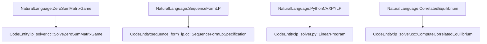
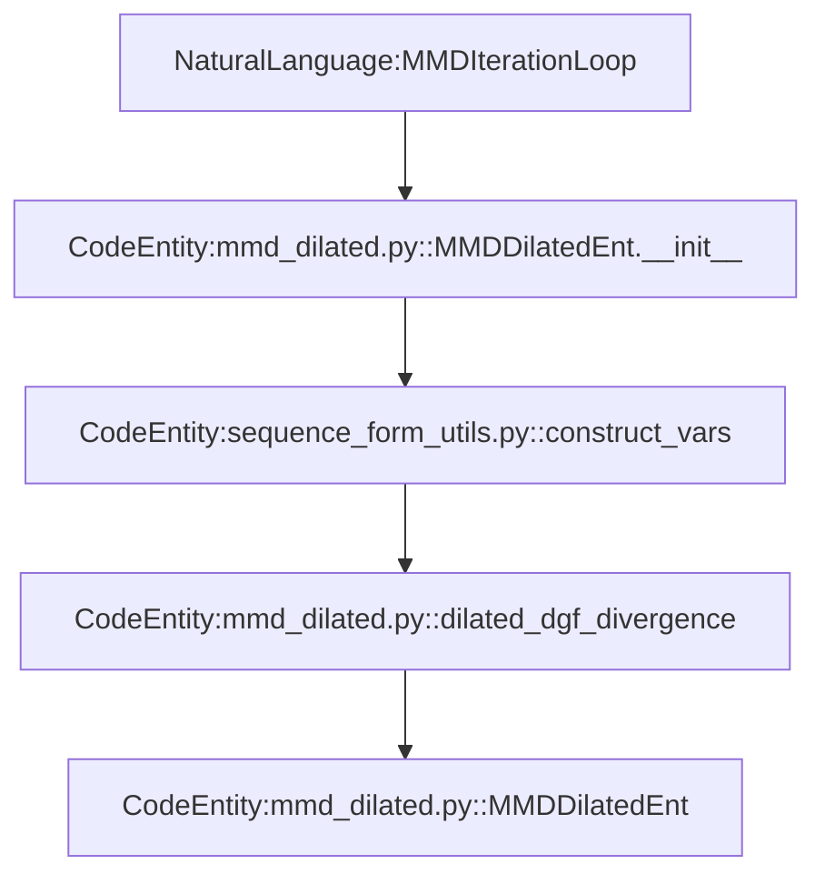

<!-- source: DeepWiki mcp.deepwiki.com · repo google-deepmind/open_spiel · page 6.6 Optimization and Equilibrium Solvers · fetched 2026-10-26 -->

# Optimization and Equilibrium Solvers

Relevant source files

The following files were used as context for generating this wiki page:

- [open_spiel/algorithms/ortools/CMakeLists.txt](open_spiel/algorithms/ortools/CMakeLists.txt)
- [open_spiel/algorithms/ortools/lp_solver.cc](open_spiel/algorithms/ortools/lp_solver.cc)
- [open_spiel/algorithms/ortools/lp_solver.h](open_spiel/algorithms/ortools/lp_solver.h)
- [open_spiel/algorithms/ortools/lp_solver_test.cc](open_spiel/algorithms/ortools/lp_solver_test.cc)
- [open_spiel/algorithms/ortools/sequence_form_lp.cc](open_spiel/algorithms/ortools/sequence_form_lp.cc)
- [open_spiel/algorithms/ortools/sequence_form_lp.h](open_spiel/algorithms/ortools/sequence_form_lp.h)
- [open_spiel/algorithms/ortools/sequence_form_lp_test.cc](open_spiel/algorithms/ortools/sequence_form_lp_test.cc)
- [open_spiel/algorithms/ortools/simple_lp_solver_example.cc](open_spiel/algorithms/ortools/simple_lp_solver_example.cc)
- [open_spiel/games/efg_game/games/guess_the_ace.efg](open_spiel/games/efg_game/games/guess_the_ace.efg)
- [open_spiel/games/efg_game/games/kuhn_poker_with_raise.efg](open_spiel/games/efg_game/games/kuhn_poker_with_raise.efg)
- [open_spiel/python/algorithms/lp_solver.py](open_spiel/python/algorithms/lp_solver.py)
- [open_spiel/python/algorithms/lp_solver_test.py](open_spiel/python/algorithms/lp_solver_test.py)
- [open_spiel/python/algorithms/matrix_nash.py](open_spiel/python/algorithms/matrix_nash.py)
- [open_spiel/python/algorithms/mmd_dilated.py](open_spiel/python/algorithms/mmd_dilated.py)
- [open_spiel/python/algorithms/mmd_dilated_test.py](open_spiel/python/algorithms/mmd_dilated_test.py)
- [open_spiel/python/algorithms/nash_averaging.py](open_spiel/python/algorithms/nash_averaging.py)
- [open_spiel/python/algorithms/nash_averaging_test.py](open_spiel/python/algorithms/nash_averaging_test.py)
- [open_spiel/python/algorithms/sequence_form_lp.py](open_spiel/python/algorithms/sequence_form_lp.py)
- [open_spiel/python/algorithms/sequence_form_lp_test.py](open_spiel/python/algorithms/sequence_form_lp_test.py)
- [open_spiel/python/algorithms/sequence_form_utils.py](open_spiel/python/algorithms/sequence_form_utils.py)
- [open_spiel/python/algorithms/sequence_form_utils_test.py](open_spiel/python/algorithms/sequence_form_utils_test.py)
- [open_spiel/python/algorithms/stackelberg_lp.py](open_spiel/python/algorithms/stackelberg_lp.py)
- [open_spiel/python/algorithms/stackelberg_lp_test.py](open_spiel/python/algorithms/stackelberg_lp_test.py)
- [open_spiel/python/coalitional_games/least_core_lp_test.py](open_spiel/python/coalitional_games/least_core_lp_test.py)
- [open_spiel/python/coalitional_games/wvg_test.py](open_spiel/python/coalitional_games/wvg_test.py)
- [open_spiel/python/egt/dynamics.py](open_spiel/python/egt/dynamics.py)
- [open_spiel/python/egt/visualization.py](open_spiel/python/egt/visualization.py)
- [open_spiel/python/examples/lp_solve_example.py](open_spiel/python/examples/lp_solve_example.py)
- [open_spiel/python/examples/matrix_nash_example.py](open_spiel/python/examples/matrix_nash_example.py)
- [open_spiel/python/examples/mmd_example.py](open_spiel/python/examples/mmd_example.py)
- [open_spiel/python/examples/mmd_matrix_example.py](open_spiel/python/examples/mmd_matrix_example.py)
- [open_spiel/python/examples/mmd_nash_example.py](open_spiel/python/examples/mmd_nash_example.py)

This section documents the optimization infrastructure, linear programming (LP) backends, and equilibrium solvers implemented in OpenSpiel. These tools enable exact and approximate solution of normal-form, extensive-form, Stackelberg, coalitional, and regularized games using both Python interfaces (backed by `cvxpy`) and high-performance C++ implementations (backed by Google OR-Tools).

---

## 1. Linear Programming (LP) Solvers: Matrix and Sequence Form

OpenSpiel provides LP-based solvers for zero-sum games in both normal-form (matrix games) and extensive-form (sequence-form LPs). 

### Python LP Interface (`lp_solver.py` & `sequence_form_lp.py`)
The Python implementation `open_spiel/python/algorithms/lp_solver.py` defines a `LinearProgram` abstraction wrapping `cvxpy` to construct linear programs with custom objective types (`ObjectiveType`) and constraints (`ConstraintType`), supporting solvers like `ECOS` and `OSQP` [open_spiel/python/algorithms/lp_solver.py:1-60](). For extensive-form games, `open_spiel/python/algorithms/sequence_form_lp.py` implements sequence-form linear programming, allowing the calculation of Nash equilibria and sequential equilibria in tree-form games.

### C++ OR-Tools Backends (`lp_solver.cc` & `sequence_form_lp.cc`)
For C++, OpenSpiel integrates Google OR-Tools under `open_spiel/algorithms/ortools/` [open_spiel/algorithms/ortools/CMakeLists.txt:1-20](). 
* `open_spiel/algorithms/ortools/lp_solver.cc` implements `SolveZeroSumMatrixGame()`, setting up strategy variables, sum-to-one constraints, and payoff constraints for GLOP [open_spiel/algorithms/ortools/lp_solver.cc:54-133](). It also provides `ComputeCorrelatedEquilibrium()` for normal-form games [open_spiel/algorithms/ortools/lp_solver.cc:135-175]().
* `open_spiel/algorithms/ortools/sequence_form_lp.cc` defines `SequenceFormLpSpecification`, which builds reach-probability constraints and counterfactual value constraints recursively over `InfostateTree` objects [open_spiel/algorithms/ortools/sequence_form_lp.cc:32-170]().

Sources:
- `open_spiel/python/algorithms/lp_solver.py` [open_spiel/python/algorithms/lp_solver.py:1-218]()
- `open_spiel/python/algorithms/sequence_form_lp.py` [open_spiel/python/algorithms/sequence_form_lp.py:1-163]()
- `open_spiel/algorithms/ortools/lp_solver.cc` [open_spiel/algorithms/ortools/lp_solver.cc:1-175]()
- `open_spiel/algorithms/ortools/sequence_form_lp.cc` [open_spiel/algorithms/ortools/sequence_form_lp.cc:1-177]()

---

## 2. Matrix Nash Equilibria and Stackelberg Solvers

For normal-form games, OpenSpiel supplies modules to compute Nash equilibria and Strong Stackelberg Equilibria (SSE).

* **Matrix Nash**: Solved via support enumeration or linear programming utilities in `open_spiel/python/algorithms/matrix_nash.py`.
* **Stackelberg Solver**: `open_spiel/python/algorithms/stackelberg_lp.py` implements `solve_stackelberg()`, which computes the optimal commitment strategy for a leader in a two-player normal-form game [open_spiel/python/algorithms/stackelberg_lp.py:20-51](). The implementation guarantees that the leader's payoff under an SSE is at least as high as in any standard Nash equilibrium [open_spiel/python/algorithms/stackelberg_lp.py:59-67]().

Sources:
- `open_spiel/python/algorithms/stackelberg_lp.py` [open_spiel/python/algorithms/stackelberg_lp.py:1-71]()

---

## 3. Axiomatic Strategy Evaluation via Nash Averaging

Nash averaging provides an axiomatic evaluation metric for populations of agents or tasks in two-player zero-sum settings [open_spiel/python/algorithms/nash_averaging.py:14-18](). Implemented in `open_spiel/python/algorithms/nash_averaging.py`, it supports both Agent-vs-Agent (AvA) and Agent-vs-Task (AvT) paradigms [open_spiel/python/algorithms/nash_averaging.py:135-164]().

### Key Functions
* `_max_entropy_symmetric_nash(p_mat, eps)`: Uses `cvxpy` to maximize entropy subject to zero-sum constraints for symmetric matrices [open_spiel/python/algorithms/nash_averaging.py:26-51]().
* `_max_entropy_symmetric_nash_avt(p_mat, num_agents, num_tasks, eps)`: Computes maxent symmetric Nash distributions over joint agent-task strategy profiles [open_spiel/python/algorithms/nash_averaging.py:54-105]().
* `nash_averaging(game, eps, a_v_a)`: Extracts game payoff arrays via `game_payoffs_array()` and dispatches to AvA or AvT solvers [open_spiel/python/algorithms/nash_averaging.py:135-164]().

Tested rigorously in `open_spiel/python/algorithms/nash_averaging_test.py` across transitive games, rock-paper-scissors, and games with dominated strategies [open_spiel/python/algorithms/nash_averaging_test.py:23-120]().

Sources:
- `open_spiel/python/algorithms/nash_averaging.py` [open_spiel/python/algorithms/nash_averaging.py:1-164]()
- `open_spiel/python/algorithms/nash_averaging_test.py` [open_spiel/python/algorithms/nash_averaging_test.py:1-122]()

---

## 4. Gradient-Based Sequence Form Solvers: Magnetic Mirror Descent

OpenSpiel includes regularized mirror descent algorithms operating over the sequence form with dilated entropy, implemented in `open_spiel/python/algorithms/mmd_dilated.py` [open_spiel/python/algorithms/mmd_dilated.py:15-30]().

### Core Class: `MMDDilatedEnt`
`MMDDilatedEnt` tracks sequence-form policies and computes Bregman divergences and dilated entropy gradients [open_spiel/python/algorithms/mmd_dilated.py:91-176](). 

Sources:
- `open_spiel/python/algorithms/mmd_dilated.py` [open_spiel/python/algorithms/mmd_dilated.py:1-206]()
- `open_spiel/python/algorithms/sequence_form_utils.py` [open_spiel/python/algorithms/sequence_form_utils.py:1-90]()

---

## 5. Coalitional Games and Core LPs

OpenSpiel models cooperative and coalitional games, providing LP formulations to analyze the core and least core.
* **Least Core**: `open_spiel/python/coalitional_games/least_core_lp_test.py` tests least-core computations via linear programming.
* **Weighted Voting Games (WVG)**: `open_spiel/python/coalitional_games/wvg_test.py` provides validation for characteristic function calculations and solution concepts in voting games.

Sources:
- `open_spiel/python/coalitional_games/least_core_lp_test.py` [open_spiel/python/coalitional_games/least_core_lp_test.py:1-50]()
- `open_spiel/python/coalitional_games/wvg_test.py` [open_spiel/python/coalitional_games/wvg_test.py:1-50]()

---

