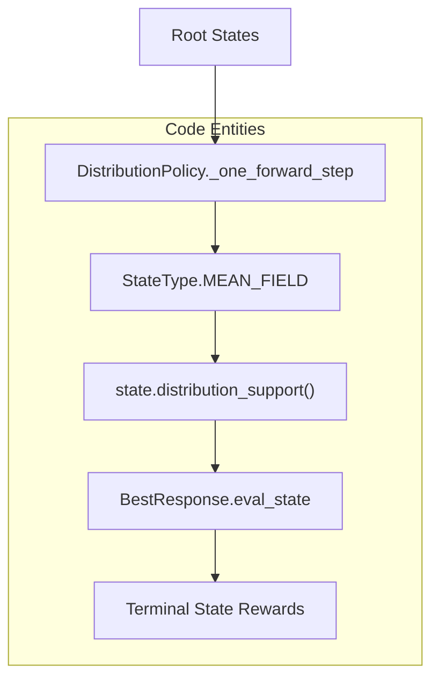
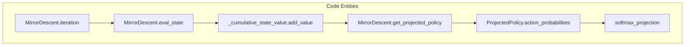

<!-- source: DeepWiki mcp.deepwiki.com · repo google-deepmind/open_spiel · page 6.7 Mean Field Game Algorithms · fetched 2026-10-26 -->

# Mean Field Game Algorithms

Relevant source files

The following files were used as context for generating this wiki page:

- [docs/algorithms.md](docs/algorithms.md)
- [open_spiel/python/coalitional_games/least_core_lagrangian.py](open_spiel/python/coalitional_games/least_core_lagrangian.py)
- [open_spiel/python/examples/escher.py](open_spiel/python/examples/escher.py)
- [open_spiel/python/mfg/algorithms/average_network_fictitious_play.py](open_spiel/python/mfg/algorithms/average_network_fictitious_play.py)
- [open_spiel/python/mfg/algorithms/average_network_fictitious_play_test.py](open_spiel/python/mfg/algorithms/average_network_fictitious_play_test.py)
- [open_spiel/python/mfg/algorithms/best_response_value.py](open_spiel/python/mfg/algorithms/best_response_value.py)
- [open_spiel/python/mfg/algorithms/best_response_value_test.py](open_spiel/python/mfg/algorithms/best_response_value_test.py)
- [open_spiel/python/mfg/algorithms/boltzmann_policy_iteration.py](open_spiel/python/mfg/algorithms/boltzmann_policy_iteration.py)
- [open_spiel/python/mfg/algorithms/boltzmann_policy_iteration_test.py](open_spiel/python/mfg/algorithms/boltzmann_policy_iteration_test.py)
- [open_spiel/python/mfg/algorithms/distribution.py](open_spiel/python/mfg/algorithms/distribution.py)
- [open_spiel/python/mfg/algorithms/fictitious_play.py](open_spiel/python/mfg/algorithms/fictitious_play.py)
- [open_spiel/python/mfg/algorithms/fictitious_play_test.py](open_spiel/python/mfg/algorithms/fictitious_play_test.py)
- [open_spiel/python/mfg/algorithms/greedy_policy.py](open_spiel/python/mfg/algorithms/greedy_policy.py)
- [open_spiel/python/mfg/algorithms/greedy_policy_test.py](open_spiel/python/mfg/algorithms/greedy_policy_test.py)
- [open_spiel/python/mfg/algorithms/mirror_descent.py](open_spiel/python/mfg/algorithms/mirror_descent.py)
- [open_spiel/python/mfg/algorithms/mirror_descent_test.py](open_spiel/python/mfg/algorithms/mirror_descent_test.py)
- [open_spiel/python/mfg/algorithms/munchausen_deep_mirror_descent.py](open_spiel/python/mfg/algorithms/munchausen_deep_mirror_descent.py)
- [open_spiel/python/mfg/algorithms/munchausen_deep_mirror_descent_test.py](open_spiel/python/mfg/algorithms/munchausen_deep_mirror_descent_test.py)
- [open_spiel/python/mfg/algorithms/munchausen_mirror_descent.py](open_spiel/python/mfg/algorithms/munchausen_mirror_descent.py)
- [open_spiel/python/mfg/algorithms/munchausen_mirror_descent_test.py](open_spiel/python/mfg/algorithms/munchausen_mirror_descent_test.py)
- [open_spiel/python/mfg/algorithms/nash_conv.py](open_spiel/python/mfg/algorithms/nash_conv.py)
- [open_spiel/python/mfg/algorithms/nash_conv_test.py](open_spiel/python/mfg/algorithms/nash_conv_test.py)
- [open_spiel/python/mfg/algorithms/policy_value.py](open_spiel/python/mfg/algorithms/policy_value.py)
- [open_spiel/python/mfg/algorithms/policy_value_test.py](open_spiel/python/mfg/algorithms/policy_value_test.py)
- [open_spiel/python/mfg/distribution.py](open_spiel/python/mfg/distribution.py)
- [open_spiel/python/mfg/examples/mfg_average_network_fp_jax.py](open_spiel/python/mfg/examples/mfg_average_network_fp_jax.py)
- [open_spiel/python/mfg/examples/mfg_dqn_fp_jax.py](open_spiel/python/mfg/examples/mfg_dqn_fp_jax.py)
- [open_spiel/python/mfg/examples/mfg_dqn_jax.py](open_spiel/python/mfg/examples/mfg_dqn_jax.py)
- [open_spiel/python/mfg/examples/mfg_fictitious_play.py](open_spiel/python/mfg/examples/mfg_fictitious_play.py)
- [open_spiel/python/mfg/examples/mfg_mirror_descent.py](open_spiel/python/mfg/examples/mfg_mirror_descent.py)
- [open_spiel/python/mfg/examples/mfg_munchausen_domd_jax.py](open_spiel/python/mfg/examples/mfg_munchausen_domd_jax.py)
- [open_spiel/python/mfg/tabular_distribution.py](open_spiel/python/mfg/tabular_distribution.py)
- [open_spiel/python/mfg/utils.py](open_spiel/python/mfg/utils.py)
- [open_spiel/python/mfg/value.py](open_spiel/python/mfg/value.py)
- [open_spiel/python/pytorch/escher.py](open_spiel/python/pytorch/escher.py)
- [open_spiel/python/pytorch/escher_test.py](open_spiel/python/pytorch/escher_test.py)
- [open_spiel/python/tests/mfg_implementation_test/mfg_test.py](open_spiel/python/tests/mfg_implementation_test/mfg_test.py)
- [open_spiel/python/utils/training.py](open_spiel/python/utils/training.py)

## Purpose and Scope

This page documents the Mean Field Game (MFG) algorithms implemented in OpenSpiel (`open_spiel/python/mfg/algorithms/`). Mean Field Games model large populations of interacting agents where individual agents have negligible impact on the aggregate population state, but the population distribution affects individual payoffs. This page covers core distribution tracking, policy evaluation, best response computation, tabular equilibrium solvers (Fictitious Play and Mirror Descent), deep RL-based solvers (Munchausen Deep Mirror Descent), and solution quality verification via `NashConv`.

---

## 1. Distribution and Value Computation Framework

MFG algorithms rely on computing population state distributions (forward pass) and evaluating value functions (backward pass). 

### Distribution Tracking

The distribution of a policy over states is computed using `DistributionPolicy`, which implements a forward propagation step across chance, decision, and mean-field nodes.

- **`DistributionPolicy`**: Located in `[open_spiel/python/mfg/algorithms/distribution.py:39-91]()`, it evaluates the state distribution induced by a given `policy_module.Policy`. It propagates state weights forward until terminal states are reached.
- **`_one_forward_step`**: Defined in `[open_spiel/python/mfg/algorithms/distribution.py:122-144]()`, it handles transition updates for chance nodes, decision nodes, and `StateType.MEAN_FIELD` nodes where `state.update_distribution(dist)` is invoked.

### Policy and Best Response Value Functions

- **`PolicyValue`**: Located in `[open_spiel/python/mfg/algorithms/policy_value.py:23-100]()`, `PolicyValue` performs a backward pass to compute the expected return of a fixed policy against a fixed population distribution.
- **`BestResponse`**: Located in `[open_spiel/python/mfg/algorithms/best_response_value.py:23-109]()`, `BestResponse` inherits from `value.ValueFunction` and computes the optimal value function for an agent reacting against a fixed population distribution (`_distribution`). At decision nodes, it takes the maximum over legal actions [[open_spiel/python/mfg/algorithms/best_response_value.py:97-103]()].

*Figure 1: Forward-backward data flow between distribution evaluation and best response computation.*

Sources: 
- `[open_spiel/python/mfg/algorithms/distribution.py:39-144]()`
- `[open_spiel/python/mfg/algorithms/policy_value.py:23-100]()`
- `[open_spiel/python/mfg/algorithms/best_response_value.py:23-109]()`

---

## 2. Iterative Equilibrium Solvers: Fictitious Play and Mirror Descent

OpenSpiel provides tabular iterative solvers that converge to Mean Field Equilibrium (MFE).

### Fictitious Play

`FictitiousPlay` (`[open_spiel/python/mfg/algorithms/fictitious_play.py:108-186]()`) maintains an aggregate policy through iterative best-response updates:
1. Computes the distribution of the current policy [[open_spiel/python/mfg/algorithms/fictitious_play.py:155-155]()].
2. Computes the best response value or policy [[open_spiel/python/mfg/algorithms/fictitious_play.py:157-162]()].
3. Updates the policy using either a greedy policy or a softmax policy with temperature [[open_spiel/python/mfg/algorithms/fictitious_play.py:165-171]()].
4. Merges past policies using `MergedPolicy` (`[open_spiel/python/mfg/algorithms/fictitious_play.py:53-105]()`) weighted by the learning rate schedule [[open_spiel/python/mfg/algorithms/fictitious_play.py:175-186]()].

### Mirror Descent

`MirrorDescent` (`[open_spiel/python/mfg/algorithms/mirror_descent.py:75-171]()`) performs online mirror descent on the simplex:
- **`eval_state`**: Evaluates state values and accumulates weighted values in `_cumulative_state_value` [[open_spiel/python/mfg/algorithms/mirror_descent.py:137-148]()].
- **`ProjectedPolicy`**: Located in `[open_spiel/python/mfg/algorithms/mirror_descent.py:33-72]()`, this class maps cumulative state values to action probabilities via `softmax_projection` [[open_spiel/python/mfg/algorithms/mirror_descent.py:26-30]()] over legal action values [[open_spiel/python/mfg/algorithms/mirror_descent.py:65-72]()].

*Figure 2: Control flow of Mirror Descent iterations and policy projection.*

Sources:
- `[open_spiel/python/mfg/algorithms/fictitious_play.py:53-186]()`
- `[open_spiel/python/mfg/algorithms/mirror_descent.py:26-171]()`

---

## 3. Deep Reinforcement Learning for MFG: Munchausen Deep Mirror Descent

For large or continuous state spaces where tabular representations are intractable, OpenSpiel provides deep RL adaptations combining Deep Q-Networks (DQN) with mirror descent regularizers.

- **`MunchausenDQN`**: Implemented in `[open_spiel/python/mfg/algorithms/munchausen_deep_mirror_descent.py:52-186]()`, this agent integrates Munchausen reinforcement learning penalties ($\tau$ temperature and $\alpha$ scaling) into the DQN target computation.
- **Network Architecture**: Utilizes Haiku MLPs (`hk.nets.MLP`) to approximate Q-values over information states, supporting both `mse` and `huber` loss functions with optional gradient clipping [[open_spiel/python/mfg/algorithms/munchausen_deep_mirror_descent.py:130-170]()].
- **Training Loops**: Example scripts such as `[open_spiel/python/mfg/examples/mfg_munchausen_domd_jax.py]()` and `[open_spiel/python/mfg/examples/mfg_dqn_jax.py]()` instantiate environments with fixed or evolving MFG population distributions (`rl_environment.Environment`).

Sources:
- `[open_spiel/python/mfg/algorithms/munchausen_deep_mirror_descent.py:52-186]()`
- `[open_spiel/python/mfg/examples/mfg_dqn_jax.py:82-171]()`
- `[open_spiel/python/mfg/examples/mfg_munchausen_domd_jax.py:127-181]()`

---

## 4. Evaluation and Solution Quality: NashConv

To measure the quality of an approximate Mean Field Equilibrium, OpenSpiel implements `NashConv`.

- **`NashConv` Class**: Defined in `[open_spiel/python/mfg/algorithms/nash_conv.py:28-82]()`.
- **Computation**: Combines `DistributionPolicy`, `PolicyValue`, and `BestResponse` to compute exploitability [[open_spiel/python/mfg/algorithms/nash_conv.py:46-58]()].
- **`nash_conv()` Method**: Returns the difference between the best response value and the policy value summed over root states [[open_spiel/python/mfg/algorithms/nash_conv.py:60-69]()]:

$$\text{NashConv}(\pi) = \sum_{s \in S_0} \left( V^{\text{BR}(\mu_\pi)}(s) - V^\pi(s) \right)$$

where $\mu_\pi$ is the distribution induced by policy $\pi$.

Sources:
- `[open_spiel/python/mfg/algorithms/nash_conv.py:28-82]()`

---

