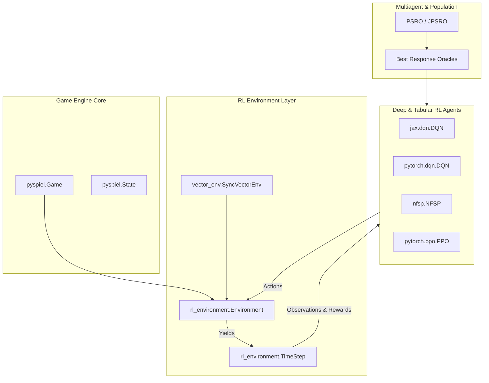

<!-- source: DeepWiki mcp.deepwiki.com · repo google-deepmind/open_spiel · page 7 Reinforcement Learning and Multiagent Training · fetched 2026-10-26 -->

# Reinforcement Learning and Multiagent Training

Relevant source files

The following files were used as context for generating this wiki page:

- [open_spiel/python/examples/ppo_example.py](open_spiel/python/examples/ppo_example.py)
- [open_spiel/python/jax/boltzmann_dqn.py](open_spiel/python/jax/boltzmann_dqn.py)
- [open_spiel/python/jax/boltzmann_dqn_jax_test.py](open_spiel/python/jax/boltzmann_dqn_jax_test.py)
- [open_spiel/python/jax/dqn.py](open_spiel/python/jax/dqn.py)
- [open_spiel/python/jax/dqn_jax_test.py](open_spiel/python/jax/dqn_jax_test.py)
- [open_spiel/python/jax/nfsp.py](open_spiel/python/jax/nfsp.py)
- [open_spiel/python/jax/nfsp_jax_test.py](open_spiel/python/jax/nfsp_jax_test.py)
- [open_spiel/python/pytorch/boltzmann_dqn.py](open_spiel/python/pytorch/boltzmann_dqn.py)
- [open_spiel/python/pytorch/boltzmann_dqn_pytorch_test.py](open_spiel/python/pytorch/boltzmann_dqn_pytorch_test.py)
- [open_spiel/python/pytorch/dqn.py](open_spiel/python/pytorch/dqn.py)
- [open_spiel/python/pytorch/dqn_pytorch_test.py](open_spiel/python/pytorch/dqn_pytorch_test.py)
- [open_spiel/python/pytorch/nfsp.py](open_spiel/python/pytorch/nfsp.py)
- [open_spiel/python/pytorch/nfsp_pytorch_test.py](open_spiel/python/pytorch/nfsp_pytorch_test.py)
- [open_spiel/python/pytorch/ppo.py](open_spiel/python/pytorch/ppo.py)
- [open_spiel/python/pytorch/ppo_pytorch_test.py](open_spiel/python/pytorch/ppo_pytorch_test.py)
- [open_spiel/python/rl_environment.py](open_spiel/python/rl_environment.py)
- [open_spiel/python/tests/rl_environment_test.py](open_spiel/python/tests/rl_environment_test.py)
- [open_spiel/python/utils/reservoir_buffer.py](open_spiel/python/utils/reservoir_buffer.py)
- [open_spiel/python/vector_env.py](open_spiel/python/vector_env.py)

## Purpose and Scope

The Reinforcement Learning (RL) and multiagent training stack in OpenSpiel provides standard abstractions, environments, deep and tabular RL agents, and population-based training frameworks (such as PSRO). This layer bridges the game-theoretic core engine (`pyspiel`) with modern machine learning frameworks like JAX and PyTorch, enabling single-agent and multiagent reinforcement learning experiments across diverse game types.

This page serves as a high-level parent overview of tabular RL, deep RL, environment wrappers, and population-based training subsystems. For implementation details, algorithm specifics, and code examples, please refer to the designated child pages:
- [RL Environment API](#7.1)
- [Deep RL Agents (JAX and PyTorch)](#7.2)
- [Tabular RL Agents](#7.3)
- [PSRO and Population-Based Methods](#7.4)

Sources: [`open_spiel/python/rl_environment.py:1-45`]()

---

## 7.1. RL Environment API

The RL environment layer wraps OpenSpiel's game engine into an RL-friendly interface similar to standard gym APIs, supporting both turn-based and simultaneous-move games [`open_spiel/python/rl_environment.py:16-45`](). Interactions are structured around `reset` and `step` methods which yield a `TimeStep` namedtuple containing observations, rewards, discounts, and step types [`open_spiel/python/rl_environment.py:76-96`](). 

Additionally, vector environments (`SyncVectorEnv`) facilitate parallel rollouts for algorithms like PPO [`open_spiel/python/pytorch/ppo.py:162-165`](), while specialized wrappers handle iterated matrix games and exploration schedules.

For complete details, see [RL Environment API](#7.1).

Sources: [`open_spiel/python/rl_environment.py:1-183`](), [`open_spiel/python/tests/rl_environment_test.py:1-154`]()

---

## 7.2. Deep RL Agents (JAX and PyTorch)

OpenSpiel implements a broad suite of Deep RL algorithms in both JAX (using Flax NNX) and PyTorch. These include Deep Q-Networks (DQN) [`open_spiel/python/pytorch/dqn.py:209-213`](), [`open_spiel/python/jax/dqn.py:1-15`](), Boltzmann variants [`open_spiel/python/jax/boltzmann_dqn.py:14-31`](), Neural Fictitious Self-Play (NFSP) [`open_spiel/python/jax/nfsp.py:15-21`](), [`open_spiel/python/pytorch/nfsp.py:15-18`](), and Proximal Policy Optimization (PPO) [`open_spiel/python/pytorch/ppo.py:15-22`]. 

Agents handle action masking, replay buffers (including uniform and reservoir sampling buffers), and loss minimization against information state tensors or observations. C++ implementations like `dqn_torch` are also available for performance-critical scenarios.

For complete details, see [Deep RL Agents (JAX and PyTorch)](#7.2).

Sources: [`open_spiel/python/pytorch/dqn.py:1-231`](), [`open_spiel/python/jax/dqn.py:1-150`](), [`open_spiel/python/jax/nfsp.py:1-165`](), [`open_spiel/python/pytorch/ppo.py:1-209`]()

---

## 7.3. Tabular RL Agents

For small-scale games and tabular settings, OpenSpiel provides lightweight C++ and Python implementations of classical RL algorithms such as Tabular Q-Learning and SARSA, alongside Boltzmann exploration variants. These agents operate directly on discrete information states or states without neural function approximation, serving as fast baselines and pedagogical examples within `open_spiel/python/examples/` and C++ utilities.

For complete details, see [Tabular RL Agents](#7.3).

Sources: [`open_spiel/python/rl_agent.py:1-50`]()

---

## 7.4. PSRO and Population-Based Methods

Multiagent learning in general-sum and extensive-form games often requires population-based training. OpenSpiel implements Policy-Space Response Oracles (PSRO v2), supporting flexible oracle definitions, meta-strategy solvers, and strategy selectors. Extensions such as Joint PSRO (JPSRO) and opponent-shaping algorithms like Learning with Opponent-Learning Awareness (LOLA) enable advanced multiagent dynamics and equilibrium approximation.

For complete details, see [PSRO and Population-Based Methods](#7.4).

Sources: [`open_spiel/python/rl_environment.py:1-50`]()

---

## RL Stack Architecture and Data Flow

Title: "OpenSpiel RL Stack Architecture and Component Relationships"

Sources: [`open_spiel/python/rl_environment.py:1-45`](), [`open_spiel/python/pytorch/dqn.py:209-231`](), [`open_spiel/python/jax/dqn.py:1-150`](), [`open_spiel/python/pytorch/ppo.py:157-209`]()

---

