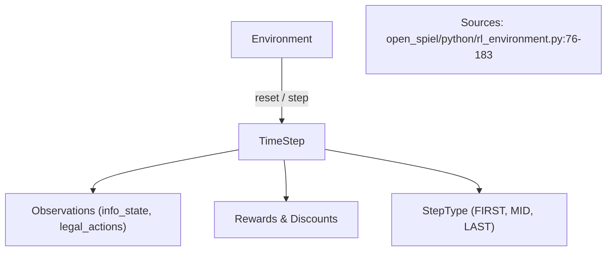
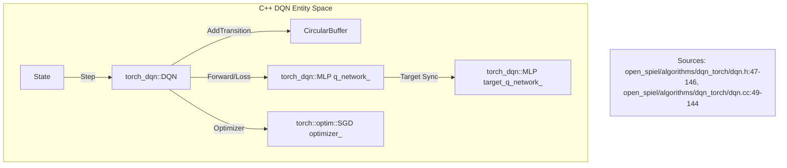
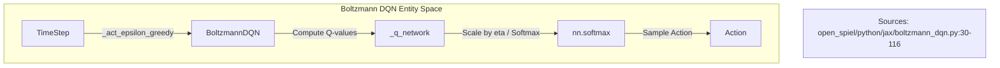
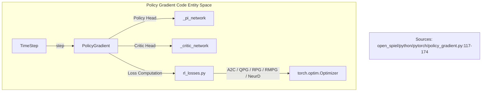

<!-- source: DeepWiki mcp.deepwiki.com · repo google-deepmind/open_spiel · page 7.2 Deep RL Agents (JAX and PyTorch) · fetched 2026-10-26 -->

# Deep RL Agents (JAX and PyTorch)

Relevant source files

The following files were used as context for generating this wiki page:

- [open_spiel/algorithms/alpha_zero_torch/CMakeLists.txt](open_spiel/algorithms/alpha_zero_torch/CMakeLists.txt)
- [open_spiel/algorithms/alpha_zero_torch/vpevaluator.h](open_spiel/algorithms/alpha_zero_torch/vpevaluator.h)
- [open_spiel/algorithms/dqn_torch/CMakeLists.txt](open_spiel/algorithms/dqn_torch/CMakeLists.txt)
- [open_spiel/algorithms/dqn_torch/dqn.cc](open_spiel/algorithms/dqn_torch/dqn.cc)
- [open_spiel/algorithms/dqn_torch/dqn.h](open_spiel/algorithms/dqn_torch/dqn.h)
- [open_spiel/algorithms/dqn_torch/dqn_torch_test.cc](open_spiel/algorithms/dqn_torch/dqn_torch_test.cc)
- [open_spiel/algorithms/dqn_torch/simple_nets.cc](open_spiel/algorithms/dqn_torch/simple_nets.cc)
- [open_spiel/algorithms/dqn_torch/simple_nets.h](open_spiel/algorithms/dqn_torch/simple_nets.h)
- [open_spiel/examples/dqn_torch_example.cc](open_spiel/examples/dqn_torch_example.cc)
- [open_spiel/python/egt/heuristic_payoff_table.py](open_spiel/python/egt/heuristic_payoff_table.py)
- [open_spiel/python/examples/ppo_example.py](open_spiel/python/examples/ppo_example.py)
- [open_spiel/python/jax/boltzmann_dqn.py](open_spiel/python/jax/boltzmann_dqn.py)
- [open_spiel/python/jax/boltzmann_dqn_jax_test.py](open_spiel/python/jax/boltzmann_dqn_jax_test.py)
- [open_spiel/python/jax/dqn.py](open_spiel/python/jax/dqn.py)
- [open_spiel/python/jax/dqn_jax_test.py](open_spiel/python/jax/dqn_jax_test.py)
- [open_spiel/python/jax/nfsp.py](open_spiel/python/jax/nfsp.py)
- [open_spiel/python/jax/nfsp_jax_test.py](open_spiel/python/jax/nfsp_jax_test.py)
- [open_spiel/python/pytorch/boltzmann_dqn.py](open_spiel/python/pytorch/boltzmann_dqn.py)
- [open_spiel/python/pytorch/boltzmann_dqn_pytorch_test.py](open_spiel/python/pytorch/boltzmann_dqn_pytorch_test.py)
- [open_spiel/python/pytorch/dqn.py](open_spiel/python/pytorch/dqn.py)
- [open_spiel/python/pytorch/dqn_pytorch_test.py](open_spiel/python/pytorch/dqn_pytorch_test.py)
- [open_spiel/python/pytorch/eva.py](open_spiel/python/pytorch/eva.py)
- [open_spiel/python/pytorch/eva_pytorch_test.py](open_spiel/python/pytorch/eva_pytorch_test.py)
- [open_spiel/python/pytorch/losses/rl_losses.py](open_spiel/python/pytorch/losses/rl_losses.py)
- [open_spiel/python/pytorch/losses/rl_losses_pytorch_test.py](open_spiel/python/pytorch/losses/rl_losses_pytorch_test.py)
- [open_spiel/python/pytorch/nfsp.py](open_spiel/python/pytorch/nfsp.py)
- [open_spiel/python/pytorch/nfsp_pytorch_test.py](open_spiel/python/pytorch/nfsp_pytorch_test.py)
- [open_spiel/python/pytorch/policy_gradient.py](open_spiel/python/pytorch/policy_gradient.py)
- [open_spiel/python/pytorch/policy_gradient_pytorch_test.py](open_spiel/python/pytorch/policy_gradient_pytorch_test.py)
- [open_spiel/python/pytorch/ppo.py](open_spiel/python/pytorch/ppo.py)
- [open_spiel/python/pytorch/ppo_pytorch_test.py](open_spiel/python/pytorch/ppo_pytorch_test.py)
- [open_spiel/python/rl_environment.py](open_spiel/python/rl_environment.py)
- [open_spiel/python/tests/rl_environment_test.py](open_spiel/python/tests/rl_environment_test.py)
- [open_spiel/python/utils/reservoir_buffer.py](open_spiel/python/utils/reservoir_buffer.py)
- [open_spiel/python/vector_env.py](open_spiel/python/vector_env.py)

## Purpose and Scope

This page documents the deep reinforcement learning (RL) infrastructure and agent implementations available in OpenSpiel across C++, JAX, and PyTorch. OpenSpiel provides deep RL algorithms for both single-agent and multi-agent environments, supporting multi-agent learning techniques like Neural Fictitious Self-Play (NFSP), Deep Q-Networks (DQN), Boltzmann DQN, Policy Gradients, Proximal Policy Optimization (PPO), and Expected Value Advantage (EVA).

---

## 1. Overview of Deep RL Stack and Environment API

OpenSpiel wraps its core game mechanics into an RL-friendly environment via `open_spiel/python/rl_environment.py`. The `Environment` class standardizes interactions through `reset()` and `step()` methods which return a `TimeStep` structure containing observations, rewards, discounts, and step types.

- **`TimeStep`**: A named tuple containing `observations` (a dict per player with `info_state`, `legal_actions`, `current_player`, and optionally `serialized_state`), `rewards`, `discounts`, and `step_type` (`StepType.FIRST`, `MID`, `LAST`) `[open_spiel/python/rl_environment.py:76-114]()`.
- **`Environment`**: Handles stepping through turn-based and simultaneous games, managing chance outcomes via `ChanceEventSampler` `[open_spiel/python/rl_environment.py:158-183]()`.

Sources: open_spiel/python/rl_environment.py:76-183

---

## 2. Deep Q-Network (DQN) Implementations

OpenSpiel features DQN implementations in C++ (LibTorch) and Python (using both JAX and PyTorch).

### C++ LibTorch DQN (`open_spiel/algorithms/dqn_torch/`)
- **`Agent`**: Base interface defining `Step(const State& state, bool is_evaluation)` `[open_spiel/algorithms/dqn_torch/dqn.h:70-75]()`.
- **`DQN`**: Core Q-learning agent implemented using LibTorch. It manages a circular replay buffer (`CircularBuffer<Transition>`), epsilon-greedy exploration, a target network updated periodically, and SGD optimization `[open_spiel/algorithms/dqn_torch/dqn.h:96-146]()`.
- **`DQNSettings`**: Struct configuring hyperparameters like learning rate, network hidden layer sizes, target network update frequency, and replay buffer capacity `[open_spiel/algorithms/dqn_torch/dqn.h:47-65]()`.

Sources: open_spiel/algorithms/dqn_torch/dqn.h:47-146, open_spiel/algorithms/dqn_torch/dqn.cc:49-144

### Python DQN (JAX and PyTorch)
- **`open_spiel/python/jax/dqn.py`**: Implements JAX-based DQN using `Flax NNX` (`nn.Module`), `Optax` optimizers, and a functional JIT-compiled ring buffer (`ReplayBuffer`) `[open_spiel/python/jax/dqn.py:33-140]()`.
- **`open_spiel/python/pytorch/dqn.py`**: Implements PyTorch-based DQN subclassing `rl_agent.AbstractAgent`, featuring configurable MLP networks, loss types (`Loss.MSE`, `Loss.HUBER`), and optimizers (`Optimiser.SGD`, `ADAM`, `RMSPROP`) `[open_spiel/python/pytorch/dqn.py:209-231]()`.

---

## 3. Boltzmann DQN and NFSP (Neural Fictitious Self-Play)

### Boltzmann DQN
Boltzmann DQN replaces epsilon-greedy exploration with a softmax (Boltzmann) policy over unregularized action values parameterized by a temperature parameter `eta` `[open_spiel/python/jax/boltzmann_dqn.py:14-46]()`.
- **JAX Variant (`open_spiel/python/jax/boltzmann_dqn.py`)**: Subclasses `dqn.DQN` and overrides action selection using `_boltzmann_action_probs()` with numerical stability adjustments and target network tracking `[open_spiel/python/jax/boltzmann_dqn.py:30-115]()`.
- **PyTorch Variant (`open_spiel/python/pytorch/boltzmann_dqn.py`)**: Similarly implements softmax policy exploration with temperature scaling.

Sources: open_spiel/python/jax/boltzmann_dqn.py:30-116

### Neural Fictitious Self-Play (NFSP)
NFSP combines deep RL with fictitious self-play in imperfect-information games by maintaining two separate policies: a best-response policy trained via DQN (using a Reinforcement Learning memory buffer) and an average policy trained via supervised learning (using a `ReservoirBuffer`) `[open_spiel/python/jax/nfsp.py:15-162]()`.
- **`ReservoirBuffer`**: Implements uniform sampling over a stream of variable or fixed-length data using reservoir sampling algorithms `[open_spiel/python/jax/nfsp.py:68-156]()`.
- **`NFSP` Agent**: Switches between best-response and average-policy behavior according to an anticipatory parameter `anticipatory_param` `[open_spiel/python/jax/nfsp.py:158-217]()`.

---

## 4. Policy Gradients, PPO, and EVA (PyTorch)

OpenSpiel implements multiple policy gradient algorithms designed for multi-agent and partially observable settings under `open_spiel/python/pytorch/policy_gradient.py`:

- **Q-based Policy Gradient (QPG)**: Uses all actions weighted by policy probabilities to estimate baselines and advantages:
  $$\text{baseline} = \sum_a \pi_a Q_a, \quad \text{loss} = -\sum_a \pi_a (Q_a - \text{baseline})$$
- **Regret Policy Gradient (RPG)** & **Regret Matching Policy Gradient (RMPG)**: Derived from Counterfactual Regret Minimization (CFR), utilizing thresholded positive regrets (`relu(Q_a - baseline)`).
- **Advantage Actor Critic (A2C)**: Standard actor-critic using value function baselines to reduce variance on taken actions `[open_spiel/python/pytorch/policy_gradient.py:16-70]()`.

Additional policy-based architectures include:
- **PPO (`open_spiel/python/pytorch/ppo.py`)**: Proximal Policy Optimization implementation for stable policy updates.
- **EVA (`open_spiel/python/pytorch/eva.py`)**: Expected Value Advantage agent implementation.

Sources: open_spiel/python/pytorch/policy_gradient.py:117-174

---

