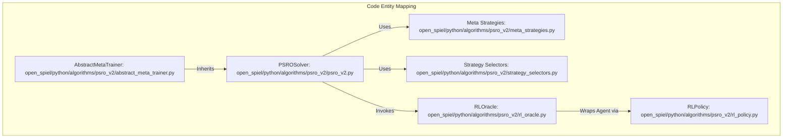
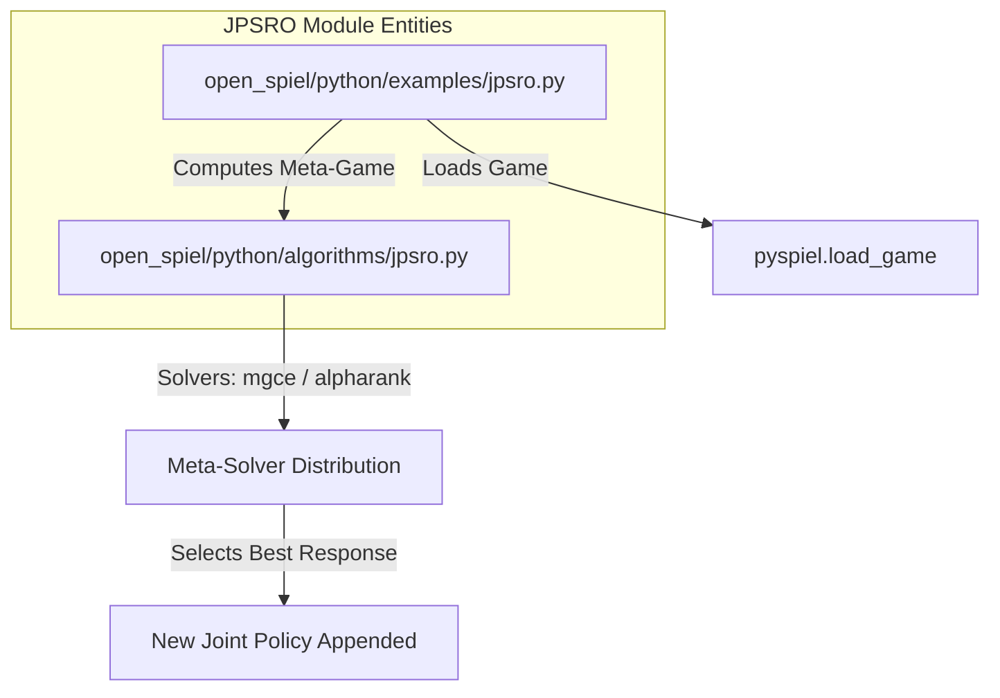

<!-- source: DeepWiki mcp.deepwiki.com · repo google-deepmind/open_spiel · page 7.4 PSRO and Population-Based Methods · fetched 2026-10-26 -->

# PSRO and Population-Based Methods

Relevant source files

The following files were used as context for generating this wiki page:

- [open_spiel/python/algorithms/jpsro.py](open_spiel/python/algorithms/jpsro.py)
- [open_spiel/python/algorithms/jpsro_test.py](open_spiel/python/algorithms/jpsro_test.py)
- [open_spiel/python/algorithms/psro_v2/abstract_meta_trainer.py](open_spiel/python/algorithms/psro_v2/abstract_meta_trainer.py)
- [open_spiel/python/algorithms/psro_v2/best_response_oracle.py](open_spiel/python/algorithms/psro_v2/best_response_oracle.py)
- [open_spiel/python/algorithms/psro_v2/best_response_oracle_test.py](open_spiel/python/algorithms/psro_v2/best_response_oracle_test.py)
- [open_spiel/python/algorithms/psro_v2/meta_strategies.py](open_spiel/python/algorithms/psro_v2/meta_strategies.py)
- [open_spiel/python/algorithms/psro_v2/optimization_oracle.py](open_spiel/python/algorithms/psro_v2/optimization_oracle.py)
- [open_spiel/python/algorithms/psro_v2/psro_v2.py](open_spiel/python/algorithms/psro_v2/psro_v2.py)
- [open_spiel/python/algorithms/psro_v2/rl_oracle.py](open_spiel/python/algorithms/psro_v2/rl_oracle.py)
- [open_spiel/python/algorithms/psro_v2/rl_policy.py](open_spiel/python/algorithms/psro_v2/rl_policy.py)
- [open_spiel/python/algorithms/psro_v2/strategy_selectors.py](open_spiel/python/algorithms/psro_v2/strategy_selectors.py)
- [open_spiel/python/algorithms/psro_v2/strategy_selectors_test.py](open_spiel/python/algorithms/psro_v2/strategy_selectors_test.py)
- [open_spiel/python/algorithms/psro_v2/utils.py](open_spiel/python/algorithms/psro_v2/utils.py)
- [open_spiel/python/environments/iterated_matrix_game.py](open_spiel/python/environments/iterated_matrix_game.py)
- [open_spiel/python/examples/jpsro.py](open_spiel/python/examples/jpsro.py)
- [open_spiel/python/examples/opponent_shaping/lola_iterated_matrix_games_jax.py](open_spiel/python/examples/opponent_shaping/lola_iterated_matrix_games_jax.py)
- [open_spiel/python/examples/opponent_shaping/requirements.txt](open_spiel/python/examples/opponent_shaping/requirements.txt)
- [open_spiel/python/examples/psro_v2_example.py](open_spiel/python/examples/psro_v2_example.py)
- [open_spiel/python/jax/opponent_shaping.py](open_spiel/python/jax/opponent_shaping.py)
- [open_spiel/python/jax/opponent_shaping_jax_test.py](open_spiel/python/jax/opponent_shaping_jax_test.py)

This page documents OpenSpiel's reinforcement learning and evolutionary game theory stack for population-based training, specifically focusing on Policy-Space Response Oracles v2 (PSRO v2), Joint Policy-Space Response Oracles (JPSRO), opponent shaping algorithms (LOLA and DiCE), and supporting iterated game environments.

---

## 1. PSRO v2 Architecture and Core Components

Policy-Space Response Oracles (PSRO) generalize double oracle methods by iteratively training best-response policies against a meta-strategy distribution over a growing population of policies. OpenSpiel's modular implementation, **PSRO v2**, supports $N$-player general-sum games, arbitrary meta-solvers, custom rectifiers, and approximate deep RL oracles.

### Core Classes and Control Flow

The backbone of PSRO v2 is split between `AbstractMetaTrainer` and `PSROSolver`.
- `AbstractMetaTrainer` (`[open_spiel/python/algorithms/psro_v2/abstract_meta_trainer.py:92-169]()`) handles game initialization, population tracking, and abstract iteration steps.
- `PSROSolver` (`[open_spiel/python/algorithms/psro_v2/psro_v2.py:53-150]()`) inherits from `AbstractMetaTrainer` and implements concrete strategy sampling, reward matrix updates, and rectification logic via `TRAIN_TARGET_SELECTORS` (`[open_spiel/python/algorithms/psro_v2/psro_v2.py:46-49]()`).

*Figure 1: PSRO v2 Class Architecture and Code Entities.*

Sources: `[open_spiel/python/algorithms/psro_v2/abstract_meta_trainer.py:92-169]()`, `[open_spiel/python/algorithms/psro_v2/psro_v2.py:46-150]()`

### Meta-Strategies and Solvers

Meta-strategies determine the selection probability distribution over the population of policies for each player. OpenSpiel implements several meta-solvers in `[open_spiel/python/algorithms/psro_v2/meta_strategies.py:195-201()`:
- `uniform_strategy` (`[open_spiel/python/algorithms/psro_v2/meta_strategies.py:28-47]()`): Uniform probability distribution over all discovered policies.
- `uniform_biased_strategy` (`[open_spiel/python/algorithms/psro_v2/meta_strategies.py:56-81]()`): Biased towards more recently added policies.
- `nash_strategy` (`[open_spiel/python/algorithms/psro_v2/meta_strategies.py:112-146]()`): Computes a Nash equilibrium using linear programming (`[open_spiel/python/algorithms/lp_solver.py]()`), restricted to 2-player zero-sum games.
- `prd_strategy` (`[open_spiel/python/algorithms/psro_v2/meta_strategies.py:148-170]()`): Projected Replicator Dynamics for general-sum or multi-player games.
- `rm_strategy` (`[open_spiel/python/algorithms/psro_v2/meta_strategies.py:172-193]()`): Regret Matching meta-strategy computation.

Sources: `[open_spiel/python/algorithms/psro_v2/meta_strategies.py:28-201]()`

### Oracles and Policy Wrapping

Oracles generate new responses against the current meta-strategy distribution.
- `RLOracle` (`[open_spiel/python/algorithms/psro_v2/rl_oracle.py:73-104()`): Manages approximate best-response training using deep reinforcement learning algorithms (such as DQN or Policy Gradient). It handles episode sampling (`[open_spiel/python/algorithms/psro_v2/rl_oracle.py:106-138]()`) and tracks training progress via `update_episodes_per_oracles` (`[open_spiel/python/algorithms/psro_v2/rl_oracle.py:26-40]()`).
- `RLPolicy` (`[open_spiel/python/algorithms/psro_v2/rl_policy.py:42-155()`): Wraps any OpenSpiel RL agent (`rl_agent.AbstractAgent`) into a standard `policy.Policy` object, allowing deep RL agents to interoperate seamlessly with tabular policies and game evaluation tools.

Sources: `[open_spiel/python/algorithms/psro_v2/rl_oracle.py:26-138]()`, `[open_spiel/python/algorithms/psro_v2/rl_policy.py:42-155]()`

---

## 2. Joint Policy-Space Response Oracles (JPSRO)

Joint Policy-Space Response Oracles (`[open_spiel/python/algorithms/jpsro.py:15-33]`) extend PSRO to handle multi-agent training beyond zero-sum games by optimizing over *joint* policy spaces using Correlated Equilibrium (CE) and Coarse Correlated Equilibrium (CCE) meta-solvers (`[open_spiel/python/algorithms/jpsro.py:93-124]`).

### Key Features of JPSRO

- **Meta-Solvers**: Supports advanced equilibrium finders including Maximum Gini CE/CCE (`mgce`, `mgcce`), Maximum Welfare CE/CCE (`mwce`, `mwcce`), and Alpha-Rank (`alpharank`) (`[open_spiel/python/algorithms/jpsro.py:103-124]()`).
- **Dominated Strategy Elimination**: Implements helper functions like `_eliminate_dominated_payoff` (`[open_spiel/python/algorithms/jpsro.py:148-183]()`) to prune strictly or weakly dominated joint strategies from the meta-game tensor before equilibrium calculation.
- **Configurable Best-Response Selections**: Controlled via command-line flags or library arguments in `[open_spiel/python/examples/jpsro.py:90-116]()`, supporting selection modes such as `largest_gap`, `all_novel`, and `random` (`[open_spiel/python/algorithms/jpsro.py:96-102]()`).

*Figure 2: JPSRO Execution and Dominated Strategy Elimination Pipeline.*

Sources: `[open_spiel/python/algorithms/jpsro.py:15-183]()`, `[open_spiel/python/examples/jpsro.py:67-116]()`

---

## 3. Opponent Shaping and Higher-Order Gradients (LOLA / DiCE)

OpenSpiel provides JAX-based implementations of opponent shaping algorithms, specifically **LOLA** (Learning with Opponent-Learning Awareness) and **DiCE** (Differentiable Monte Carlo Estimators), located in `[open_spiel/python/jax/opponent_shaping.py:15-24]()`.

### Architecture and Data Structures

- `TrainState` (`[open_spiel/python/jax/opponent_shaping.py:65-78()`): Encapsulates policy parameters, policy optimizer states, critic parameters, and critic optimizer states in dictionaries keyed by agent ID.
- `TransitionBatch` (`[open_spiel/python/jax/opponent_shaping.py:49-63()`): Stores batched rollout transitions including information states, actions, rewards, and legal action masks.
- `get_critic_update_fn` (`[open_spiel/python/jax/opponent_shaping.py:113-180()`): Computes temporal-difference (TD) error loss and applies gradient updates to critic networks across minibatches.
- `get_dice_update_fn` (`[open_spiel/python/jax/opponent_shaping.py:183-208()`): Implements the DiCE policy gradient update accounting for opponent adaptation via lookaheads (`n_lookaheads`).

Sources: `[open_spiel/python/jax/opponent_shaping.py:49-180]()`

---

## 4. Iterated Game Environments

To train reinforcement learning agents, PSRO oracles, and opponent shaping models on normal-form games, OpenSpiel provides the `IteratedMatrixGame` environment (`[open_spiel/python/environments/iterated_matrix_game.py:30-42]()`).

### Features

- Automatically vectorizes normal-form games for batch training (`[open_spiel/python/environments/iterated_matrix_game.py:15-20]()`).
- Provides pre-defined factories for common iterated games:
  - `IteratedPrisonersDilemma` (`[open_spiel/python/environments/iterated_matrix_game.py:171-177]()`)
  - `IteratedMatchingPennies` (`[open_spiel/python/environments/iterated_matrix_game.py:180-186]()`)
- Implements standard `Environment` APIs (`step`, `reset`, `observation_spec`, `action_spec`) compatible with both JAX agents and PSRO oracles (`[open_spiel/python/environments/iterated_matrix_game.py:61-168]()`).

Sources: `[open_spiel/python/environments/iterated_matrix_game.py:30-186]()`

---

