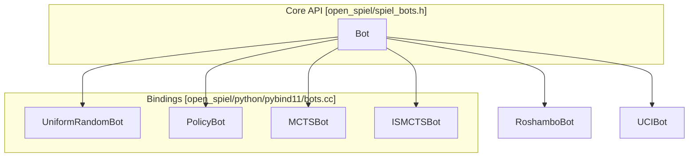
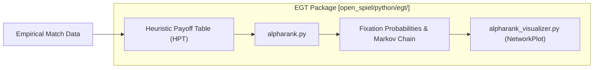
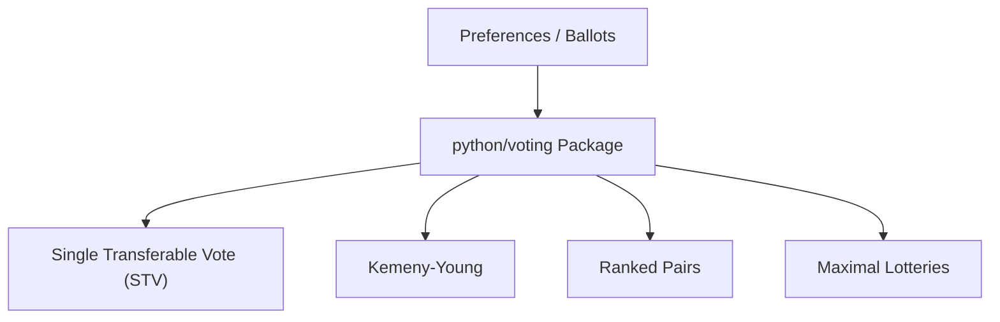
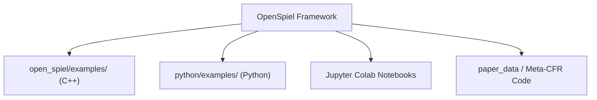

<!-- source: DeepWiki mcp.deepwiki.com · repo google-deepmind/open_spiel · page 8 Bots, Evaluation and Analysis Tools · fetched 2026-10-26 -->

# Bots, Evaluation and Analysis Tools

Relevant source files

The following files were used as context for generating this wiki page:

- [open_spiel/algorithms/evaluate_bots_test.cc](open_spiel/algorithms/evaluate_bots_test.cc)
- [open_spiel/bots/roshambo/CMakeLists.txt](open_spiel/bots/roshambo/CMakeLists.txt)
- [open_spiel/bots/roshambo/README.md](open_spiel/bots/roshambo/README.md)
- [open_spiel/bots/roshambo/roshambo_bot.cc](open_spiel/bots/roshambo/roshambo_bot.cc)
- [open_spiel/bots/roshambo/roshambo_bot.h](open_spiel/bots/roshambo/roshambo_bot.h)
- [open_spiel/bots/roshambo/roshambo_bot_test.cc](open_spiel/bots/roshambo/roshambo_bot_test.cc)
- [open_spiel/python/algorithms/evaluate_bots.py](open_spiel/python/algorithms/evaluate_bots.py)
- [open_spiel/python/algorithms/evaluate_bots_test.py](open_spiel/python/algorithms/evaluate_bots_test.py)
- [open_spiel/python/bots/uniform_random.py](open_spiel/python/bots/uniform_random.py)
- [open_spiel/python/bots/uniform_random_test.py](open_spiel/python/bots/uniform_random_test.py)
- [open_spiel/python/egt/alpharank.py](open_spiel/python/egt/alpharank.py)
- [open_spiel/python/egt/alpharank_test.py](open_spiel/python/egt/alpharank_test.py)
- [open_spiel/python/egt/alpharank_visualizer.py](open_spiel/python/egt/alpharank_visualizer.py)
- [open_spiel/python/egt/heuristic_payoff_table_test.py](open_spiel/python/egt/heuristic_payoff_table_test.py)
- [open_spiel/python/egt/utils.py](open_spiel/python/egt/utils.py)
- [open_spiel/python/egt/utils_test.py](open_spiel/python/egt/utils_test.py)
- [open_spiel/python/egt/visualization_test.py](open_spiel/python/egt/visualization_test.py)
- [open_spiel/python/pybind11/bots.cc](open_spiel/python/pybind11/bots.cc)
- [open_spiel/python/tests/bot_test.py](open_spiel/python/tests/bot_test.py)
- [open_spiel/spiel_bots.cc](open_spiel/spiel_bots.cc)
- [open_spiel/spiel_bots.h](open_spiel/spiel_bots.h)

This page provides an overview of OpenSpiel's bot interface, evaluation harnesses, and analysis/visualization tooling. OpenSpiel defines a standardized C++ and Python `Bot` abstraction for playing games, along with tools for evaluating bot performance, performing empirical game-theoretic analysis (EGT), conducting social choice and voting analysis, and working with examples and research datasets.

This is a parent page. For deep technical details, refer to the child pages:
- **Bot Interface and Implementations**: [Bot Interface and Implementations](#8.1) — Document `spiel_bots.h` Bot API, uniform random, human, UCI, GTP, RoShamBo, xinxin bots, scenarios, and `EvaluateBots`.
- **Empirical Game Theory and Visualization**: [Empirical Game Theory and Visualization](#8.2) — Document the `egt/` package (`alpharank`, dynamics, heuristic payoff tables, visualization) and tree visualization/gambit export utilities.
- **Voting and Social Choice**: [Voting and Social Choice](#8.3) — Document the `python/voting` package: base abstractions, STV, Kemeny-Young, ranked pairs, Copeland, maximal lotteries, and examples.
- **Examples, Colabs and Research Data**: [Examples, Colabs and Research Data](#8.4) — Guide to `open_spiel/examples`, `python/examples`, colab notebooks, meta-CFR research code, and `paper_data` experiments.

---

## 8.1 Bot Interface and Implementations

OpenSpiel provides a uniform API for bots that can play games, make decisions, expose policies, and interact with arbitrary states. The core abstract base class `Bot` is defined in `open_spiel/spiel_bots.h` [open_spiel/spiel_bots.h:73-73]() and exposed to Python via `open_spiel/python/pybind11/bots.cc` [open_spiel/python/pybind11/bots.cc:54-68](). 

Key features of the `Bot` interface include:
- **Decision Making**: `Step(const State& state)` [open_spiel/spiel_bots.h:80-80]() returns a chosen `Action`, while `StepVerbose()` [open_spiel/spiel_bots.h:85-87]() can return debugging or logging information alongside the action.
- **State Synchronization**: `InformAction()` [open_spiel/spiel_bots.h:110-111]() and `InformActions()` [open_spiel/spiel_bots.h:114-115]() allow stateful bots to track actions taken by other players.
- **Reset and Cloning**: `Restart()` [open_spiel/spiel_bots.h:118-118]() and `RestartAt(const State& state)` [open_spiel/spiel_bots.h:121-123]() configure the bot for a specific trajectory or arbitrary game state.
- **Policy Exposure**: `ProvidesPolicy()` [open_spiel/spiel_bots.h:144-144]() and `GetPolicy()` [open_spiel/spiel_bots.h:145-155]() allow bots to expose explicit stochasticity (distributions over actions).

Built-in bot implementations include uniform random bots, policy-backed bots, fixed action preference bots, UCI-compliant chess bots, GTP-compliant Go bots, and International RoShamBo Programming Competition bots [open_spiel/bots/roshambo/roshambo_bot.h:18-24](). Bot evaluation harnesses [open_spiel/algorithms/evaluate_bots.h]() simulate matches between multiple bots and return utility outcomes [open_spiel/python/tests/bot_test.py:41-44]().

For details, see [Bot Interface and Implementations](#8.1).

**Figure 8.1.1**: Overview of the C++ and Python `Bot` class hierarchy.
Sources: `open_spiel/spiel_bots.h`, `open_spiel/python/pybind11/bots.cc`

---

## 8.2 Empirical Game Theory and Visualization

The `open_spiel/python/egt` package provides tools for Empirical Game Theory (EGT). EGT allows researchers to analyze large-scale multi-agent interactions by sampling heuristic payoff tables (HPTs) from deep reinforcement learning simulations or tournaments, and subsequently computing game-theoretic solution concepts.

Key components in `egt/` include:
- **Alpha-Rank**: Implemented in `open_spiel/python/egt/alpharank.py` [open_spiel/python/egt/alpharank.py:15-24](), Alpha-Rank computes continuous-time Markov chain stationary distributions over strategy profiles in empirical games.
- **Heuristic Payoff Tables (HPT)**: Compact representations of empirical game data supporting multi-population and n-strategy interactions [open_spiel/python/egt/alpharank.py:33-58]().
- **Visualization**: `alpharank_visualizer.py` [open_spiel/python/egt/alpharank_visualizer.py:15-20]() provides network graphs and population dynamics plotting utilities using `networkx` and `matplotlib`.

For details, see [Empirical Game Theory and Visualization](#8.2).

**Figure 8.2.1**: Empirical Game Theory data processing pipeline.
Sources: `open_spiel/python/egt/alpharank.py`, `open_spiel/python/egt/alpharank_visualizer.py`, `open_spiel/python/egt/utils.py`

---

## 8.3 Voting and Social Choice

OpenSpiel includes a voting and social choice package (`python/voting`) that models collective decision-making systems. It implements various voting rules and preference aggregation algorithms, making it possible to evaluate social choice mechanisms alongside game-theoretic scenarios.

Supported voting rules and utilities include:
- Single Transferable Vote (STV)
- Kemeny-Young aggregation
- Ranked pairs (Tideman method)
- Copeland method
- Maximal lotteries

For details, see [Voting and Social Choice](#8.3).

**Figure 8.3.1**: Voting rules and social choice algorithms in `python/voting`.
Sources: `open_spiel/python/voting/`

---

## 8.4 Examples, Colabs and Research Data

OpenSpiel provides a rich set of runnable scripts, Jupyter notebooks, and experimental datasets to help researchers understand and apply the framework:
- **C++ Examples**: Located in `open_spiel/examples/`, demonstrating basic game simulation, MCTS, and CFR solvers.
- **Python Examples**: Located in `python/examples/`, covering deep RL, AlphaZero, NFSP, and EGT analyses.
- **Colab Notebooks**: Interactive tutorials guiding users through core abstractions, policy training, and analysis.
- **Research Code & Experiments**: Includes meta-CFR implementations and `paper_data` artifacts reproducing published research experiments.

For details, see [Examples, Colabs and Research Data](#8.4).

**Figure 8.4.1**: Educational and research assets in OpenSpiel.
Sources: `open_spiel/examples/`, `python/examples/`

---

