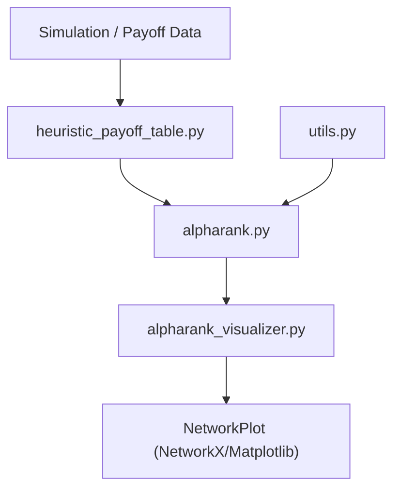
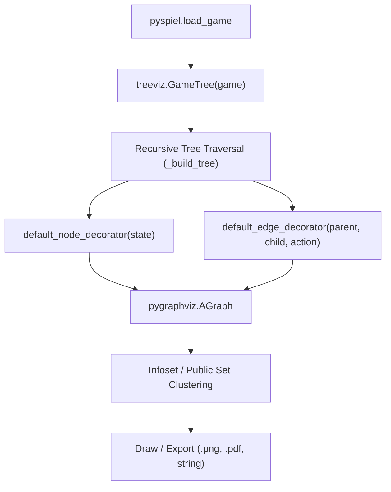

<!-- source: DeepWiki mcp.deepwiki.com · repo google-deepmind/open_spiel · page 8.2 Empirical Game Theory and Visualization · fetched 2026-10-26 -->

# Empirical Game Theory and Visualization

Relevant source files

The following files were used as context for generating this wiki page:

- [open_spiel/python/egt/alpharank.py](open_spiel/python/egt/alpharank.py)
- [open_spiel/python/egt/alpharank_test.py](open_spiel/python/egt/alpharank_test.py)
- [open_spiel/python/egt/alpharank_visualizer.py](open_spiel/python/egt/alpharank_visualizer.py)
- [open_spiel/python/egt/heuristic_payoff_table_test.py](open_spiel/python/egt/heuristic_payoff_table_test.py)
- [open_spiel/python/egt/utils.py](open_spiel/python/egt/utils.py)
- [open_spiel/python/egt/utils_test.py](open_spiel/python/egt/utils_test.py)
- [open_spiel/python/egt/visualization_test.py](open_spiel/python/egt/visualization_test.py)
- [open_spiel/python/examples/cfr_cpp_example.py](open_spiel/python/examples/cfr_cpp_example.py)
- [open_spiel/python/examples/dqn_breakthrough_jax.py](open_spiel/python/examples/dqn_breakthrough_jax.py)
- [open_spiel/python/examples/dqn_breakthrough_pytorch.py](open_spiel/python/examples/dqn_breakthrough_pytorch.py)
- [open_spiel/python/examples/dqn_skat_example.py](open_spiel/python/examples/dqn_skat_example.py)
- [open_spiel/python/examples/gambit_example.py](open_spiel/python/examples/gambit_example.py)
- [open_spiel/python/examples/nego_nbs_example.py](open_spiel/python/examples/nego_nbs_example.py)
- [open_spiel/python/examples/nfsp_leduc_pytorch.py](open_spiel/python/examples/nfsp_leduc_pytorch.py)
- [open_spiel/python/examples/rl_response.py](open_spiel/python/examples/rl_response.py)
- [open_spiel/python/examples/rrps_poprl/poprl_main.py](open_spiel/python/examples/rrps_poprl/poprl_main.py)
- [open_spiel/python/examples/treeviz_example.py](open_spiel/python/examples/treeviz_example.py)
- [open_spiel/python/examples/universal_poker_cfr_cpp_load_from_acpc_gamedef_example.py](open_spiel/python/examples/universal_poker_cfr_cpp_load_from_acpc_gamedef_example.py)
- [open_spiel/python/visualizations/__init__.py](open_spiel/python/visualizations/__init__.py)
- [open_spiel/python/visualizations/treeviz.py](open_spiel/python/visualizations/treeviz.py)

## Purpose and Scope

This page documents the empirical game theory (EGT) package located in `open_spiel/python/egt/`, game tree visualization utilities in `open_spiel/python/visualizations/treeviz.py`, and Gambit game-tree export utilities in `open_spiel/python/algorithms/gambit/`. These tools bridge multi-agent reinforcement learning (MARL), population-based training (such as PSRO), game-theoretic solution concepts, and qualitative analysis by evaluating empirical payoff tables, computing Alpha-Rank stationary distributions, rendering interaction networks, and exporting extensive-form games for external solvers.

---

## Empirical Game Theory (`egt/`) Architecture

The `egt/` package implements methods to analyze empirical games where exact analytical payoff matrices are unavailable or derived from simulation outcomes (e.g., population-based evaluations). 

### Key Modules and Data Flow

*Sources: `[open_spiel/python/egt/alpharank.py:15-31]`, `[open_spiel/python/egt/alpharank_visualizer.py:42-81]`, `[open_spiel/python/egt/utils_test.py:151-161]()`*

### Heuristic Payoff Tables (`heuristic_payoff_table.py`)
Heuristic payoff tables (HPTs) store empirical payoffs for multi-population or single-population games as a function of the strategy distribution across players. 
- `_PayoffTableInterface`: Base interface for querying payoff profiles given strategy distributions.
- `from_matrix_game()`: Converts standard matrix games into HPT format `[open_spiel/python/egt/alpharank_test.py:58-61]()`.

### Alpha-Rank (`alpharank.py`)
Alpha-Rank computes stationary distributions ($\pi$) for general games with n-strategy interactions by modeling population evolutionary dynamics via a Markov chain of fixation probabilities `[open_spiel/python/egt/alpharank.py:15-24]()`.
- `_get_payoff()`: Retrieves the payoff for an agent given a pure strategy profile or an HPT distribution `[open_spiel/python/egt/alpharank.py:33-74]()`.
- `_get_singlepop_2player_fitness()`: Computes agent fitness in finite populations of competitors for 2-player symmetric games `[open_spiel/python/egt/alpharank.py:76-113]()`.
- `_get_rho_sr()`: Calculates fixation probability of a rogue strategy $r$ in a population playing $s$ using Fermi distribution temperature parameter $\alpha$ `[open_spiel/python/egt/alpharank.py:115-166]()`.
- `compute()`: Main entry point returning fixation probabilities, transition matrix, stationary distribution $\pi$, and related metrics.
- `sweep_pi_vs_alpha()`: Sweeps the selection intensity parameter $\alpha$ to track robustness of stationary distributions, with built-in recovery handlers for degenerate or reducible Markov chains `[open_spiel/python/egt/alpharank_test.py:95-177]()`.

### Alpha-Rank Visualizer (`alpharank_visualizer.py`)
`NetworkPlot` renders the Alpha-Rank interaction network using `NetworkX` and `Matplotlib` `[open_spiel/python/egt/alpharank_visualizer.py:42-81]()`.
- `__init__()`: Initializes node coordinates, edge colors proportional to fixation flows, and stationary distribution heatmaps (`plt.cm.Blues`) `[open_spiel/python/egt/alpharank_visualizer.py:45-81]()`.
- `_draw_network()`: Draws nodes, directed edges with arrows, edge labels, and population strategy profiles `[open_spiel/python/egt/alpharank_visualizer.py:98-180]()`.

### EGT Utilities (`utils.py`)
Provides helper functions for simplex sampling, lexicographical row sorting, profile-to-ID mappings, and constant-sum verification `[open_spiel/python/egt/utils_test.py:61-188]()`.
- `distribute()`: Implements stars-and-bars combinatorics for distribution generation `[open_spiel/python/egt/utils_test.py:67-78]()`.
- `get_id_from_strat_profile()` / `get_strat_profile_from_id()`: Maps pure strategy profiles to linear integer IDs and vice versa `[open_spiel/python/egt/utils_test.py:111-135]()`.
- `check_is_constant_sum()`: Verifies if empirical payoff tables form a constant-sum game `[open_spiel/python/egt/utils_test.py:151-161]()`.

*Sources: `[open_spiel/python/egt/alpharank.py:1-166]`, `[open_spiel/python/egt/alpharank_visualizer.py:42-180]`, `[open_spiel/python/egt/utils_test.py:61-188]`, `[open_spiel/python/egt/alpharank_test.py:33-177]()`*

---

## Game Tree Visualization (`treeviz.py`)

OpenSpiel provides game tree visualization utilities using `pygraphviz` to render extensive-form games into image files (`.png`, `.pdf`) or interactive notebook graphs `[open_spiel/python/visualizations/treeviz.py:15-42]()`.

*Sources: `[open_spiel/python/visualizations/treeviz.py:52-190]`, `[open_spiel/python/examples/treeviz_example.py:52-90]()`*

### Key Classes and Functions
- `GameTree`: Subclasses `pygraphviz.AGraph` to construct a directed graph representation of a `pyspiel.Game` `[open_spiel/python/visualizations/treeviz.py:110-144]()`.
  - Supports `depth_limit`, `group_terminal`, `group_infosets`, and `group_pubsets` parameters `[open_spiel/python/visualizations/treeviz.py:130-141]()`.
  - Automatically clusters nodes belonging to the same information set or public observation set into dashed subgraphs (`add_subgraph`) `[open_spiel/python/visualizations/treeviz.py:176-189]()`.
- `default_node_decorator(state)`: Populates graphviz node styling attributes (`shape`, `width`, `height`, `label`). Terminal nodes are represented as diamonds, chance nodes as small points, and player nodes as squares or ellipses colored by player ID `[open_spiel/python/visualizations/treeviz.py:52-83]()`.
- `default_edge_decorator(parent, unused_child, action)`: Decorates edges with action labels and player-specific colors `[open_spiel/python/visualizations/treeviz.py:86-107]()`.

### Example Usage (`treeviz_example.py`)
`treeviz_example.py` loads sequential games (reloading simultaneous games as turn-based if needed), applies custom decorators (e.g., zero-sum returns display), and exports the rendered tree `[open_spiel/python/examples/treeviz_example.py:44-90]()`.

*Sources: `[open_spiel/python/visualizations/treeviz.py:52-190]`, `[open_spiel/python/examples/treeviz_example.py:44-90]()`*

---

## Gambit Export Utilities (`export_gambit.py`)

To interface OpenSpiel with external game-theoretic software (such as Gambit for computing exact Nash equilibria via sequence-form linear programming or Lemke-Howson algorithms), OpenSpiel provides extensive-form game export utilities.

- `export_gambit(game)`: Translates a `pyspiel.Game` instance into Gambit's `.efg` (Extensive Form Game) file format string `[open_spiel/python/examples/gambit_example.py:49-49]()`.
- `gambit_example.py`: Demonstrates loading any OpenSpiel game, converting it via `export_gambit`, and either printing the `.efg` markup to `stdout` or saving it to disk `[open_spiel/python/examples/gambit_example.py:38-55]()`.

*Sources: `[open_spiel/python/examples/gambit_example.py:24-55]()`*

---

